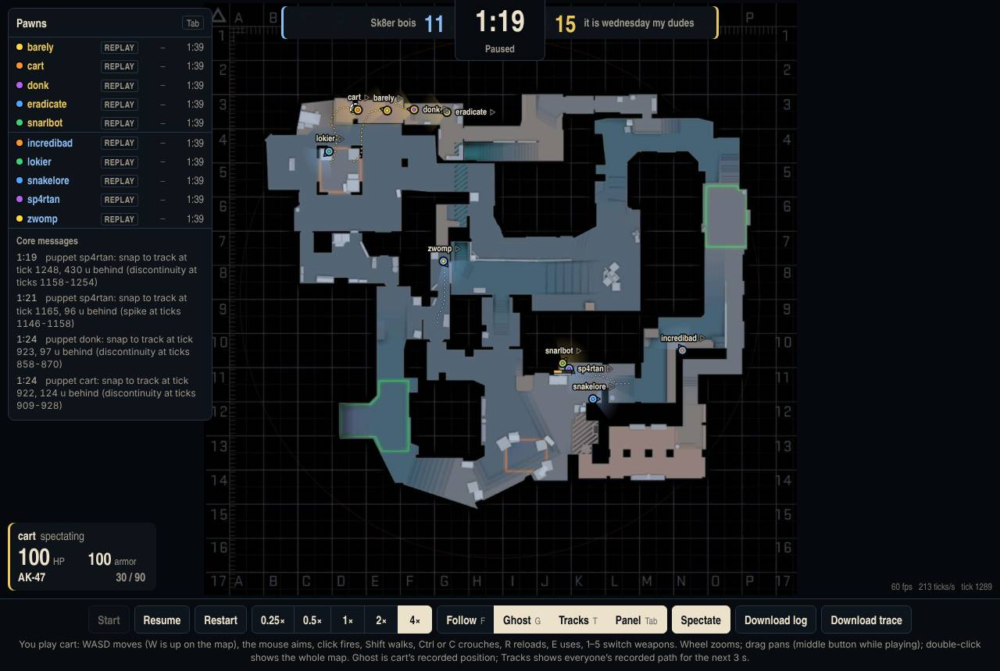
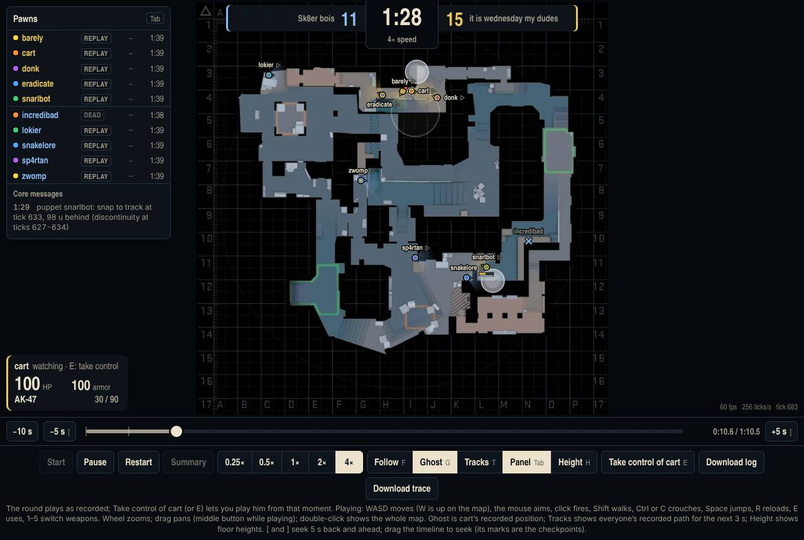
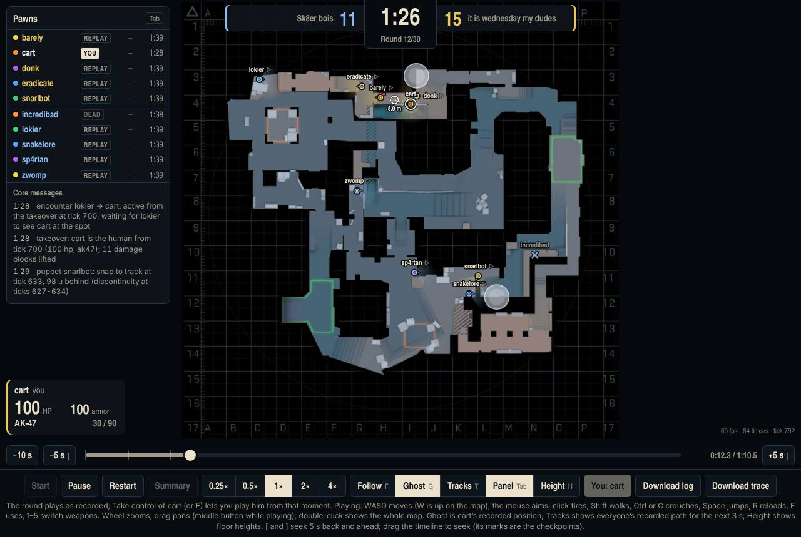
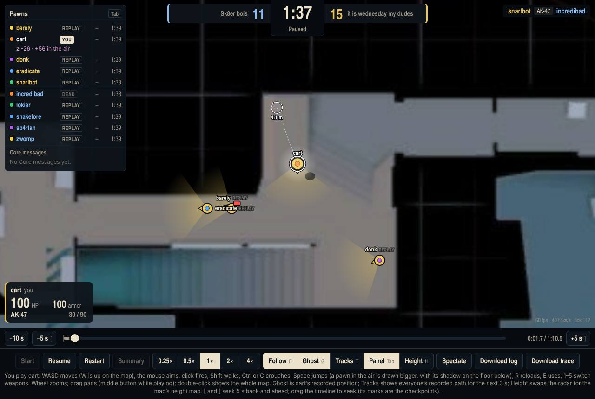
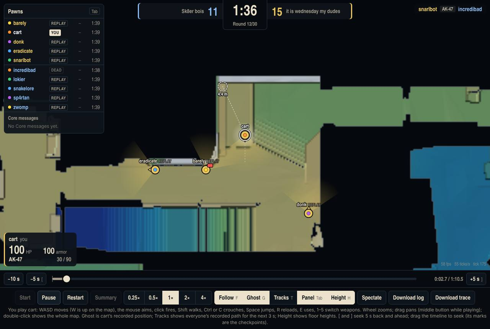
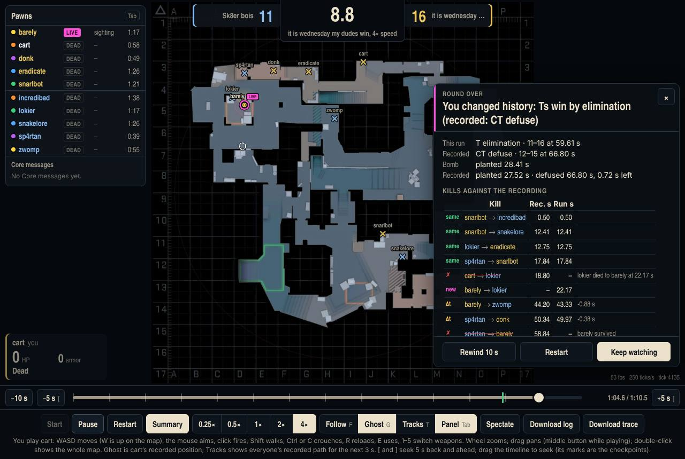

# Browser app (`src/app`, `index.html`)

One static page (Vite build, no framework, no runtime dependencies) that replays the round in 2D. It starts
**watching**: all ten replay and the round plays exactly as recorded. At any moment the player can **take control of
cart** (the button or E) and play him with keyboard and mouse from there while Core replays the other nine (G4,
"Takeover" below). Everything runs client-side; the only requests are the page's own assets.



## Modules

| File | What it does | DOM? |
| --- | --- | --- |
| `session.ts` | `Session`: owns `Sim2DHost`, `ReplayCore` and the `SessionLog`; runs a tick; controls, human input, weapon-slot queue, restart, snapshot/restore, log and trace; (B5) capabilities, checkpoints, rewind, seek. `parseSessionData()` parses the data files (and the sight mask, C4). | no |
| `timeline.ts` | B5: the timeline scrubber's pure mapping (tick ↔ bar fraction ↔ pointer, video time, `[` / `]`, seek progress) and `TimelineDom`, the bar under the map. | mapping no, `TimelineDom` yes |
| `summary-overlay.ts` | B5: `summaryView` (a Core `RoundSummary` → display strings), `summaryDue` (2 s after the round end) and `SummaryOverlay`, the end-of-round card. | view no, overlay yes |
| `loop.ts` | `FixedLoop`: 64 Hz accumulator, speed 0.25–4×, pause, per-frame cap. `RateMeter` for fps / ticks-per-second. | no |
| `input.ts` | Pure keyboard/mouse → `PawnInput` mapping, key bindings (fixed keys plus the rebindable duck / walk / jump / use: `keyMapFor`, `rebind`, `parseKeyBinds`), the shortcut guard `blocksShortcut`, `weaponForSlot`. | no |
| `keybinds.ts` | `KeyBindsStore`: the key-binding setting in localStorage (`cs2-sim-keybinds`, shared by the 2D and 3D pages). | no (storage injected) |
| `keybinds-dom.ts` | The Keys buttons in the controls bar (click a control, press its new key; Reset keys). | yes |
| `play-guard.ts` | `PlayGuard`: the ⛶ Fullscreen button with Keyboard Lock, and the leave-site (`beforeunload`) guard while playing (see "Ctrl+W" below). | yes |
| `radar.ts` | World ↔ radar ↔ screen transforms, `fitView`, yaw → screen direction. | no |
| `scene.ts` | `Scene`: what is drawn, built tick by tick (previous/current observe, statuses, kill feed, tracers, effects, pops, bomb, round end, Core logs); interpolation helpers. | no |
| `camera.ts` | Zoom, pan, follow, clamp; the camera → `View`. | no |
| `effects.ts` | `Effect` / `EffectsSource`; smokes, fires, flying grenades, pops and tracers as drawing primitives. | no |
| `takeover.ts` | G4: who plays at load (`startHuman`), the "Take control of cart" button's view (`takeoverButtonView`) and the status card's note (`youNote`). | no |
| `hud-model.ts` | Mode badges, weapon names, view toggles, the clock / bomb timer and score (reads C3's `observe.round` when present), the status card; where a pawn label goes clear of the HUD (`chooseLabelSpot`) and a LIVE pawn's AI line (`aiDebugLine`) (F). | no |
| `style.ts` | Palette and fonts shared by the canvas and the HUD (index.html mirrors them as CSS variables). | no |
| `input-dom.ts` | Thin listener layer: which bound keys and buttons are held, cursor position. | yes |
| `camera-dom.ts` | Wheel, drag, pinch and double-click/double-tap → camera calls. | yes |
| `renderer.ts` | `Renderer`: the canvas (radar cache, pawns, overlays, effects layer). `resize()`, `view`, `draw(frame)`. | yes |
| `hud.ts` | `Hud`: the DOM overlay (scoreboard and clock, kill feed, status panel, your status, rates); `occupiedRects()`, where it is on the stage. | yes |
| `main.ts` | Entry: loads data, builds the Session, runs the loop on `requestAnimationFrame`, feeds the Scene, wires the controls bar and view keys. | yes |
| `assets.ts` | `loadAssets()`: fetches the round, nav and sight-mask JSON and the radar. The single-file build swaps in `assets-embedded.ts`, which reads them from the page (docs/deploy.md). | yes |
| `index.ts` | Barrel of the DOM-free parts, for Node (C5's headless harness). | no |

The DOM-free files hold the logic and are unit-tested in Node (`tests/session.test.ts`,
`tests/loop.test.ts`, `tests/input.test.ts`, `tests/scene.test.ts`, `tests/camera.test.ts`,
`tests/effects.test.ts`, `tests/hud-model.test.ts`; B5: `tests/rewind.test.ts`, `tests/timeline.test.ts`).

```
requestAnimationFrame(now)
  ├─ InputDom (held keys, cursor) ─► input.ts ─► session.setHumanInput(PawnInput)   (cursor → world through renderer.view)
  ├─ loop.advance(now − last) ─► n × { act = session.step()
  │                                    observe → canonicalize → core.step → log.append → host.apply(+ human set_weapon) → host.tick
  │                                    scene.ingest(session.observe(), act, session.host.activeEffects()) }
  ├─ alpha = loop.pending / TICK_MS
  ├─ Renderer.draw({scene, alpha, model, clock, human, overlays, aim, fovDeg, nowMs, avoid: hud.occupiedRects(), ai: host})   (canvas)
  └─ Hud.update({scene, clock, human, you, phase, speed, panelOpen, tick, fps, tps, ai: host})     (DOM)
```

## Session (`session.ts`)

```ts
const data = parseSessionData(roundJson, navJson, tuningJson, visJson);   // values or text; visJson (the sight mask) may be null
const s = new Session({ ...data, seed: 1 });                       // human: 'cart' (default) or null; the seed also seeds the LIVE AI
const w = new Session({ ...data, seed: 1, human: null });          // G4: watching; w.takeControl() hands cart over at any tick
s.step();                                                          // tick 0: Core sets the round up
s.setHumanInput(humanInput('cart', held, yaw));                    // used every tick until replaced
s.requestWeaponSlot(3);                                            // knife, on the next step
s.control({ type: 'pause', paused: true });
s.log().toText(); s.trace();                                       // JSONL; toReplayTrace(log)
const snap = s.snapshot(); /* … */ s.restore(snap); s.restart();
```

- **Per tick**, exactly the driver contract of `docs/contracts.md` and `docs/movement.md`:
  `o = canonicalize(host.observe())` → `act = core.step(o)` → `log.append(o, act, controls)` →
  `host.apply(act)` → `host.tick()`. The observe is canonicalized as A4 requires (`tests/fakes.ts`
  `runSession`), even though Sim2DHost already emits canonical numbers.
- **Armed on construction.** The constructor delivers `start` to Core, so the first `step()` (tick 0)
  logs `controls: [{type: 'start'}]` and emits the setup. The app steps once on load ("ready"), so the
  pawns are on their spots at tick 1 before Start is pressed.
- **Controls** go to Core when `control()` is called and are logged on the next step's line.
  - `start`, `pause`, `speed`: to Core only. The driver paces them (`FixedLoop`); Sim2DHost has no use
    for them.
  - `checkpoint {id}`, `rewind {id}`, `seek {t}` (B5): `checkpoint()`, `rewind()`, `seek()` below. Driver work,
    not logged (a resync rewind logs the `rewind` it sends the Core).
  - `take_control {id}` (G4): `takeControl(id)` below. Engine work, not logged, not sent to the Core.
  - `restart`: `Session.restart()`.
  - A control Core rejects (speed ≤ 0) throws and is not logged; so does `speed` without the speed capability.
- **Human input.** `setHumanInput(input | null)` forwards to `Sim2DHost.setHumanInput`; the input
  persists until replaced. `null` means no input: the pawn stands still (the Core sends the human's pawn nothing). It
  throws while spectating or watching.
- **G4: takeover** (`docs/core.md` "Takeover"). `SessionConfig.human` is who plays from the start (`cart` by default,
  null = watching) and `playable` the pawn a watching player may take over (default `cart`). `human` is a getter: the
  pawn controlled now, null while watching. `takeControl(id = playable)` hands the pawn to the human from the next
  step on: `Sim2DHost.setHuman` before the next observe, which therefore names him; the pawn keeps everything the
  puppet had (position, velocity, view, weapon, HP, items) and stands still until `setHumanInput`. Not logged (the log
  shows it as `observe.human` changing). `takeControlBlocked(id)` says why not (already controlled, not the playable
  pawn, `cart is dead`, a seek running, a resync pending) and `canTakeControl` is its boolean; after the round end it
  is allowed while cart lives. `takeoverTick` is the tick he took control from (0 from the start). The takeover is
  part of the run: checkpoints store who controlled cart and since when, a rewind to one before the takeover is
  watching again (exact: the host snapshot has `human`; resync: the Session calls `setHuman(null)` before the resync
  step) and keeps the takeover on the tape, so a forward seek replays it on its tick, before his inputs; the first
  live step drops it. `restart()` returns to the start (watching, if built so). A session snapshot (version 2) has
  `human` and `takeoverTick`; `restore` accepts one whose human is null, the start's or the playable pawn.
- **Weapon slots (app-side action queue).** Keys 1–5 call `requestWeaponSlot(slot)`. On the next step
  each queued press becomes `set_weapon {id: human, weapon}` (`weaponForSlot`, against the host's
  inventory). It is appended after Core's actions in the Act given to the host.
  - It is **not** in the logged Act. In CS2 the human switches weapons natively, and the Replayer diffs
    Core's own output; the next observe shows the new weapon.
  - Likewise the human's `PawnInput` is engine-side and not in the log. A log with a human therefore
    replays against Core (tested in Node and on a log downloaded from Chrome), but it does not on its
    own reproduce cart's trajectory.
- **`restart()`** restores the snapshot taken at the end of the constructor: host and Core state,
  `start` pending, empty log, no human input, no queued slots, pause/speed at Core's defaults (the app
  re-sends speed when it isn't 1×). Running the same calls again gives a byte-identical log (tested
  with and without a human).
- **`snapshot()` / `restore()`** cover the whole driver state as plain JSON: host and Core snapshots,
  pending controls, queued slots, pause/speed, last Act and the log lines.
  - `restore` cuts the log back to the snapshot, so the log stays replayable and stepping on reproduces
    the original continuation byte for byte (tested: snapshot at tick 150, diverge, restore, continue).
  - Rebuilding a log costs a re-parse: about 0.11 s per 1,000 ticks (580 ms for a full round in Node).
    Restoring to the current log, or to an empty one, is free. B5's in-log rewinds (repeated ticks plus
    a `rewind` control) are a different mechanism.
- **B5: capabilities, checkpoints, rewind, seek** (`docs/core.md` "Checkpoints, rewind, summary"):
  - `capabilities` = the host's `capabilities()` and-ed with `SessionConfig.capabilities` (tests pass
    `{snapshot: false}` to rewind as on a CS2 server).
  - `step()` takes an automatic checkpoint before the step of every `replay.checkpointSec` multiple;
    `checkpoint(id)` takes one now. `checkpoints` (a `CheckpointStore`) keeps the last `replay.checkpointMax`.
  - `rewind(id)`: exact (host and Core restored, log cut back) or, without the snapshot capability, a resync on
    the next step (Core restored, log cut back, `rewind` sent to the Core, `observe()` and `tick` report the
    checkpoint until that step). `checkpointFor(tick)` is the target a seek uses (without hazards when resyncing).
  - `seek(t)` (Node) or `beginSeek(t)` + `advanceSeek(maxTicks)` (the app, per animation frame), `seeking`,
    `cancelSeek()`, `rewindBy(sec)`. A seek back rewinds to `checkpointFor(t)` first. The human's inputs and weapon
    slots are recorded by tick; what he did after a rewind target becomes the **tape** (`tapeEnd`), and a forward
    seek replays it, so scrubbing back and forth lands where a straight run would, byte for byte. The first live
    step (not a seek) discards it. Pause and speed controls are not replayed (they don't change an Act).
- **Core factory.** `SessionConfig.core` (default `defaultCore`) builds the Core from
  `{model, schedule, tuning, seed, nav}`. If B2 adds a nav-based `WalkQuery` parameter to
  `ReplayCore`, `defaultCore` is the one line to change.
- `human: null` (spectate / watch) puts `human: null` in every observe until a takeover, and Core drives all ten
  pawns: never taking control is the golden master byte for byte (`tests/takeover.test.ts`).

## Game loop (`loop.ts`)

- `advance(elapsedMs)` adds `elapsedMs × speed` to an accumulator and runs `floor(acc / 15.625 ms)`
  ticks, carrying the remainder, so the long-run rate is exactly 64 ticks per round-second at any frame
  rate. It returns the number of ticks run.
- **Cap:** at most `maxTicksPerFrame` (default 16 = 0.25 s of round time; enough for 4× down to
  16 fps). Extra whole ticks are dropped, not queued, and counted in `droppedTicks`, so after a tab
  switch the page does not freeze while it catches up.
- **Speed** is clamped to 0.25–4. **Pause** runs nothing and stops the time from piling up, so resuming
  never bursts.
- Pure: the caller passes the elapsed time, and the tests drive it with fake frame times (60 fps, a
  jittery 30–120 fps, 144 fps).

## Controls

| Input | Action |
| --- | --- |
| W A S D (or arrows) | Move relative to the **screen**: W = up = north, D = right = east, whatever way cart faces |
| Mouse | Cart faces the cursor (world coordinates) |
| Left / right button | ATTACK / ATTACK2 |
| Shift | WALK |
| Ctrl or C | DUCK (rebindable under **Keys**; C ducks too while no other control has it) |
| Space | JUMP (G3; held, it jumps once: a fresh press each jump, as CS2 with `sv_autobunnyhopping 0`; a tap shorter than a frame is latched until the next frame reads the keys) |
| R / E | RELOAD / USE while playing. **E while watching: take control of cart** (G4; CS2's own key for taking over a spectated bot) |
| 1 2 3 4 5 | Primary, pistol, knife, grenades (repeat to cycle), C4 (app-side `set_weapon`, see above) |
| F | Follow cart (the camera centres on him; from the full map it zooms to 3×) |
| G | Ghost: cart's recorded position now, as a hollow outline (on by default) |
| T | Recorded tracks: every pawn's recorded path for the next 3 s, and its recorded position now |
| Tab | Status panel (open by default on screens at least 900 px wide) |
| H | Height map (G3): the map layer shows `data/geometry/mirage-height.png` (CS2 floor heights, radar-aligned) instead of the radar |
| Mouse wheel / trackpad pinch | Zoom about the cursor (about the centre while following), 1–8× |
| Drag | Pan (left button while not playing, middle button any time); panning turns follow off |
| Double-click | Back to the whole map |
| Touch: drag, pinch, double-tap | Pan, zoom, back to the whole map |

WASD → forward/side: the screen direction `d` (diagonals normalized to length 1) is projected onto
the yaw frame of `docs/movement.md`: `forward = d · (cos yaw, sin yaw)`, `side = d · (sin yaw, −cos yaw)`
(+side = strafe right). So W at yaw 90 is forward 1, W at yaw 0 is side −1, and D at yaw 90 is side +1.
The test also checks, through `wishFromInput`, that the wish direction equals the screen direction at any yaw.

Keys are matched by `KeyboardEvent.code` (layout-independent). While the human plays, bound keys and every Ctrl
combination have their default blocked, except with ⌘ held, so Mac shortcuts still work. All keys are released when the window loses
focus. The grenade cycle order (he → flash → smoke → molotov) has not been checked against CS2.

### Ctrl+W, fullscreen and key bindings

Ctrl is CS2's duck and W is forward, so Ctrl+W (crouch-walk forward) is constant; on Windows and Linux it is also the
browser's "close tab", and Chromium and Firefox act on Ctrl+W / Ctrl+T / Ctrl+N before the page can `preventDefault`
them. Three layers, shared with the 3D page (`play-guard.ts`, `keybinds.ts`, `keybinds-dom.ts`):

1. **⛶ Fullscreen + Keyboard Lock (the real fix).** The button calls `requestFullscreen()` and then, where the browser
   has the [Keyboard Lock API](https://developer.mozilla.org/en-US/docs/Web/API/Keyboard/lock) (feature-detected:
   `navigator.keyboard.lock`), locks the letters, digits, Ctrl, Shift, Alt, Space, Tab, Escape and the arrows
   (`KEYBOARD_LOCK_CODES`). The keys then reach the page first, and keydown blocks Ctrl+W / S / T / N (also while
   watching) and every Ctrl combination while playing. With Escape locked the browser leaves fullscreen only on a
   **held** Esc (it shows its own "Press and hold Esc to exit full screen" banner, and the page shows a hint line); a
   short Esc goes to the page (the 3D page frees the mouse with it, as before). Leaving fullscreen (held Esc or the
   button) unlocks.
2. **Leave-site guard (every browser).** While the player controls a living pawn a `beforeunload` handler is on, so an
   accidental Ctrl+W outside fullscreen, in Safari or Firefox, or ⌘W on a Mac brings up the browser's "Leave site?"
   dialog instead of closing the tab silently. It comes off when the player is not playing (watching, dead, round not
   started). Ctrl+W and Ctrl+S are `preventDefault`ed in keydown in any state as a best effort (it works where the
   browser lets the page see them first).
3. **Keys** in the controls bar: Duck, Walk, Jump, Use show their key; click one, press the new key (Esc cancels; a key
   another of the four has swaps; WASD, arrows, R, 1–5, Escape, Tab, ⌘ and the page's own keys F G T H [ ] V Z X P are
   refused). Stored in localStorage (`cs2-sim-keybinds`, one setting for both pages); **Reset keys** goes back to CS2's
   defaults (Ctrl duck, Shift walk, Space jump, E use). C ducks as well unless another control takes it, so moving
   Duck off Ctrl is one click away (Duck → press C, or Alt).

| Browser | Ctrl+W while playing |
| --- | --- |
| Chrome, Edge, Opera, Brave (Windows, Linux, ChromeOS), in ⛶ Fullscreen | crouch-walks forward; the tab stays (Keyboard Lock) |
| The same, not fullscreen | the browser closes the tab, but the leave-site guard asks first |
| Firefox, Safari (no Keyboard Lock) | as "not fullscreen": the dialog asks first; rebind Duck to C or Alt to avoid it |
| macOS, any browser | Ctrl+W is not a shortcut there (tab close is ⌘W), so it just crouches forward. **⌘W can't be captured by any page** (not even with Keyboard Lock); while playing the leave-site dialog asks first |
| iPhone / iPad | no keyboard play (touch-only devices can't take control); iPhone Safari has no element fullscreen, so the button is hidden |

Checked: `tests/keybinds.test.ts` (Ctrl+W `preventDefault`ed with duck and forward still held, the locked-state
shortcuts, ⌘ never blocked, rebinding, the store); `npm run check:browser` / `check:browser:3d` dispatch Ctrl+W, Ctrl+T
and Ctrl+N while playing and require them prevented and the leave-site guard on. Headless Chrome can't show that the
real browser shortcut is held off; that needs a manual check in desktop Chrome or Edge.

**Timeline (B5)**, the bar under the map: the played part filled, the checkpoints as marks (automatic dim, on demand
amber), the round end in green, the human's replayable future (the tape) dashed. Drag (or tap) to seek; on the
focused bar ←/→ seek 1 s, Page Up/Down 5 s, Home/End to the ends. **−10 s**, **−5 s** and **+5 s** beside it,
and the keys **`[`** / **`]`** (5 s back / ahead). A seek stops the loop and runs `advanceSeek` for about 10 ms
per animation frame (the bar reads "Seeking N %"), then the Scene restarts where it landed and the round goes on
running if it was running (else paused). Seeking ahead past what the human played lets go of his keys. Measured in
headless Chrome: the drag from 0:09 to 1:00 (3,240 ticks) took 1.5 s at 60 fps.

**Summary overlay (B5)**: 2 s of round time after the round end (`summaryDue`) a card opens bottom right (a
bottom sheet on phones) with the headline, this run against the recording (result, bomb), the kill table (same, Δt,
✗ didn't happen with why, soon, new), who went LIVE (time, trigger, reason) and the player's stats (kills, damage
dealt and taken, time alive, metres RMS off his recording), with **Rewind 10 s**, **Restart** and **Keep watching**.
It doesn't pause anything: the post-round kill (69.4 s) still happens behind it and the card refreshes when it
lands. Escape, × or Keep watching close it; the **Summary** button (enabled once the round is over) brings it
back. A rewind to before the round end closes it.

**Controls bar:** Start (from the ready state), Pause/Resume, Restart (back to ready, watching), Summary (B5), speed
0.25/0.5/1/2/4×, the view toggles Follow / Ghost / Tracks / Panel / Height (the F, G, T, Tab and H keys, as
buttons for touch), **Take control of cart** (G4, below; it replaced D1's Spectate button, which rebuilt the
session with or without a human), Download log (JSONL), Download trace (JSON). Downloads are `Blob` URLs. Tab toggles the panel only
while focus is on the page, so it still moves focus inside the controls bar.

**Touch (iPhone):** there are no touch controls for the human (on-screen joystick and fire button are
out of scope; so no jump button either). Touch-only devices (`(hover: none) and (pointer: coarse)`) watch, like every
device at load, and their Take control button stays disabled ("Playing needs a keyboard and mouse"); the controls bar
works by tapping; drag, pinch and double-tap move the camera. In landscape on a phone
the bar moves to a column on the right.

**URL parameters:** `?seed=<int>` (default 1) and `?human=cart` (play cart from the start, tick 0; `none` or absent:
watching).

**Takeover (G4)**, `docs/core.md` "Takeover". The page starts watching on every device (`startHuman`: `?human=` absent
or `none`): nobody controls cart, his card says "watching · E: take control", and a run nobody takes over is the
golden master byte for byte ("Played it like the tape: CT defuse, 0.72 s left"; `tests/takeover.test.ts` runs the
page's session config to the end). **Take control of cart** or **E** (only while watching; once playing E is USE)
calls `Session.takeControl()`: from the next tick cart is yours, exactly where and how the puppet left him (moving,
aiming, holding whatever he held), and the HUD switches to "YOU" (the badge, "you" on the card, the button reads
"You: cart" and stays pressed). Allowed in the ready state (from tick 1), while running or paused, and after the round
end while cart lives; disabled while seeking and once cart is dead (69.41 s on the tape; the tooltip says why).
Taking control at another speed drops it to **1×** (nobody plays at 4×; the speed buttons still work, so 0.5× or 2×
are a click away); the `speed` control is logged on the takeover tick, after the untouched prefix. The camera is not
changed (the spectate view or F's follow, which follows cart either way). **Restart** returns to watching; a rewind
(`[`, −5 s, −10 s, the timeline) to before the takeover is watching again too, and a forward seek through it replays it
(the tape). The tape and checkpoints carry it ("Session" above).





## Loading and bundle

`round.json`, `mirage-nav.json` and `mirage-vismask.json` (C4, 49 KB with F's cover rows, 5.6 KB gzip) are imported with `?url` and fetched in parallel with the radar
image, so they are cached separately and don't bloat the script. `tuning.json` (1.8 KB) is inlined.
Build output (`npm run build`):

| File | Size | gzip |
| --- | ---: | ---: |
| `index.html` (with the HUD's CSS) | 13.5 KB | 4.1 KB |
| `assets/index-*.js` | 112.7 KB | 39.0 KB |
| `assets/round-*.json` | 835 KB | 63.5 KB |
| `assets/mirage-nav-*.json` | 173 KB | 17.7 KB |
| `assets/mirage-radar-*.jpg` | 136 KB | (jpeg) |

That's about 260 KB over the wire with gzip (GitHub Pages compresses JSON).

`npm run build:single` (`vite.single.config.ts`) makes the same app one self-contained `dist-single/index.html`
(447 KB) for the password-locked johnjp15.github.io/cs2/sim/: the JSON is embedded gzipped and base64-encoded and
inflated with `DecompressionStream`, the radar is a data: URI, and the page makes no requests. See
[`deploy.md`](deploy.md). Of the script, C2's combat
code took it from 58.7 to 82.9 KB and D2's renderer, HUD and camera add 29.9 KB (10.3 KB gzip).

**3D world (G3).** Both builds also load `data/geometry/mirage-geometry.bin` (the CS2 collision mesh, 428 KB),
`mirage-clips.bin` (player clips, 151 KB), `mirage-tracks.json` (the snapped tracks, 70 KB) and `mirage-height.png`
(the height map layer, 125 KB), and the session plays in 3D (`parseSessionData`'s `world3d`). The normal build
fetches them (`?url`, `arrayBuffer`); the single file embeds the binaries and the tracks gzipped + base64 and inflates
them with `DecompressionStream` (geometry 313 KB, clips 81 KB, tracks 20 KB as embedded) and the height map as a data:
URI (156 KB). `npm run build:single` is now 1,144,387 bytes (1117.6 KB; gzip 706.7 KB; locked ≈ 1,496 KB), up from
560,231 bytes (547.1 KB) before; the geometry is the 313 KB G2 estimated, the height map layer the next biggest part
(a JPEG would halve it: a follow-up). Building the 3D nav (portal checks on the CS2 mesh) takes about 0.25 s at
start-up in Node.

## Renderer and HUD (D2)

**Height (G3).** The view is top-down, so height needs a cue: a pawn in the air (not `onGround`) is drawn up to 35 %
bigger and lighter with its shadow on the floor below, offset down and to the right in proportion to its height above
the floor (`airCue`, capped at 120 units; the floor from `MapGeometry.floorBelow` under the standing hull's footprint).
The status panel adds `z −48` and `+56 in the air` (or `crouched`) for LIVE pawns and anyone in the air
(`heightText`). H swaps the radar for the height map (same frame; its transparency kept).






**Look.** Dark and quiet so the round reads at a glance: the replay page's "Mirage after dusk" palette
(`style.ts`, mirrored as CSS variables in `index.html`): night background, sand text, Ts warm gold
`#ebc75e`, CTs cool blue `#8bbcf3`, bomb red, defuse green. Magenta `#ff4fd8` is reserved for LIVE
pawns and used for nothing else. Names, numbers and badges use a condensed face (Avenir Next Condensed
on macOS and iOS; TeX Gyre Heros Cn / DejaVu Sans Condensed on the Linux test VM) with tabular figures;
log lines use the system face. No web fonts and no game UI assets: everything is drawn by the app.

**Canvas (`renderer.ts`),** bottom to top:

1. **Radar** through `radar.ts` and the camera. It is drawn once into an offscreen canvas at the current
   device scale, with a slight cool tint multiplied in so the marks pop, and blitted 1:1 each frame.
   The cache covers the visible radar plus a quarter-view margin on each side, and is rebuilt only when
   the zoom, size or devicePixelRatio changes or panning leaves it (1 rebuild in 3.5 s of the follow
   camera at 4×; at most 16 M device pixels).
2. **Smokes and fires** (`effectPrimitives`): a grey disc of the smoke radius with a light rim, swelling
   in after the pop and fading over its last 1.5 s; an orange disc with a dashed, flickering rim for a
   fire.
3. **Recorded tracks** (T): each pawn's recorded path for the next 3 s as a dotted line in its team
   colour, and its recorded position now as a small ring, with a thin line to the pawn when it has
   drifted more than 24 units (puppet drift and snaps show at a glance). With them (F), each LIVE pawn's way on
   (`Sim2DHost.aiDebug(id).path`, from its next waypoint) as a faint dashed magenta line from the pawn, with a small
   ring at the next waypoint. 2D debug: the Core never reads `aiDebug` (CS2's bots have their own state).
4. **Bomb** (planted): a red dot at the plant position that blinks faster as the timer runs down (once
   a second at the plant, about seven times a second at the end), with the time left beside it; a
   dashed green ring while someone defuses; green once defused.
5. **Death crosses** at each dead pawn's position, in its team colour, with a red ring for the first
   0.75 s.
6. **Shot tracers** from `shot` events: from the shooter along his yaw, ending on the pawn the same
   tick's `damage` event names, or at the first wall (bisection on `NavMesh.lineOfSight`, the same
   query C2's bullets use) or 1,800 units. They fade over 10 ticks (156 ms of round time).
7. **View wedges**: a soft cone of `tuning.ai.fovDeg` (106°) in the team colour.
8. **Ghost** (G): cart's recorded position at the render time (`RoundModel.trackAt`) as a hollow
   dashed outline. When he is more than 64 units away, a dashed link and the distance in metres
   (1 unit = 1 inch).
9. **Pawns**: a disc in the team colour with the player's own `round.json` colour (the CS2 radar
   colour) at its centre, and a pointer notch for the facing. The human's pawn has a white ring and a
   soft glow; a flashed pawn a white bloom while blind (`blindUntilTick`); a LIVE pawn a magenta ring and a pulsing halo; the bomb carrier (from C3's
   `observe.round`) a small red tag. A thin HP bar (green, amber at 50, red at 20) with armor under it
   appears once a pawn is hurt.
10. **Flying grenades and pops**: a small dot in the grenade's colour while in the air; a flash pops as
    a white flare, an HE as an expanding ring (a flying flash or HE that leaves `activeEffects()` has
    popped, at its `grenade` sound).
11. **Names and mode badges** above the pawns, nudged apart where they would overlap. Badges come from
    the latest `act.status` (`statusBadge`): REPLAY is a small dim "play" mark (spelled out from 2×
    zoom), **LIVE** a solid magenta tag, DEAD dim text, and the human's pawn none (it has the ring). The
    human's pawn is reported `HUMAN` by Core (B4), which `statusBadge` reads as "YOU" (the HUD's status card).
    **Clear of the HUD (F):** each label takes the first of its spots (above, right, below, left, higher up) that
    overlaps neither another label nor the HUD's rectangles (`Hud.occupiedRects()`: scoreboard, kill feed, panel or its
    button, your status, the rates) nor the canvas edge; else the first clear of the HUD (overlapping another label, as
    before); else its text is left out and only the dot shows (`chooseLabelSpot`). The bomb's time and the ghost's
    distance are left out under the HUD too. `__cs2replay.stats().labels` reports the last frame's label rectangles,
    how many were left out, and the HUD's rectangles.
12. **Aim line** from the human's pawn to the cursor while playing.

**Interpolation.** After each `Session.step()` the Scene keeps the previous and the current observe;
each pawn is drawn `alpha = loop.pending / TICK_MS` of the way between them (yaw the short way round),
and the render time `prev.tick + alpha` drives the ghost, the tracks and every fade. A pawn that moves
more than 48 units in a tick (a teleport or snap) or dies is drawn where it is, not slid. Events of an
observe with tick N are stamped N − 1, the tick the render time is in right after the step.

**Camera** (`camera.ts`, `camera-dom.ts`). Full map by default. Zoom is 1–8× about the cursor; zoomed
in, the radar may leave at most a quarter of the canvas empty (or stick out a quarter where it is
narrower than the canvas), so the point under the cursor stays put (1.3 px in the browser check). F
follows cart with a 90 ms exponential ease. The renderer's `view` is always the camera's, so
`input-dom.ts` aims correctly at any zoom (checked at 4.7× while following).

**HUD** (`hud.ts`, DOM over the canvas; crisp text, CSS layout; elements are rewritten only when their
text changes):

- **Top centre:** CT name and score, the clock, T score and name. The clock is `RoundClock.hudClock`;
  after the plant it turns red and shows the bomb timer (`hudBomb`) with a draining bar; green once
  defused. The line under it says "Press Start", "Paused", the speed when not 1×, "Bomb planted", the
  winner, or else the round ("Round 12/30"). The score is 11–15 plus this round's winner. With C3,
  clock, bomb and score come from `observe.round` (`clockView`, `scoreView`).
- **Kill feed, top right:** "killer [weapon] victim" with a drawn headshot mark, names in team colours,
  the newest at the bottom; the last 5, each for 5 s of round time (so a pause freezes it). Kills
  involving the human get a red outline. Wherever it would cover the scoreboard (desktop windows narrower than
  about 1,100 px, phones in landscape) or the collapsed panel button (phones), it moves down below them (F, measured
  each frame); an open panel sits above it.
- **Status panel, left (Tab):** each pawn's mode badge, trigger and since-time (the round clock at
  `sinceTick`), Ts then CTs, and under a LIVE pawn (F) what the 2D engine's AI is doing, from `host.aiDebug(id)`:
  behaviour, target ("out of sight" while it keeps one it lost) and goal (role → destination), e.g. "fighting · target
  lokier · plant → (−1873, 396)"; then the last 20 Core `log` actions, newest first. Collapsed by default on phones.
- **Your status, bottom left:** cart's HP (amber, then red as it drops), armor, weapon and clip /
  reserve ("spectating" when nobody plays him).
- **Bottom right:** frame rate, ticks per second and tick.

`prefers-reduced-motion` turns off the pulsing rings (LIVE halo, bomb pulse, fresh deaths); the static
marks stay.

## Worker decision

**Stay on the main thread.** `npm run bench:session` steps a full recording (`meta.durationSec` × 64 =
5,137 ticks), spectating, three runs each, timing every `session.step()` in Node 22 on a 2-vCPU 2.1 GHz
Xeon (cloud VM; an M-series Mac is faster):

| Core | mean | p50 | p90 | **p99** | p99.9 | max | log size |
| --- | ---: | ---: | ---: | ---: | ---: | ---: | ---: |
| B1 `ReplayCore` (pawns stand still) | 0.24 ms | 0.21 ms | 0.25–0.30 ms | **0.63–0.70 ms** | 0.8–2.7 ms | 1.2–6.7 ms | 18.7 MB |
| Stand-in for B2: every pawn runs and turns (`RunningCore`) | 0.89–0.98 ms | 0.90–0.94 ms | 1.10–1.27 ms | **1.28–1.96 ms** | 1.4–4.1 ms | 1.5–11.9 ms | 20.4 MB |

p99 is under 2 ms in both, so the Session stays on the main thread. At 4× (256 ticks/s) the running
stand-in uses about 0.24 s of main-thread time per second, about 4 ms per 60 Hz frame. Single max
values are GC pauses and JIT warm-up.

In the running case, `host.tick()` (movement and nav clamping) is 0.70 ms of the 0.94 ms. The JSON
work is 0.24 ms: canonicalizing the observe 0.09 ms, the log line 0.11 ms, and `apply`'s canonicalize
0.05 ms. Re-run `npm run bench:session` after B2/C2 land. If p99 passes 2 ms, move the `Session` into
a Worker: it is DOM-free, and the page needs only `observe()`, `lastAct`, the clock and the downloads.

## Browser check

`npm run build && npm run check:browser` (`tools/browser-check.ts`; playwright-core 1.63 with its
Chromium from `PLAYWRIGHT_BROWSERS_PATH`, `npx playwright-core install chromium`, or `CHROME_PATH`).
Screenshots and downloads go to `logs/browser-check/` (gitignored). Results in headless Chromium
153.0.8010.12 on this VM:

- **(a) Ready** (`a-desktop-ready`): the radar, ten pawns on their start spots, clock 1:39, tick 1, watching (G4);
  E takes control of cart there (from tick 1). **After Start:** 1:36 after about 3 s (tick ≈ 194).
- **Human:** with the mouse east of cart, holding S for 1 s moves him 211 units south with x unchanged
  (screen-relative), and he faces the cursor. Key 3 switches to the knife. Both downloads work: a log of
  ~290 lines is about 1.1 MB, and its trace is 11.6 KB.
- **Rate at 4× over 10 s with every overlay on** (tracks, ghost, status panel, follow camera at 3×):
  **60.0 fps, 256.1 ticks/s** (target 256; runs gave −0.08 % to +0.09 %), 0 dropped ticks. Spectating
  with the follow camera moving with cart, every overlay on: **60.1 fps, 256.5 ticks/s** over 3.5 s,
  1 radar-cache rebuild.
- **(b) Spectating at 20 s with the tracks overlay** (`b-desktop-spectate-tracks`, the image at the
  top): the Ts are coming out of Apartments toward B. Six wheel notches about a point zoom to 3.8× and
  move the point under the cursor by 1.3 px (`b2-desktop-spectate-zoomed`).
- **(c) Follow camera zoomed in on cart** (`c-desktop-follow-zoomed`, the image above): cart throws a
  smoke (a real `activeEffects()` cloud), steps into the corridor and fires along the longest clear line;
  aiming through the zoomed, following view turns him to within 0.01° of the cursor; the screenshot is
  paused on the frame after a shot, so its tracer shows.
- **(d) Phone viewport** (`d-phone-spectate`, 390×844, DPR 3, touch): starts in spectate mode with the
  panel collapsed; the scoreboard sits above the map and your status below it; the controls wrap into
  four rows.
- **(d2) Phone, zoomed in and dragged** (F, `d2-phone-zoomed-labels`): 2.44× about the Ts at T spawn, then dragged so
  they sit under the scoreboard and the kill feed: 4 labels drawn, 2 left out, **0 overlapping the HUD** (before F, the
  check:locked phone screenshot had barely's and eradicate's labels under the scoreboard). donk's label moves below
  his dot, out from under the clock.
- **(g) Desktop 900×700 at 12.8 s** (F, `g-desktop-narrow-killfeed`): the kill feed (2 rows) moves below the scoreboard
  (rows from y 84; the scoreboard ends at y 78) instead of covering its right end; 0 labels overlap the HUD.
- **(h) LIVE AI in the panel** (F, `h-desktop-live-aidebug`, `?human=cart`, cart idle in Back Alley, tracks on): at 1:17 Lokier
  (outlived) and barely (sees him) are LIVE; their panel lines read "reacting · target lokier (out of sight) · plant →
  (−1873, 396)" and "reacting · target barely · hold", and their paths show on the map.
- **Determinism:** the spectate log from Chrome has the same digest as a Node run of the same length,
  and the desktop log (with a human) replays identically in Node against the app's Core (`defaultCore`:
  with the nav walk query; the check used a bare `ReplayCore` before, which stopped matching when B2
  turned the puppets on).
- **Golden parity** (E1, `docs/golden.md`; `--only parity` runs just this): the no-human round played by the
  page at 4× has, through tick 1280 (20 s), the digest of the Node headless harness (`tools/harness.ts`) run with
  the controls the page logged (`8a6f3b52` with F's cover; it was `2b8dc5fb` on B4's main, the `045fe7ec` here before
  was C4's), and so does the page's whole log (`e5b41166` for 1,293 lines; the length depends on where the page
  paused).
- **(e) B5: rewind and summary** (`--only b5` runs just this): cart played by nobody at 4×: `[` at 24 s seeks to
  19 s and keeps running; −10 s while paused lands 10 s back, paused; dragging the timeline to 1:00 lands on tick
  3,839 in 1.5 s; the page's log after all that is one straight run (every line's tick its index) that replays
  identically in Node. The summary opens 2 s after the round end ("You changed history: Ts win by elimination
  (recorded: CT defuse)", `e-desktop-summary`) while the round goes on; Keep watching closes it, Summary reopens it,
  its Rewind 10 s goes back 10 s and closes it. Spectating: "Played it like the tape: CT defuse, 0.72 s left"
  (`e2-desktop-summary-spectate`). Phone (390×844, touch): −5 s by tap, and the summary as a bottom sheet
  (`f-phone-summary`). `summarize()` of a 4,000-line log takes ~80 ms in the page.
- **(i) G4: takeover** (`--only takeover` runs just this): the default page watches at 4×; at 10 s (`i-desktop-watching`)
  "Take control of cart" at tick 700: speed 1×, the button "You: cart", the card "you" (`i2-desktop-takeover`, after
  S held 0.8 s); the page's log before tick 700 has the digest of the Node no-human run with the page's `speed`
  control (`336b2945`); `[` lands on tick 604, watching again, and E takes control again (tick 606); Restart is
  watching; after a seek to 69.6 s (cart dead) the button is disabled ("Not now: cart is dead.") and E does nothing.
  The pages that play cart from the start (c, the jump, h, e) load `?human=cart`; the phone (d) watches with the
  button disabled.
- No console errors, and no requests outside the page's origin.



**Safari (macOS / iOS) was not tested**: there is no WebKit in this environment. Things to check on
the iPhone are the layout with Safari's toolbars (`100dvh`, safe areas), downloads (iOS shows a
download sheet for the Blob link), and the JavaScriptCore vs. V8 numeric caveat in `docs/movement.md`.

## Known issues and notes for later tasks

- ~~**Start yaws are lost on tick 0 (Core, B1/B2).**~~ Fixed in B2: on the setup step every REPLAY
  pawn gets the yaw of its setup `teleport` (eradicate faces 167.2° in the screenshots).
- ~~Sim2DHost v0 merges duplicate grenades into one inventory entry.~~ Fixed in C2: each grenade `give` adds its own entry (cart has two smokes), and throwing removes one (`docs/combat.md`).
- **C3 wiring** (bomb and round rules): `hud-model.ts` reads `observe.round` through `roundStateOf()`
  (`{phase, score, winner, reason, endTick, timeLeftSec, bomb: {state, carrier, pos, plantTick, defuser,
  defuseEndTick}}`) for the clock, the bomb timer and dot, the score and the carrier tag. Until then the
  clock falls back to `RoundClock` and the Scene's `bomb` / `round_end` events. Check after C3 lands:
  the `bomb.state` strings (`defused`, `exploded`, `defusing` are assumed) and whether `timeLeftSec`
  is the round clock (it is shown as m:ss before the plant). A defuse progress arc could use
  `defuseEndTick`; today it is a dashed ring.
- **Effects** are wired to `Sim2DHost.activeEffects()` (`EffectsSource`) and flashed pawns to
  `Sim2DHost.blindUntilTick()` (`BlindSource`).
- **Ideas for the Session / frame API:** `Session.step()` could return the post-tick observe with the
  Act (the app calls `observe()` right after every step, and the host builds it twice per tick); an
  `effects()` on Session would save the app reaching into `session.host`; and a per-tick `events`
  stream (or the Act's `log` actions with their tick) would let the Scene skip re-reading.
- `window.__cs2replay` has `stats()` (now with overlays, camera and radar-cache rebuilds; B5: `seeking`,
  `summaryOpen`, `checkpoints`), `session()`, `scene()`, `screenOf(x, y)` and (B5) `summary()` (the
  `RoundSummary` of the run so far) and `seek(t)`; `tools/browser-check.ts` uses them.
