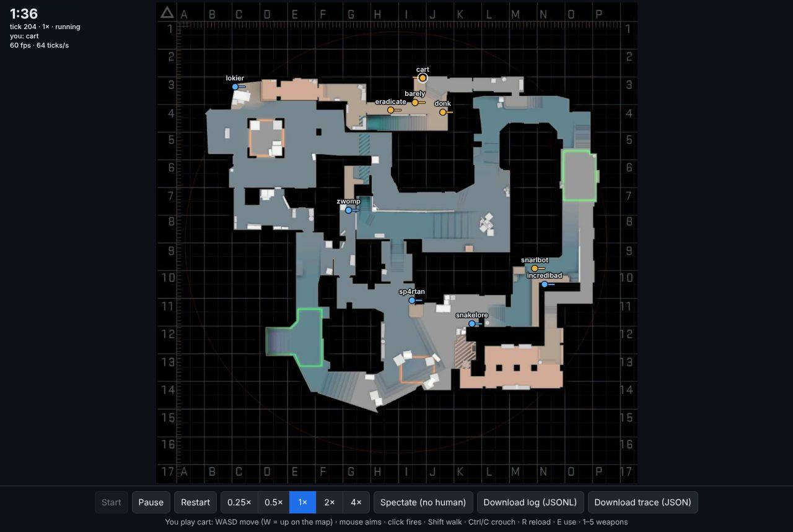

# Browser app (`src/app`, `index.html`)

One static page (Vite build, no framework, no runtime dependencies) that replays the round in 2D: a
human plays `cart` with keyboard and mouse, Core replays the other nine. Everything runs client-side;
the only requests are the page's own assets.



## Modules

| File | What it does | DOM? |
| --- | --- | --- |
| `session.ts` | `Session`: owns `Sim2DHost`, `ReplayCore` and the `SessionLog`; runs a tick; controls, human input, weapon-slot queue, restart, snapshot/restore, log and trace. `parseSessionData()` parses the three data files. | no |
| `loop.ts` | `FixedLoop`: 64 Hz accumulator, speed 0.25–4×, pause, per-frame cap. `RateMeter` for fps / ticks-per-second. | no |
| `input.ts` | Pure keyboard/mouse → `PawnInput` mapping, key bindings, `weaponForSlot`. | no |
| `radar.ts` | World ↔ radar ↔ screen transforms, `fitView`, yaw → screen direction. | no |
| `input-dom.ts` | Thin listener layer: which bound keys and buttons are held, cursor position. | yes |
| `debug-render.ts` | Minimal canvas renderer (D2 replaces it). | yes |
| `main.ts` | Entry: loads data, builds the Session, runs the loop on `requestAnimationFrame`, wires the controls bar. | yes |
| `index.ts` | Barrel of the DOM-free parts, for Node (C5's headless harness). | no |

Only `session.ts`, `loop.ts`, `input.ts` and `radar.ts` hold logic; they are unit-tested in Node
(`tests/session.test.ts`, `tests/loop.test.ts`, `tests/input.test.ts`).

```
requestAnimationFrame(now)
  ├─ InputDom (held keys, cursor) ─► input.ts ─► session.setHumanInput(PawnInput)
  ├─ loop.advance(now − last) ─► n × session.step()
  │                                 observe → canonicalize → core.step → log.append → host.apply(+ human set_weapon) → host.tick
  └─ session.observe() ─► DebugRenderer.draw(...)
```

## Session (`session.ts`)

```ts
const data = parseSessionData(roundJson, navJson, tuningJson);   // values or text
const s = new Session({ ...data, seed: 1 });                       // human: 'cart' (default) or null
s.step();                                                          // tick 0: Core sets the round up
s.setHumanInput(humanInput('cart', held, yaw));                    // used every tick until replaced
s.requestWeaponSlot(3);                                            // knife, on the next step
s.control({ type: 'pause', paused: true });
s.log().toText(); s.trace();                                       // JSONL; toReplayTrace(log)
const snap = s.snapshot(); /* … */ s.restore(snap); s.restart();
```

- **Per tick**, exactly the driver contract of `docs/contracts.md` and `docs/movement.md`:
  `o = canonicalize(host.observe())` → `act = core.step(o)` → `log.append(o, act, controls)` →
  `host.apply(act)` → `host.tick()`. The observe is canonicalized as A4 requires (`tests/fakes.ts`
  `runSession`), even though Sim2DHost already emits canonical numbers.
- **Armed on construction.** The constructor delivers `start` to Core, so the first `step()` (tick 0)
  logs `controls: [{type: 'start'}]` and emits the setup. The app steps once on load ("ready"), so the
  pawns are on their spots at tick 1 before Start is pressed.
- **Controls** go to Core when `control()` is called and are logged on the next step's line.
  - `start`, `pause`, `speed`: to Core only. The driver paces them (`FixedLoop`); Sim2DHost has no use
    for them.
  - `seek`, `checkpoint`, `rewind`: to Core (it throws "not implemented until B5") and then to the host.
  - `restart`: `Session.restart()`.
  - A control Core rejects (speed ≤ 0, B5 controls) throws and is not logged.
- **Human input.** `setHumanInput(input | null)` forwards to `Sim2DHost.setHumanInput`; the input
  persists until replaced. `null` hands cart back to Core. It throws while spectating.
- **Weapon slots (app-side action queue).** Keys 1–5 call `requestWeaponSlot(slot)`. On the next step
  each queued press becomes `set_weapon {id: human, weapon}` (`weaponForSlot`, against the host's
  inventory). It is appended after Core's actions in the Act given to the host.
  - It is **not** in the logged Act. In CS2 the human switches weapons natively, and the Replayer diffs
    Core's own output; the next observe shows the new weapon.
  - Likewise the human's `PawnInput` is engine-side and not in the log. A log with a human therefore
    replays against Core (tested in Node and on a log downloaded from Chrome), but it does not on its
    own reproduce cart's trajectory.
- **`restart()`** restores the snapshot taken at the end of the constructor: host and Core state,
  `start` pending, empty log, no human input, no queued slots, pause/speed at Core's defaults (the app
  re-sends speed when it isn't 1×). Running the same calls again gives a byte-identical log (tested
  with and without a human).
- **`snapshot()` / `restore()`** cover the whole driver state as plain JSON: host and Core snapshots,
  pending controls, queued slots, pause/speed, last Act and the log lines.
  - `restore` cuts the log back to the snapshot, so the log stays replayable and stepping on reproduces
    the original continuation byte for byte (tested: snapshot at tick 150, diverge, restore, continue).
  - Rebuilding a log costs a re-parse: about 0.11 s per 1,000 ticks (580 ms for a full round in Node).
    Restoring to the current log, or to an empty one, is free. B5's in-log rewinds (repeated ticks plus
    a `rewind` control) are a different mechanism.
- **Core factory.** `SessionConfig.core` (default `defaultCore`) builds the Core from
  `{model, schedule, tuning, seed, nav}`. If B2 adds a nav-based `WalkQuery` parameter to
  `ReplayCore`, `defaultCore` is the one line to change.
- `human: null` (spectate) puts `human: null` in every observe, and Core drives all ten pawns.

## Game loop (`loop.ts`)

- `advance(elapsedMs)` adds `elapsedMs × speed` to an accumulator and runs `floor(acc / 15.625 ms)`
  ticks, carrying the remainder, so the long-run rate is exactly 64 ticks per round-second at any frame
  rate. It returns the number of ticks run.
- **Cap:** at most `maxTicksPerFrame` (default 16 = 0.25 s of round time; enough for 4× down to
  16 fps). Extra whole ticks are dropped, not queued, and counted in `droppedTicks`, so after a tab
  switch the page does not freeze while it catches up.
- **Speed** is clamped to 0.25–4. **Pause** runs nothing and stops the time from piling up, so resuming
  never bursts.
- Pure: the caller passes the elapsed time, and the tests drive it with fake frame times (60 fps, a
  jittery 30–120 fps, 144 fps).

## Controls

| Input | Action |
| --- | --- |
| W A S D (or arrows) | Move relative to the **screen**: W = up = north, D = right = east, whatever way cart faces |
| Mouse | Cart faces the cursor (world coordinates) |
| Left / right button | ATTACK / ATTACK2 |
| Shift | WALK |
| Ctrl or C | DUCK |
| R / E | RELOAD / USE |
| 1 2 3 4 5 | Primary, pistol, knife, grenades (repeat to cycle), C4 (app-side `set_weapon`, see above) |

WASD → forward/side: the screen direction `d` (diagonals normalized to length 1) is projected onto
the yaw frame of `docs/movement.md`: `forward = d · (cos yaw, sin yaw)`, `side = d · (sin yaw, −cos yaw)`
(+side = strafe right). So W at yaw 90 is forward 1, W at yaw 0 is side −1, and D at yaw 90 is side +1.
The test also checks, through `wishFromInput`, that the wish direction equals the screen direction at any yaw.

Keys are matched by `KeyboardEvent.code` (layout-independent). While the human plays, bound keys have
their default blocked, except with ⌘ held, so Mac shortcuts still work. On Windows/Linux, Chrome does
not let a page block Ctrl+W/T/N: crouch with C there. All keys are released when the window loses
focus. The grenade cycle order (he → flash → smoke → molotov) has not been checked against CS2.

**Controls bar:** Start (from the ready state), Pause/Resume, Restart (back to ready), speed
0.25/0.5/1/2/4×, Spectate (no human) (rebuilds the session with `human: null` or `cart` and returns to
ready), Download log (JSONL), Download trace (JSON). Downloads are `Blob` URLs.

**Touch (iPhone):** there are no touch controls for the human (on-screen joystick and fire button are
out of scope). Touch-only devices (`(hover: none) and (pointer: coarse)`) start in spectate mode, and
the controls bar works by tapping. In landscape on a phone the bar moves to a column on the right.

**URL parameters:** `?seed=<int>` (default 1) and `?human=cart|none` (overrides the touch default).

## Loading and bundle

`round.json` and `mirage-nav.json` are imported with `?url` and fetched in parallel with the radar
image, so they are cached separately and don't bloat the script. `tuning.json` (1.8 KB) is inlined.
Build output (`npm run build`):

| File | Size | gzip |
| --- | ---: | ---: |
| `index.html` | 4.0 KB | 1.6 KB |
| `assets/index-*.js` | 58.7 KB | 20.6 KB |
| `assets/round-*.json` | 835 KB | 63.5 KB |
| `assets/mirage-nav-*.json` | 173 KB | 17.7 KB |
| `assets/mirage-radar-*.jpg` | 136 KB | (jpeg) |

That's about 240 KB over the wire with gzip (GitHub Pages compresses JSON).

## Debug renderer (`debug-render.ts`)

It draws the radar fitted inside the canvas (contain, centred, 4 px margin), with
`px = (x + 3230) / 5`, `py = (1713 − y) / 5` from `round.json` `meta.map`. Each pawn is a team-coloured
dot (T gold, CT blue), with a facing line of 3 radii and its id above it. The human gets a white ring,
and dead pawns are a grey X. The HUD shows `RoundClock.hudClock(tick)`, the tick, speed, phase,
human/spectating and fps / ticks-per-second. The backing store follows the CSS size × `devicePixelRatio`
on every frame.

## Worker decision

**Stay on the main thread.** `npm run bench:session` steps a full recording (`meta.durationSec` × 64 =
5,137 ticks), spectating, three runs each, timing every `session.step()` in Node 22 on a 2-vCPU 2.1 GHz
Xeon (cloud VM; an M-series Mac is faster):

| Core | mean | p50 | p90 | **p99** | p99.9 | max | log size |
| --- | ---: | ---: | ---: | ---: | ---: | ---: | ---: |
| B1 `ReplayCore` (pawns stand still) | 0.24 ms | 0.21 ms | 0.25–0.30 ms | **0.63–0.70 ms** | 0.8–2.7 ms | 1.2–6.7 ms | 18.7 MB |
| Stand-in for B2: every pawn runs and turns (`RunningCore`) | 0.89–0.98 ms | 0.90–0.94 ms | 1.10–1.27 ms | **1.28–1.96 ms** | 1.4–4.1 ms | 1.5–11.9 ms | 20.4 MB |

p99 is under 2 ms in both, so the Session stays on the main thread. At 4× (256 ticks/s) the running
stand-in uses about 0.24 s of main-thread time per second, about 4 ms per 60 Hz frame. Single max
values are GC pauses and JIT warm-up.

In the running case, `host.tick()` (movement and nav clamping) is 0.70 ms of the 0.94 ms. The JSON
work is 0.24 ms: canonicalizing the observe 0.09 ms, the log line 0.11 ms, and `apply`'s canonicalize
0.05 ms. Re-run `npm run bench:session` after B2/C2 land. If p99 passes 2 ms, move the `Session` into
a Worker: it is DOM-free, and the page needs only `observe()`, `lastAct`, the clock and the downloads.

## Browser check

`npm run build && npm run check:browser` (`tools/browser-check.ts`; playwright-core 1.63 with its
Chromium from `PLAYWRIGHT_BROWSERS_PATH`, `npx playwright-core install chromium`, or `CHROME_PATH`).
Screenshots and downloads go to `logs/browser-check/` (gitignored). Results in headless Chromium
153.0.8010.12 on this VM:

- **Ready:** the radar, ten dots on their start spots, clock 1:39, tick 1. **After Start:** 1:36 after
  about 3 s (tick ≈ 195).
- **Human:** with the mouse east of cart, holding S for 1 s moves him 211 units south with x unchanged
  (screen-relative), and he faces the cursor. Key 3 switches to the knife. Both downloads work: a log of
  294 lines is about 1.05 MB, and its trace is 11.6 KB.
- **Rate at 4× over 10 s:** **60.0 fps, 256.1 ticks/s** (target 256, +0.05 %; runs gave −0.03 % to
  +0.07 %), 0 dropped ticks.
- **Phone viewport** (390×844, DPR 3, touch): starts in spectate mode, and the controls wrap into
  four rows under the map.
- **Determinism:** the spectate log from Chrome has the same digest as a Node run of the same length,
  and the desktop log (with a human) replays identically against a fresh Core in Node.
- No console errors, and no requests outside the page's origin.

**Safari (macOS / iOS) was not tested**: there is no WebKit in this environment. Things to check on
the iPhone are the layout with Safari's toolbars (`100dvh`, safe areas), downloads (iOS shows a
download sheet for the Blob link), and the JavaScriptCore vs. V8 numeric caveat in `docs/movement.md`.

## Known issues and notes for later tasks

- **Start yaws are lost on tick 0 (Core, B1/B2).** On the setup tick, `ReplayCore.pawnInput` returns
  each pawn's *pre-teleport* yaw (0, from the tick-0 observe). Sim2DHost applies the input yaw after
  the `teleport`, so from tick 1 every Core-driven pawn faces east. The start yaws are eradicate 167.2,
  snarlbot −58.3, incredibad 121.7, barely/cart/donk from motion. Cart keeps his yaw because the human
  pawn gets no Core input. The fix belongs in Core: no inputs on the setup tick, or the setup yaw. It is
  visible in the screenshot above.
- Sim2DHost v0 merges duplicate grenades into one inventory entry (cart's two smokes are one).
- D2: reuse `radar.ts` (`fitView`, `worldToScreen`, `screenToWorld`, `yawToScreenDir`) and keep
  `DebugRenderer`'s interface (`resize()`, `view`, `draw(frame)`), or replace both in `main.ts`, where
  the renderer is built and called. `input-dom.ts` maps the cursor through `renderer.view`, so a new
  renderer must expose the same `View`. `loop.pending / TICK_MS` is the fraction of a tick owed, for
  interpolation. `window.__cs2replay` (`stats()`, `session()`, `screenOf(x, y)`) is the hook
  `tools/browser-check.ts` uses.
