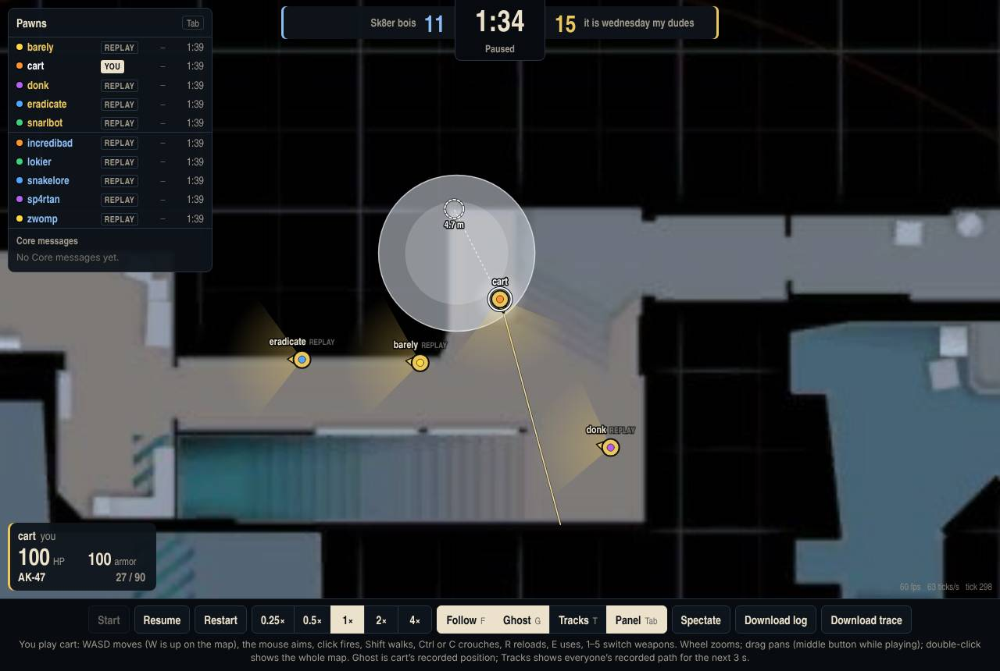

# Browser app (`src/app`, `index.html`)

One static page (Vite build, no framework, no runtime dependencies) that replays the round in 2D: a
human plays `cart` with keyboard and mouse, Core replays the other nine. Everything runs client-side;
the only requests are the page's own assets.


## Modules

| File | What it does | DOM? |
| --- | --- | --- |
| `session.ts` | `Session`: owns `Sim2DHost`, `ReplayCore` and the `SessionLog`; runs a tick; controls, human input, weapon-slot queue, restart, snapshot/restore, log and trace. `parseSessionData()` parses the three data files. | no |
| `loop.ts` | `FixedLoop`: 64 Hz accumulator, speed 0.25–4×, pause, per-frame cap. `RateMeter` for fps / ticks-per-second. | no |
| `input.ts` | Pure keyboard/mouse → `PawnInput` mapping, key bindings, `weaponForSlot`. | no |
| `radar.ts` | World ↔ radar ↔ screen transforms, `fitView`, yaw → screen direction. | no |
| `scene.ts` | `Scene`: what is drawn, built tick by tick (previous/current observe, statuses, kill feed, tracers, effects, pops, bomb, round end, Core logs); interpolation helpers. | no |
| `camera.ts` | Zoom, pan, follow, clamp; the camera → `View`. | no |
| `effects.ts` | `Effect` / `EffectsSource`; smokes, fires, flying grenades, pops and tracers as drawing primitives. | no |
| `hud-model.ts` | Mode badges, weapon names, view toggles, the clock / bomb timer and score (reads C3's `observe.round` when present), the status card. | no |
| `style.ts` | Palette and fonts shared by the canvas and the HUD (index.html mirrors them as CSS variables). | no |
| `input-dom.ts` | Thin listener layer: which bound keys and buttons are held, cursor position. | yes |
| `camera-dom.ts` | Wheel, drag, pinch and double-click/double-tap → camera calls. | yes |
| `renderer.ts` | `Renderer`: the canvas (radar cache, pawns, overlays, effects layer). `resize()`, `view`, `draw(frame)`. | yes |
| `hud.ts` | `Hud`: the DOM overlay (scoreboard and clock, kill feed, status panel, your status, rates). | yes |
| `main.ts` | Entry: loads data, builds the Session, runs the loop on `requestAnimationFrame`, feeds the Scene, wires the controls bar and view keys. | yes |
| `index.ts` | Barrel of the DOM-free parts, for Node (C5's headless harness). | no |

The DOM-free files hold the logic and are unit-tested in Node (`tests/session.test.ts`,
`tests/loop.test.ts`, `tests/input.test.ts`, `tests/scene.test.ts`, `tests/camera.test.ts`,
`tests/effects.test.ts`, `tests/hud-model.test.ts`).

```
requestAnimationFrame(now)
  ├─ InputDom (held keys, cursor) ─► input.ts ─► session.setHumanInput(PawnInput)   (cursor → world through renderer.view)
  ├─ loop.advance(now − last) ─► n × { act = session.step()
  │                                    observe → canonicalize → core.step → log.append → host.apply(+ human set_weapon) → host.tick
  │                                    scene.ingest(session.observe(), act, session.host.activeEffects()) }
  ├─ alpha = loop.pending / TICK_MS
  ├─ Renderer.draw({scene, alpha, model, clock, human, overlays, aim, fovDeg, nowMs})   (canvas)
  └─ Hud.update({scene, clock, human, you, phase, speed, panelOpen, tick, fps, tps})     (DOM)
```

## Session (`session.ts`)

```ts
const data = parseSessionData(roundJson, navJson, tuningJson);   // values or text
const s = new Session({ ...data, seed: 1 });                       // human: 'cart' (default) or null
s.step();                                                          // tick 0: Core sets the round up
s.setHumanInput(humanInput('cart', held, yaw));                    // used every tick until replaced
s.requestWeaponSlot(3);                                            // knife, on the next step
s.control({ type: 'pause', paused: true });
s.log().toText(); s.trace();                                       // JSONL; toReplayTrace(log)
const snap = s.snapshot(); /* … */ s.restore(snap); s.restart();
```

- **Per tick**, exactly the driver contract of `docs/contracts.md` and `docs/movement.md`:
  `o = canonicalize(host.observe())` → `act = core.step(o)` → `log.append(o, act, controls)` →
  `host.apply(act)` → `host.tick()`. The observe is canonicalized as A4 requires (`tests/fakes.ts`
  `runSession`), even though Sim2DHost already emits canonical numbers.
- **Armed on construction.** The constructor delivers `start` to Core, so the first `step()` (tick 0)
  logs `controls: [{type: 'start'}]` and emits the setup. The app steps once on load ("ready"), so the
  pawns are on their spots at tick 1 before Start is pressed.
- **Controls** go to Core when `control()` is called and are logged on the next step's line.
  - `start`, `pause`, `speed`: to Core only. The driver paces them (`FixedLoop`); Sim2DHost has no use
    for them.
  - `seek`, `checkpoint`, `rewind`: to Core (it throws "not implemented until B5") and then to the host.
  - `restart`: `Session.restart()`.
  - A control Core rejects (speed ≤ 0, B5 controls) throws and is not logged.
- **Human input.** `setHumanInput(input | null)` forwards to `Sim2DHost.setHumanInput`; the input
  persists until replaced. `null` hands cart back to Core. It throws while spectating.
- **Weapon slots (app-side action queue).** Keys 1–5 call `requestWeaponSlot(slot)`. On the next step
  each queued press becomes `set_weapon {id: human, weapon}` (`weaponForSlot`, against the host's
  inventory). It is appended after Core's actions in the Act given to the host.
  - It is **not** in the logged Act. In CS2 the human switches weapons natively, and the Replayer diffs
    Core's own output; the next observe shows the new weapon.
  - Likewise the human's `PawnInput` is engine-side and not in the log. A log with a human therefore
    replays against Core (tested in Node and on a log downloaded from Chrome), but it does not on its
    own reproduce cart's trajectory.
- **`restart()`** restores the snapshot taken at the end of the constructor: host and Core state,
  `start` pending, empty log, no human input, no queued slots, pause/speed at Core's defaults (the app
  re-sends speed when it isn't 1×). Running the same calls again gives a byte-identical log (tested
  with and without a human).
- **`snapshot()` / `restore()`** cover the whole driver state as plain JSON: host and Core snapshots,
  pending controls, queued slots, pause/speed, last Act and the log lines.
  - `restore` cuts the log back to the snapshot, so the log stays replayable and stepping on reproduces
    the original continuation byte for byte (tested: snapshot at tick 150, diverge, restore, continue).
  - Rebuilding a log costs a re-parse: about 0.11 s per 1,000 ticks (580 ms for a full round in Node).
    Restoring to the current log, or to an empty one, is free. B5's in-log rewinds (repeated ticks plus
    a `rewind` control) are a different mechanism.
- **Core factory.** `SessionConfig.core` (default `defaultCore`) builds the Core from
  `{model, schedule, tuning, seed, nav}`. If B2 adds a nav-based `WalkQuery` parameter to
  `ReplayCore`, `defaultCore` is the one line to change.
- `human: null` (spectate) puts `human: null` in every observe, and Core drives all ten pawns.

## Game loop (`loop.ts`)

- `advance(elapsedMs)` adds `elapsedMs × speed` to an accumulator and runs `floor(acc / 15.625 ms)`
  ticks, carrying the remainder, so the long-run rate is exactly 64 ticks per round-second at any frame
  rate. It returns the number of ticks run.
- **Cap:** at most `maxTicksPerFrame` (default 16 = 0.25 s of round time; enough for 4× down to
  16 fps). Extra whole ticks are dropped, not queued, and counted in `droppedTicks`, so after a tab
  switch the page does not freeze while it catches up.
- **Speed** is clamped to 0.25–4. **Pause** runs nothing and stops the time from piling up, so resuming
  never bursts.
- Pure: the caller passes the elapsed time, and the tests drive it with fake frame times (60 fps, a
  jittery 30–120 fps, 144 fps).

## Controls

| Input | Action |
| --- | --- |
| W A S D (or arrows) | Move relative to the **screen**: W = up = north, D = right = east, whatever way cart faces |
| Mouse | Cart faces the cursor (world coordinates) |
| Left / right button | ATTACK / ATTACK2 |
| Shift | WALK |
| Ctrl or C | DUCK |
| R / E | RELOAD / USE |
| 1 2 3 4 5 | Primary, pistol, knife, grenades (repeat to cycle), C4 (app-side `set_weapon`, see above) |
| F | Follow cart (the camera centres on him; from the full map it zooms to 3×) |
| G | Ghost: cart's recorded position now, as a hollow outline (on by default) |
| T | Recorded tracks: every pawn's recorded path for the next 3 s, and its recorded position now |
| Tab | Status panel (open by default on screens at least 900 px wide) |
| Mouse wheel / trackpad pinch | Zoom about the cursor (about the centre while following), 1–8× |
| Drag | Pan (left button while not playing, middle button any time); panning turns follow off |
| Double-click | Back to the whole map |
| Touch: drag, pinch, double-tap | Pan, zoom, back to the whole map |

WASD → forward/side: the screen direction `d` (diagonals normalized to length 1) is projected onto
the yaw frame of `docs/movement.md`: `forward = d · (cos yaw, sin yaw)`, `side = d · (sin yaw, −cos yaw)`
(+side = strafe right). So W at yaw 90 is forward 1, W at yaw 0 is side −1, and D at yaw 90 is side +1.
The test also checks, through `wishFromInput`, that the wish direction equals the screen direction at any yaw.

Keys are matched by `KeyboardEvent.code` (layout-independent). While the human plays, bound keys have
their default blocked, except with ⌘ held, so Mac shortcuts still work. On Windows/Linux, Chrome does
not let a page block Ctrl+W/T/N: crouch with C there. All keys are released when the window loses
focus. The grenade cycle order (he → flash → smoke → molotov) has not been checked against CS2.

**Controls bar:** Start (from the ready state), Pause/Resume, Restart (back to ready), speed
0.25/0.5/1/2/4×, the view toggles Follow / Ghost / Tracks / Panel (the F, G, T and Tab keys, as
buttons for touch), Spectate (rebuilds the session with `human: null` or `cart` and returns to ready),
Download log (JSONL), Download trace (JSON). Downloads are `Blob` URLs. Tab toggles the panel only
while focus is on the page, so it still moves focus inside the controls bar.

**Touch (iPhone):** there are no touch controls for the human (on-screen joystick and fire button are
out of scope). Touch-only devices (`(hover: none) and (pointer: coarse)`) start in spectate mode, and
the controls bar works by tapping; drag, pinch and double-tap move the camera. In landscape on a phone
the bar moves to a column on the right.

**URL parameters:** `?seed=<int>` (default 1) and `?human=cart|none` (overrides the touch default).

## Loading and bundle

`round.json` and `mirage-nav.json` are imported with `?url` and fetched in parallel with the radar
image, so they are cached separately and don't bloat the script. `tuning.json` (1.8 KB) is inlined.
Build output (`npm run build`):

| File | Size | gzip |
| --- | ---: | ---: |
| `index.html` (with the HUD's CSS) | 13.5 KB | 4.1 KB |
| `assets/index-*.js` | 112.7 KB | 39.0 KB |
| `assets/round-*.json` | 835 KB | 63.5 KB |
| `assets/mirage-nav-*.json` | 173 KB | 17.7 KB |
| `assets/mirage-radar-*.jpg` | 136 KB | (jpeg) |

That's about 260 KB over the wire with gzip (GitHub Pages compresses JSON). Of the script, C2's combat
code took it from 58.7 to 82.9 KB and D2's renderer, HUD and camera add 29.9 KB (10.3 KB gzip).

## Renderer and HUD (D2)



**Look.** Dark and quiet so the round reads at a glance: the replay page's "Mirage after dusk" palette
(`style.ts`, mirrored as CSS variables in `index.html`): night background, sand text, Ts warm gold
`#ebc75e`, CTs cool blue `#8bbcf3`, bomb red, defuse green. Magenta `#ff4fd8` is reserved for LIVE
pawns and used for nothing else. Names, numbers and badges use a condensed face (Avenir Next Condensed
on macOS and iOS; TeX Gyre Heros Cn / DejaVu Sans Condensed on the Linux test VM) with tabular figures;
log lines use the system face. No web fonts and no game UI assets: everything is drawn by the app.

**Canvas (`renderer.ts`),** bottom to top:

1. **Radar** through `radar.ts` and the camera. It is drawn once into an offscreen canvas at the current
   device scale, with a slight cool tint multiplied in so the marks pop, and blitted 1:1 each frame.
   The cache covers the visible radar plus a quarter-view margin on each side, and is rebuilt only when
   the zoom, size or devicePixelRatio changes or panning leaves it (1 rebuild in 3.5 s of the follow
   camera at 4×; at most 16 M device pixels).
2. **Smokes and fires** (`effectPrimitives`): a grey disc of the smoke radius with a light rim, swelling
   in after the pop and fading over its last 1.5 s; an orange disc with a dashed, flickering rim for a
   fire.
3. **Recorded tracks** (T): each pawn's recorded path for the next 3 s as a dotted line in its team
   colour, and its recorded position now as a small ring, with a thin line to the pawn when it has
   drifted more than 24 units (puppet drift and snaps show at a glance).
4. **Bomb** (planted): a red dot at the plant position that blinks faster as the timer runs down (once
   a second at the plant, about seven times a second at the end), with the time left beside it; a
   dashed green ring while someone defuses; green once defused.
5. **Death crosses** at each dead pawn's position, in its team colour, with a red ring for the first
   0.75 s.
6. **Shot tracers** from `shot` events: from the shooter along his yaw, ending on the pawn the same
   tick's `damage` event names, or at the first wall (bisection on `NavMesh.lineOfSight`, the same
   query C2's bullets use) or 1,800 units. They fade over 10 ticks (156 ms of round time).
7. **View wedges**: a soft cone of `tuning.ai.fovDeg` (106°) in the team colour.
8. **Ghost** (G): cart's recorded position at the render time (`RoundModel.trackAt`) as a hollow
   dashed outline. When he is more than 64 units away, a dashed link and the distance in metres
   (1 unit = 1 inch).
9. **Pawns**: a disc in the team colour with the player's own `round.json` colour (the CS2 radar
   colour) at its centre, and a pointer notch for the facing. The human's pawn has a white ring and a
   soft glow; a flashed pawn a white bloom while blind (`blindUntilTick`); a LIVE pawn a magenta ring and a pulsing halo; the bomb carrier (from C3's
   `observe.round`) a small red tag. A thin HP bar (green, amber at 50, red at 20) with armor under it
   appears once a pawn is hurt.
10. **Flying grenades and pops**: a small dot in the grenade's colour while in the air; a flash pops as
    a white flare, an HE as an expanding ring (a flying flash or HE that leaves `activeEffects()` has
    popped, at its `grenade` sound).
11. **Names and mode badges** above the pawns, nudged apart where they would overlap. Badges come from
    the latest `act.status` (`statusBadge`): REPLAY is a small dim "play" mark (spelled out from 2×
    zoom), **LIVE** a solid magenta tag, DEAD dim text, and the human's pawn none (it has the ring).
12. **Aim line** from the human's pawn to the cursor while playing.

**Interpolation.** After each `Session.step()` the Scene keeps the previous and the current observe;
each pawn is drawn `alpha = loop.pending / TICK_MS` of the way between them (yaw the short way round),
and the render time `prev.tick + alpha` drives the ghost, the tracks and every fade. A pawn that moves
more than 48 units in a tick (a teleport or snap) or dies is drawn where it is, not slid. Events of an
observe with tick N are stamped N − 1, the tick the render time is in right after the step.

**Camera** (`camera.ts`, `camera-dom.ts`). Full map by default. Zoom is 1–8× about the cursor; zoomed
in, the radar may leave at most a quarter of the canvas empty (or stick out a quarter where it is
narrower than the canvas), so the point under the cursor stays put (1.3 px in the browser check). F
follows cart with a 90 ms exponential ease. The renderer's `view` is always the camera's, so
`input-dom.ts` aims correctly at any zoom (checked at 4.7× while following).

**HUD** (`hud.ts`, DOM over the canvas; crisp text, CSS layout; elements are rewritten only when their
text changes):

- **Top centre:** CT name and score, the clock, T score and name. The clock is `RoundClock.hudClock`;
  after the plant it turns red and shows the bomb timer (`hudBomb`) with a draining bar; green once
  defused. The line under it says "Press Start", "Paused", the speed when not 1×, "Bomb planted", the
  winner, or else the round ("Round 12/30"). The score is 11–15 plus this round's winner. With C3,
  clock, bomb and score come from `observe.round` (`clockView`, `scoreView`).
- **Kill feed, top right:** "killer [weapon] victim" with a drawn headshot mark, names in team colours,
  the newest at the bottom; the last 5, each for 5 s of round time (so a pause freezes it). Kills
  involving the human get a red outline.
- **Status panel, left (Tab):** each pawn's mode badge, trigger and since-time (the round clock at
  `sinceTick`), Ts then CTs; then the last 20 Core `log` actions, newest first. Collapsed by default on
  phones.
- **Your status, bottom left:** cart's HP (amber, then red as it drops), armor, weapon and clip /
  reserve ("spectating" when nobody plays him).
- **Bottom right:** frame rate, ticks per second and tick.

`prefers-reduced-motion` turns off the pulsing rings (LIVE halo, bomb pulse, fresh deaths); the static
marks stay.

## Worker decision

**Stay on the main thread.** `npm run bench:session` steps a full recording (`meta.durationSec` × 64 =
5,137 ticks), spectating, three runs each, timing every `session.step()` in Node 22 on a 2-vCPU 2.1 GHz
Xeon (cloud VM; an M-series Mac is faster):

| Core | mean | p50 | p90 | **p99** | p99.9 | max | log size |
| --- | ---: | ---: | ---: | ---: | ---: | ---: | ---: |
| B1 `ReplayCore` (pawns stand still) | 0.24 ms | 0.21 ms | 0.25–0.30 ms | **0.63–0.70 ms** | 0.8–2.7 ms | 1.2–6.7 ms | 18.7 MB |
| Stand-in for B2: every pawn runs and turns (`RunningCore`) | 0.89–0.98 ms | 0.90–0.94 ms | 1.10–1.27 ms | **1.28–1.96 ms** | 1.4–4.1 ms | 1.5–11.9 ms | 20.4 MB |

p99 is under 2 ms in both, so the Session stays on the main thread. At 4× (256 ticks/s) the running
stand-in uses about 0.24 s of main-thread time per second, about 4 ms per 60 Hz frame. Single max
values are GC pauses and JIT warm-up.

In the running case, `host.tick()` (movement and nav clamping) is 0.70 ms of the 0.94 ms. The JSON
work is 0.24 ms: canonicalizing the observe 0.09 ms, the log line 0.11 ms, and `apply`'s canonicalize
0.05 ms. Re-run `npm run bench:session` after B2/C2 land. If p99 passes 2 ms, move the `Session` into
a Worker: it is DOM-free, and the page needs only `observe()`, `lastAct`, the clock and the downloads.

## Browser check

`npm run build && npm run check:browser` (`tools/browser-check.ts`; playwright-core 1.63 with its
Chromium from `PLAYWRIGHT_BROWSERS_PATH`, `npx playwright-core install chromium`, or `CHROME_PATH`).
Screenshots and downloads go to `logs/browser-check/` (gitignored). Results in headless Chromium
153.0.8010.12 on this VM:

- **(a) Ready** (`a-desktop-ready`): the radar, ten pawns on their start spots, clock 1:39, tick 1.
  **After Start:** 1:36 after about 3 s (tick ≈ 194).
- **Human:** with the mouse east of cart, holding S for 1 s moves him 211 units south with x unchanged
  (screen-relative), and he faces the cursor. Key 3 switches to the knife. Both downloads work: a log of
  ~290 lines is about 1.1 MB, and its trace is 11.6 KB.
- **Rate at 4× over 10 s with every overlay on** (tracks, ghost, status panel, follow camera at 3×):
  **60.0 fps, 256.1 ticks/s** (target 256; runs gave −0.08 % to +0.09 %), 0 dropped ticks. Spectating
  with the follow camera moving with cart, every overlay on: **60.1 fps, 256.5 ticks/s** over 3.5 s,
  1 radar-cache rebuild.
- **(b) Spectating at 20 s with the tracks overlay** (`b-desktop-spectate-tracks`, the image at the
  top): the Ts are coming out of Apartments toward B. Six wheel notches about a point zoom to 3.8× and
  move the point under the cursor by 1.3 px (`b2-desktop-spectate-zoomed`).
- **(c) Follow camera zoomed in on cart** (`c-desktop-follow-zoomed`, the image above): cart throws a
  smoke (a real `activeEffects()` cloud), steps into the corridor and fires along the longest clear line;
  aiming through the zoomed, following view turns him to within 0.01° of the cursor; the screenshot is
  paused on the frame after a shot, so its tracer shows.
- **(d) Phone viewport** (`d-phone-spectate`, 390×844, DPR 3, touch): starts in spectate mode with the
  panel collapsed; the scoreboard sits above the map and your status below it; the controls wrap into
  four rows.
- **Determinism:** the spectate log from Chrome has the same digest as a Node run of the same length,
  and the desktop log (with a human) replays identically in Node against the app's Core (`defaultCore`:
  with the nav walk query; the check used a bare `ReplayCore` before, which stopped matching when B2
  turned the puppets on).
- No console errors, and no requests outside the page's origin.

**Safari (macOS / iOS) was not tested**: there is no WebKit in this environment. Things to check on
the iPhone are the layout with Safari's toolbars (`100dvh`, safe areas), downloads (iOS shows a
download sheet for the Blob link), and the JavaScriptCore vs. V8 numeric caveat in `docs/movement.md`.

## Known issues and notes for later tasks

- ~~**Start yaws are lost on tick 0 (Core, B1/B2).**~~ Fixed in B2: on the setup step every REPLAY
  pawn gets the yaw of its setup `teleport` (eradicate faces 167.2° in the screenshots).
- ~~Sim2DHost v0 merges duplicate grenades into one inventory entry.~~ Fixed in C2: each grenade `give` adds its own entry (cart has two smokes), and throwing removes one (`docs/combat.md`).
- **C3 wiring** (bomb and round rules): `hud-model.ts` reads `observe.round` through `roundStateOf()`
  (`{phase, score, winner, reason, endTick, timeLeftSec, bomb: {state, carrier, pos, plantTick, defuser,
  defuseEndTick}}`) for the clock, the bomb timer and dot, the score and the carrier tag. Until then the
  clock falls back to `RoundClock` and the Scene's `bomb` / `round_end` events. Check after C3 lands:
  the `bomb.state` strings (`defused`, `exploded`, `defusing` are assumed) and whether `timeLeftSec`
  is the round clock (it is shown as m:ss before the plant). A defuse progress arc could use
  `defuseEndTick`; today it is a dashed ring.
- **Effects** are wired to `Sim2DHost.activeEffects()` (`EffectsSource`) and flashed pawns to
  `Sim2DHost.blindUntilTick()` (`BlindSource`).
- **Ideas for the Session / frame API:** `Session.step()` could return the post-tick observe with the
  Act (the app calls `observe()` right after every step, and the host builds it twice per tick); an
  `effects()` on Session would save the app reaching into `session.host`; and a per-tick `events`
  stream (or the Act's `log` actions with their tick) would let the Scene skip re-reading.
- `window.__cs2replay` has `stats()` (now with overlays, camera and radar-cache rebuilds), `session()`,
  `scene()` and `screenOf(x, y)`; `tools/browser-check.ts` uses them.
