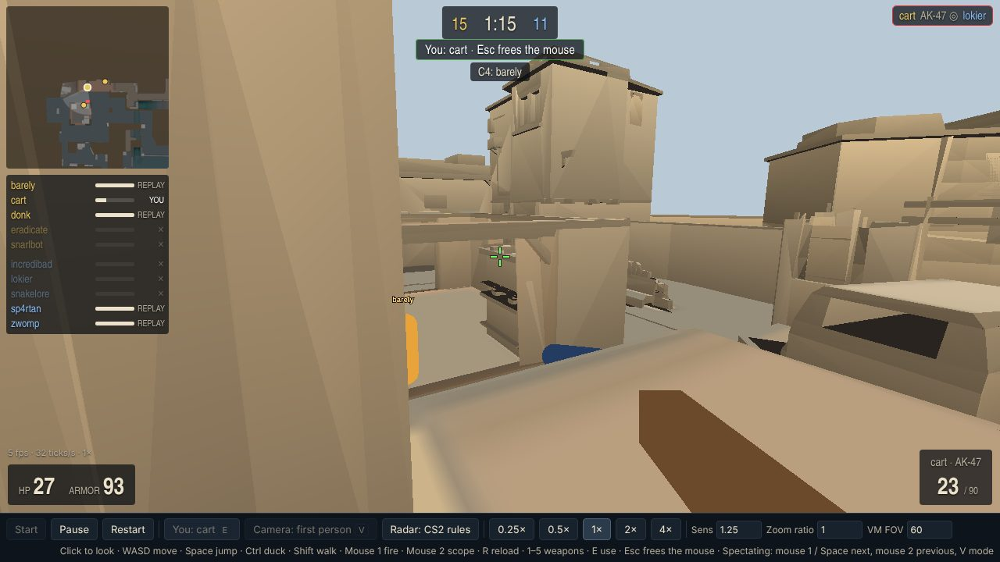
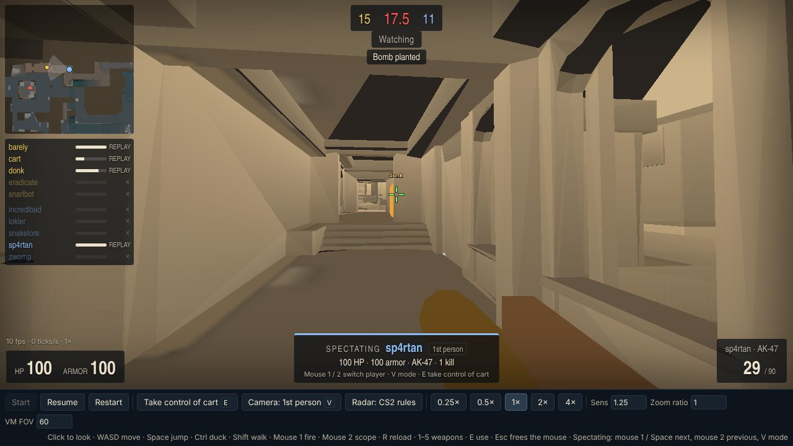
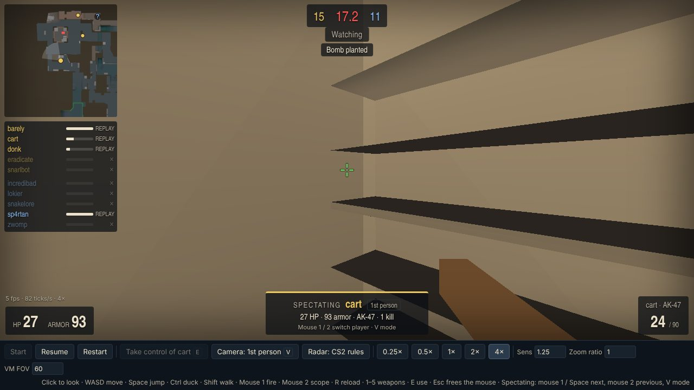

# The 3D app (H1)

`src/app3d` + `sim3d/index.html`: the round in first person on CS2's Mirage, published at
`https://johnjp15.github.io/cs2/sim3d/` behind the same lock as the 2D page (`cs2/sim/`, unchanged). The engine is
`Sim3DHost` (docs/sim3d.md) in the 2D app's own `Session` (src/app/session.ts: checkpoints, takeover, the input tape,
seek), so watching, taking control and restarting behave exactly as in 2D.

```sh
npm run dev:3d            # http://localhost:5173 (the 3D page)
npm run build:3d          # dist-3d/ (npm run preview:3d serves it)
npm run build:single:3d   # dist-single-3d/index.html: one self-contained page
npm run check:browser:3d  # after build:3d: headless Chromium, screenshots, fps, takeover and firing (port 4180)
```


## What's on screen

- **World**: the CS2 collision mesh (data/geometry/mirage-geometry.bin, no player clips), flat shaded, in Mirage's
  colours (below). Sky and distance fog.
- **Players**: capsules in team colours (T yellow-orange, CT blue; the human lighter), a dark visor at eye height
  along the view, crouched shorter, the dead lying flat and grey; name tags over the viewer's living teammates, and
  over an enemy only while the viewer sees it (`sees`: never through walls). The viewer is the human, else the
  spectated player.
- **Effects**: 3D tracers of the last 10 ticks' bullets (`Sim3DHost.shots()`), the muzzle flash on the viewmodel,
  smokes (grey domes), molotov fires (orange discs), grenades in flight, the bomb (red, blinking when planted).
- **First person**: the camera at the eye, a box viewmodel coloured by weapon drawn in its own pass and camera
  (viewmodel_fov), crosshair, hit marker (white; red for a headshot), the scope overlay while zoomed.
- **HUD**: score and round clock (the bomb timer once planted, red; green while defusing), the bomb line (carrier,
  planted, who is defusing and how long is left, defused), the kill feed, the radar minimap (the CS2 radar around the
  camera, every pawn as a dot, the view cone), the team panel (HP bar, mode: REPLAY / LIVE / YOU), HP / armor and
  weapon / ammo of the pawn being viewed, the mode line, fps and ticks/s, and the end-of-round summary line 2 s after
  the round end. While spectating: the spectator panel and an edge vignette (below).
- **Bar**: Start, Pause, Restart, Take control of cart (E), Camera (V), Radar (CS2 rules / show everyone), speed
  0.25–4×, and the settings (CS2's sensitivity, zoom_sensitivity_ratio, viewmodel_fov, and **Recoil tracking**; these
  and the radar toggle are kept in localStorage, `cs2-sim3d-settings`).

## Controls

Watching (default, every device) and dead: spectating, as CS2 (below). P pause.

**E** or the button takes control of cart from that tick (the speed drops to 1×; the pointer is locked): mouse look,
W / S forward / back and A / D strafe relative to the view (CS2's), Space jump, Ctrl or C duck, Shift walk, mouse 1
fire / throw, mouse 2 scope (the input's ATTACK2: the scope is the engine's, H2b: levels and FOVs from
data/weapons.json, scoped accuracy and speed, a reload or a bolt cycle drops it), R reload, 1–5 weapon slots (as the 2D app), E use (plant, defuse). Esc frees the mouse. Dead,
the camera spectates again (your living teammates first, as CS2 competitive's mp_forcecamera 1). G (drop) is not implemented: the engine has no dropped weapons yet (H4).

## Spectating (U1)

`src/app3d/spectate.ts` (pure), `main.ts`, `hud3d.ts`. Watching (nobody controlled) or dead:

| Input | First person (default) | Third person | Free fly |
| --- | --- | --- | --- |
| Mouse 1 / Space | next player | next player (the click that grabs the pointer only grabs it) | mouse 1: first person on the next player (once the pointer is grabbed); Space flies up |
| Mouse 2 | previous player | previous player | first person on the previous player |
| Mouse | nothing (the view is theirs) | orbits | looks |
| V | → third person | → free fly | → first person |
| Z / X | previous / next player (kept from H1) | same | same |
| E | take control of cart (when allowed) | same | same |

- **First person** is through the spectated player's eyes exactly as they'd see it: their eye height (duck eased),
  view angles (interpolated), their viewmodel (the box gun, flashing when they fire), their HP / armor / weapon /
  ammo in the HUD, and their crosshair at their aim, moving with the recoil-tracked camera, the scope overlay
  instead while scoped. The angles, crosshair and scope come from `Sim3DHost.aimView(id, view, tracking)` (H2b's
  weapon mechanics: camera = view + tracking × the recoil + the screen shake, crosshair = where the next bullet goes;
  `spectatedView` in main.ts, with the viewer's Recoil tracking setting). The crosshair offset is the projection of the aim
  direction through the camera (`aimOffsetPx`). No crosshair in third person or free fly.
- **Who**: watching, every living player in id order; dead, your living teammates (everyone once they're dead).
  When the spectated player dies the camera moves on after 2 s.
- **Unmistakable**: the line under the score says "Watching" (or "You: cart (dead) · spectating") vs "You: cart";
  the bottom panel says SPECTATING and the name in team colour, with the mode (1st person / 3rd person / free camera),
  HP, armor, weapon, kills this round and the controls' hints; a soft vignette darkens the screen edges. The panel's
  text nodes are written only when they change.

## Radar (U1)

`src/app3d/radar3d.ts` (pure; tests/app3d-radar.test.ts) feeds every tick's `Observe` to both teams' spotting; the
minimap (redrawn at 10 Hz) shows the viewer's team view: the human's team, else the spectated player's.

| Rule (CS2 rules, the default) | Value | Source |
| --- | --- | --- |
| Teammates | always shown | [SPOT] cs_player.cpp: a player's spot rules are SPOT_RULE_ENEMY \| SPOT_RULE_ALWAYS_SEEN_BY_FRIEND |
| Enemy spotted | while any living teammate (you included) sees it (`sees`: FOV, walls, smoke) | [SPOT] cs_entity_spotting.cpp CanPlayerSeeTargetEntityFunctor |
| Spotting cadence (the dot appears and lingers up to this late) | 0.5 s (`SPOT_INTERVAL_S`; every 32 ticks) | [SPOT] `ENTITY_SPOT_FREQUENCY 0.5f` |
| Last seen | the dot becomes the "?" ghost at the last spotted position, fading linearly over 6 s (`GHOST_FADE_S`) | [RADAR] `GHOST_FADE_TIME 6.0f`, SetupIconsFromStates |
| Dead | an X at the death position, fading over 4 s (`DEAD_FADE_S`); an enemy only if it was spotted when it died | [RADAR] `DEAD_FADE_TIME 4.0f` |
| Bomb carrier | the bomb icon on the carrier's dot (Ts always; CTs while the carrier is spotted) | [RADAR] HasC4 → m_bBombIsSpotted; [SPOT] weapon_c4.cpp SPOT_RULE_CT \| SPOT_RULE_ALWAYS_SEEN_BY_T |
| Dropped bomb | Ts only (the sim has no bomb spotting for CTs) | [SPOT] weapon_c4.cpp |
| Planted bomb | everyone (`PLANTED_BOMB_FOR_ALL`; the brief: CS:GO's rule would need a CT to spot it) | — |

Sources: the CS:GO source as mirrored in SwagSoftware/Kisak-Strike (commit `4c2fdc31`, read 2026-11-07):
**[RADAR]** `game/client/cstrike15/Scaleform/HUD/sfhudradar.cpp`, **[SPOT]** `game/server/cstrike15/`. CS2's radar
code isn't public; it shows the same "?" and fading X, but the timings are **unverified** for CS2 (hence tunables).
"Radar: show everyone" (the toggle) draws every pawn, the dead as X without fading, and the bomb always.

## View: CS2's numbers, with sources

`src/app3d/view-cs2.ts`. Primary sources: **[CVARS]** CS2's convar dump, SteamDatabase/GameTracking-CS2
`DumpSource2/convars.txt` (commit `cce7bf1f`, fetched 2026-11-07); **[SDK]** Source SDK 2013
(ValveSoftware/source-sdk-2013: `src/game/client/in_mouse.cpp`, `view.cpp`, `src/game/shared/shareddefs.h`,
`gamemovement.cpp`).

| What | Value / rule | Source | Verified for CS2 |
| --- | --- | --- | --- |
| Mouse → yaw | yaw −= m_yaw × counts_x × sensitivity | [SDK] CInput::ScaleMouse, ApplyMouse | rule: Source; values: [CVARS] |
| Mouse → pitch | pitch += m_pitch × counts_y × sensitivity (mouse down = look down) | [SDK] ApplyMouse | as above |
| m_yaw, m_pitch | 0.022° per count | [CVARS] `m_yaw 0.022`, `m_pitch 0.022` | yes |
| sensitivity | default 1.25, range 0.0001–8 (settings field, `?sens=`) | [CVARS] | yes |
| Acceleration, smoothing | none (m_customaccel 0, no filter) | [SDK] ScaleMouse with m_customaccel 0 | CS2 has no mouse accel option in its dump: yes |
| Pitch limit | ±89° | [CVARS] `cl_pitchup 89`, `cl_pitchdown 89` | yes |
| FOV | 90° horizontal at 4:3, hor+: vertical 73.74° fixed, 106.26° horizontal at 16:9 | [SDK] `ScaleFOVByWidthRatio` (view.cpp); 90 = CS:GO's default_fov | the 90: **unverified** against a CS2 primary source (CS2 locks the FOV; `fov_desired 75` in the dump isn't applied in matchmaking) |
| Scoped FOVs | AWP 40 / 10, SSG 08 40 / 15, AUG and SG 553 45, autosnipers 40 / 15 (4:3 degrees) | CS:GO weapon data `zoom_fov_1/2` as documented by players | **unverified** for CS2; H2's table replaces them |
| Zoomed sensitivity | sensitivity × (zoomed FOV / 90) × zoom_sensitivity_ratio (linear in the FOV) | [SDK] view.cpp (`m_flFOVSensitivityAdjust`); [CVARS] `zoom_sensitivity_ratio 1` (0.01–3) | rule: Source; the default: yes |
| viewmodel_fov | 60, 60–68 (a 4:3 FOV, hor+ like the world's) | [CVARS] `viewmodel_fov 60 (min 60, max 68)`; [SDK] `fovViewmodel = ScaleFOVByWidthRatio(...)` | yes (CS:GO allowed 54) |
| Aim punch | bullets: view + punch × weapon_recoil_scale (2) + the inaccuracy cone; camera: view + punch × 2 × view_recoil_tracking (default 0.45, the **Recoil tracking** setting, 0–1) + the view punch (screen shake); crosshair: at the bullets' direction (view + punch × 2). The punch is H2's (src/engine/weapons), in the host since H2b | CS:GO cvars | **unverified** (both are hidden in CS2: not in the dump) |
| Eye height | 64 standing, 46 ducked | Source view offsets (`damage.eyeHeight`) | as the sim |
| Duck transition (camera) | 0.4 s down, 0.2 s up, SimpleSpline (3x² − 2x³) | [SDK] TIME_TO_DUCK, TIME_TO_UNDUCK, SetDuckedEyeOffset | **unverified** for CS2 (the shared movement ducks the hull at once; M1 owns that) |

**Mouse counts.** The page uses pointer lock and reads `movementX / movementY`. It first asks for
`requestPointerLock({ unadjustedMovement: true })` (Chromium: raw mouse counts, the OS pointer acceleration bypassed,
like CS2's raw input; `view().raw` says whether it was granted); Safari and Firefox ignore or reject the option, so
there the deltas are the OS pointer's pixels: with the OS acceleration off and 1:1 pointer scaling one pixel is one
count. DPI changes counts per inch, not this formula (cm/360 = 360 / (0.022 × sensitivity × DPI) × 2.54).

**Firing (H2b).** The human's input carries the plain view (yaw, pitch). The host's weapon mechanics
(src/engine/weapons, docs/weapons.md) add the aim punch × 2 and the inaccuracy / spread cone to every bullet, punch
the view, tag on hits and own the scope; the app only draws what `Sim3DHost.aimView` returns, so nothing in the
headless host depends on the view code.

**Recoil tracking** (settings field, 0–1, default 0.45; CS:GO's `view_recoil_tracking`, hidden in CS2): how much of
the recoil the camera follows, i.e. "how much the screen moves vs how much the crosshair moves". The bullets don't
change: they always go to view + punch × 2, and the crosshair is drawn there. At 0.45 (CS:GO / CS2 feel) the camera
climbs with 45 % of the spray and the crosshair climbs the rest on screen; at 0 the screen stays still (only the
screen shake) and the crosshair alone climbs the full pattern; at 1 the camera follows the bullets and the crosshair
stays at the centre. Kept in localStorage with the sensitivity (`recoilTracking`). `npm run check:browser:3d` checks
the kick and recovery (screenshot app3d-g-spray-kick.jpg) and the 0 / 1 ends of the setting.

## Frames

Source: x east, y north, z up; yaw counter-clockwise from +x; pitch positive = down. Three.js: y up. The mapping is
the rotation (x, y, z)_Source → (x, z, −y)_Three (src/app3d/coords.ts; determinant +1, so windings are kept): Three
+x east, +y up, −z north. The camera uses Euler order YXZ with y = yaw − 90° and x = −pitch (tests/app3d-view.test.ts
checks it against the view direction).

## World colours

`src/app3d/world-mesh.ts` (pure; tests/app3d-world.test.ts). Up and down are decided by space, not the normal (the
mesh's winding is inconsistent): a near-horizontal triangle (|nz| ≥ 0.7) with free space 24 units above its centre is
a floor, otherwise an underside (dark). Floors are drawn with the CS2 radar (data/source/cs2/de_mirage.png) as their
texture, UVs from the radar transform (`px = (x − pos_x) / scale`, `py = (pos_y − y) / scale`, pos −3230 / 1713,
scale 5), after `floorArt` maps the stylized radar onto Mirage's sand: its brightness (boxes, steps, outlines) and
30 % of its hue (the levels, the wooden and tiled areas) survive; outside the playable area plain sand. Floors with
something solid within 256 units above are indoors and darker (Apartments, Connector, the underpass). Walls are a
sandstone ramp by height, shaded by how much they face the sun (two-sided), tinted 30 % toward the floor colour in
front of them, darker toward their foot, with ±3 % grain per triangle. The mesh is cut into 1024-unit tiles so the
renderer culls what is off screen; everything is unlit at run time (colours baked), ≈ 73k triangles.

## Data, build and deploy

Normal build: the JSON and binary files are fetched next to the page (assets3d.ts). Single file
(vite.single.3d.config.ts): `./assets3d` is redirected to `assets3d-embedded.ts`; the round, nav, sight mask, tracks,
movement mesh and clips are gzip + base64, the radar a data: URI, Three.js (0.187) bundled into the inlined script;
the build fails if anything but index.html is written. **Sizes**: dist-single-3d/index.html 1,488 KB (gzip 739 KB),
locked by cs2/tools/encrypt.cjs ≈ 1,990 KB (budget 3 MB; the 2D locked page is ≈ 1.5 MB). `tools/stage-web-apps.sh`
stages both pages (`cs2/sim/`, `cs2/sim3d/`) and adds the sim3d card and README row once; the web-apps workflow
(`git add -A cs2`) needs no change.

## Test API

`window.__cs2sim3d.test` (src/app3d/main.ts), for automated comparisons (V0's frame-by-frame check against the
round's video) and screenshots. Deterministic: the same tick, camera and viewport give the same pixels (the check
renders twice in two browsers and compares: identical).

| Call | What it does |
| --- | --- |
| `freeze(true)` | the frame loop stops drawing (and a running round pauses); `freeze(false)` resumes drawing |
| `seekTick(k)` | runs (or rewinds through the Session's checkpoints) the round to observe tick `k`, synchronously; returns the tick reached; tracers are cleared, the round is left paused |
| `eyes(id)` | the camera through a player's eyes: its sim position, eye 64 / 46, its sim yaw / pitch |
| `pose(x, y, z, yaw, pitch)` | a free camera (Source units and degrees: yaw counter-clockwise from +x, pitch + = down) |
| `render()` | draws one frame now, exactly at the current tick: no interpolation between ticks, the duck eased fully, effect animations at time tick × 15.625 ms, no muzzle flash or hit marker; returns `state()` |
| `state()` | `{tick, t, phase, camera: {mode, followed, eye, yaw, pitch, vfovDeg, hfovDeg, width, height}}` of the last frame drawn |

Example: `const t = window.__cs2sim3d.test; t.freeze(true); t.seekTick(1184); t.eyes('cart'); t.render();` then
screenshot `#view`. The other hooks (`stats`, `session`, `takeControl`, `aimAt`, `mouse`, `camera`, `fly`, `seek`,
`view`, `summary`) are the browser check's.

## Browser check

`tools/browser-check3d.ts` (port 4180, or `--port <n>` / `CHECK3D_PORT`; `--single` serves the single file). It screenshots (a) the start, (b) Lokier
at B from cart's window (18.5 s, cart's eyes), (c) the plant (27.6 s, behind barely), (d) Sp4rtaN behind donk
(49.95 s), (e) the defuse (64 s), (f) first person after taking control; checks the FOV (vertical 73.74°), that E
takes control (YOU, 1×), that mouse counts turn the view by exactly counts × 1.25 × 0.022°, and that mouse 1 fires
(ammo drops); measures fps and ticks/s at 1× and 4×. U1's spectating checks: at the start cart's radar shows the five
Ts and exactly the CTs a T sees (the rest hidden), the toggle shows all ten and is stored; first person through
Sp4rtaN's eyes shows his HP / armor / ammo / weapon, the crosshair, the panel ("SPECTATING sp4rtan 1st person"),
the vignette and "Watching"; mouse 1 / mouse 2 / Space switch player; V cycles 1st → 3rd (no crosshair) → free →
1st; playing on at 4×, an enemy spotted earlier turns into the "?" ghost. Screenshots `app3d-spectate-*.jpg`.

WebGL in the sandbox's headless Chromium is software (lavapipe or SwiftShader) on two shared cores: a bare WebGL
canvas that only clears reaches 26–50 fps at 1280 × 800 and 56–60 at 640 × 400, so the frame rate is measured at
640 × 400 (the rendering itself is cheap: 37k triangles in 0.7 ms with `gl.finish`). On a machine whose load per
core is above 1.25 during the run (other agents' test suites), the rates are reported but not asserted. Results:
logs/browser-check3d.json; the numbers of the H1 run are in the PR.







