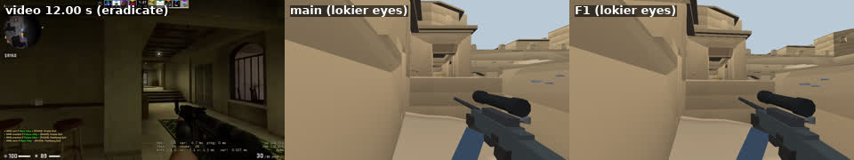
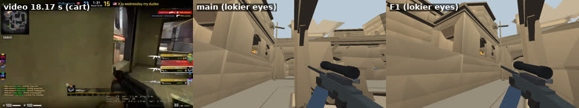
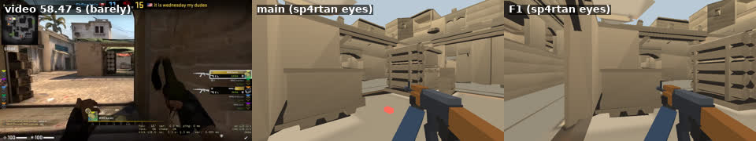

# Fights: an audit of every fight's aim, and the fix (F1)

John (17:41): "The fight interactions look really shaky at the moment. Sometimes some players are looking the wrong way
and then snap onto the target when they appear, like they're aimbotting." This is the audit of every fight of the
recorded round (both participants), what was wrong, and how puppets aim now (`src/core/fight-aim.ts`, `docs/core.md`
"Aim").

## How it is measured (`tools/fight-audit.ts`)

`npx tsx tools/fight-audit.ts [--scenario fixtures/scenarios/<name>.json] [--json out.json]` runs the 3D harness (the
golden master without `--scenario`) and, for every kill in the run, both ways round (killer → victim, victim → killer):

- **LOS**: first tick of the last unbroken line of sight (MeshSight, eye to body, *no* field-of-view limit, smokes
  included) that reaches the kill: the moment the enemy "appears". **sees**: the same for the engine's `sees` (106°
  field of view), i.e. the moment the viewer notices him.
- **Error at LOS**: yaw / pitch from the viewer's view to the other's head at the LOS tick: how far off the angle the
  viewer was looking when the enemy appeared.
- **Max °/tick**: the largest per-tick yaw / pitch change from 3 s before LOS to the kill. At 64 tick a change over
  ~25°/tick (1,600°/s) is a visible snap; `snaps` counts them. The tool also lists every such change in the whole run.
- **On target**: seconds from LOS until the view is within 2° (yaw and pitch) of the head: the flick.
- **1st shot**: the first `shot` event, and the yaw error of the view that fired it. Shots are scripted on the tape's
  ticks (the golden master), so they never move; the error says whether the tracer leaves toward the target.

## The fights on the tape

| Video s | Fight | What the tape and the video show |
|---|---|---|
| 0.50 | snarlbot → incredibad (Palace Alley) | clip start; no sighting recorded |
| 12.40 | snarlbot → snakelore (A ramp) | snarlbot saw him 12.0–12.4 (off-radar arrow) |
| 12.75 | Lokier (SSG 08, Truck) → eradicate (Apartments), HS | eradicate's POV: he holds the corridor steadily, no turn, Lokier spotted 12.5; dies 0.25 s later |
| 17.85 | sp4rtan (Deagle) → snarlbot (A site) | no sighting; in the sim there is no line of sight at all (a scripted hit through geometry, `docs/vision.md`) |
| 18.50 / 18.80 | Lokier → cart 73; cart → Lokier HS | cart's POV (6 fps sheet 17.4–18.85): he walks to the Apartments window, looks out at B, the turns between views are smooth (at most ~90° in 0.17 s, ≈ 8°/tick); Lokier seen 17.45 |
| 44.20 | barely → Zwomp (stairs / Catwalk) | camera on cart in Shop (holding a wall): no view of it; Zwomp seen 44.0 |
| 49.90–50.35 | sp4rtan (AK) sprays donk (Apartments) | donk's POV: scoped east into the Apartments room, he barely turns while the four hits land (100 → 73 → 39 → 13 → 0) |
| 58.85 | sp4rtan → barely (B site), HS | barely's POV: molotov out, a steady view across B toward the boxes, no turn; sp4rtan seen 58.6, dead 0.25 s later |
| 69.40 | sp4rtan → cart (post-round) | cart's POV: he sprays at sp4rtan from the Shop door |

Every human view on the tape is steady or turns smoothly; nobody snaps. The shooters the video doesn't show (Lokier,
sp4rtan, Zwomp) are inferred: they held the angle the enemy came from (Lokier on the Apartments window, sp4rtan on the
B entrances) and corrected by a few degrees.

## What was wrong (main at e1c41ad, with V2's fitted views)

- **21 view changes over 25°/tick** in the no-human round (17 in `never-peeks`, 11 in `peek-before-eradicate`), all
  REPLAY puppets: B3's scripted aim turned at a constant 30°/tick (1,920°/s) from wherever the puppet happened to look
  the moment the aim window opened (0.35 s before the first press). Lokier turned 3 ticks in a row at 30° onto cart at
  18.16 s (V2 has him hold his angle until then, 85° away); sp4rtan 3 ticks onto donk (49.55) and onto barely (58.45);
  barely onto Zwomp (43.25); donk (49.50); snarlbot at 0.16 and 12.06; cart onto Lokier (18.16); sp4rtan onto the bomb
  when the defuse look began (61.45, 30° yaw and pitch).
- **Looking the wrong way when the enemy appears**: outside the 0.35 s window a puppet faced its walking heading (or the
  held angle), so at first sight Lokier was 85° / 12° (yaw / pitch) off cart, sp4rtan 34.5° off donk and 33° off cart,
  snarlbot 23° off snakelore, and the view then snapped.
- **Turning away after the kill**: the moment the window closed the view went straight back toward the walking heading
  at 12°/tick (no moment on the fallen target).
- **LIVE bots** (`src/sim2d/ai.ts`, in `never-peeks` and `peek-before-eradicate`): at most 12°/tick (G8's combat
  rate), no snaps over 25°/tick, so `ai.ts` is unchanged (its turn is linear, not eased; see "Not done").

## The fix (`src/core/fight-aim.ts`; rules in `docs/core.md` "Aim")

1. **Pre-aim the angle.** From `aimLeadSec` (1.5 s) before an engagement's anticipated sight the shooter holds where
   the target will appear, head-high: the target's recorded position at the tape's first sighting of the pair (when it
   is at most 1.5 s before the aim window), else at the window's start. Once the target is in his `sees` he tracks it.
2. **Eased, rate-limited motion.** Every scripted look moves by a critically damped ease (smooth time 0.06 s onto a seen
   target, 0.12 s for pre-aims, holds, the defuse look and the ease back) that speeds up by at most a third of the peak
   per tick and peaks at 18°/tick: to within 0.5°, a 10° correction takes 0.16 s, a 90° flick 0.23 s.
3. **Reaction and shot.** Shots stay on the tape's ticks. Before each ATTACK the ease tightens (smooth time ≤ half the
   ticks left), so the view arrives on the target just before the shot and is exactly on it on the ATTACK tick (≤ 3°
   closed there).
4. **After the kill** the shooter stays on the target for 0.4 s, then eases back to the puppet's own look.
5. **V2 (`tracks.<id>.view[]`)**: a shooter with a fitted video view keeps it in the lead-in and after phases
   (`fittedViewAt` on `RoundModel.viewTrack`: cart before Lokier, donk before sp4rtan); only the aim windows are this
   rule's.
6. **The scheduled encounter (B4)** that replaces Lokier's hit on a human cart gets the same lead-in: Lokier holds the
   window from 15.95 s (1.5 s before the recorded sighting) instead of from the aim's start (18.14 s), so he sees cart
   the moment cart is in sight there (tick 1138, as before V2) instead of turning onto him late (1163).

## Before / after (no-human round, 3D harness; before = main e1c41ad with V2, after = this branch)

| kill (s) | viewer → other | LOS (s) | sees (s) before → after | yaw / pitch error at LOS (°) before → after | max °/tick yaw / pitch before → after | snaps > 25°/tick | on target (≤ 2°) after LOS (s) | 1st shot (s), yaw error at it (°) before → after | max °/tick in 1 s after the kill |
|---|---|---|---|---|---|---|---|---|---|
| 0.50 | snarlbot → incredibad | 0.00 | 0.16 → 0.00 | 0.0 / 0.0 → 0.0 / 0.0 | 30.0 / 30.0 → 0.7 / 3.9 | 2 → 0 | 0.00 → 0.00 | 0.50, -0.3 → -0.4 | 12.0 → 1.5 |
| 0.50 | incredibad → snarlbot | 0.00 | 0.00 → 0.00 | 0.0 / 0.0 → 0.0 / 0.0 | 0.0 / 0.0 → 0.0 / 0.0 | 0 → 0 | 0.00 → 0.00 | –, – → – | 0.0 → 0.0 |
| 12.41 | snarlbot → snakelore | 12.08 | 12.08 → 12.08 | 23.4 / 3.9 → 2.8 / 0.4 | 30.0 / 1.9 → 12.0 / 0.9 | 2 → 0 | – → – | 12.41, -0.5 → -0.8 | 12.0 → 1.5 |
| 12.41 | snakelore → snarlbot | 12.06 | – → – | 55.6 / 1.9 → 55.6 / 1.9 | 0.0 / 0.0 → 0.0 / 0.0 | 0 → 0 | – → – | –, – → – | 0.0 → 0.0 |
| 12.75 | lokier → eradicate | 11.95 | 11.95 → 11.95 | 8.0 / 1.7 → 4.2 / 0.0 | 4.0 / 1.7 → 0.4 / 0.2 | 0 → 0 | 0.44 → 0.08 | 12.73, -0.2 → -0.2 | 7.9 → 0.8 |
| 12.75 | eradicate → lokier | 11.95 | 11.95 → 11.95 | 0.7 / 3.7 → 0.7 / 3.7 | 8.5 / 1.1 → 8.5 / 1.1 | 0 → 0 | – → – | –, – → – | 0.0 → 0.0 |
| 17.84 | sp4rtan → snarlbot | – | – → – | – → – | 2.2 / 15.7 → 0.3 / 1.3 | 0 → 0 | – → – | 17.84, 0.2 → 0.4 | 12.0 → 1.5 |
| 17.84 | snarlbot → sp4rtan | – | – → – | – → – | 12.0 / 0.0 → 12.0 / 0.0 | 0 → 0 | – → – | –, – → – | 0.0 → 0.0 |
| 18.80 | cart → lokier | 18.55 | 18.55 → 18.55 | 0.4 / 0.2 → 0.4 / 0.2 | 30.0 / 2.2 → 9.7 / 2.2 | 2 → 0 | 0.00 → 0.00 | 18.50, -0.6 → -0.5 | 12.0 → 1.5 |
| 18.80 | lokier → cart | 17.78 | 18.17 → 17.78 | 84.8 / 12.4 → 0.6 / 1.2 | 30.0 / 12.9 → 9.5 / 1.0 | 3 → 0 | 0.41 → 0.00 | 18.50, 0.0 → 0.0 | 0.0 → 0.0 |
| 44.20 | barely → zwomp | 40.77 | 43.25 → 41.83 | 97.4 / 0.4 → 97.4 / 0.4 | 30.0 / 17.2 → 12.0 / 7.1 | 2 → 0 | 0.73 → 0.73 | 43.59, -0.6 → -1.0 | 12.0 → 1.5 |
| 44.20 | zwomp → barely | 40.80 | 40.80 → 40.80 | 52.7 / 0.4 → 52.7 / 0.4 | 2.6 / 0.0 → 2.6 / 0.0 | 0 → 0 | 0.64 → 0.64 | –, – → – | 0.0 → 0.0 |
| 50.34 | sp4rtan → donk | 49.19 | 49.56 → 49.19 | 34.5 / 3.9 → 6.2 / 0.5 | 30.0 / 1.8 → 1.9 / 0.4 | 3 → 0 | 0.41 → 0.16 | 49.89, -0.3 → -0.4 | 7.9 → 0.7 |
| 50.34 | donk → sp4rtan | 49.86 | 49.86 → 49.86 | 12.1 / 2.6 → 0.4 / 1.6 | 30.0 / 5.4 → 14.4 / 0.4 | 2 → 0 | 0.17 → 0.00 | 49.84, 0.3 → 0.3 | 0.0 → 0.0 |
| 58.84 | sp4rtan → barely | 58.72 | 58.72 → 58.72 | 0.3 / 0.0 → 1.0 / 0.0 | 30.0 / 0.6 → 6.1 / 0.2 | 3 → 0 | 0.00 → 0.00 | 58.80, -0.1 → -0.2 | 0.3 → 0.3 |
| 58.84 | barely → sp4rtan | 58.75 | 58.75 → 58.75 | 12.0 / 0.6 → 12.0 / 0.6 | 1.8 / 10.4 → 1.8 / 10.4 | 0 → 0 | – → – | –, – → – | 0.0 → 0.0 |
| 69.41 | sp4rtan → cart | 67.80 | 67.80 → 67.80 | 33.4 / 1.1 → 23.4 / 2.2 | 24.1 / 12.0 → 5.9 / 1.7 | 0 → 0 | – → 0.38 | 69.41, -0.0 → 0.1 | 0.0 → 0.1 |
| 69.41 | cart → sp4rtan | 67.80 | 67.80 → 67.80 | 11.0 / 4.1 → 11.0 / 4.1 | 16.5 / 6.2 → 12.0 / 0.9 | 0 → 0 | – → – | 66.81, 0.8 → 0.8 | 0.0 → 0.0 |

View changes over 25°/tick in the whole round: **21 → 0** (no-human), **17 → 0** (`never-peeks`), **11 → 0**
(`peek-before-eradicate`). Largest per-tick change anywhere in a fight: 30° → 14.4° (donk's flick onto sp4rtan
behind him).

Rows that stay as they were, and why:

- **barely → Zwomp, 97° at LOS**: in the sim they have line of sight from 40.77 s, 3.2 s before the tape's sighting
  (44.0) and 2.8 s before barely's first shot, because Zwomp's position is inferred along the nav mesh. The lead-in
  starts 1.5 s before the window (41.74 s), so barely now turns (eased) onto Zwomp at 41.8 and tracks him; the error at
  LOS is a track problem, not an aim one.
- **Victims with no shot on the tape** (snakelore 55.6°, Zwomp 52.7°, barely 12.0°, cart 11.0° at 67.80, incredibad,
  eradicate, snarlbot at 17.85): the fight aim only moves shooters; eradicate, barely and cart follow V2's fitted views
  (their POV videos: steady views).
- **sp4rtan → cart, 23° at LOS 67.80**: LOS opens right after the defuse, 1.3 s before his post-round engagement's
  lead-in; he settles on cart in 0.38 s at the hold pace.
- **sp4rtan → snarlbot (17.85)**: no line of sight at all in the sim (`docs/vision.md` "Scripted hits through geometry").

### Human scenarios (LIVE bots, `ai.ts`)

`never-peeks`: every kill on the same tick as before; LIVE fights unchanged (barely → Lokier 22.36, sp4rtan → cart
40.73, barely → Zwomp 41.92). `peek-before-eradicate`: sp4rtan, now pre-aiming B's entrance before he goes LIVE, sees
eradicate 0.22 s sooner (57.39 vs 57.61) and kills him at 57.88 instead of 58.00; barely then kills sp4rtan at 60.31
instead of 60.08. Every REPLAY-only fight is as in the golden master.

Human cart and the window (the encounter's lead-in): following his recording, cart is in Lokier's sight at tick 1138
and the recorded duel starts there (V2 main: 1163); 2 s early (`window-2s-early`), Lokier sees him at 16.84 s and his
time-shifted 73 lands at 17.83 s, before cart's 18.47 s kill, as that scenario describes. Takeovers
(`tests/takeover.test.ts`, cart idle after taking control): at 17.6 s Lokier sees the idle cart at tick 1146 (+0.5 s, on
course: the hit is due on the recorded tick 1184), but his recorded peek takes him out of sight of that spot first
(1183): no hit, he goes LIVE holding, barely kills him at 20.36 s and plants on the tape's tick (before: seen at 1202,
hit at 1266, plant 6 ticks late); at 18.0 s he has seen the puppet since 1138 (V2 main 1163); at 18.6 s sp4rtan's
lead-in for donk changes when he sees cart and goes LIVE, and he kills donk 7 ticks sooner (3207). Digests: golden
no-human `4b0286da`, never-peeks with rejoin off `7a4ab5fe` (`tests/rejoin.test.ts`).

## Frames (video | main | this branch)

From the shooter's eyes in the 3D app (`tools/fight-shots.ts`, headless, `npm run build:3d` on each side), next to the
video's POV at the same moment.

Lokier → eradicate, 12.00 s (Lokier sees eradicate from 11.95 s in the sim): main faces 0° (east), this branch holds −4.6°, 1.7° up, the Apartments corridor where eradicate appears.

Lokier → cart, 18.17 s: main is mid-snap (yaw 3°, turning 30° a tick from the angle V2 has him hold), this branch has
held the Apartments window (29°, 13° up) since cart appeared at 17.78 s.

sp4rtan → barely, 58.47 s: main is mid-snap (−39.5°, 30° a tick), this branch holds −12°, where barely comes out
(the video is barely's POV: a steady view, no turn, as he walks into it).

## Golden master and fixtures

The no-human round plays like the tape in both engines (kills 32, 794, 816, 1142, 1203, 2829, 3222, 3766, 4442; plant
1761; defuse 3955 → 4275; "Played it like the tape: CT defuse, 0.72 s left"). `tools/fixture-diff.ts` on the three
golden fixtures: acts differ (the look, and the yaw a puppet snap keeps), observes differ in yaw, pitch, `sees` and
positions; every event other than `sound` is identical, and so is every Core log line, and the `sound` and `bomb` differences are the shooter's / carrier's position in the 6th decimal
(the stick re-expressed in the new view frame by `withLook`, rounded to 6 decimals). The largest position difference is
barely's 5 units on the tunnel stairs at 42.8 s, where that rounding decides a step; everyone else ≤ 0.001 units.
`tools/react-check.ts`'s invariant (tests/normal-bots, tests/duels) holds.

## Not done

- **LIVE bots** (`ai.ts`): no snaps over 25°/tick (12°/tick linear at most), so not changed. Their turn has no
  ease-in/out and they fire 0.06–0.14 s after `sees` (reaction 0.25 s ± 30 % counts from the first sight, which can be
  an earlier, broken one); a later pass could ease them the same way.
- **Victims don't react** to an enemy they see when the tape gives them no shot (Zwomp sees barely for 3.4 s in the sim).
- **Grenade throws** still set the throw pitch (−10°) in one tick (S1's smokes depend on the throw view, so left alone).
- **Track positions** (Zwomp's inferred route, cart at the Apartments window) make some sim sightings earlier than the
  tape's; that is the tracks', not the aim's.
- The appear point is the tape's sighting (video-measured), not a MeshSight scan along the tracks: the Core has no sight
  query. The audit's LOS column measures the error against MeshSight's actual first sight instead.
