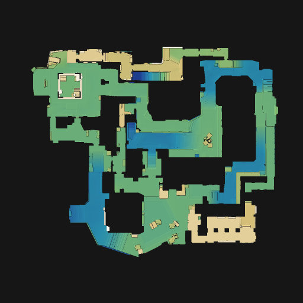

# Mirage collision geometry for 3D movement (G2: `src/sim2d/geometry.ts`, `data/geometry/`)

This is CS2's real Mirage collision, as a compact triangle mesh, plus the queries that 3D movement (G3: walking on
real floors, stepping, jumping, falling) and later eye-height sight need. The view stays 2D. Nothing in the running app
uses it yet: movement, nav, vision and the renderer are unchanged (golden digest `e9a228d9`).



*The floors a player can reach from the spawns (walking, dropping, jumping ≤ 64), shaded by height from deep blue
(−370, the Underpass) through green to sand (+30 and above, Apartments, Palace); darker edges are steps over 18 units.
`data/geometry/mirage-height.png` is the full 1024 × 1024 image, radar-aligned and transparent elsewhere.*

## Source

`data/source/cs2/` holds the awpy-data release `2000942` (CS2 ClientVersion 2000942, patch 1.41.9.6, Steam build
26445667). Hashes, URLs and formats are in `data/source/cs2/PROVENANCE.md`. **These are Valve's files: private repo and
encrypted pages only.** Three facts about the mesh, from awpy-data's own build script, shape everything below:

1. It is the map's **physics** (`world_physics.vmdl_c`), which is what the engine moves players against.
2. awpy-data built it for line of sight, so it **drops every material named `playerclip`, `grenadeclip`, `sky`,
   `passbullets`, `glass` or `window`**. Player clips (invisible walls, clip ramps, the clips that keep players off
   roofs and wall tops) and glass are missing.
3. It is **decimated by vertex clustering on an 8-unit grid**. Big flat floors and walls are exact, but small props
   (crate stacks, beveled edges) come out distorted, with slanted faces up to a cell off.

The radar transform in `map_data.json` (`pos_x −3230`, `pos_y 1713`, `scale 5`) is the same as our 2020 data's, so
the frames match.

## Representation: why triangles, not a voxel span grid

The brief suggested a Recast-style solid-span grid. I measured both and chose the triangles themselves (quantized and
re-encoded) with exact queries:

| | span grid, cs 8 / ch 2 | span grid, cs 4 / ch 1 | **triangles (G2GM)** |
| --- | ---: | ---: | ---: |
| gzip size (naive planes, before smarter coding) | 229 KB | 681 KB | **235 KB** |
| wall position error | up to 8 per side (doorways −16) | up to 4 per side | **0 (the mesh itself, ±1/16)** |
| floor on slopes | staircase of 8-unit steps | staircase of 4-unit steps | **exact plane** |
| contact normal | axis-aligned (±x, ±y, ±z) | axis-aligned | **the triangle's (or edge's) normal** |

The deciding row is the normal. About **15 % of Mirage's wall area is more than 10° off an axis** (16 % more than 5°;
measured over all triangles with |nz| < 0.3). A voxel grid turns those walls into staircases whose faces are all
axis-aligned. Source's slide move (`ClipVelocity`) against an axis-aligned face stops a hull that runs straight into a
45° wall dead: running east, it hits an x-face, and clipping (250, 0) against (−1, 0, 0) leaves (0, 0). Against the
real plane it keeps cos 45° of its speed. `tests/geometry.test.ts` ("slides along a 45° wall without snagging") runs
that case: the hull reaches the wall after 68 units and then slides 46.6 ticks at the full clipped 176.8 u/s, to the
expected y = −91.0. Exact triangle queries cost about the same as voxel ones would here (1–3 µs, below). The voxel
grid's main advantage, a solid "inside", doesn't exist for this mesh anyway (see Known limits: winding).

## Format and build (`tools/extract-geometry.ts`)

```sh
npm run geometry:extract                        # data/geometry/*, docs/img/geometry-height.jpg (≈ 11 s)
npx tsx tools/extract-geometry.ts --check       # rebuild in memory; exit 1 if the .bin or the manifest is stale
npx tsx tools/extract-geometry.ts --report      # the validation below (markdown; details in logs/geometry-report.json)
npx tsx tools/extract-geometry.ts --bench       # query costs
```

Build, from `de_mirage.mesh` (AWMH: 44,159 float32 vertices, 73,290 triangles):

1. Quantize every coordinate to **1/8 unit** (`quant` 8, `Math.round`: error ≤ 1/16, far below the source's own
   8-unit decimation; 1/8 keeps every integer and half-integer exact).
2. Merge vertices that became equal (first kept, in source order; 33 merged, 239 unused), drop triangles that repeat
   a vertex or have zero area (exact integer cross product; 133) and repeated triangles (same vertex set, either
   winding; 14). This leaves **43,887 vertices and 73,143 triangles**.
3. Rotate each triangle so that its smallest index comes first (winding kept) and sort by (a, b, c). The source order
   compresses best: 236 KB gzip, against 238 KB for 256-unit tiles, 272 KB for Morton order and 276 KB sorted by x.
4. Write **G2GM v1**: a 16-byte header (`"G2GM"`, version 1, `quant` u16, vertex and triangle counts u32), then
   unsigned LEB128 varints. Each vertex is the zigzag delta of its integer x, y and z from the previous vertex. Each
   triangle is `a − previous a`, `b − a − 1`, `c − a − 1`. The full layout is in the header comment of
   `src/sim2d/geometry.ts`.

| file | bytes | notes |
| --- | ---: | --- |
| `data/geometry/mirage-geometry.bin` | 428,400 | SHA-256 `4456186c…`; gzip 234,580 |
| … embedded in the single page (gzip + base64, as the JSON is) | **312,776** | budget 1,500,000 |
| … in the locked page (× 4/3, ciphertext as base64) | ≈ 417,000 | |
| `data/geometry/mirage-geometry.json` | 2,153 | manifest: format, source and output SHA-256s, parameters, counts, bounds, query constants, image stats |
| `data/geometry/mirage-height.png` | 125,410 | 1024 × 1024 RGBA; the manifest records the SHA-256 of its pixels (zlib versions may change the PNG bytes) |
| `docs/img/geometry-height.jpg` | 39,976 | the preview above |

**Determinism:** the same mesh gives the same bytes (integer keys, explicit sort orders, no object-key iteration). The
test rebuilds the binary from `data/source/cs2/de_mirage.mesh` and compares its SHA-256 with the manifest and the
committed file. It also decodes the committed PNG and compares its pixel hash. `--check` rebuilds everything,
including the image.

**Embedding (for whoever wires it in; not done here).** The decoder is plain synchronous JS over a `Uint8Array`: no
`DecompressionStream`, no WASM. To embed it, add the `.bin` to `vite.single.config.ts`'s `embedAssets` as
gzip + base64, the same as the JSON, and inflate it with `new Response(stream).arrayBuffer()` in `assets-embedded.ts`.
That needs `DecompressionStream('gzip')`, so Safari 16.4+, which the page already requires. The normal build can
fetch `mirage-geometry.bin?url` with `res.arrayBuffer()`. Decoding plus the broad phase takes 50–60 ms in Node.

## API (`src/sim2d/geometry.ts`)

Positions are **feet** positions in the Mirage world frame (z up). A hull is Source's axis-aligned box
[x − w, x + w] × [y − w, y + w] × [z, z + h]: `STANDING_HULL` {16, 72}, `CROUCHING_HULL` {16, 54}. Every triangle is
**two-sided**.

| member | meaning |
| --- | --- |
| `MapGeometry.fromBytes(bytes)`, `decodeGeometry`, `encodeGeometry` | load G2GM (validates magic, version, canonical triangles, length) |
| `boxBlocked(minX, minY, minZ, maxX, maxY, maxZ)`, `hullBlocked(x, y, z, hull)` | true if any triangle cuts into the box deeper than `OVERLAP_EPS` (1e-4) on every separating axis. A hull resting on a floor or against a wall is **free**. |
| `traceBox(from, to, hull) → BoxTrace` | Source's `TracePlayerBBox`: sweeps the hull and stops at the first triangle it would cut into, pulled back `TRACE_SKIN` (1/32, Source's `DIST_EPSILON`) **along the hit normal**. Returns `fraction`, `end{X,Y,Z}`, `hit`, the unit `normal` (pointing back at the hull: the face normal for face contacts, the edge cross product for edge-on-edge contacts), `tri`, `startSolid`, `allSolid`. **Start contacts** (touching, or cutting in: `startSolid`) block only a move that goes deeper along their shallowest axis. So a hull standing on a floor slides freely, the 2-unit ground check down returns fraction 0, walking into a rising ramp returns fraction 0 with the ramp's normal (clip and continue, as in Source), and a hull stuck in a wall can always back out. |
| `traceAabb(cx, cy, cz, hx, hy, hz, dx, dy, dz)` | the same for any box given by centre and half extents |
| `floorBelow(x, y, z, halfWidth = 16, up = 18, down = 8192) → FloorHit \| null` | the highest surface top under the footprint (open square) at or below z + up and at or above z − down: where a hull would rest (Source boxes rest on the highest point beneath them, the uphill edge on a slope). Triangles that rise above z + up inside the footprint are obstacles and are skipped. `FloorHit` = `z`, the triangle's normal oriented up, `walkable` (nz ≥ `WALKABLE_NZ` 0.7), `tri`. |
| `ceilingAbove(x, y, z, halfWidth = 16, up = 8192)` | the lowest surface bottom strictly above z under the footprint; +Infinity if none (headroom for jumps and standing up) |
| `traceLine(ax, ay, az, bx, by, bz)`, `lineBlocked(a, b)` | the first crossing of a segment with a triangle (open segment, closed triangle); eye-to-eye sight. Glass, windows and bullet-pass railings aren't in the mesh, so they don't block. |
| `traceSight(…)`, `sightBlocked(…)` (G6) | `traceLine` against the **sight triangles** only: `[0, sightTriangleCount)`. `combineMeshes(world, clips)` sets `sightTriangles` to the world's count, so player clips stop movement but not sight or bullets. Skips cells whose sight triangles' z extent misses the segment (open floors) and triangles whose box misses it; 1.53 µs per eye-to-eye trace on recorded pairs (G2's `traceLine`: 1.86) |
| `sightBlocker(…)`, `crossesTriangle(t, …)` (G6) | the sight triangle a segment crosses (−1 if clear), and the single-triangle test: MeshSight's per-pair hint (`docs/vision.md`) |
| `footprintSpans`, `surfacesAt`, `triangle`, `triangleNormal` | tools and tests (they allocate) |

Implementation notes:

- The broad phase is a uniform 2D grid of 32-unit cells listing each triangle under its xy bounding box. A query
  visits the cells under its box and tests each triangle once (in the first query cell it covers, so no "seen" set is
  needed), after a 3D bounding-box reject.
- Box tests use the 13 separating axes (face normal, x, y, z, nine edge cross products) with closed slabs. Time of
  impact is the latest entry over the axes. Footprint queries clip the triangle to the footprint (Sutherland–Hodgman);
  pieces lying only on the footprint's boundary don't count.
- Only + − × ÷, comparisons, `Math.floor`, `Math.abs`, `Math.min`/`max` and `Math.sqrt` are used, all IEEE-exact, so a
  C# port gives identical results. The scratch fields make an instance non-reentrant, which is fine on one thread.
  Candidate visits use a callback, which is a lambda in C#.

### Costs

Node 22, this workspace; `--bench`. The positions are the 2,556 recorded samples that have a stand level within ±32 of
their z, at that level.

| query | µs per call |
| --- | ---: |
| `hullBlocked` (standing) | 1.0–1.3 |
| `floorBelow` (16, up 18) | 2.9–3.2 |
| `ceilingAbove` (16) | 3.2 |
| `traceBox` 4 u horizontal (8 directions) | 1.9–2.4 |
| `traceBox` 2 u down (ground check) | 2.5–2.8 |
| `traceBox` 18 u up (step up) | 1.4 |
| `traceBox` 4 u across + 12 u down (air move) | 3.1 |
| `lineBlocked` eye to eye, recorded pairs (mean 1,555 u; most blocked early) | 2.3 |
| `lineBlocked` eye to eye, clear lines only (31 pairs, mean 320 u) | 1.5 |
| decode + broad phase | 50–60 ms once |

Repeated runs vary by ±15 %. Broad-phase cells of 16, 32 and 64 units measured the same within that noise. A Source
move is about 4–8 traces per pawn-tick (ground check, up to 4 bumps, step up, forward and down), so 10 pawns at 256
ticks/s cost about 10 × 256 × 8 × 2.5 µs ≈ 50 ms per wall-clock second in Node (5 %), maybe 10–15 % in mobile Safari.
`tests/geometry.test.ts` asserts under 25 µs per query (CI headroom). Sight lines cost in proportion to their length
(a DDA over the cells), so a full `sees` pass (45 pairs) is roughly 0.1 ms.

## The height image

For every radar pixel inside the CS2 radar's playable area (`de_mirage.png` alpha 255: 302,397 px, grown by 6 px), the
tool lists the **stand levels**: surface tops under the standing footprint whose triangle is walkable and where the
standing or the crouched hull fits. That gives 571,564 levels. They are linked to the four neighbours by walking
(|Δz| ≤ 18), dropping (any height, if the hull fits above the lower floor) and jumping (up to 64, a crouch jump, if
the crouched hull fits raised to the upper floor), and flooded from the ten start positions: 320,749 reachable levels
(293,098 walk, 26,590 drop and 1,052 jump links). Each pixel then shows the floor under the pixel itself at the highest
reachable level within 16 units (half a hull), so floors reach the walls. 285,337 pixels (94 % of the playable area)
are coloured. Most of the rest are 16-unit strips beside walls, plus spots behind props.

## Validation against the 2020 data (`--report`)

### The brief's spot checks

| spot | 2020 | CS2 | explanation |
| --- | ---: | ---: | --- |
| B plant (−1982, 311) | −160 | **−160** ✓ (floor −176 under the plant platform) | |
| T Ramp top (240, −1500) | −176 | **−176** ✓ | |
| Apartments (−1761, 794) | −48 | **−48** ✓ | |
| Tunnel Stairs (−786, 391) | −318 | **−320** at the point, −312 under the footprint (a step) ✓ | |
| Catwalk (−726, 243) | −172 | hull blocked | The point is 24 units off the 2020 source nav (a patch from recorded positions). In CS2 it is in the walkway's east wall. The walkway (x −822 … −762) is at −166 … −174 (−171 at x −790) ✓ |
| Shop (−2364, −674) | −168 | only z 144 at the point | 10–12 units inside the Shop's south wall (face at y ≈ −662, top 144), beside shelving (boards at −163, −151, −138). The 2020 nav had only a patch here. Floor −168 from y ≥ −660 ✓ |
| Back Alley (−391, 909) | −84 | −144 / 77 at the point; hull blocked | This is cart's start. It is 5 units past the north edge (y 904) of the −84 platform (y 688 … 904), where a railing face rises to −46. The hull fits at (−391, ≤ 885, −84) on the platform or at (−391, ≥ 921, −144) below it. |

So the "mismatches" are recorded positions in or against walls, not missing floors.

### (a) Every 2020 nav area vs the CS2 mesh

9,746 samples (a 25-unit grid in each of the 1,108 areas of `data/mirage-nav.json`: 9,541 in source areas, 205 in
patch areas). |Δz| is the distance from the nav height to the nearest walkable CS2 surface top under a 2 × 2 footprint
at the sample (−256 … +128):

| |Δz| | ≤ 1 | 1–2 | 2–4 | 4–8 | 8–16 | 16–32 | 32–64 | > 64 | no floor |
| --- | ---: | ---: | ---: | ---: | ---: | ---: | ---: | ---: | ---: |
| all samples | 52.9 % | 16.1 % | 17.2 % | 9.1 % | 3.1 % | 0.9 % | 0.3 % | 0.1 % | 0.4 % |
| source areas | 53.2 % | 16.3 % | 17.4 % | 9.0 % | 3.1 % | 0.9 % | 0.1 % | 0.0 % | 0.0 % |
| patch areas | 37.6 % | 8.8 % | 5.4 % | 11.2 % | 2.4 % | 1.0 % | 10.7 % | 2.4 % | 20.5 % |

**95.3 % of samples (95.9 % of source-area samples) are within 8 units.** A hull also fits there at 86.9 %; the rest
are mostly area edges within 16 units of a wall, since nav areas run up to the walls on a 25-unit grid. 89.4 % lie
inside a CS2 nav polygon within 32 units of the 2020 height.

The 468 samples that differ by more than 8 units, or have no floor, fall into 108 clusters (8-connected on the grid,
nav heights within 32). For each cluster the tool compares three heights (2020 nav, CS2 mesh, CS2 nav) and the CS2
radar. The CS2 nav is generated by Valve from the full collision, clips included, so it decides between "the map
changed" and "the mesh is missing something":

| likely reason (clusters of ≥ 3 samples) | samples |
| --- | ---: |
| **2020 nav height model on a slope or stairs**: the CS2 mesh and CS2 nav agree within 12, and the 2020 area is sloped (two corner heights ≥ 24 apart) | 230 |
| patch area from recorded positions (not in the 2020 source nav either) | 60 |
| CS2 mesh and CS2 nav agree, 2020 differs (by 8–18, on flat or slightly sloped areas) | 60 |
| outside the CS2 playable area (radar alpha 0) | 29 |
| both navs agree, the mesh differs (a slope under a coarse nav polygon) | 9 |
| not in the CS2 nav (not walkable in CS2) | 6 |
| **mesh gap (CS2 nav has a floor, mesh none)** | **0** |

The 2020 export kept only two of each nav area's four corner heights (`docs/nav.md`). On stairs and ramps that rise
along one axis, the diagonal interpolation is off by 10–26 units. Both CS2 sources agree with each other there, for
example on the Tunnel Stairs (2020 −282 / CS2 −256 / CS2 nav −250), CT Spawn ramp and T Ramp. **No cluster is a mesh
gap** (CS2 nav floor at the 2020 height, no mesh floor). The largest clusters (≥ 5 samples):

| # | place (2020 nav) | samples (patch) | x range | y range | 2020 z | 2020 slope | CS2 mesh z | CS2 nav z (share inside) | CS2 radar | likely reason |
| ---: | --- | ---: | --- | --- | ---: | ---: | ---: | --- | ---: | --- |
| 1 | (unnamed) | 25 (0) | −1187 … −1087 | 37 … 237 | −352 | 0 | −364 | −166 (48 %) | 48 % | outside the CS2 playable area: a 2020 area under Catwalk that the CS2 radar and nav don't include |
| 2 | CT Spawn | 23 (0) | −1637 … −1512 | −1312 … −1187 | −250 | 27 | −261 | −257 (78 %) | 100 % | 2020 height model on a slope |
| 3 | CT Spawn | 20 (0) | −1662 … −1562 | −937 … −837 | −197 | 72 | −182 | −177 (100 %) | 100 % | 2020 height model on a slope |
| 4 | Middle | 19 (0) | −212 … −112 | −637 … −537 | −224 | 58 | −238 | −236 (74 %) | 100 % | 2020 height model on a slope |
| 5 | CT Spawn | 18 (0) | −1562 … −1462 | −1087 … −962 | −212 | 72 | −225 | −215 (72 %) | 100 % | 2020 height model on a slope |
| 6 | Back Alley | 15 (15) | −712 … −512 | 637 … 662 | −81 | 0 | −144 (93 %) | – | 53 % | patch: the corridor (floor −80) ends at a wall at y ≈ 632; these cells are behind it |
| 7 | T Ramp | 14 (0) | 337 … 387 | −1712 … −1537 | −200 | 38 | −208 | −197 (86 %) | 100 % | 2020 height model on a slope |
| 8 | (unnamed) | 14 (0) | 787 … 887 | 587 … 662 | −210 | 91 | −235 | −226 (100 %) | 100 % | 2020 height model on a slope |
| 9 | Middle | 13 (0) | −87 … 12 | −762 … −662 | −218 | 58 | −205 | −198 (100 %) | 100 % | 2020 height model on a slope |
| 10–13 | Tunnel Stairs | 4 × 12 (0) | −837 … −387 | 362 … 462 | −318, −282, −182, −146 | 128 | −336, −256, −200, −120 | −329, −250, −196, −113 | 100 % | 2020 height model on stairs (off by 18–26 both ways) |
| 14 | Top of Mid | 12 (0) | 262 … 387 | −162 … −87 | −186 | 49 | −174 | −175 (100 %) | 100 % | 2020 height model on a slope |
| 15 | Bombsite B | 10 (0) | −2212 … −2112 | 587 … 662 | −165 | 21 | −157 | −151 (80 %) | 100 % | CS2 agree, 2020 differs (8) |
| 16 | Back Alley | 9 (0) | −312 … −237 | 737 … 812 | −126 | 16 | −135 | −127 (100 %) | 100 % | CS2 agree, 2020 differs (9) |
| 17 | Back Alley | 8 (7) | −487 … −387 | 887 … 937 | −84 | 12 | −144 | – | 63 % | patch: cart's start, past the platform's railing |
| 18–19 | Middle, Side Alley | 8, 8 (0) | | | −252, −243 | 25, 47 | −264, −254 | −256, −247 | 100 % | 2020 height model on a slope |
| 20 | Apartments | 7 (7) | −1437 … −1312 | 812 … 862 | −80 | 0 | −76 (14 %) | – | 43 % | patch: behind the corridor wall at x = −1288 (solid in both) |
| 21–23 | Side Alley, Balcony, Connector | 7, 6, 6 (0) | | | −257, −28, −255 | 2, 0, 13 | −266, −46, −264 | −261, −40, −257 | 100 % | CS2 agree, 2020 differs (9, 18, 9) |
| 24 | Catwalk (Mid) | 6 (0) | −12 … 12 | −487 … −412 | −174 | 11 | −185 | −172 (100 %) | 100 % | a floor sloping 8 units under coarse nav polygons; the mesh is the collision |
| 25 | Shop | 5 (4) | −2412 … −2337 | −687 … −662 | −168 | 0 | – | – | 80 % | patch: inside the south wall and shelving |
| 26 | Back Alley | 5 (5) | −887 … −812 | 637 … 662 | −81 | 0 | – | – | 80 % | patch: behind the corridor wall |
| 27–30 | Back Alley, Top of Mid, Side Alley, (unnamed) | 5 each | | | | | | | 100 % | 2 × CS2 agree (9, 14), 2 × slope model |

There's no evidence that Mirage's walkable layout changed between 2020 and CS2 at the scale of the nav grid. Heights
differ only where the 2020 model is weak. The few flat 8–18-unit differences (B site's north edge, Balcony,
Connector) could be small remodels or 2020 export rounding; both CS2 sources agree there.

### (b) Every recorded track sample on the CS2 geometry

There are 3,562 samples (all ten players, observed, estimated and inferred). The classes:

- **ok**: a standing or crouched hull fits on walkable CS2 ground within ±8 of the recorded z at the recorded (x, y).
- **snap**: not ok, but fixed by a small correction. Either there is a stand level within ±24 of z at (x, y), or
  there is a spot within 16 units with one within ±8.
- **far**: the nearest spot with a stand level within ±24 is 16–64 units away.
- **impossible**: there is no such spot within 64 units.
- **blocked**: walkable ground lies within ±8 under the footprint, but the hull overlaps a wall or prop.

| player | samples | observed | ok | snap | far | impossible | blocked (not ok) | on the 2020 source nav | ok and on it |
| --- | ---: | ---: | ---: | ---: | ---: | ---: | ---: | ---: | ---: |
| barely | 589 | 588 | 282 | 125 | 181 | 1 | 250 | 364 | 269 |
| cart | 695 | 683 | 354 | 110 | 225 | 6 | 219 | 431 | 340 |
| donk | 504 | 504 | 379 | 39 | 86 | 0 | 60 | 193 | 180 |
| eradicate | 128 | 128 | 42 | 9 | 77 | 0 | 74 | 38 | 37 |
| incredibad | 6 | 0 | 0 | 0 | 6 | 0 | 6 | 0 | 0 |
| lokier | 189 | 17 | 45 | 7 | 137 | 0 | 144 | 53 | 45 |
| snakelore | 125 | 5 | 125 | 0 | 0 | 0 | 0 | 125 | 125 |
| snarlbot | 179 | 48 | 131 | 21 | 11 | 16 | 45 | 138 | 124 |
| sp4rtan | 704 | 87 | 466 | 223 | 11 | 4 | 221 | 694 | 466 |
| zwomp | 443 | 4 | 421 | 17 | 5 | 0 | 14 | 235 | 220 |
| **all** | **3,562** | 2,064 | **2,245** (63 %) | **551** (15 %) | **739** (21 %) | **27** (1 %) | 1,033 | 2,271 | 1,806 |

By confidence (ok + snap): estimated 95.0 %, inferred 88.5 %, observed 70.6 %. The observed samples are worst, which
looks backwards, but they are the T players hugging walls in Back Alley and Apartments (below). The decisive check is
against the 2020 source nav, with the same samples cross-tabulated:

| | ok | snap | far | impossible |
| --- | ---: | ---: | ---: | ---: |
| on the 2020 source nav (2,271) | 1,806 | 390 | 75 | **0** |
| off it, i.e. a patch or a hole (1,291) | 439 | 161 | 664 | 27 |

**96.7 % of the samples the 2020 nav accepted are ok or snap on CS2.** 90 % of the far or impossible samples (691 of
766) were already off the 2020 source nav: `docs/nav.md` found 36 % of recorded positions off-mesh (90th percentile 31
units) and patched them in. The recorded path is impossible because the recording puts players inside walls, not
because CS2 differs. The 75 exceptions on the 2020 nav: 32 on the Tunnel Stairs (z from the 2020 stairs model),
32 in Shop (below), 5 of sp4rtan's on a sloped unnamed area (height model) and 6 single samples elsewhere.

**Recorded segments that are far or impossible on CS2** (runs of ≥ 3 consecutive far or impossible samples, 741 of
the 766; snap samples end a run):

| player | t (s) | samples | kind | blocked | on 2020 src | where (2020 place, first sample) | nearest fit (±24) | why |
| --- | --- | ---: | --- | ---: | ---: | --- | --- | --- |
| barely | 0.4–9.6 (4 runs) | 75 | far | 73 | 0 | Back Alley (−514 … −687, 635 … 645, −81) | ≤ 20–36 | 20–40 units north of the corridor's north wall (y ≈ 632; the hull fits at y ≤ 616) |
| barely | 14.5–14.9 | 5 | far | 4 | 0 | Apartments (−1120, 823, −80) | ≤ 36 | against the corridor walls |
| barely | 15.7–18.2 | 26 | far | 4 | 0 | Apartments (−1304, 862, −80) | ≤ 52 | through the solid block west of the wall at x = −1288 (also outside the CS2 radar) |
| barely | 22.6–22.9 | 4 | far | 4 | 0 | Bombsite B (−1867, 423, −168) | ≤ 48 | in the B-site box stack |
| barely | 28.5–29.1 | 7 | far 6, impossible 1 | 7 | 0 | Bombsite B (−1967, 404, −160) | ≤ 60 | the plant, recorded inside the box stack beside the plant spot |
| barely | 33.7–35.3 | 17 | far | 15 | 0 | Bombsite B (−1231, 327, −168) | ≤ 32 | against the walls toward Underpass |
| barely | 37.7–40.7 | 31 | far | 3 | 31 | Tunnel Stairs (−779, 363, −331) | ≤ 24 | **z**: the recorded z comes from the 2020 stairs model, 27 below the CS2 step (−304) |
| barely | 54.2–55.1 | 10 | far | 10 | 0 | Bombsite B (−1471, 277, −168) | ≤ 28 | against the north wall |
| cart | 0.0–5.2 | 53 | far | 11 | 0 | Back Alley (−391, 909, −84) | ≤ 44 | his start, past the platform's railing (y 904) |
| cart | 8.2–8.4 | 3 | far | 3 | 0 | Back Alley (−517, 634, −81) | ≤ 20 | behind the corridor wall |
| cart | 20.0–20.2 | 3 | far | 3 | 0 | Apartments (−1896, 796, −48) | ≤ 28 | balcony door frame (x = −1888) |
| cart | 29.2–29.8 | 7 | far | 6 | 0 | Shop (−1987, −331, −168) | ≤ 40 | Shop's north door frame |
| cart | 33.5–44.6 | 112 | far 106, impossible 6 | 54 | 31 | Shop (−2360, −642, −168) | ≤ 64 | **Shop's south wall and shelving**: 31 samples on 2020 source areas that reach 30–50 units further south than CS2's floor. This is the one place where the 2020 layout looks different (shelves added or moved) |
| cart | 46.9–64.3 (4 runs) | 45 | far | 33 | 1 | Shop (−2267 … −1983, −450 … −351, −168) | ≤ 24–44 | Shop walls and doors |
| donk | 12.8–14.1 (2 runs) | 12 | far | 6 | 0 | Back Alley (−539 … −802, 633 … 647, −81) | ≤ 28–60 | behind the corridor wall |
| donk | 21.4–28.3 | 70 | far | 16 | 0 | Apartments (−1606, 895, −48) | ≤ 64 | 40–64 units north of the corridor (the 2020 nav has only patches there) |
| eradicate | 1.0–9.8 (3 runs) | 77 | far | 65 | 0 | Back Alley (−700 … −794, 639 … 655, −81) | ≤ 28–36 | behind the corridor wall |
| incredibad | 0.0–0.5 | 6 | far | 6 | 0 | Palace Alley (905, −1290, −109) | ≤ 36 | inferred spot in a wall |
| lokier | 0.0–13.1 | 132 | far | 132 | 0 | Truck (−2387, 815, −127) | ≤ 48 | inside the Truck's collision (62 units off the 2020 source nav too) |
| lokier | 18.5–18.8 | 4 | far | 4 | 1 | Bombsite B (−2125, 452, −164) | ≤ 48 | in a box stack |
| snarlbot | 9.0–9.7 | 8 | far | 5 | 1 | Palace Alley (560, −1420, −264) | ≤ 48 | estimated, in a wall |
| snarlbot | 16.1–17.8 | 18 | impossible 16, far 2 | 18 | 0 | Bombsite A (−78 … −134, −1427 … −1400, −170) | > 64 | among the crates west of the A-site stairs, in gaps narrower than a hull; patch-only in 2020 |
| sp4rtan | 19.5–20.0 | 6 | far 3, impossible 3 | 6 | 0 | Bombsite A (−120, −1464, −169) | ≤ 56 | inferred, the same crates |
| sp4rtan | 38.6–39.0 | 5 | far | 2 | 5 | (unnamed) (785, 633, −202) | ≤ 32 | inferred, on a sloped 2020 area (height model, cluster 8) |
| zwomp | 43.8–44.2 | 5 | far | 5 | 0 | Catwalk (−734, 225, −172) | ≤ 28 | the Catwalk's east wall (the brief's Catwalk spot) |

### (c) The CS2 nav

`de_mirage.nav` (version 36) parses as far as the areas (`readCs2Nav` and `Cs2NavIndex` in the tool; layout from
ValveResourceFormat's `NavMeshFile.cs`, with the binary KV3 blocks skipped by their header sizes). It has 2,544 areas (1,543 triangles, 1,001 quads), all on
hull 0, with no place names. At each area's centroid, the CS2 nav vs the nearest walkable mesh surface:

| |Δz| | ≤ 1 | 1–2 | 2–4 | 4–8 | 8–16 | 16–32 | 32–64 | > 64 | no floor |
| --- | ---: | ---: | ---: | ---: | ---: | ---: | ---: | ---: | ---: |
| areas | 3.2 % | 3.5 % | 52.6 % | 28.3 % | 6.4 % | 1.2 % | 2.2 % | 2.6 % | 0.0 % |

The nav sits a median **4.0 units above** the mesh (p10 2.2, p90 5.9; Recast's cell height), so 87.6 % agree within
8. The 122 areas more than 32 units off are draped over props and ledges the decimated mesh renders coarsely:

- the rotated crate stack at Top of Mid (200 … 330, −700 … −530): 18-unit layers with a small flat top at −88 and
  slanted sides;
- a 15-unit shelf at −86 along the diagonal wall near (−1850, −420);
- box tops on the sites.

Coverage in 2D on a 25-unit grid: both navs 8,681 cells, only 2020's 969 (179 of them 2020 patches), only CS2's 571.

### Sight at eye height (for later vision work)

Eyes are 64 above the CS2 stand level nearest the recorded z. All **12 of the 12** hand-picked must-not-see pairs in
`tests/fixtures/vision-labels.json` are blocked by the mesh; the Underpass ↔ Catwalk pair is blocked in 3D
near its Underpass end (at z −285, the Underpass ceiling), with no level check needed. Only **3 of the 12 trusted must-see pairs** are clear:

- **Lokier's three** (12.5, 12.75, 18.5 s): his recorded Truck spot puts his eye 1.2 units from a face of the Truck.
- **The four Apartments ↔ B lines** (17.45, 18.8 s): they hit the Apartments' south wall beside its openings. The real
  windows are at x −1820 … −1748 and −1676 … −1604, from z −23 to +58. The balcony door is at x = −1888, y 706 … 790.
  The radar-based mask treats the whole 415-unit wall as a window (`docs/vision.md`).
- **sp4rtan ↔ donk at 49.9–50.1 s**: these hit a door frame at x = −1488. The same shot from 12 units further south
  (50.35 s) is clear.

Windows are open in the mesh (glass is filtered), so with corrected positions these become visible. That makes
**position snapping a prerequisite for 3D sight**.

## Known limits

- **No player clips, no glass** (G3 adds clips from the CS2 nav: "Player clips" above). The mesh can't tell which wall tops, ledges and roofs the game keeps players off
  with `playerclip`: every walkable top where a hull fits counts as standable (for example a ledge 28 units above the
  Catwalk walkway at x ≈ −745). Windows and glass panes are holes. Crouch-jump reachability from boxes could reach places the real game forbids.
  Getting the clips back would need the unfiltered `world_physics` export (rerun awpy-data's
  `process_geometry.py --drop sky --no-decimate` on a CS2 install), which this workspace can't do.
- **Decimation (8-unit vertex clustering).** Small props are distorted: crate stacks get slanted faces, box tops can
  shrink below a hull's width, and wall bases can get small slanted fillets. Large floors and walls are exact. The
  CS2 nav marks a few prop tops walkable that the mesh doesn't (Top of Mid crates).
- **Surfaces, not solids.** Winding is inconsistent and solids aren't closed: about 6 % of vertical lines through the
  map cross faces in an order no closed solid allows. So there is no reliable "inside": a hull teleported into the
  hollow inside of a pillar is free until it touches a face. Use `hullBlocked` plus `floorBelow` to validate
  teleports (snap first; see below).
- **Recorded z is the 2020 nav's**, wrong by up to ~27 on stairs and ramps. Recorded (x, y) is wrong by ±20–40 near
  walls, and by 60 or more at the Truck and some A-site crates.
- **CS2 vs 2020 layout.** Within the nav grid's resolution only Shop's south side differs (shelving where 2020 had
  floor); props (boxes, the Truck) may have moved by a few tens of units (`docs/vision.md`).
- **Box queries are for hulls.** `floorBelow` with a tiny footprint can find surfaces in gaps a hull can't enter. Use
  `halfWidth` 16 for anything a player stands on.
- `traceBox`'s candidate set grows with the swept area, so it is meant for per-tick moves (tens of units). Use
  `traceLine` for long lines.

## Recommendations for G3

1. **Collide against this mesh with Source's algorithm, unchanged.** `CategorizePosition` is `traceBox` 2 units down
   (ground if `hit && normalZ ≥ 0.7`). `TryPlayerMove` is up to 4 bumps of `traceBox` with `ClipVelocity` against
   the returned normals. `StepMove` is a trace up 18, then forward, then down. Then gravity 800 and a jump impulse
   (CS:GO's 301.993 u/s, apex ≈ 57; check both in CS2). The tests' `slideMove` and `stepMove` helpers are a minimal sketch. Keep the
   TRACE_SKIN behaviour: players float 1/32 above floors, as in Source. Round positions to 6 decimals as now; that
   rounding is far below `OVERLAP_EPS`.
2. **Trust the mesh for floors, walls and heights** (95 % of the 2020 nav within 8 units, 0 missing floors). Don't
   trust it for clip boundaries. Where a pawn must not go, the 2D nav (or the CS2 nav) is a better authority. For
   LIVE pawns and the human, consider constraining movement to stay over a CS2 or 2020 nav polygon, or adding a few
   hand-made clip boxes, so nobody climbs onto wall tops or roofs.
3. **Snap every recorded position before using it in 3D**: the puppet track, teleports, start states and sight
   endpoints. For each sample, take the nearest spot within 64 units where `standLevels` (or `floorBelow(…, 16)` plus
   `hullBlocked`) gives a level within ±24 of the recorded z, preferring the smallest horizontal move, then the
   smallest |Δz|; then z = that level. The tool's `checkSpot` (in `tools/extract-geometry.ts`) is that search. This
   fixes 79 % ok + snap at once, and every far sample (up to 64 units). The 27 impossible samples (snarlbot and
   sp4rtan among the A-site crates, 16.1–20.0 s, and 6 of cart's in Shop) need a nav path to the nearest reachable
   level, or need the 2D behaviour kept there. Precompute the snapped tracks offline into a new data file (a new
   tool, deterministic), so the Core and the golden fixtures stay independent of the 3D pass.
4. **Keep the patched 2020 nav for paths and 2D fallbacks for now.** It agrees with CS2 within the grid, and the
   Core's WalkQuery and the golden digests depend on it. Decide separately whether to switch paths to the CS2 nav
   (parser above; no place names, 4 units above the mesh) when CS2 parity matters.
5. **Sight in 3D needs step 3 first**: 9 of the 12 trusted recorded engagements are blocked by walls beside the
   windows, or start inside the Truck, at their recorded positions.
6. **Wiring.** Load `mirage-geometry.bin` once (≈ 55 ms) and share one `MapGeometry` across pawns. Instances aren't
   re-entrant, which is fine on the main thread or one per worker. Embed it as described under Format; it adds
   313 KB to the single page and ≈ 417 KB to the locked one.

## Player clips (G3, `tools/extract-clips.ts`)

The mesh has no `playerclip` brushes, so G3 puts them back where they matter: **CS2's own nav mesh is the authority**
(Valve generates it from the full collision, clips included). `npm run clips:extract` writes
`data/geometry/mirage-clips.bin` (G2GM, 151,199 bytes: 3,864 surface pieces as prisms, 27,155 triangles),
`mirage-clips.json` (manifest, parameters, rounds, validation) and `docs/img/geometry-clips.jpg`. The movement mesh
is the world merged with the clips (`combineMeshes`), so every trace sees them as walls.

1. Every walkable world triangle is cut into 8-unit world cells ("pieces"). A piece is **allowed** when the CS2 nav
   has a polygon at its height at the point (within 16) or within 24 units (within 16): the nav is eroded by Recast's
   agent radius and sits a few units off the decimated mesh.
2. Flood from the ten start positions over allowed stand levels at every 5-unit radar pixel, by walking (up 18),
   dropping and jumping (up to 72, with the crouched hull's headroom). A forbidden level an edge reaches is a frontier:
   a wall top, ledge, roof or out-of-map floor a pawn could get onto.
3. Under each frontier level, every forbidden piece the hull would rest on gets a prism up 512 units (or to just
   under the ceiling). Allowed floors are never covered, so a pawn beside a low wall isn't pushed off it.
4. Repeat on the merged mesh until nothing new is reached (3 rounds), then validate: a flood of the merged mesh with
   **no** nav filter reaches 244,742 stand levels, 1,267 of them not nav-covered (the van top after C1's patches, below, prop
   corners and nav holes; 35 of 243,495 before them; the first 40 cells are in the manifest).

So pawns stand on the B-site and A-site boxes, the Catwalk, the Balcony and Window, and not on wall tops, roofs or
outside the map (tests in `tests/movement3d.test.ts`). The clips don't cover glass (windows stay open) and don't add
invisible walls in mid-air (there are none in the nav to find).

### Clip patches (C1, `MIRAGE_CLIP_PATCH`)

The flood puts a prism on every surface the CS2 nav doesn't cover that a pawn can reach, which is right for wall tops and
wrong for a prop the nav skips but CS2 lets you stand on. `ClipSpec.patch` removes flooded pieces by id (the world
triangle and its 8-unit cell: `tri`, `ci`, `cj`) after the flood and before nav relief; each entry says why, a piece that
isn't a flooded clip is an error, and the manifest lists them under `patch`. `npm run map:check` rebuilds with the patch
(`mirageClipSpec()` carries it), so the rest of the package stays byte-identical to a build without it. Mirage has 19:

- **The van (the Truck near Lokier's recorded spot, −2387, 815, −127), 18 pieces.** The van is the box at x −2400…−2176,
  y 784…850 (box roof z −8, reached by a jump from the z −45 box at y < 770), its cab at x −2420…−2384 (roof z 24–30) and a
  long narrow roof strip at x −2425…−2392, y 667…781 (z 21–24) that ends 100 units above the z −80 crate. The nav has
  nothing on any of it, so the flood walled it: a 512-unit prism on each of 16 cells of the strip (a pawn on it started
  inside a prism: no standing, walking or jumping there) and on two cells of a z 0 sliver inside the cab roof (tri 27904,
  (−2398, 784, 0)(−2392, 786, −2)(−2387, 822, 0)), whose prisms stand straight up through the roof (`ceilingAbove` found
  no ceiling) and stopped a pawn running south over the cab at y 808 (`traceBox`: clip triangle 73881, box x −2398…−2396,
  y 784…792, z 0…512). Removed: tri 27941 cells (ci −302, cj 83…91) and (ci −301, cj 91…97); tri 27904 (ci −300, cj 98) and
  (ci −299, cj 98).
- **A crate corner**, tri 7599 (ci −301, cj 83): the NW corner cell of the z −80 crate at B (x −2400…−2364, y 620…668) had
  a 512-unit prism on it.

The manifest's `validation.notAllowedByNav` rises from 35 to 1,267: the van top is now reachable and the nav doesn't
cover it, which is the point. The same pattern, left alone because it needs more than a one-line patch or is a real
wall top: tri 27606's floor cells at (−2412…−2404, 596…612) (prisms 8–24 and 384 units tall beside the crate's west
side), tri 4049's cells at y 753…760 under the z −46 box's lid (6–20 units tall; they only fill the gap), tri 27682's
two cells at z −70 (6 units). Browser check: `npm run build:3d && npx tsx tools/browser-check3d-c1.ts`; unit test:
`tests/c1-van-clip.test.ts`. The 2020 map's real player clips (`origin/x1b-mirage2020`) replace this for that package.

## Track snapping (G3, `tools/snap-tracks.ts`)

The recording's (x, y) are from a 2020 POV video and its z from the 2020 nav, so many samples are inside CS2's
walls, props or the Truck, or on the wrong floor. `npm run tracks:snap` writes `data/geometry/mirage-tracks.json` (one
[x, y, z] per sample of `round.tracks`, 1/32-unit grid, plus jump take-offs; `--check` fails when it is stale). The
app applies it to the round before the Core sees it (`applyTracks3d`), so puppets follow positions a hull can stand
at. Deterministic, offline (36 s). Passes:

0. **Level flips** (T1, `levelFlips`): the recording's z is the 2020 nav floor under the radar dot, so where two
   floors overlap a dot near one's edge can pick up the other. A stretch whose z jumps by more than 48 in one sample
   step and back again within 20 s, with the floor it left within 128 units of every sample in between, and where
   neither change of floor is a way a hull can go (the A* below, with drops and jumps, finds none), keeps its x/y and
   takes the floor it left. It flags one stretch: barely 35.1–44.7 s (97 samples, dz −198 in, +154 out), whose dot
   ran 40–110 units north of Catwalk's north strip, over the underpass and the Tunnel Stairs beneath it; it is put back
   on Catwalk (below).
1. **Snap** each sample to the nearest allowed stand level within 64 units (2-unit search grid, level within 32 of the
   recorded z), preferring one on the previous sample's floor in a clear hull line from it (`hullLineClear`, as the
   puppets' WalkQuery); else the spot reachable from the previous one nearest the recording (`follow`). A recorded
   change of floor is taken when a hull can walk there; a track left on another floor than the recording's for a
   second restarts on the recording's.
2. **Repair**: where consecutive samples still aren't in a clear line, re-place the samples around the gap together
   (Viterbi over candidate spots).
3. **Detour**: a gap that remains is a wall the recording walked through: an A* over stand levels (8-unit grid, up a
   step, down ledges up to 216, no jumps) finds the way round, and the samples around the gap are spread along it.
4. **Retime and reroute**: a snapped track longer than the recording can't be followed at run speed, so the track
   falls behind along its own path at the recorded weapon's run speed and catches up where the recording is slower
   (35 stretches, at most 67 units behind). Where it would fall more than 48 units behind, the shortest way (A* with
   jump edges onto levels up to 48 higher, checked with the 3D movement, with headroom for the jump) replaces the
   snapped one when it is shorter, the samples placed by the recording's progress (3 stretches: barely 17.7–23.9 s
   through the Apartments and off the Balcony's west end, 1,427 → 1,072 units; cart 19.5–21.1 s and 46.9–48.6 s).
   Plant and defuse samples never move.
5. **Sight (G6, `tools/sight-snap.ts`)**: every recorded duel (a trusted sighting with a hit or kill in its window) in
   sight on the mesh at every sample; where not, one side's samples move as little as they can (Viterbi, run-speed
   steps in clear hull lines): cart 17.0–19.3 s up to 106 u (the Apartments window over B), eradicate 12.5–12.7 s
   33 u, donk 49.9–50.1 s 6 u. Details in `docs/vision.md` "Recorded duels". The tool now takes ≈ 60–85 s.

Result: 3,562 samples; 2,248 unmoved, 136 moved ≤ 16 units, 1,094 moved 16–64, 84 further (horizontal moves ≤ 4: 67,
≤ 8: 60, ≤ 16: 103, ≤ 32: 271, ≤ 48: 335, more: 214; most of the 64+ are barely's 35–45 s on Catwalk, 40–110 north of
his radar dot). 5 transitions are still not in a clear hull line: the recording walking through an A-site box CS2 has,
with no way round found in time (cart 29.3 s and 64.2 s); floors that don't match (donk 20.9 s onto a floor CS2 raises
32 units in the Apartments, snarlbot 9.8 s on T ramp where the 2020 z is 80 above CS2's floor); and 9 units at barely
2.5 s. The puppets snap at these when nobody watches (`docs/core.md`, "Snaps on CS2
Mirage"). **Jumps: none.** The search found
jump edges (the B Apartments window's 20-unit sill), but a jump there bumps the lintel and stalls the puppet, so jump
landings need headroom for a whole jump; with that rule no track needs one. Puppets still press JUMP for any take-off
the tracks mark (`docs/core.md`), tested with synthetic tracks.

## Port notes (C#)

- G2GM decoding: unsigned LEB128 and zigzag (`u % 2 == 0 ? u / 2 : -(u + 1) / 2` on `long`), integer coordinates
  divided by `quant` into `double`.
- Queries use only `+ − * /`, comparisons, `Math.Floor`, `Math.Abs`, `Math.Min`/`Max` and `Math.Sqrt`, so results are
  bit-identical. The candidate callback becomes a `Func<int, bool>` or an inlined loop. Ties are broken by the lower
  triangle index (traces) or by (|nz| desc, index) (floors), so iteration order doesn't matter.
- The CS2 game itself doesn't need any of this: the CS2 host moves players with the engine. Only a C# re-run of 2D-sim
  logs that include 3D movement would.

### barely 33–48 s: Catwalk, not the underpass (T1)

John: "It's not possible to jump from underpass to catwalk like that. It's the result of a position overlaying on top of
the map." The recording had barely drop from Catwalk into the underpass at 35.1 s (dz −198 in 0.1 s), walk up the Tunnel
Stairs, hold them 38–44 s, kill Zwomp "from the Tunnel Stairs" at 44.20 s and be back on Catwalk at 44.8 s (+154 in
0.1 s). On CS2 Mirage neither is possible, and the kill isn't either:

- Catwalk's north strip (z ≈ −168, y ≤ ~310 at x −1040 … −760) and the Tunnel Stairs (y ≈ 335–475, rising east from the
  underpass at −368 to the Back Alley at −80) are separated by a solid wall at y ≈ 310–335 from below the underpass to
  above the Apartments; the underpass runs under Catwalk at x −1050 … −975.
- No way between the floors near by: `astar` (drops ≤ 216, jumps) finds none at either flip.
- Sight: of every stand spot at x −1000 … −640, y 260 … 460, only the Catwalk ones (y ≤ 280) have an eye-height line to
  Zwomp at the kill (−752, 243, eye −107); no spot on the stairs or in the underpass does.

So barely stayed on Catwalk: he walked east along its north strip (35–38 s), held its north-east corner by the wall
(−760, 294) 38–40.5 s, moved along the strip between x −836 and −771 (40.5–44.6 s), killed Zwomp coming north up
Catwalk at 44.20 s from (−783, 289, −165) with a clear line, and turned south down Catwalk (−772, 254 at 45.0 s), as
recorded from 44.8 s on. Pass 0 does this; the snapped track is a continuous walk (every step a clear hull line, at most
22 units per 0.1 s), and the golden master's barely snaps 2299 and 2880 are gone.
