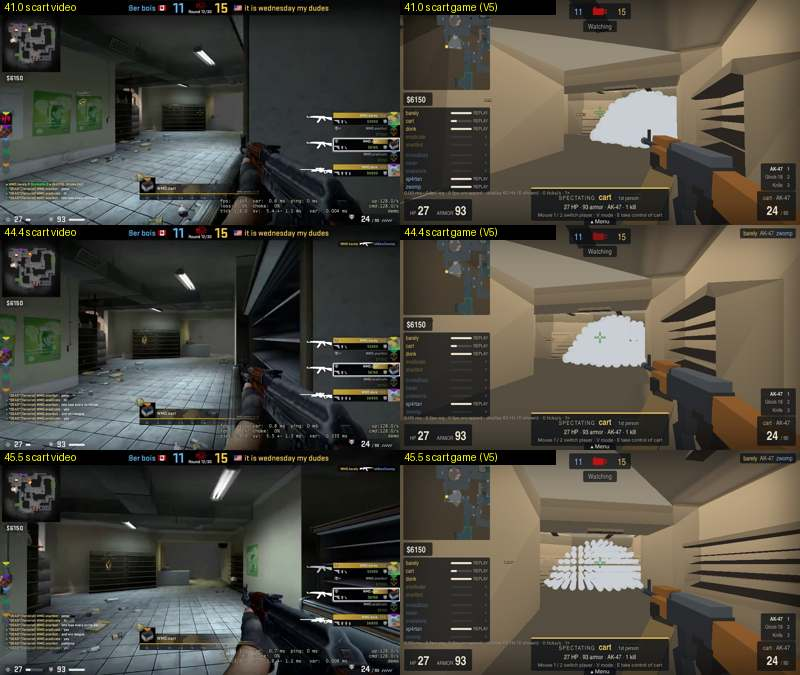
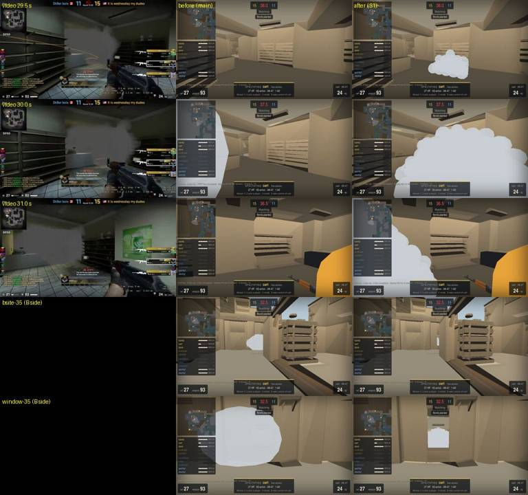

# CS2 grenades (`src/engine/grenades`, H5)

A pure, deterministic module for CS2's six grenades (smoke, flash, HE, molotov, incendiary, decoy): the throw,
the projectile with bounces and rest, the detonation rules, and the effects (a volumetric smoke with HE and bullet
holes, flash blindness, spreading fire, HE blast damage, the decoy's fake fire). Hosts call it once per 64 Hz tick.
It imports only `src/contracts` (ESLint zone `src/engine`) and touches the world only through the `GrenadeWorld`
interface, which the hosts implement on their collision. The tests run it on the real CS2 de_mirage mesh
(`src/sim2d/geometry.ts`, docs/geometry.md) through a test-only adapter. **Every grenade runs on this engine in both
hosts** (S1 smokes, V5 flashes, HE and molotovs; below: "Grenades in the hosts"); the 2D sim's simplified grenades
(`src/sim2d/grenades.ts`, docs/combat.md) remain only for a host without the CS2 mesh.

Constants live in `data/tuning.json` → `grenades.cs2` (validated by `parseTuning`, `GrenadeCs2Tuning` in
`src/contracts/tuning.ts`; additive: the 2D keys are unchanged).

## Sources

| id | source | what it gives | status |
| --- | --- | --- | --- |
| S1 | CS2 `scripts/weapons.vdata` from [SteamDatabase/GameTracking-CS2](https://github.com/SteamDatabase/GameTracking-CS2/blob/master/game/csgo/pak01_dir/scripts/weapons.vdata) (sha256 `cc04aa26…`, the same file as H2's `data/source/cs2/weapons.vdata`) | `m_flThrowVelocity` 750 (all grenades); HE `m_nDamage` 99, `m_flRange` 350, `m_flArmorRatio` 1.2, flinch 0.1 / 0.3; molotov armor ratio 1.8, flinch 1 / 1; incendiary 1.475, flinch 0.8 / 0.7; decoy / flash / smoke damage fields | **verified** (game files) |
| S2 | CS2 convar dump `DumpSource2/convars.txt`, same repository | `sv_gravity` 800; `molotov_throw_detonate_time` 2; `inferno_max_flames` 16, `inferno_flame_spacing` 42, `inferno_max_range` 150 / `_ct` 110, `inferno_flame_lifetime` 7 / `_incendiary` 5.5, `inferno_damage` 40 / `_ct` 40, `inferno_damage_timer` 0.2, `inferno_initial_spawn_interval` 0.02, `inferno_max_child_spawn_interval` 0.5, `inferno_child_spawn_max_depth` 4, `inferno_spread_speed_mult` 1 / `_ct` 10, `inferno_surface_offset` 15, `inferno_velocity_factor` 0.003, `inferno_velocity_decay_factor` 0.2; `ff_damage_reduction_grenade` 0.25, `ff_damage_reduction_grenade_self` 1; `sv_hegrenade_damage_multiplier` / `radius_multiplier` 1; `sv_flashed_amount_for_blind_kill` 0.7; `sv_grenade_collision_sphere_radius` 2 (sphere off by default); `sv_jump_impulse` 301.99338 | **verified** (defaults of the shipping build) |
| S3 | Source SDK 2013 ([ValveSoftware/source-sdk-2013](https://github.com/ValveSoftware/source-sdk-2013)) `game/shared/physics_main_shared.cpp` (`PhysicsToss`, `PhysicsAddGravityMove`, `PhysicsClipVelocity`, `ResolveFlyCollisionBounce`) and `game/shared/gamerules.cpp` (`RadiusDamage`) | The projectile loop (move, trace, reflect with backoff 2, scale by elasticity, continue the rest of the frame), rest below a speed on floors; the blast shape (source raised 1 unit, a trace to the body target, blocked = no damage, linear falloff). The SDK has **no Counter-Strike code** | verified (Source structure, not CS2's numbers) |
| S4 | [memorin.app mechanics](https://memorin.app/mechanics): [throw](https://memorin.app/mechanics/grenade-throw), [gravity](https://memorin.app/mechanics/grenade-gravity), [bounce](https://memorin.app/mechanics/grenade-bounce), [jump-throw](https://memorin.app/mechanics/jump-throw), [smoke voxels](https://memorin.app/mechanics/smoke-voxels), [molotov](https://memorin.app/mechanics/molotov-fire) — a community reverse-engineering of the current CS2 binary, checked against demos and captures | Release law `clamp(750 × 0.9, 15, 750) × (0.3 + 0.7 s)`, `+ 1.25 × playerVelocity`, spawn `trace(eye → eye + 22 fwd, 2-unit hull).end − 6 fwd` with the eye lowered `12 (1 − s)`, pitch `p − (90 − |p|) × 10 / 90` (transcribed + demo-verified); gravity 320, no drag, 2 substeps of 1/128 s with the trapezoid z update (capture-verified); bounce `0.45 × reflect(v, n)`, no per-surface elasticity, rest when `n.z > 0.1` and the post-bounce speed < 20 (capture-derived, smoke); jump latch at jump + 0.1 s, vz 218.87 (demo-verified); smoke grid 32³ × 20 units (verified), HE hole core 200 / feather 240 / influence 250 / residual 2 % / regrowth smoothstep 0.5–5 s ^1.8, 7 s max (transcribed); molotov detonate slope 30° (`n.z ≥ cos 30°`), 2 s air fuse, the thrower never triggers it; fire cells ~48 apart, footprint ~117–144, ≤ ~16 cells, ~1.83 s to peak, burn-out 6–7 s (measured); inferno dies when > 1/3 of its areas are in smoke (log string) | **community, verified against CS2** (the strongest source after the game files) |
| S5 | [csdb.gg grenade guide](https://csdb.gg/guides/grenade-guide/), [csdb.gg HE](https://csdb.gg/weapon/he-grenade) | Smoke "roughly 20 seconds … a couple of seconds longer than CS:GO's 18"; flash "up to 5 seconds of full blindness"; HE ~98 point blank, ~57 armored, ~350 radius; molotov ~7 s, incendiary ~5.5 s, ~40 HP/s, smoke puts fire out; decoy ~15 s, ~5 HP pop | community |
| S6 | [counterstrikewiki.com Decoy](https://counterstrikewiki.com/Decoy_Grenade) | "A Decoy lasts for 15 seconds and it will explode after that time" | community |
| S7 | [GGRecon on CS2 smokes](https://www.ggrecon.com/guides/counter-strike-2-smokes/) (Valve's March 2023 reveal) | Smokes fill the space around them and stop at walls; bullets punch see-through holes; an HE "disintegrates a section of the smoke" | qualitative |
| S8 | [cs2util.com Mirage lineups](https://www.cs2util.com/mirage/smoke), [csnades.gg](https://astro.csnades.gg/guides/mirage-instant-window-smokes) | `setpos … ;setang …` commands and throw types for the lineup tests | community |
| S10 | Smoke lifetime (V5): [swap.gg](https://swap.gg/blog/how-long-does-smoke-last-in-cs2) "lasts for 18 seconds from the moment it detonates", thinning at the edges in the final 2–3 s, "CS2 kept the same 18-second duration from CS:GO"; [Counter-Strike Wiki](https://counterstrike.fandom.com/wiki/Smoke_Grenade) (CS:GO) "lasts for 18 seconds after the fuse expires"; against them S5's "roughly 20 s" and [Sportskeeda](https://sportskeeda.com/esports/all-utility-changes-counter-strike-2-cs-go) "based on TheWarOwl's tests, smokes in CS 2 lasts 3.5 seconds longer". GameTracking-CS2 has no duration field (`CSmokeGrenadeProjectile`: `m_nSmokeEffectTickBegin`, `m_flLastBounce`, …; no convar) | **18 s, thinning from 15 s** (V5's tuning); community, conflicting |
| S9 | [Dexerto, 20 Aug 2024](https://www.dexerto.com/counter-strike-2/cs2-pros-furious-after-valve-rules-jump-throw-binds-as-cheating-2869622/) | Valve removed binds that combine movement and attack (jump-throw binds) on 19 Aug 2024; jump throws are done by hand since | context |

**Unverified** (no primary source found; Source/CS:GO structure or fits; all tunable): the 1.5 s HE / flash fuse,
the smoke and decoy rest check (first at 1.5 s, then every 0.2 s), the 0.3 player elasticity, the 128-unit
molotov air-burst floor limit, every flash constant (radius 1500, the band factors and dot thresholds, the probes,
the overall scale), the Gaussian HE falloff (σ = r / 3, CS:GO), the smoke's voxel budget / radius / growth / 15 + 3 s
life (S10) / opacity length, the bullet holes, the fire placement details (growth 1.22, climb 24, drop 64, flame contact
30 × 80, lifetime jitter 1 s), whether armor reduces fire damage (`fireUsesArmor`, default true from the vdata
armor ratios), and the decoy's burst pattern, 5 damage and 75 radius.

## Throw (`throw.ts`)

```
pitch'   = pitch − (90 − |pitch|) × 10 / 90                     (level aim throws 10° up)      S4
speed    = clamp(750 × 0.9, 15, 750) × (0.3 + 0.7 × strength)    675 / 438.75 / 202.5 u/s       S1, S4
src      = eye − (0, 0, 12 × (1 − strength))
spawn    = traceHull(src → src + 22 · dir, 2).end − 6 · dir      (16 ahead in the open)         S4
velocity = speed · dir(pitch', yaw) + 1.25 × playerVelocity                                     S4
```

Strength is 1 for ATTACK (left click), 0 for ATTACK2 (right click, underhand), 0.5 for both. Run throws come
from the player velocity term. **Jump throws:** `jumpThrowPose(eyeAtJump, horizontalVel)` gives the latched pose
(S4): eye + horizontal × 0.1 s and +25.89 units (rise over 0.1 s from 298.87 u/s), velocity (horizontal,
218.87 u/s). CS2 latches a release within about −6…+12 ticks of the jump; outside that window the host passes the
live pose. memorin also lists a "release tick + 7" construction delay that is not modelled.

## Projectile (`projectile.ts`)

Per 64 Hz tick, `substeps` (2) substeps of h = 1/128 s (S4; Source `PhysicsToss`, S3):

1. `vz' = vz − 320 h`; move `(vx h, vy h, (vz + vz') / 2 · h)` (exact for constant gravity; no drag).
2. Sweep the 2-unit box (±2, `hullHalf`) through the world (`traceHull`) and the pawns' hulls (±16 × height;
   the thrower is never hit), take the nearer contact, move there (1/32 short).
3. Hit: `v ← e · (v − 2 (v·n) n)` with e = 0.45 off the world, 0.45 × 0.3 off a player. Molotov / incendiary:
   a world surface with `n.z ≥ cos 30°` or any other player → burst (the impact point). Otherwise, if
   `n.z > 0.1` and |v| < 20 → rest. Else continue the rest of the substep's move with the new velocity
   (≤ 4 bumps per substep).

Rolling is the repeated small floor bounces (each × 0.45) until the rest rule; stuck (`allSolid`) also rests.

**Fuses** (`stepGrenades`): HE and flash at throw + 1.5 s, wherever they are (mid-air too). Smoke and decoy:
checked at throw + 1.5 s and every 0.2 s after; they detonate at the first check where they are at rest (so a
detonation tick is 96 + 13k). Molotov / incendiary: on contact as above, else at 2 s (S2) in the air; an air
burst makes a fire only if there is floor within 128 units below (`no_fire` `airburst` otherwise).

## Smoke (`smoke.ts`)

CS2 simulates a smoke in a 32³ grid of 20-unit voxels (S4) and fills the space around obstacles (S7). The engine
floods that grid with Dijkstra from the detonation voxel (10 units above the grenade, layer 10 of 32 so it can flow
160 units down): a step to one of the 26 neighbours costs its length (× `smokeUpCost` 1.25 going up) and is
allowed only if the segment between the two voxel centres is clear of the world, so the cloud goes around corners,
through doorways and down stairs but never through a wall or floor. It stops at `smokeMaxVoxels` (750) voxels or
cost 300. In the open that is a dome about 170 wide-radius and 140 high (750 voxels ≈ a hemisphere of radius
142); in a corridor the same volume runs further (test: > 250 units down a 80-wide corridor). Voxels appear by
cost distance over 1.2 s, hold full density for 15 s, then thin out linearly over 3 s (total 18 s, S10; H5 had 18 + 2 s
after S5; V5 #88).

- `smokeBlocks(state, a, b, tick, t)`: march the segment every 4 units, accumulate density × length; blocked at
  `smokeOpaqueLength` (40 units of full smoke, two voxels). `smokeOpticalLength` returns the amount.
- **Bullets** (`smokeBulletHole(state, from, to, tick, t)`, called by the host per bullet): voxels within 12 units
  of the path are clear for 1.5 s.
- **HE** (automatic on every HE detonation, the last five blasts kept): density × (1 − open × 0.98 × (1 − rec)),
  open = 1 − smoothstep(200, 240, d) within 250, rec = smoothstep(0.5 s, 5 s, age)^1.8, gone at 7 s (S4).
- `smokeDensityAt`, `smokeVoxels(state, seq, tick, t)` (voxel centres and densities, for the renderer).

On the Mirage mesh a flood costs ~20 k `traceLine` calls (≈ 0.2 s in Node for the Window smoke), once per smoke.

## Flash (`flash.ts`)

CS2's flash formula is not public (no CS2 table found; S5 gives only "up to ~5 s"). The model keeps the Source
Counter-Strike `RadiusFlash` structure: for each alive pawn (thrower and teammates included) within 1500:

```
exposure = 1 if traceLine(flash → eye) is clear, else 0.167 × (clear probes of: eye ± 30 right, eye + 30 up)
strength = flashBase (2) × (1 − distance / 1500) × exposure      (× flashSmokeFactor if smoke is in the way; 1 by default)
dot = view direction · direction to the flash
front (dot ≥ 0.5):  fade = 2.5 × strength, hold = 1.25 × strength, white 1
side (dot ≥ −0.5):  fade = 1.75 × strength, hold = 0.8 × strength
back:               fade = 1.0 × strength, hold = 0.75 × strength, white 200/255
```

Table (full exposure):

| distance | front hold / total | side | back |
| ---: | --- | --- | --- |
| 0 | 2.5 / 5.0 s | 1.6 / 3.5 s | 1.5 / 2.0 s |
| 375 | 1.88 / 3.75 | 1.2 / 2.63 | 1.13 / 1.5 |
| 750 | 1.25 / 2.5 | 0.8 / 1.75 | 0.75 / 1.0 |
| 1125 | 0.63 / 1.25 | 0.4 / 0.88 | 0.38 / 0.5 |

`blind` events carry `{startTick, holdSec, fadeSec, maxAlpha}`; `flashAlpha(b, tick)` is full white through the
hold and linear to 0 at `fadeSec`; `isBlind` = alpha ≥ 0.7 (`sv_flashed_amount_for_blind_kill`, S2);
`mergeBlind` keeps the flash whose hold ends later.

## Fire (`fire.ts`)

On burst, the floor under the impact is the first flame (none if that spot is in smoke: `no_fire` `smoke`). New
flames are tried 0.02 s after the burst and then at intervals growing × 1.22 up to 0.5 s (fitted so the 16th flame
comes at ~1.9 s; S4 measured ~1.83 s), ÷ `inferno_spread_speed_mult` (10 for the CT incendiary). Each attempt takes
the burning flame with the fewest children (depth < 4), a seeded random direction plus the grenade's horizontal
velocity × 0.003 (capped at the unit vector, × 0.2 per generation), and places a flame 42 away if: within 150 of
the burst (110 incendiary), ≥ 29 from other flames, the path at 15 above the parent's floor is clear (or clear over a
24-unit step), there is floor within 64 below, and that spot is not in smoke. Up to 16 flames. Each flame burns out
between 6 and 7 s after the burst (incendiary 4.5–5.5 s). On flat ground: 16 flames, the furthest 146 from the
burst, full at 1.89 s, out at 7.0 s; against a wall nothing crosses it (tests).

Damage: every 0.2 s from the burst (ticks round(12.8 k)), 40 × 0.2 = 8 to every alive pawn whose hull is within 30
(xy) of a burning flame and whose feet are between flame − 8 and flame + 80; thrower included; teammates with
friendly fire × 0.25. `armorPen` = armor ratio × 0.5 (0.9 molotov, 0.7375 incendiary) when `fireUsesArmor`, else 1.
**Burn slowdown:** CS2 has no separate burn slow; damage tags the victim with the weapon's flinch modifiers, which
the hurt event carries: molotov 1.0 / 1.0 (no slow), incendiary 0.8 small / 0.7 large (S1). An inferno dies
(`fire_end` `smoked`) when more than a third of its burning flames are in smoke (S4), so a smoke landing on a fire
puts it out as soon as its voxels reach the flames.

## HE (`he.ts`)

At detonation (1.5 s), from the grenade raised 1 unit: every alive pawn whose body centre (feet + height / 2) is
within 350 and has a clear line from the blast (S3) takes `99 × exp(−d² / (2 (350/3)²))` (CS:GO's Gaussian,
`heGaussian`; false = Source's linear `99 (1 − d / 350)`), × 1 for the thrower (S2), × 0.25 for teammates with
friendly fire, 0 without; `armorPen` 0.6 (= 1.2 × 0.5, S1). Point blank on a standing pawn (d ≈ 34): 95 raw,
≈ 57 to health with armor (S5: ~98 / ~57). Distances: 100 → 68.6, 175 → 32.1, 250 → 10.0, 349 → 1.1.
`applyArmor(damage, armor, armorPen)` is the CS rule (health = damage × pen; armor takes half the rest; overflow to
health) for hosts that don't have it. Every HE also opens a smoke hole (above).

## Decoy (`decoy.ts`)

At rest (same rule as the smoke) it starts: bursts of 1–5 shots at the thrower's weapon interval
(`ThrowRequest.decoyShotIntervalSec`, default 0.1 s) separated by 0.4–2 s gaps, from the seeded hash, for 15 s
(S6); then `decoy_explode` and a 5-damage blast of radius 75 (S5 "~5 HP"; the brief's "1 damage" is not sourced).
`decoy_shot` events carry the decoy's position: the host turns them into gunfire sounds of the thrower's weapon.

## Host API

```ts
import { createGrenadeState, throwGrenade, stepGrenades, smokeBlocks, smokeBulletHole, flashAlpha, isBlind,
         smokeVoxels, jumpThrowPose, type GrenadeWorld } from '../engine/grenades';

const cfg = { tuning: tuning.grenades.cs2 };
const state = createGrenadeState(seed, firstTick);       // plain JSON: snapshot / restore with JSON
// on release (ATTACK / ATTACK2 let go; jump throw: pass jumpThrowPose(...)):
throwGrenade(state, { type, thrower, team, eye, pitch, yaw, strength, velocity, decoyShotIntervalSec }, world, cfg);
// every tick, after movement and shots (dt = 1/64; state.tick advances by one):
const events = stepGrenades(state, world, { pawns, friendlyFire }, cfg);
// scripted throw at a measured landing (once, cached): const a = aimAtLanding({ type, thrower, team, eye, velocity }, landing, world, cfg);
// queries for tick T (the tick just stepped): smokeBlocks(state, eyeA, eyeB, T, t), smokeDensityAt(...),
// per bullet: smokeBulletHole(state, muzzle, impact, T, t); flash: flashAlpha(blind, T), isBlind(blind, T, t)
```

**Aiming at a landing** (`aim.ts`): `aimAtLanding(base, target, world, cfg, opts?)` → `{pitch, yaw, strength,
landing, error, sec, evaluated}` finds the throw from `base` (type, thrower, team, eye, velocity) whose detonation
lands nearest `target` (3D). It simulates a grid on the host's world (strength 1 / 0.5 / 0, yaw ±15° around the
bearing in 3° steps, pitch −60…+30° in 5° steps) and then refines around the best three times (halving the steps);
it is deterministic. For the recorded round the target is `utility[].landing` (V0, `data/round.json`), so a host
solves each scripted throw once (≈ 650 throws, a few seconds on the Mirage mesh; cache the angles) and releases with
the result. Where `landing` is null the host keeps an assumed target. On cart's B-site smoke: aimed at the Market
window's front it lands 3.4 from it (pitch −5°, yaw −64.8°, strength 0.5); aimed at V0's measured spot (−1885, −320, −166) it lands 1.7 from it (pitch −6.25°, yaw −66.9°, strength 0.5), on
the Shop floor just inside the window (see below).

`GrenadeWorld` = `traceHull(c, half, d) → {fraction, hit, normal, startSolid, allSolid}` and
`traceLine(a, b) → fraction` (1 = clear). `pawns` are `{id, team, alive, pos (feet), height, eye, yaw, pitch}`.
Events, in order: `thrown`, `bounce` (pawn id or null), `rest`, `detonate`, `hurt` (raw damage, `armorPen`,
`flinchSmall/Large`: the host applies armor, death, tagging, `block_damage`), `blind`, `smoke_start` / `smoke_end`,
`fire_start` / `no_fire` / `fire_end`, `decoy_shot`, `decoy_explode`. `simulateThrow(req, world, cfg)` runs one
grenade to its detonation (tools, lineup previews). Projectiles keep their per-tick `path` for renderers; fires
expose `state.infernos[].flames`, smokes `smokeVoxels`.

Determinism: no `Math.random`/`Date`; randomness is `hashRandom(seed, seq, n, salt)` (stateless murmur mixing, so
the state needs no RNG stream); every list is processed in seq / id order; the same inputs give byte-identical
events and state (tests).

## Lineups on the CS2 Mirage mesh (`tests/grenades/grenades-mirage.test.ts`)

From cs2util.com's console commands (S8). `setpos` z is CS2's **eye** height (`getpos` convention: every standing
spot here is floor + 63–65 on the mesh), so the eye is the setpos point; jump throws use `jumpThrowPose`. The
"expected" spot is the lineup's named target as a 2020 nav callout region (`data/mirage-nav.json` place names:
asserted as "a named area within 48 units (xy) and 160 in height", 250 for a flash in the air) and, for the
Window, the window opening measured on the mesh (wall face x = −1088, open over y −725…−525, z −130…−60).

| lineup | throw | expected | detonation | callout | error | time |
| --- | --- | --- | --- | --- | ---: | ---: |
| Window smoke from Top Mid cart | stand, left click | Snipers Nest, window (−1088, −625, −95) ± 120 | (−1146, −594, −166) on the window-room floor (entered through the window) | Snipers Nest | 97 | 5.58 s |
| Jungle smoke from Side Alley | stand, jump throw | Jungle | (−917, −1486, −166) | Jungle | in region | 6.59 s (site: 6.8) |
| Tetris molotov from Trash (CT) | stand, left click | A site, Tetris | (−109, −1484, −67) on top of the Tetris boxes | Bombsite A | in region | 1.89 s |
| Default molotov from Stairs | stand, left click | A site, default box | (−329, −2152, −178), after glancing off the default box at (−289, −2247, −114) | Bombsite A | in region | 2.02 s |
| Bench molotov from B Apartments | stand, left click | B site | (−2146, 347, −33) on the B box stack | Bombsite B | in region | 1.34 s |
| B flash from B Apartments window | stand, left click | over B site | (−1668, 612, −4), 156 above the site; blinds a CT at (−2000, 450) looking at Apartments | Bombsite B | in region | 1.52 s |

Also asserted: the Window smoke's volume blocks the window ↔ Top Mid sight line 3 s after the pop and not after
21 s. **Reported, not asserted** (long T-spawn jump throws that thread past geometry):

| lineup | expected | detonation | why it misses |
| --- | --- | --- | --- |
| Window smoke from T Spawn trash can | Snipers Nest | (−872, −622, −262), Middle, 273 from the window | grazes the 8-unit-decimated pillar corner at (−827, −508, −142) on the mid's north wall, 3.9 s in; a 1–2 unit error over 2,300 units of flight is enough |
| Stairs smoke from T Spawn | Stairs | (−811, −1826, −150), A site | lands on the Palace roof edge at (−245, −1407, 242) first and rolls off |

The two misses are within what the mesh can resolve (docs/geometry.md: vertex clustering on an 8-unit grid,
grenade clips and glass dropped) and the uncertainty of the jump latch (with the jump-tick velocity instead of the
latched one they land elsewhere, also off). The standing throws, which depend only on the verified release law and
physics, all land in their callouts.

## The recorded round's utility (plausible aim)

*H5's illustration on the bare engine (tests/grenades). What the hosts throw since V5 is in "Grenades in the hosts" below.*

`data/round.json` has the thrower and the spot at the radio call, and since V0 (#39) a measured `landing` for the one throw the video shows (cart's B-site smoke; below). Recorded spots are often inside walls
(docs/geometry.md (b)), so each throw starts from the nearest free standing spot within 64 units; the yaw points at
a plausible target and the pitch is the one in −45…+10° (5° steps) that lands nearest it. These are assumptions,
not data.

| t | thrower | grenade | recorded → stand | target (assumed) | pitch, yaw | detonation | callout | time | miss (xy, to the target) |
| ---: | --- | --- | --- | --- | --- | --- | --- | ---: | ---: |
| 4.8 | cart | smoke | (−468, 924, −80) → (−464, 888, −72) | west down the Apartments approach | 10°, −176° | (−75, 864, −134) | Back Alley / House | 2.53 s | 1225 |
| 5.6 | snarlbot | smoke | (718, −1274, −264) | the A ramp | 10°, −142° | (634, −1359, −260) | Palace Alley | 1.72 s | 412 |
| 7.8 | snarlbot | flash | (700, −1300, −262) | over the ramp | −45°, −143° | (623, −1355, −104) | Palace Alley | 1.52 s | 405 |
| 8.8 | donk | flash | (−180, 623, −77) → (−180, 623, −72) | the Apartments corridor | −40°, 179° | (−907, 640, 366), in the air 86 above the roof at z 280 (not in the corridor; the miss is xy only) | – | 1.52 s | 7 |
| 17.8 | barely | HE | (−1403, 847, −80) → (−1403, 807, −70) | B balcony / Truck | −15°, −152° | (−1772, 717, −25) | Apartments | 1.52 s | 121 |
| 19.2 | donk | molotov | (−1297, 776, −80) | the corridor exit | −40°, 177° | (−1478, 788, −46) | Apartments | 0.70 s | 222 |
| 25.8 | cart | smoke | (−2059, 88, −160) | the Market window (John, backlog 21) | 10°, −64° | (−1911, −224, −166), 40 in front of the window | Bombsite B | 1.52 s | 26 |
| 29.8 | barely | smoke | (−1729, 410, −168) | CT / Market side | −40°, −142° | (−2202, −10, −166) | Bombsite B | 6.19 s | 49 |

**Market window** (measured on the mesh): the wall between Bombsite B and Shop (Market) has its face at y = −264,
the window open over x −1946…−1890 from the sill at z −126 (40 above the B floor at −166) to the lintel at −14; the
door is the full-height gap at x −2356…−2292. cart's B-site smoke is aimed at the floor 64 in front of the window and
lands 26 from it; the test asserts that it blocks the clear line from a CT in Market (−1921, −330, −104) out through
the window to (−1921, −100, −104) 3 s after the pop and not after 21 s, and the cloud fills the opening.

## Grenades in the hosts (S1, V5)

`src/sim3d/grenades.ts` (`Cs2Grenades`, the `GrenadeEngine` interface of `src/sim2d/grenades.ts`) runs every grenade of
Sim3DHost and of Sim2DHost with the CS2 mesh (the 2D app; `defaultHost` injects it, since `src/sim2d` may not import the
engine) on this module: released on ATTACK's release from the eye with the view angles and the thrower's velocity
(full strength), flying and bouncing on the world mesh without player clips (`SessionData.world`) and off the pawns, and
detonating by the engine's rules. S1 moved the smokes (growth 1.2 s, V5: 15 s full, 3 s thinning); **V5 (#91) the
flashes, HE and molotovs**, which had the 2D model's flat throw along the yaw that lands on the thrower's floor (donk's
19.2 s molotov burst on the Balcony in front of cart). The host applies what `step` returns, in event order:

- `pop` for every detonation (the grenade sound; the 2D renderer's flare for a flash or HE);
- `hurt` for HE and fire: raw damage and `armorPen`, through the host's armor rule, blocked pairs (puppets never hurt
  each other or themselves, docs/core.md) and team damage (3D, W3: the engine reports full team damage,
  `rawTeamDamage`, and the host applies `ff_damage_reduction_*`; 2D: the engine's own rule without friendly fire);
- `blind` for a flash: the host's `blindUntilTick` is the first tick the engine's whiteness is under
  `flashBlindAlpha` 0.7 (`blindUntil`), so `sees` and the AI go blind exactly while CS2 counts a blind kill.

`sees` uses `smokeBlocks` eye to eye (standing eyes); the engine puts a fire out under a smoke and smothers a molotov
that bursts in one. The 3D renderer draws the smoke voxels (`activeEffects()[].cells`) and **one flickering patch per
burning flame** (`flames`, `flameRadius`), the 2D one a disc with the cloud's footprint area or around the flames.
Snapshots keep each cloud's inputs only (seq, thrower, centre, pop tick; HE holes are kept apart) and rebuild it on
restore; fires, decoys and projectiles are rounded like a snapshot after every step, so a restored run goes on exactly
like the live one (tests). A projectile lost over the map edge (no skybox clip) is dropped after 30 s or below z −3000.

**Scripted throws** are released with solved angles: `tools/utility-aim.ts` (run by `tools/snap-tracks.ts`) puts the
thrower at his snapped track at the release tick with the track's velocity capped at the grenade's run speed, solves
`aimAtLanding` at full strength with the other players where their tracks have them during the flight (V5: a grenade
bounces off them, a molotov bursts on them), and writes `{tick, thrower, pitch, yaw, landing, error, sec, assumed}` into
`data/geometry/mirage-tracks.json` `utility`; `applyTracks3d` sets `utility[].aim` and the Core (`ScriptPlan`) looks there
during the pin-pull window instead of the track yaw and `throwPitchDeg`. The target is the measured landing
(`utility[].landing`) or, for the four throws the video doesn't show, an assumption (`ASSUMED_TARGETS`, docs/round-data.md
"Grenade landings": no T blinded, nothing in a POV the video shows). The 4.8, 5.6 and 29.8 s smokes have neither and keep
the default throw (track yaw, −10° pitch) on the engine.

| t | thrower | kind | target | solve: pitch, yaw → detonation, error | in the hosts |
| ---: | --- | --- | --- | --- | --- |
| 7.8 | snarlbot | flash | assumed (400, −1690, 300) | −57.5°, −118.9° → (396, −1672, 310), 21 u | pops at 9.28 s at (351, −1661, 290); blinds nobody |
| 8.8 | donk | flash | assumed (−650, 470, −220) | −15°, −150° → (−668, 474, −182), 42 u | pops at 10.28 s down the Tunnel Stairs; only donk (0.37 s) |
| 17.8 | barely | HE | assumed (−1920, 600, −160) | −5°, −152.5° → (−1893, 621, −65), 101 u (it is in the air at 1.5 s) | 19.28 s just past the Balcony railing; hurts nobody |
| 19.2 | donk | molotov | assumed (−2330, 800, −125) | −8.75°, −171.3° → (−2259, 702, −65), 136 u | bursts at 20.94 s at (−2385, 774, −126), the Truck platform by the van; 16 flames to 27 s, nobody in them |
| 25.8 | cart | smoke | measured (−1890, −585, −166) ± 40, pops 28.1 s | 0°, −83.4° → (−1841, −578, −166), 49 u, 2.31 s | pops at **28.09 s** (was 29.13 s) at (−1840, −578), 50 u east of the spot |

**cart's Shop smoke, pop time and fade (V5, #88).** S1's aim landed it 15 u from the measured spot, but by a high throw
that hits the Shop's far wall at 26.5 s, a counter at 27.0 s and reaches the floor at 27.85 s, then bounces (×0.45) for
another 1.2 s: rest after the 3.3 s check, a pop at 29.13 s where the video's first puff is 28.1 s. The rest rule is
H5's (post-bounce speed < 20 on a floor, the check at 1.5 s and every 0.2 s; CS2's own is unpublished, S4), so V5 fixes
the throw: `aimAtLanding` takes the measured pop time (`landing.t`, `targetSec`) and minimises `error + 200 u/s × |Δt|`,
on a fine grid, counting a rest less than 4 ticks before its check as the next check (a puppet's release differs from
the solve by a few units, `restSlackTicks`). The flatter throw lands directly and pops 2.31 s after the release, 28.09 s
in both hosts, 49 u from the spot (the spot's own uncertainty is 40 u). The cloud then holds 15 s and thins out to
nothing over 3 s (S10): dense until 43.1 s, gone at 46.1 s (was 47.1 → 49.1 s).

What the video shows (cart's POV, 60 fps): the cloud already fills the middle of his view at 28.217 s; he faces walls
32.2–40.8 s; at **41.0–41.4 s** he looks across Shop and the cloud is a **thin, translucent haze** by the freezer, with the
counter visible through it; at **44.4 s** the same spot is clear, and so at 45.5, 46.0 and 48.0 s. So the recording's
(CS:GO's) cloud was thinning ~12.9 s after its puff and gone by ≤ 16.3 s, about 2 s ahead of CS2's 15 + 3 s here: at
41.0 s the game's cloud is still dense, at 44.4 s it is at 57 % density and at 45.5 s at 20 %; from 46.1 s both are
clear. Matching the video closer would mean CS:GO's lifetime, not CS2's (the tuning's `smokeFullSec` / `smokeFadeSec`).



*The video's haze at 41.0 s (right of the shelves) is gone at 44.4 s; the game's cloud is dense at 41.0 s and thinning at
44.4 and 45.5 s (the 3D renderer shrinks the puffs with the density, still white and opaque: #64). The cameras are V2's
fitted views on CS2 Mirage, so the rooms don't line up exactly.*



*Columns: the video, main (the 2D model's sphere popped in front of the window, 27.3 s), S1 (the engine's cloud deep in
Shop). Rows 1–3: cart's camera as V2 fitted it; rows 4–5: from B site and from just outside the window at 35 s: the
window is open, the cloud is inside.*

**V0's measured landing** (`data/round.json` `utility[].landing`; only this throw has one): (−1885, −320, −166) ± 45,
on the Shop floor just inside the window. #39 had (−2035, −305, −94) on the counter, about one window width west and
behind solid wall. H5 found it unreachable from cart's spot (4,880 throws, none within 35 u; nearest 89 u away, on the
B side). V0b re-measured it from the frames: the trajectory line passes the opening and goes behind its east jamb, and
cart climbs through the same opening at 28.5 s, so the window matches the mesh and the x was off
(`docs/round-data.md`). `aimAtLanding` now reaches the measured spot within its uncertainty.

Throws from Back Alley and Palace Alley (cramped, roofed or overhung spots) come back off nearby geometry for every
pitch tried (cart's 4.8 s smoke, aimed west, pops 390 units east of him); the open-site throws reach their targets.
Apart from cart's B-site smoke the real landing spots are unknown (V0: not visible in the video), so these rows are an
illustration, not a check.

## Known gaps

- **Mesh**: no grenade clips, player clips or glass (awpy-data drops them), 8-unit decimation of props: long
  lineups that pass within a few units of an edge can diverge (above). The port uses CS2's own traces.
- **Smoke**: the flood, budget, growth curve, opacity threshold and bullet holes are approximations of CS2's
  shader-side volume; CS2's own fill rules are not public. Smoke detonation timing is open (S4 lists it as
  uncaptured). Smoke blocks sight only through `smokeBlocks`; whether it should dampen flashes is a tunable (off).
- **Flash**: the CS2 formula is unknown; the constants are Source structure scaled to "~5 s". Needs a CS2 probe
  (record `m_flFlashDuration` / `m_flFlashMaxAlpha` against distance and angle).
- **Fire**: placement is an approximation of CS2's hashed spread with the real convars; flames have no slope or
  ceiling test beyond the climb/drop rule; fire damage vs armor is assumed from the vdata armor ratios.
- **HE**: the Gaussian falloff is CS:GO's (unverified for CS2); no partial occlusion (Source's robust radius damage
  probes are not modelled); HE does not damage or move other grenades.
- **Decoy**: the burst schedule, damage and radius are guesses; no fake radar blip.
- **Throw**: the jump latch window and the "+7 tick" construction delay are host / not modelled; sub-tick release
  timing is quantized to the tick.
- **World bounds**: the mesh has no skybox or map-edge clip, so a high throw out over the map edge falls forever and
  never detonates (9 of the 4,880 search throws above; `simulateThrow` gives up at 30 s, a host's projectile lives on).
  A host should drop projectiles below the map's lowest floor.
- Not modelled: grenades breaking glass or hitting breakables, grenades pushed by explosions, water, the HE's
  effect on molotov fires (none in CS2 as far as known), smoke colours.
