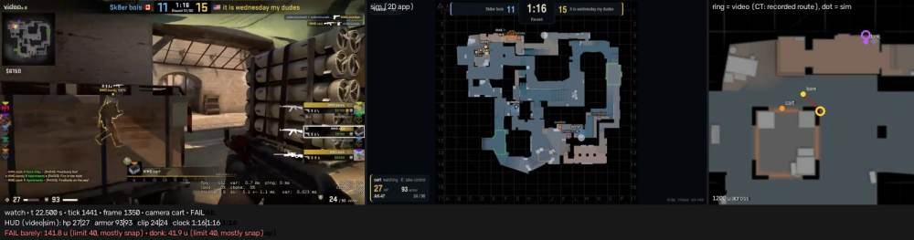

# Video parity (V0): the sim against the original round's video, frame by frame

John (2026-11-07): "play the round in the 3D sim game and compare it frame by frame to the original round's video to make
sure they look the same, minus the obvious differences in graphics. Use this test to verify the work is being developed
correctly at each milestone. Also run this test on the 2D game."

`tools/video-parity.ts` takes eradicate's POV recording (the only source of the round, `docs/round-data.md`), reads what
it shows at each timestamp (the radar dots, the HUD numbers, the kill feed, the C4 icon, the score) and compares it with
the sim's state at the same moment, per player. It writes a contact sheet per timestamp (video | sim | radar overlay),
an index page, a JSON report, a markdown summary, and diffs everything against a committed baseline, so each milestone
shows what got better or worse. Findings of the first run on the 2D game: [`parity/2026-11-07-2d.md`](parity/2026-11-07-2d.md).



## Run it

```sh
npm run parity:2d     # milestone gate: build, the whole round every 0.5 s + every event/shot frame, watch and follow runs,
                      # against docs/parity/baseline-2d.json (exit 1 on a regression)
npm run parity:3d     # the same for the 3D app (needs H1's src/app3d and npm run build:3d; exits 2 until then)
npm run parity -- --app 2d --times "18.5,18.8,50.2" --runs watch --out logs/p   # a few frames
npm run parity -- --app 2d --times "every 0.5" --out logs/parity-2d --baseline docs/parity/baseline-2d.json \
                  --update-baseline --write-docs docs/parity/<date>-2d.md        # new baseline + dated report
```

| Option | Meaning |
| --- | --- |
| `--app 2d\|3d` | Which game. |
| `--times "every 0.5"` or `"<t>,<t>,…"` | Video seconds (0–70 s; the clip then shows the next round). Plus, unless `--no-events`, every kill, the plant, the defuse start and end and every timed row of the shots CSV (181 timestamps for `every 0.5`). |
| `--runs watch,follow` | `watch`: nobody plays (the golden master). `follow`: cart is the human on `fixtures/scripts/cart-follows-recording.json` (`docs/golden.md`). |
| `--out <dir>` | Output and cache (default `logs/parity-<app>`; gitignored). |
| `--video <mp4>` | The recording; default `../web-apps/cs2/mirage-round-replay/source/video_1080p60_h264.mp4` next to the repo (or next to the main clone for a worktree in `../wt/`), or `$PARITY_VIDEO`. |
| `--no-browser` / `--reuse-shots` | Skip the app screenshots (the middle panel is then drawn from the log) / reuse the ones in `<out>/app`. |
| `--sheets all\|fails\|none` | Which contact sheets to draw (default all). |
| `--baseline <json>` `[--update-baseline]` | Compare against (or write) a baseline. |
| `--write-docs <md>` | Put the summary (only failing timestamps) between the `parity:begin/end` markers of that file. |

**Needs:** Node 22, `python3` with `numpy` and `opencv-python-headless` (`pip install numpy opencv-python-headless`),
`ffmpeg` on `PATH` (or `$FFMPEG`; `pip install imageio-ffmpeg` provides a static binary), Chrome for the screenshots
(`CHROME_PATH`, as `npm run check:browser`), and the private video. It never runs in CI (the video is private), only the
pure comparisons are unit-tested (`tests/video-parity.test.ts`). The video and audio never enter this repo: frames
and full-size contact sheets stay in `--out`; only a few downscaled sheets are committed (`docs/img/parity-*.jpg`).

**Time** (2-vCPU cloud VM, roughly): a first run is about 5 minutes (decoding the 202 frames, one pass of the 60 fps
HUD-strip scan over all 4,816 frames, 181 seeks and screenshots of the 2D page, two harness runs, 362 sheets). Later
runs reuse the frames and the scan (`<out>/truth`) and take 2–3 minutes, about 1 minute with `--reuse-shots`.

**Outputs** in `<out>`: `index.html` (every timestamp, its verdict and failing checks, a link to its sheet),
`sheets/<run>-<t>.jpg`, `summary.md`, `report.json` (every check), `truth/truth.json` (the ground truth),
`truth/frames/` (the decoded frames), `truth/digit-templates.png` (the HUD digit templates), `app/` (2D app screenshots).

## Pipeline

| Step | File | What |
| --- | --- | --- |
| 1. Frames | `tools/parity/video_truth.py` | ffmpeg, one decode pass with a `select` filter: frame `n = round(60 t)` for each t (the video starts at pts 0, 60 fps constant; `t` is the sim's clock, round clock = 98.25 − t). |
| 2. Ground truth | `tools/parity/video_truth.py` | Radar dots → world x/y, HUD numbers, and the 60 fps events (below). |
| 3. The sim | `tools/video-parity.ts` | `runHarness` (the app's own `Session`, `docs/golden.md`) for each run; the state at t is the observe after tick `round(64 t)` has run (its shots and damage included, as the frame at t shows them). 2D: Playwright drives the built page (`dist/`, `vite preview` on **port 4181**; the browser check uses 4179) at `?human=none&seed=1`, `window.__cs2replay.seek(t)` for each t in order, closes the status panel and screenshots the map canvas; each shot's pawn positions are checked against the Node run (identical: 0.000 u at all 181 shots). |
| 4. Metrics | `tools/parity/metrics.ts` | Per timestamp and player (below); events; summary; baseline diff. Pure, unit-tested. |
| 5. Sheets | `tools/parity/sheets.py` | Video frame \| app screenshot (or, for runs the page doesn't play, the sim's dots drawn on the radar) \| a radar overlay zoomed on the worst failing player (ring = video, dot = sim, red line = a failing error). Also `similarity` (edge F-score and blurred SSIM of two views) for the 3D mode. |

## Ground truth, per field

| Field | How it is read | Automatic? | Accuracy (measured) |
| --- | --- | --- | --- |
| Radar, 13.2 s on (spectator full-map radar) | Fixed crop (1920×1080 px 10–290, 66–346), registered once to the overview (`data/mirage-radar.jpg`) by OpenCV ECC (affine, on the walkable masks; median of 10 frames, correlation 0.94), then `radar_px → world` with the round's transform (`x = 5 px − 3230`, `y = 1713 − 5 py`). Dots: saturated round blobs (area 25–220 px, solidity ≥ 0.8, circularity ≥ 0.55) that differ from the median background of 38 frames, classified by hue: the T teammates by their colour (barely yellow, cart orange, donk purple, eradicate blue, snarlbot green), CTs red. | yes | Against round.json's observed samples (the same video, read by the original extraction): **RMS 20.7 u, p95 38 u** over 438 dots. 1 crop px = 18.4 u. |
| Radar, 0–12.75 s (eradicate's rotating POV radar) | Dots as screen offsets from the radar centre; world = eradicate's recorded position + `z · R(yaw)` (offset), with his recorded yaw and one complex scale `z` (zoom and rotation) fitted by least squares on 14 teammate dots in 5 frames: 12.18 u/px, −0.6°. ECC per frame on this radar was unreliable (the radar shows a dark sector and the CS:GO radar differs from the CS2 overview at this zoom), so the centre and rotation come from the recording. | dot offsets yes; centre and yaw from round.json | 2–11 u residuals on the calibration dots; eradicate himself is not measured (he is the centre). |
| Identity | T dots by colour; a dead T's colour (after his kill-feed death) is his death marker. Red dots: the CT with a sighting (round.json `sightings`, ±0.3 s) nearest to the dot within `max(150, uncertainty + 100)` u; red blobs outside every sighting are last-known "?" markers or the flashing site marker. | colour yes; CT identity from round.json | Detection: barely 129/135 alive timestamps, cart 165/176, donk 109/116 (a dot under the C4 icon or another dot is missed); snarlbot 9/37 (off eradicate's radar before 13 s); Sp4rtaN on the bomb is under the C4 icon and not seen. |
| HP, armor, ammo clip (watched player) | Template matching of the HUD digits (white, low chroma connected components, 16×24 normalized glyphs) against templates cut from 31 hand-labelled frames (`LABELS` in `video_truth.py`; every digit of every font); reads under a 0.8 match score count as unread. | yes | Match scores 0.85–0.98 on read digits; 2 HP and 5 clip reads of 170/167 fell under 0.8 (unread). Every value that disagrees with the sim was re-read at 60 fps around it (12.55–12.8, 18.4–18.6, 49.8–50.4, 58.75–58.9, 59.3–64 s) and is consistent frame to frame. Reserve has templates for 0 and 9 only, so it is read but not compared. |
| Round clock (until the plant) | The same digit reader on the clock (two layouts: POV until 12.75 s, spectator after). Templates from frames whose clock is `ceil(98.25 − t)`, so this checks consistency, not the formula. | yes | 51 read, 11 unread (the seconds around camera cuts and the death cam), 0 disagreements. |
| Bomb planted | The HUD swaps the clock for a red C4 icon: red pixels in the clock box, scanned at 60 fps; "shown" at t = seen in the last 0.75 s (it pulses). The bomb timer itself is **not shown** on this (CS:GO) HUD, so it is not compared; the 2D app's bomb countdown is an addition. | yes | First icon frame 27.517 s = the breakdown's plant. |
| Round end | The CT score digits change (11 → 12), 60 fps scan. | yes | 66.800 s = the breakdown's defuse. |
| Kill feed | 60 fps scan of the kill-feed rows (yellow T-name / blue CT-name pixels, and the red box of the watched player's own death); an onset is a row rising by > 12 px over its last 9 frames and staying up 3 frames (the entry's first visible frame; it fades in over ~3 frames). Each kill takes the onset nearest its breakdown time within −0.3/+0.4 s. | yes (window from round.json) | All 9 kills found. |
| Watched player | The breakdown's camera schedule (round.json `pov`). | from the docs | — |
| CTs never on the radar | Not in the video: the recording's inferred route and its uncertainty radius (round.json) are the truth. | from the docs | the stated radius. |

## Checks and thresholds

| Check | Pass when |
| --- | --- |
| Radar dot (T, spotted CT) | sim within **40 u** of the video's dot (the video's own accuracy is ±20–40 u, measured RMS 21 u) |
| Inferred CT | sim within the recording's **uncertainty radius** (110–450 u) of the inferred route |
| Alive/dead | the sim agrees with the tape (kill-feed deaths) except within 0.05 s of the death |
| HP, armor, clip | **exact**, at t or one video frame either side (the 60 fps frames and 64 Hz ticks don't line up); a grenade/knife/C4 in hand must show no ammo counter |
| Clock / bomb | the clock text exact before the plant; after it, the C4 icon iff the sim's bomb is planted (± a frame) |
| Kill, plant, round end | sim tick within **2 ticks** of the video's first frame |
| Timestamp | every check above passes |

Every failing radar check is split three ways so the cause is visible: **recording** (the video's dot vs round.json:
the extraction misread the video), **snap** (round.json vs `data/geometry/mirage-tracks.json`, the track snapped and
retimed onto CS2 Mirage that the puppet actually follows: the CS2 map differs or the snap chose badly) and **puppet**
(the sim vs that snapped track: lag, body blocks, AI, a human script). The largest part is named in the report.

## Milestone gate

`docs/parity/baseline-2d.json` holds every check's verdict of the committed run (per run: per timestamp and player,
per HUD field, per event). `npm run parity:2d` rebuilds the app, reruns everything, prints how many checks got fixed
and lists every **regression** (a check that passed in the baseline and fails now), exiting 1 if there is one. At each
milestone:

1. `npm run parity:2d` (and `npm run parity:3d` once the 3D app exists). Regressions must be explained or fixed.
2. Look at the sheets of what changed (`logs/parity-2d/index.html`).
3. When the change is intended (a fix landed, the data was corrected), update the baseline in the same PR:
   `npm run parity -- --app 2d --out logs/parity-2d --baseline docs/parity/baseline-2d.json --update-baseline
   --write-docs docs/parity/<date>-2d.md` and say in the PR what moved.

The baseline is deterministic for the same data and code: the harness is (`docs/golden.md`), and the ground truth is
(same frames, deterministic OpenCV calls, fixed templates). Changing the detector changes the truth: regenerate the
baseline in the same commit and say so.

## The 3D mode (H1's app)

`--app 3d` drives `dist-3d/` (H1's `npm run build:3d`) with Playwright at 1920×1080 and needs these from the page
(`tools/parity/browser.ts` `shots3d`), so H1 can expose them:

- **`window.__cs2sim3d.ready`** once loaded, watching (`?human=none&seed=1`).
- **`seek(t): Promise<void>`**: land on observe tick `round(64 t)` deterministically (the same state whatever the path:
  the 2D Session's `seek`), resolved once that state is rendered.
- **`spectate(id | null)`**: the first-person camera of that pawn as the video shows it: at his eye (64 standing, 46
  crouched), his yaw and pitch, CS2/CS:GO's 90° horizontal FOV at 4:3, i.e. 106.26° at 16:9, viewmodel off or fixed;
  `null` a free camera.
- **`pawns()`**: `[{id, x, y, z, yaw, pitch, alive}]` at the landed tick; **`hud()`**: `{hp, armor, clip, reserve,
  clock, bombPlanted}` of the spectated pawn as the HUD shows them.
- **`project(x, y, z)`**: screen pixels `{x, y, visible}` of a world point through the current camera (for player
  screen positions vs the video).
- **Deterministic rendering**: nothing keyed to wall time (tracers, muzzle flash, smoke animation by tick), no random
  per-frame effects, so a screenshot after `seek` is reproducible; the HUD drawn in the same places as CS2's if
  possible (the masks of `sheets.py similarity` cover radar, kill feed, team panels and the bottom bar).

It then compares per timestamp: the view's geometry (`sheets.py similarity`: Canny edges F-score at 3 px and SSIM of
the blurred, equalized grey views at 480×270, HUD areas masked), the spectated player's yaw (vs the recording's yaw,
only known for the Ts on camera), the HUD numbers (from `hud()`) and the radar positions as in 2D (from `pawns()`).
Players' screen positions need boxes in the video: detection on a 2020 CS:GO frame vs flat-shaded capsules is not
reliable, so the plan is ~20 hand-labelled key frames (the Lokier window duel 17.4–18.8 s, Sp4rtaN behind donk
49.9–50.3 s, the retake 58.6–66.8 s) in `tools/parity/labels-3d.json`, against `project()` of the sim's pawns. Until
`src/app3d` is on main, `npm run parity:3d` exits 2 with a message.

## Limitations

- The radar is the only position source, so z is not compared; a T hidden under another icon is not measured.
- Before 13 s the POV radar's centre and rotation come from the recording (eradicate's track and yaw), so eradicate is
  not measured and his teammates are measured relative to him.
- CTs are measured only while spotted (red dots); otherwise against their inferred route's radius.
- HUD: only the watched player's HP/armor/ammo; the team panel's HP (all five Ts) could be read the same way (the
  digits are smaller) and would cover the Ts off camera.
- The audio (`audio_opus.webm`) is not used: shot times come from the ammo HUD (exact to a frame), which the clip check
  covers; the audio onsets in the shots CSV look about 0.05 s late against the video (eradicate's HUD reads 0 HP at
  12.683 s, Lokier's audio onset is 12.733 s).
