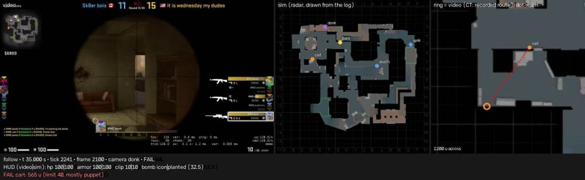
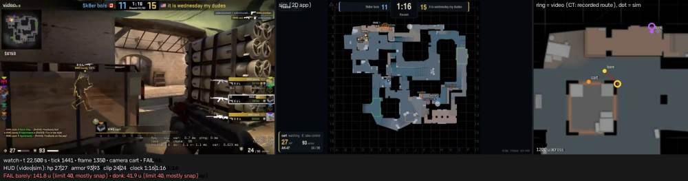
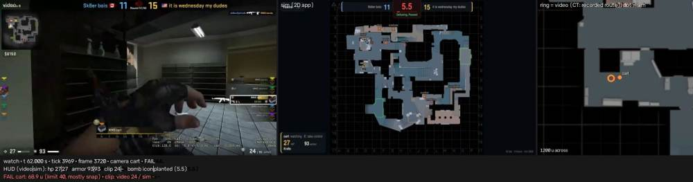
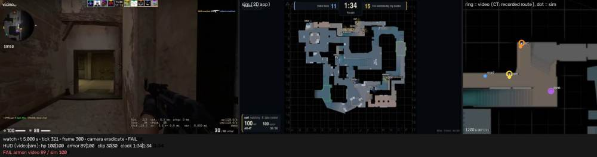

# Video parity, 2D game, 2026-11-07 (V0): findings

The first run of `tools/video-parity.ts` (`docs/parity.md`) on the 2D game against eradicate's recording: the whole
round every 0.5 s plus every kill, plant, defuse and shots-CSV frame (181 timestamps, 0–70 s), in watch mode (nobody
plays: the golden master, digest `72b58704`) and in the follow-recording run (cart as the human on
`fixtures/scripts/cart-follows-recording.json`, digest `0c4f0fa7`), on `main` at `dd593f2`. The 2D page's screenshots
were checked against the Node run (positions identical at all 181 shots). The generated summary is at the end;
the baseline is `baseline-2d.json`. Rerun on `v0-parity` after merging `main` at `2de435f` (3D app, weapons, M1): every check identical (0 fixed, 0 regressed). Rerun again after merging `main` at `97dd679` (M1 #30, G6 #37, H2b #35; watch digest `150f77b4`, follow `b182b907`): 2 checks fixed (donk at 50 s), 22 regressed (cart 17.5–19.5 s in both runs: finding 0); the numbers below and the baseline are from this rerun.

**In short.** Plant and defuse land on the video's frame exactly (27.517 s, 66.800 s), the clock matches to the
second (51/51), HP matches everywhere but one death frame (169/170), and the teammates' dots are within 40 u of the
video in 299 of 438 checks (RMS 42 u; the video's own reading agrees with round.json to 21 u RMS). What a viewer would
notice: the follow run loses cart for 35 s; puppets teleport ~100 u (Sp4rtaN 395 u) in eleven places; Sp4rtaN reaches
B 200 u late for the barely kill; barely takes a different path through Apartments and over B; most other position
errors are the CS2 snap of the 2020 track (116 of the 139 radar failures). Then three recording errors on the HUD
(eradicate's armor, donk's armor, cart's knife), and kill times 2–4 ticks off the frames.

| run | timestamps passing | radar dots > 40 u (RMS, worst) | HUD fails | events within 2 ticks |
| --- | ---: | --- | --- | ---: |
| watch | 57 / 181 | 139 / 438 (42.3 u, 163 u barely 23 s): snap 116, recording 13, puppet 10 | armor 35, clip 9, hp 1 | 5 / 11 |
| follow | 29 / 181 | 185 / 438 (177 u, 608 u cart 41.5 s): puppet 92, snap 82, recording 11 | same as watch | 5 / 11 |

Causes (each failing dot split three ways, `docs/parity.md`): **recording** = the video's dot vs round.json,
**snap** = round.json vs the CS2-snapped track the puppet follows (`data/geometry/mirage-tracks.json`), **puppet** =
the sim vs that track.

## Findings, ranked by what a viewer would notice

### 0. New since G6 (#37): cart is 40–110 u south of the video at the Apartments window (17.5–19.5 s), the Lokier duel

- **What:** cart's dot passed at every timestamp of the duel in the first run; after G6 it fails at 17.5–19.5 s in
  both runs (42.7 u at 17.5 s, 101 u at 18.5 s, 110 u at 18.7 s, 98 u at the kill 18.8 s, 41 u at 19.5 s): the sim has
  him at about (−1730, 700) while the video's dot is at (−1760, 800), inside the window room.
- **Cause (snap):** G6's pass 5 (`tools/sight-snap.ts`, a5d8da4: "snapped tracks keep every recorded duel in sight on
  the CS2 mesh") moved cart's snapped track about 100 u south so Lokier is in his sight on the CS2 mesh; the recording
  is unchanged (the split names `snap`).
- **Fix:** keep the duel in sight with a smaller move (a spot within 40 u of the video's dot that sees Lokier: the
  window itself is penetrable since H2b), or accept it until the 2020 map (X1) removes the need. Owner: G6 / geometry.

### 1. Follow run: cart is stuck behind a box for 35 s (29.3–64 s), 300–608 u from the video

- **What:** in the follow-recording run cart stops at (−2000, −248) at 29.25 s and stands there until about 64 s,
  while the video shows him walking into Shop (30–34 s), hiding there (34–59 s) and coming to the Shop door for the
  spray (65.9 s). Error 182 u at 30 s, 365 u at 32 s, 565–608 u from 34 to 44 s, 194–370 u to 62 s, then he
  reaches the door area (16 u at 66 s). 81 of the follow run's 92 puppet-caused failures (88 are cart's).
- **Cause (sim):** the follow script's shadow puppet never snaps (a human can't teleport), and at 29.3 s cart's
  snapped track has one of the 7 unresolved transitions of `docs/geometry.md` ("the recording walking through a box
  CS2 has, with no way round found in time (cart 29.3 s and 64.2 s)"); the straight-line track follower pushes into
  the box forever. The watch-mode puppet snaps through it instead (finding 2: cart 104 u at 29.4 s).
- **Fix:** (a) `tools/snap-tracks.ts` (G3): resolve the 29.3 s and 64.2 s transitions (a longer A* budget or a detour
  round the box), then regenerate the follow script (`npm run fixtures:update`); and/or (b) the track follower
  (`src/core` puppet following, B2; used by `tools/follow-script.ts`): when the next sample is not in a clear hull
  line, steer along the nav path to it instead of straight at it. Owner: geometry/G3 + core B2; data `fixtures/scripts`.

### 2. Puppets teleport 96–395 u in eleven places (watch mode)

- **What:** the harness's snaps (summary.json): snarlbot 98 u at 9.89 s, cart 97 u at 14.37 s, Sp4rtaN 103 u at
  18.30 s, **395 u at 19.20 s** and 97 u at 19.45 s, donk 112 u at 21.00 s, cart 96 u at 21.77 s, cart 104 u at
  29.38 s, barely 96 u at 35.92 s, barely 99 u at 45.00 s, cart 112 u at 64.30 s. Each is a visible jump on the 2D
  map; the video's dots move continuously. The parity checks see them as the "puppet" errors just before each snap
  (barely 70 u at 45.5 s, cart 37–58 u at 21.5–27 s, Sp4rtaN 244–293 u at 18.9–19.0 s against a 200 u radius).
- **Cause:** for the Ts, the snaps sit on the unresolved transitions and jump take-offs of the snapped tracks
  (`docs/geometry.md`: cart 14.2–14.5 s and the Balcony drop at 21 s, donk 20.9 s onto a floor CS2 raises 32 u, barely
  35.0 s into the underpass and 44.9 s back up, snarlbot 9.8 s on T ramp) where the puppet falls more than 96 u behind
  (`replay.driftSnapUnits` in `data/tuning.json`). For Sp4rtaN it is the **recording**: his inferred route runs from (−633, −1647) at
  18.5 s to (−229, −1652) at 19.1 s, about 670 u/s, three times a Desert Eagle's 230 u/s; the puppet runs at 230 and
  is 395 u behind when it snaps.
- **Fix:** Sp4rtaN: retime the inferred route 17.9–19.6 s (the A-stairs kill to the AK pick-up) to ≤ 230 u/s,
  starting the move earlier (round data: the web-apps page's track, `tools/extract-round.ts` inputs; it is an
  inferred reconstruction, so nothing observed moves). Ts: resolve those transitions in `tools/snap-tracks.ts` with
  jump/drop edges where they fit (check whether the Balcony drop and the underpass step work as a drop or a
  crouch-jump on the CS2 mesh, which the standing-jump headroom rule of `docs/geometry.md` would not have found), so
  the puppets move through instead of snapping. Owner: round
  data + geometry/G3.

### 3. Sp4rtaN reaches B 200 u late and kills barely from 180 u north of where the video has him (57.7–59.5 s)

- **What:** the recording observes Sp4rtaN on B at (−2089, 357) from 58.6 s (the video's radar hides his dot under
  the C4 icon, so the check uses the recording's reading of the same frames): the sim has him at (−2136, 553) at
  58.75 s, 189 u off at 58.8 s, 181 u at the kill (58.85 s), 155 u at 59.0 s, 75 u at 59.5 s. Before that he is
  outside his inferred radius (120 u) by 142–215 u at 58.0–58.5 s. The scripted kill still happens on its tick, so
  the shot comes from the wrong place.
- **Cause (recording):** the inferred approach goes from (−2150, 666) at 57.6 s to the observed (−2110, 360) at 58.6 s,
  about 360 u/s; the AK puppet runs at 215 u/s.
- **Fix:** retime Sp4rtaN's inferred route over 55–58.6 s so it reaches (−2110, 360) by 58.6 s at ≤ 215 u/s (leave
  earlier or take the shorter way through the B Apartments stairs). Owner: round data.

### 4. barely takes a different path through Apartments (20–23.5 s) and over B after the plant (29–31.5 s)

- **What:** barely is 66–163 u off the video at 20–23.5 s (worst 163 u at 23.0 s) and 58–137 u at 29–31.5 s; the
  video and round.json agree there (2–12 u).
- **Cause (snap):** 55–117 u of it is the snapped track itself: `tools/snap-tracks.ts` "retime and reroute" replaced
  barely's 17.7–23.9 s stretch (1,427 u through the Apartments and off the Balcony's west end) with a 1,072 u shortest
  way; at 29–31.5 s the snap moves the post-plant walk (bomb → smoke spot) 52–123 u around CS2's B-site boxes.
- **Fix:** follow the recorded path where a hull can (a drop or crouch-jump edge with the right headroom, finding 2)
  and retime along it (behind at run speed, catch up where the recording is slower) instead of rerouting; for 29–31.5 s
  check which boxes differ between the 2020 map and CS2 and keep the snap on the recorded side of them. Owner:
  geometry/G3.

### 5. Standing players sit 40–85 u from where the video has them (the CS2 snap of 2020 spots)

- **What:** most of the remaining radar failures are players standing or walking slowly whose snapped spot is
  34–108 u from the recording: cart in Shop 34–44 s (57–85 u: snap 34–47 u plus the recording's own 20–38 u), donk at
  his Apartments window 21–28 s (42–55 u, snap 36–48 u), cart in Back Alley 1.5–4 s (41–43 u, snap 34–38 u), barely
  0.5–1.5 s and 11–16.5 s (45–87 u, snap 45–94 u), donk 13.5–16 s (52–134 u, snap 55–108 u: the Apartments floor CS2
  raises 32 u). In the 2D view the dot is half to one hull off; in 3D it decides what is in view.
- **Cause:** the 2020 positions are inside CS2 geometry or on another floor; the snap takes the nearest stand spot
  within 64 u. The registration is not the cause: elsewhere the video's dots and round.json agree to 21 u RMS.
- **Fix:** decide per spot (a short list: these five stretches) whether CS2's Mirage really differs there (then it is
  unavoidable, and the gate should allow the snap distance: a `snap-allowance` per sample, so only avoidable errors
  fail) or the snap picked the wrong side (then prefer the stand spot nearest the recording along the direction the
  player came from). Owner: geometry/G3 (snap), V0 (allowance, once G3 has decided).

### 6. cart holds a knife at 61.4–63.5 s; the video shows his AK (24/90)

- **What:** the HUD ammo counter is back at 24/90 from 61.4 s (60 fps reads: none 59.4–61.3 s, 24/90 from 61.4 s);
  the sim's cart has the knife until 63.5 s. 5 failing clip checks; in 3D the viewmodel and the run speed (knife
  250 vs AK 215 u/s) differ too.
- **Cause (recording):** `round.json` `timelines.weapon.cart` (from the web-apps page's `weapons`) has the knife at
  59.6 s and the AK at 63.5 s.
- **Fix:** AK-47 at 61.4 s (the first frame with the ammo counter) in the page data / `tools/extract-round.ts`'s
  weapon timeline, then regenerate round.json, the golden master and the fixtures. Owner: round data.

### 7. eradicate starts with 89 armor, not 100

- **What:** his HUD reads 100 / **89** from the first frame until his death (28 timestamps, every one of 0–12.7 s);
  the sim gives everyone but snarlbot 100/100. The other Ts' starting armor is confirmed by the HUD the first time
  the camera shows them (cart, donk, barely: 100).
- **Cause (recording):** the kit table in `tools/extract-round.ts` (from the movement doc) assumes 100.
- **Fix:** eradicate `startArmor: 89` (helmet: the HUD can't say; keep it). Owner: round data.

### 8. donk's armor doesn't drop when Sp4rtaN hits him (49.9–50.3 s)

- **What:** the video's HUD goes 100/100 → 73/**96** (49.900 s) → 39/**91** (50.000 s) → 13/**91** (50.100 s) →
  0 (50.300 s); the sim keeps donk's armor at 100. 6 failing armor checks.
- **Cause (recording):** the three damage rows (27, 34, 26) have `armor: null` (the CSV has armor only for cart's
  73/7); the scripted damage then removes none.
- **Fix:** armor 4, 5 and 0 on the 49.9, 50.0 and 50.1 s damage rows (round data from the shots CSV / the page's
  damage table). Owner: round data. (Check while there that Sim2D's scripted `damage` applies its `armor`; cart's
  7 does, 100 → 93 matches the video.)

### 9. Deaths are 2–4 ticks late against the victim's HUD, and kills 1–4 ticks early against the kill feed

- **What:** the victim's HUD reads 0 HP at eradicate 12.683 s, donk 50.300 s, barely 58.767 s; the sim's deaths are
  at ticks 816 (12.75 s), 3222 (50.34 s), 3766 (58.84 s). The kill-feed entries' first frames are 12.80, 50.40 and
  58.883 s, and 12.45 (Snakelore), 44.25 (Zwomp), 69.467 s (cart): 6 of 9 kills are 3–4 ticks before the kill feed
  (the others −2, −1, +1). The plant and the round end are exact.
- **Cause (recording):** round.json's kill times are the breakdown's kill-feed readings rounded to 0.05 s; in the
  video the HUD drops 0.10–0.12 s before the entry appears (it fades in), so the recorded times sit between the two.
- **Fix:** take a kill's tick from the victim's 0-HP frame when he is on camera (eradicate 12.683, donk 50.300,
  barely 58.767 s) and from the first kill-feed frame minus the measured HUD→feed lag otherwise; then the event check
  can compare against the HUD frame. The same frames show the shots CSV's audio onsets about 0.05 s late (Lokier's
  shot is heard at 12.733 s, eradicate's HUD is already 0 at 12.683 s): shift the audio-confirmed times by −0.05 s.
  Owner: round data (then the golden master, fixtures). Small (≤ 0.12 s) but a 3D viewer watching a duel frame by
  frame would see it.

### 10. Where the video and round.json disagree by 40–77 u (recording error candidates)

- **What:** snarlbot 13.5–16.5 s on A: the video's dot is 52–77 u south-east of round.json (6 failing checks);
  donk 12.73 s (47 u), 21.0 s (46 u), 34.5 s (47 u), 50.0 s (42 u); Lokier 12.73 s and 17.85 s (41–43 u); Zwomp 44.0 s
  (30 u, 45 u from the sim). Everywhere else the two readings agree to 21 u RMS.
- **Cause:** one of the two readings of the radar is off at those frames (the original extraction's per-frame ECC
  fit vs this tool's fixed affine and blob centroids; the A-site corner of the radar is where a global affine fit
  is least exact).
- **Fix:** look at the frames (the sheets are in `logs/parity-2d/sheets/watch-<t>.jpg`) and correct round.json where
  the video is clear. Owner: round data. Low.

### 11. A scheduled shot shows one tick early

- **What:** cart's first shot at Lokier is 18.517 s in the CSV (clip 30 → 29 on frame 1111); the sim's clip is 29
  already in the observe of tick 1184 (18.500 s), together with Lokier's hit. 1 failing clip check at 18.5 s; the
  other 8 clip failures are finding 6 (5) and the death frames of finding 9 (3).
- **Cause (sim):** the shot lands one tick before its scheduled tick (or the CSV time rounds up). One frame.
- **Fix:** check the shot schedule's tick (B3) against `round(t × 64)`. Owner: core B3. Lowest.

### 12. By design: the 2D HUD shows a bomb countdown

- The CS:GO HUD (and CS2's) shows only the C4 icon once the bomb is down; the 2D app shows a countdown in its place.
  The check compares the bomb state (99/99 pass), not the text. For the 3D app (H1, H4): copy CS2's HUD (no bomb
  timer) if the goal is "looks the same".

## What passes

- Plant 27.517 s and defuse/round end 66.800 s on the video's exact frame (60 fps scan).
- Clock: 51/51 read timestamps before the plant; bomb icon vs planted: 99/99.
- HP: 169/170 (the one failure is donk's death frame, finding 9); armor 137/172 (the 35 failures: findings 7 and 8,
  and barely's death frame); clip 158/167 (the 9: findings 6, 9 and 11).
- Alive/dead: no disagreement outside a frame of a death.
- Inferred CTs: inside their radius in 276 of 280 checks (the 4 are Sp4rtaN, findings 2 and 3).
- The puppets follow their snapped tracks closely: only 10 of the 139 watch-mode radar failures are the puppet.

## Generated summary

<!-- parity:begin (generated by tools/video-parity.ts --write-docs; do not edit by hand) -->
Generated by `npm run parity:2d` on 2026-11-07 (`tools/video-parity.ts`, thresholds in `docs/parity.md`).

| run | timestamps | pass | fail | radar checks | radar fail | radar RMS (u) | p95 (u) | worst (u) | video vs recording RMS / p95 (u) | recording-observed fail | inferred-CT fail | alive/dead fail | HUD fail (hp/armor/clip/clock/bomb) | events fail | worst event offset (ticks) |
| --- | ---: | ---: | ---: | ---: | ---: | ---: | ---: | --- | ---: | ---: | ---: | ---: | --- | ---: | ---: |
| watch | 181 | 57 | 124 | 438 | 139 | 42.3 | 86.2 | 163.0 (barely @ 23s) | 20.7 / 38.4 | 8/39 | 4/280 | 0 | 1/170 · 35/172 · 9/167 · 0/51 · 0/99 | 6/11 | 4 |
| follow | 181 | 29 | 152 | 438 | 185 | 176.8 | 565.0 | 608.4 (cart @ 41.5s) | 20.7 / 38.4 | 9/39 | 4/280 | 0 | 1/170 · 35/172 · 9/167 · 0/51 · 0/99 | 6/11 | 4 |

### watch: radar error per player (observed dots)

Radar failures by dominant cause: snap 116, recording 13, puppet 10 (recording = the video's dot vs round.json; snap = round.json vs the CS2-snapped track the puppet follows; puppet = the sim vs that track).

| player | samples | RMS (u) | max (u) | > 40 u |
| --- | ---: | ---: | ---: | ---: |
| barely | 129 | 47.8 | 163 | 42 |
| cart | 165 | 44.1 | 110.1 | 64 |
| donk | 109 | 33.6 | 134 | 23 |
| lokier | 10 | 24.6 | 43.7 | 2 |
| snarlbot | 9 | 57.7 | 79.3 | 7 |
| sp4rtan | 15 | 19.6 | 28.5 | 0 |
| zwomp | 1 | 45.2 | 45.2 | 1 |

### watch: events

| event | video t (s) | video tick | sim tick | offset (ticks) | verdict | source |
| --- | ---: | ---: | ---: | ---: | --- | --- |
| kill snarlbot → incredibad | 0.533 | 34 | 32 | -2 | pass | kill feed (60 fps scan) |
| kill snarlbot → snakelore | 12.450 | 797 | 794 | -3 | fail | kill feed (60 fps scan) |
| kill lokier → eradicate | 12.800 | 819 | 816 | -3 | fail | kill feed (60 fps scan) |
| kill sp4rtan → snarlbot | 17.867 | 1143 | 1142 | -1 | pass | kill feed (60 fps scan) |
| kill cart → lokier | 18.783 | 1202 | 1203 | 1 | pass | kill feed (60 fps scan) |
| kill barely → zwomp | 44.250 | 2832 | 2829 | -3 | fail | kill feed (60 fps scan) |
| kill sp4rtan → donk | 50.400 | 3226 | 3222 | -4 | fail | kill feed (60 fps scan) |
| kill sp4rtan → barely | 58.883 | 3769 | 3766 | -3 | fail | kill feed (60 fps scan) |
| kill sp4rtan → cart | 69.467 | 4446 | 4442 | -4 | fail | kill feed (60 fps scan) |
| bomb planted | 27.517 | 1761 | 1761 | 0 | pass | C4 icon replaces the clock (60 fps scan) |
| round end (CT bomb_defused) | 66.800 | 4275 | 4275 | 0 | pass | CT score 11 → 12 on the scoreboard (60 fps scan) |

### watch: failing timestamps

| t (s) | tick | camera | verdict | worst dot (u) | failing checks |
| ---: | ---: | --- | --- | ---: | --- |
| 0 | 1 | eradicate | fail | 24.8 | armor video 89 sim 100 |
| 0.5 | 33 | eradicate | fail | 59.5 | barely 59.5 u (rec 3.1, snap 60.2, puppet 0.2); armor video 89 sim 100 |
| 1 | 65 | eradicate | fail | 51.9 | barely 51.9 u (rec 4.4, snap 53.2, puppet 7.4); armor video 89 sim 100 |
| 1.5 | 97 | eradicate | fail | 45.6 | barely 45.6 u (rec 6.7, snap 45.0, puppet 2.5); cart 41.8 u (rec 7.7, snap 34.0, puppet 1.7); armor video 89 sim 100 |
| 2 | 129 | eradicate | fail | 41.2 | cart 41.2 u (rec 5.4, snap 36.0, puppet 0.1); armor video 89 sim 100 |
| 2.5 | 161 | eradicate | fail | 39.4 | armor video 89 sim 100 |
| 3 | 193 | eradicate | fail | 41.9 | cart 41.9 u (rec 7.6, snap 38.2, puppet 0.4); armor video 89 sim 100 |
| 3.5 | 225 | eradicate | fail | 41.3 | cart 41.3 u (rec 10.2, snap 34.0, puppet 0.1); armor video 89 sim 100 |
| 4 | 257 | eradicate | fail | 42.6 | cart 42.6 u (rec 6.0, snap 38.0, puppet 0.4); armor video 89 sim 100 |
| 4.5 | 289 | eradicate | fail | 39.9 | armor video 89 sim 100 |
| 5 | 321 | eradicate | fail | 35.9 | armor video 89 sim 100 |
| 5.5 | 353 | eradicate | fail | 25.5 | armor video 89 sim 100 |
| 6 | 385 | eradicate | fail | 28.5 | armor video 89 sim 100 |
| 6.5 | 417 | eradicate | fail | 20.5 | armor video 89 sim 100 |
| 7 | 449 | eradicate | fail | 32.7 | armor video 89 sim 100 |
| 7.5 | 481 | eradicate | fail | 26.9 | armor video 89 sim 100 |
| 8 | 513 | eradicate | fail | 37.1 | armor video 89 sim 100 |
| 8.5 | 545 | eradicate | fail | 39.1 | armor video 89 sim 100 |
| 9 | 577 | eradicate | fail | 24.6 | armor video 89 sim 100 |
| 9.5 | 609 | eradicate | fail | 25.3 | armor video 89 sim 100 |
| 10 | 641 | eradicate | fail | 15.7 | armor video 89 sim 100 |
| 10.5 | 673 | eradicate | fail | 16.3 | armor video 89 sim 100 |
| 11 | 705 | eradicate | fail | 72.0 | barely 72 u (rec 25.2, snap 45.0, puppet 5.4); armor video 89 sim 100 |
| 11.5 | 737 | eradicate | fail | 57.2 | barely 57.2 u (rec 1.3, snap 57.3, puppet 1.1); armor video 89 sim 100 |
| 12 | 769 | eradicate | fail | 39.8 | armor video 89 sim 100 |
| 12.4 | 795 | eradicate | fail | 68.9 | barely 68.9 u (rec 11.4, snap 77.3, puppet 2.2); armor video 89 sim 100 |
| 12.5 | 801 | eradicate | fail | 74.7 | barely 74.7 u (rec 4.1, snap 76.4, puppet 3.0); armor video 89 sim 100 |
| 12.73 | 816 | eradicate | fail | 48.4 | barely 40.7 u (rec 36.2, snap 69.1, puppet 5.7); donk 48.4 u (rec 46.9, snap 15.2, puppet 4.6); lokier 40.7 u (rec 41.8, snap 60.3, puppet 0.1); armor video 0 sim 100; clip video 0 sim 30 |
| 13.5 | 865 | donk | fail | 79.3 | donk 51.8 u (rec 21.1, snap 55.5, puppet 20.7); snarlbot 79.3 u (rec 75.6, snap 0.0, puppet 5.7) |
| 14 | 897 | cart | fail | 72.3 | donk 56.6 u (rec 14.8, snap 56.3, puppet 15.8); snarlbot 72.3 u (rec 76.4, snap 0.0, puppet 4.4) |
| 14.5 | 929 | cart | fail | 100.2 | barely 87.1 u (rec 8.0, snap 93.7, puppet 5.6); cart 75.7 u (vs recording); donk 100.2 u (rec 7.6, snap 96.6, puppet 11.2); snarlbot 49 u (rec 70.2, snap 0.0, puppet 24.8) |
| 15 | 961 | cart | fail | 93.7 | barely 49.1 u (rec 1.7, snap 45.0, puppet 5.4); donk 93.7 u (rec 9.8, snap 107.5, puppet 6.9); snarlbot 62 u (rec 74.7, snap 0.0, puppet 14.7) |
| 15.5 | 993 | cart | fail | 134.0 | barely 79.7 u (rec 0.8, snap 76.5, puppet 5.2); donk 134 u (rec 9.4, snap 107.8, puppet 31.7); snarlbot 54.6 u (rec 52.5, snap 0.0, puppet 4.7) |
| 16 | 1025 | cart | fail | 102.7 | barely 51.7 u (rec 5.3, snap 52.5, puppet 3.2); donk 102.7 u (rec 11.3, snap 69.6, puppet 30.3); snarlbot 67 u (rec 77.5, snap 10.0, puppet 6.8) |
| 16.5 | 1057 | cart | fail | 54.6 | barely 51.2 u (rec 1.5, snap 50.0, puppet 1.2); snarlbot 54.6 u (rec 60.1, snap 110.8, puppet 3.2) |
| 17 | 1089 | cart | fail | 44.1 | barely 44.1 u (rec 4.7, snap 42.0, puppet 0.2) |
| 17.5 | 1121 | cart | fail | 42.7 | cart 42.7 u (rec 7.4, snap 40.2, puppet 5.4) |
| 17.85 | 1143 | cart | fail | 69.9 | barely 55.9 u (rec 8.0, snap 51.7, puppet 2.1); cart 69.9 u (rec 17.1, snap 59.7, puppet 3.9); lokier 43.7 u (rec 40.7, snap 0.0, puppet 3.4) |
| 18 | 1153 | cart | fail | 72.6 | barely 51.5 u (rec 5.8, snap 47.5, puppet 6.6); cart 72.6 u (rec 25.1, snap 64.1, puppet 6.7) |
| 18.5 | 1185 | cart | fail | 101.3 | barely 56.4 u (rec 1.9, snap 44.1, puppet 14.5); cart 101.3 u (rec 5.6, snap 106.3, puppet 6.4); clip video 30 sim 29 |
| 18.517 | 1186 | cart | fail | 93.9 | barely 50.4 u (rec 6.4, snap 44.1, puppet 15.2); cart 93.9 u (rec 8.1, snap 105.6, puppet 5.6) |
| 18.617 | 1192 | cart | fail | 105.6 | barely 60.7 u (rec 4.9, snap 42.9, puppet 18.4); cart 105.6 u (rec 6.4, snap 102.5, puppet 2.7) |
| 18.7 | 1198 | cart | fail | 110.1 | barely 54.1 u (rec 2.4, snap 38.1, puppet 16.1); cart 110.1 u (rec 6.7, snap 102.5, puppet 1.8) |
| 18.8 | 1204 | cart | fail | 98.4 | barely 52.7 u (rec 11.0, snap 26.5, puppet 17.5); cart 98.4 u (rec 6.4, snap 97.4, puppet 4.3) |
| 18.9 | 1211 | cart | fail | 87.2 | cart 87.2 u (rec 8.4, snap 75.9, puppet 3.9); sp4rtan 243.6 u > r 200 |
| 19 | 1217 | cart | fail | 73.4 | cart 73.4 u (rec 5.9, snap 58.2, puppet 11.5); sp4rtan 292.5 u > r 200 |
| 19.5 | 1249 | cart | fail | 41.4 | cart 41.4 u (rec 19.4, snap 27.9, puppet 4.8) |
| 20 | 1281 | cart | fail | 67.5 | barely 67.5 u (rec 12.1, snap 54.8, puppet 5.3); cart 46.3 u (rec 12.4, snap 29.2, puppet 5.6) |
| 20.5 | 1313 | cart | fail | 66.1 | barely 66.1 u (rec 1.4, snap 65.4, puppet 2.6); cart 56.3 u (rec 7.0, snap 43.0, puppet 16.7) |
| 21 | 1345 | cart | fail | 45.4 | donk 45.4 u (rec 45.6, snap 0.0, puppet 0.3) |
| 21.5 | 1377 | cart | fail | 94.2 | barely 94.2 u (rec 14.4, snap 99.6, puppet 1.6); cart 51.2 u (rec 6.9, snap 4.0, puppet 54.8); donk 51.3 u (rec 12.4, snap 38.0, puppet 1.0) |
| 22 | 1409 | cart | fail | 137.0 | barely 137 u (rec 4.7, snap 116.5, puppet 19.4) |
| 22.5 | 1441 | cart | fail | 141.8 | barely 141.8 u (rec 7.6, snap 115.7, puppet 38.9); donk 41.9 u (rec 15.6, snap 26.0, puppet 2.5) |
| 23 | 1473 | cart | fail | 163.0 | barely 163 u (rec 10.7, snap 85.1, puppet 92.6); cart 61.5 u (rec 6.0, snap 26.0, puppet 48.3); donk 45.1 u (rec 9.7, snap 36.0, puppet 0.2) |
| 23.5 | 1505 | cart | fail | 51.0 | barely 106.6 u (vs recording); cart 84.7 u (vs recording); donk 51 u (rec 16.3, snap 36.0, puppet 0.1) |
| 24 | 1537 | cart | fail | 51.0 | donk 51 u (rec 16.3, snap 36.0, puppet 0.1) |
| 24.5 | 1569 | cart | fail | 53.6 | donk 53.6 u (rec 17.3, snap 38.0, puppet 0.3) |
| 25 | 1601 | cart | fail | 50.3 | donk 50.3 u (rec 16.2, snap 36.0, puppet 0.2) |
| 25.5 | 1633 | cart | fail | 55.5 | donk 55.5 u (rec 5.0, snap 48.0, puppet 10.0) |
| 26 | 1665 | cart | fail | 53.7 | donk 53.7 u (rec 7.7, snap 46.0, puppet 0.6) |
| 26.5 | 1697 | cart | fail | 58.8 | cart 58.8 u (rec 8.8, snap 0.0, puppet 58.6); donk 53.5 u (rec 7.7, snap 46.0, puppet 0.1) |
| 27 | 1729 | cart | fail | 52.9 | cart 50.9 u (rec 15.8, snap 0.0, puppet 37.0); donk 52.9 u (rec 7.4, snap 46.0, puppet 0.9) |
| 27.5 | 1761 | cart | fail | 52.4 | donk 52.4 u (rec 8.4, snap 44.0, puppet 0.1) |
| 27.517 | 1762 | cart | fail | 52.4 | donk 52.4 u (rec 8.4, snap 44.0, puppet 0.1) |
| 28 | 1793 | cart | fail | 49.7 | donk 49.7 u (rec 9.7, snap 40.0, puppet 0.6) |
| 28.5 | 1825 | cart | fail | 11.2 | barely 63.2 u (vs recording) |
| 29 | 1857 | cart | fail | 115.6 | barely 115.6 u (rec 5.1, snap 91.7, puppet 25.7); cart 105.1 u (rec 36.8, snap 75.0, puppet 2.5) |
| 29.5 | 1889 | cart | fail | 60.5 | barely 60.5 u (rec 15.9, snap 51.9, puppet 12.7); cart 46.8 u (rec 21.8, snap 35.4, puppet 39.7) |
| 30 | 1921 | cart | fail | 98.4 | barely 98.4 u (rec 3.6, snap 109.9, puppet 13.4) |
| 30.5 | 1953 | cart | fail | 136.6 | barely 136.6 u (rec 12.8, snap 122.7, puppet 7.3) |
| 31 | 1985 | cart | fail | 106.2 | barely 106.2 u (rec 12.1, snap 93.3, puppet 6.9) |
| 31.5 | 2017 | cart | fail | 58.5 | barely 58.5 u (rec 17.0, snap 40.0, puppet 5.2) |
| 34 | 2177 | donk | fail | 57.5 | barely 41.6 u (rec 11.2, snap 40.0, puppet 8.6); cart 57.5 u (rec 21.8, snap 39.4, puppet 0.7) |
| 34.5 | 2209 | donk | fail | 61.5 | cart 61.5 u (rec 25.0, snap 39.3, puppet 0.1); donk 47.4 u (rec 46.5, snap 0.0, puppet 1.0) |
| 35 | 2241 | donk | fail | 60.0 | cart 60 u (rec 28.2, snap 39.3, puppet 0.1) |
| 35.5 | 2273 | donk | fail | 72.2 | barely 72.2 u (rec 19.0, snap 4.5, puppet 66.1); cart 64.4 u (rec 31.4, snap 36.9, puppet 0.5) |
| 36 | 2305 | donk | fail | 63.3 | cart 63.3 u (rec 31.0, snap 34.5, puppet 0.1) |
| 36.5 | 2337 | donk | fail | 65.3 | barely 65.3 u (rec 18.8, snap 44.4, puppet 2.3); cart 64 u (rec 31.3, snap 34.2, puppet 0.1) |
| 37 | 2369 | donk | fail | 64.0 | barely 62.3 u (rec 19.7, snap 34.5, puppet 9.4); cart 64 u (rec 31.3, snap 34.2, puppet 0.6) |
| 37.5 | 2401 | cart | fail | 74.1 | cart 74.1 u (rec 33.1, snap 46.6, puppet 0.2) |
| 38 | 2433 | cart | fail | 73.7 | cart 73.7 u (rec 33.9, snap 44.9, puppet 0.7) |
| 38.5 | 2465 | cart | fail | 69.7 | cart 69.7 u (rec 33.6, snap 43.9, puppet 0.1) |
| 39 | 2497 | cart | fail | 73.4 | cart 73.4 u (rec 37.5, snap 43.9, puppet 0.1) |
| 39.5 | 2529 | cart | fail | 72.0 | cart 72 u (rec 38.4, snap 42.2, puppet 0.2) |
| 40 | 2561 | cart | fail | 72.0 | cart 72 u (rec 38.4, snap 42.2, puppet 0.1) |
| 40.5 | 2593 | cart | fail | 72.0 | cart 72 u (rec 38.4, snap 42.2, puppet 0.2) |
| 41 | 2625 | cart | fail | 60.8 | cart 60.8 u (rec 19.8, snap 50.2, puppet 0.3) |
| 41.5 | 2657 | cart | fail | 84.7 | cart 84.7 u (rec 26.4, snap 67.5, puppet 0.1) |
| 42 | 2689 | cart | fail | 66.1 | cart 66.1 u (rec 27.5, snap 42.4, puppet 0.7) |
| 42.5 | 2721 | cart | fail | 66.9 | cart 66.9 u (rec 31.1, snap 41.6, puppet 0.2) |
| 43 | 2753 | cart | fail | 68.5 | cart 68.5 u (rec 35.4, snap 40.5, puppet 0.6) |
| 43.5 | 2785 | cart | fail | 69.2 | cart 69.2 u (rec 31.4, snap 43.3, puppet 0.7) |
| 44 | 2817 | cart | fail | 58.0 | cart 58 u (rec 22.8, snap 40.5, puppet 0.7); zwomp 45.2 u (rec 30.1, snap 26.0, puppet 1.4) |
| 44.2 | 2830 | cart | fail | 50.7 | cart 50.7 u (rec 17.5, snap 35.4, puppet 1.6) |
| 45.5 | 2913 | cart | fail | 90.1 | barely 90.1 u (rec 22.7, snap 0.0, puppet 70.2) |
| 49 | 3137 | barely | fail | 49.4 | barely 49.4 u (rec 25.2, snap 0.0, puppet 39.5) |
| 49.9 | 3195 | donk | fail | 33.3 | armor video 96 sim 100 |
| 49.93 | 3197 | donk | fail | 32.2 | armor video 96 sim 100 |
| 50 | 3201 | donk | fail | 35.0 | armor video 91 sim 100 |
| 50.1 | 3207 | donk | fail | 23.9 | armor video 91 sim 100 |
| 50.2 | 3214 | donk | fail | 24.7 | armor video 91 sim 100 |
| 50.3 | 3220 | donk | fail | 22.2 | hp video 0 sim 13; armor video 0 sim 100; clip video 0 sim 8 |
| 53 | 3393 | barely | fail | 60.2 | cart 60.2 u (rec 21.5, snap 62.1, puppet 3.3) |
| 53.5 | 3425 | barely | fail | 71.5 | cart 71.5 u (rec 17.7, snap 75.0, puppet 5.4) |
| 54 | 3457 | barely | fail | 48.4 | barely 48.4 u (rec 10.5, snap 44.0, puppet 0.8) |
| 54.5 | 3489 | cart | fail | 81.8 | barely 81.8 u (rec 9.3, snap 74.0, puppet 2.1) |
| 55 | 3521 | cart | fail | 70.9 | barely 70.9 u (rec 9.2, snap 58.8, puppet 9.3) |
| 57.5 | 3681 | barely | fail | 40.1 | cart 40.1 u (rec 23.2, snap 28.0, puppet 1.1) |
| 58 | 3713 | barely | fail | 40.8 | cart 40.8 u (rec 23.2, snap 28.0, puppet 0.1); sp4rtan 141.5 u > r 120 |
| 58.5 | 3745 | barely | fail | 41.7 | cart 41.7 u (rec 22.0, snap 28.0, puppet 2.2); sp4rtan 214.5 u > r 120 |
| 58.8 | 3764 | barely | fail | 46.1 | cart 46.1 u (rec 21.6, snap 34.0, puppet 1.6); sp4rtan 189.1 u (vs recording); armor video 0 sim 100; clip video 0 sim – |
| 58.85 | 3767 | barely | fail | 46.0 | cart 46 u (rec 21.0, snap 34.0, puppet 1.3); sp4rtan 181.2 u (vs recording) |
| 59 | 3777 | barely | fail | 47.4 | cart 47.4 u (rec 23.5, snap 36.0, puppet 1.9); sp4rtan 155 u (vs recording) |
| 59.5 | 3809 | cart | fail | 41.1 | cart 41.1 u (rec 19.4, snap 30.0, puppet 1.9); sp4rtan 75 u (vs recording) |
| 61.5 | 3937 | cart | fail | 69.9 | cart 69.9 u (rec 24.5, snap 80.9, puppet 1.8); clip video 24 sim – |
| 61.8 | 3956 | cart | fail | 79.6 | cart 79.6 u (rec 23.3, snap 85.6, puppet 4.5); clip video 24 sim – |
| 62 | 3969 | cart | fail | 68.9 | cart 68.9 u (rec 18.1, snap 67.3, puppet 2.9); clip video 24 sim – |
| 62.5 | 4001 | cart | fail | 23.3 | clip video 24 sim – |
| 63 | 4033 | cart | fail | 42.2 | cart 42.2 u (rec 30.3, snap 23.3, puppet 2.8); clip video 24 sim – |
| 63.5 | 4065 | cart | fail | 40.3 | cart 40.3 u (rec 28.8, snap 7.4, puppet 10.2) |
| 68.5 | 4385 | cart | fail | 86.2 | cart 86.2 u (rec 0.5, snap 59.9, puppet 27.8) |
| 68.667 | 4396 | cart | fail | 66.7 | cart 66.7 u (rec 12.9, snap 53.4, puppet 26.6) |
| 68.767 | 4402 | cart | fail | 64.7 | cart 64.7 u (rec 9.6, snap 41.2, puppet 27.6) |
| 68.867 | 4408 | cart | fail | 41.7 | cart 41.7 u (rec 12.5, snap 23.8, puppet 28.8) |

### follow: radar error per player (observed dots)

Radar failures by dominant cause: snap 82, recording 11, puppet 92 (recording = the video's dot vs round.json; snap = round.json vs the CS2-snapped track the puppet follows; puppet = the sim vs that track).

| player | samples | RMS (u) | max (u) | > 40 u |
| --- | ---: | ---: | ---: | ---: |
| barely | 129 | 47.8 | 163 | 42 |
| cart | 165 | 283.2 | 608.4 | 110 |
| donk | 109 | 33.6 | 134 | 23 |
| lokier | 10 | 24.6 | 43.7 | 2 |
| snarlbot | 9 | 57.7 | 79.3 | 7 |
| sp4rtan | 15 | 19.6 | 28.5 | 0 |
| zwomp | 1 | 45.2 | 45.2 | 1 |

### follow: events

| event | video t (s) | video tick | sim tick | offset (ticks) | verdict | source |
| --- | ---: | ---: | ---: | ---: | --- | --- |
| kill snarlbot → incredibad | 0.533 | 34 | 32 | -2 | pass | kill feed (60 fps scan) |
| kill snarlbot → snakelore | 12.450 | 797 | 794 | -3 | fail | kill feed (60 fps scan) |
| kill lokier → eradicate | 12.800 | 819 | 816 | -3 | fail | kill feed (60 fps scan) |
| kill sp4rtan → snarlbot | 17.867 | 1143 | 1142 | -1 | pass | kill feed (60 fps scan) |
| kill cart → lokier | 18.783 | 1202 | 1203 | 1 | pass | kill feed (60 fps scan) |
| kill barely → zwomp | 44.250 | 2832 | 2829 | -3 | fail | kill feed (60 fps scan) |
| kill sp4rtan → donk | 50.400 | 3226 | 3222 | -4 | fail | kill feed (60 fps scan) |
| kill sp4rtan → barely | 58.883 | 3769 | 3766 | -3 | fail | kill feed (60 fps scan) |
| kill sp4rtan → cart | 69.467 | 4446 | 4442 | -4 | fail | kill feed (60 fps scan) |
| bomb planted | 27.517 | 1761 | 1761 | 0 | pass | C4 icon replaces the clock (60 fps scan) |
| round end (CT bomb_defused) | 66.800 | 4275 | 4275 | 0 | pass | CT score 11 → 12 on the scoreboard (60 fps scan) |

### follow: failing timestamps

| t (s) | tick | camera | verdict | worst dot (u) | failing checks |
| ---: | ---: | --- | --- | ---: | --- |
| 0 | 1 | eradicate | fail | 24.8 | armor video 89 sim 100 |
| 0.5 | 33 | eradicate | fail | 59.5 | barely 59.5 u (rec 3.1, snap 60.2, puppet 0.2); armor video 89 sim 100 |
| 1 | 65 | eradicate | fail | 51.9 | barely 51.9 u (rec 4.4, snap 53.2, puppet 7.4); armor video 89 sim 100 |
| 1.5 | 97 | eradicate | fail | 45.6 | barely 45.6 u (rec 6.7, snap 45.0, puppet 2.5); cart 41.8 u (rec 7.7, snap 34.0, puppet 1.7); armor video 89 sim 100 |
| 2 | 129 | eradicate | fail | 41.2 | cart 41.2 u (rec 5.4, snap 36.0, puppet 0.1); armor video 89 sim 100 |
| 2.5 | 161 | eradicate | fail | 39.4 | armor video 89 sim 100 |
| 3 | 193 | eradicate | fail | 41.9 | cart 41.9 u (rec 7.6, snap 38.2, puppet 0.4); armor video 89 sim 100 |
| 3.5 | 225 | eradicate | fail | 41.3 | cart 41.3 u (rec 10.2, snap 34.0, puppet 0.1); armor video 89 sim 100 |
| 4 | 257 | eradicate | fail | 42.6 | cart 42.6 u (rec 6.0, snap 38.0, puppet 0.4); armor video 89 sim 100 |
| 4.5 | 289 | eradicate | fail | 39.9 | armor video 89 sim 100 |
| 5 | 321 | eradicate | fail | 35.9 | armor video 89 sim 100 |
| 5.5 | 353 | eradicate | fail | 25.5 | armor video 89 sim 100 |
| 6 | 385 | eradicate | fail | 28.5 | armor video 89 sim 100 |
| 6.5 | 417 | eradicate | fail | 20.5 | armor video 89 sim 100 |
| 7 | 449 | eradicate | fail | 32.7 | armor video 89 sim 100 |
| 7.5 | 481 | eradicate | fail | 26.9 | armor video 89 sim 100 |
| 8 | 513 | eradicate | fail | 37.1 | armor video 89 sim 100 |
| 8.5 | 545 | eradicate | fail | 39.1 | armor video 89 sim 100 |
| 9 | 577 | eradicate | fail | 24.6 | armor video 89 sim 100 |
| 9.5 | 609 | eradicate | fail | 25.3 | armor video 89 sim 100 |
| 10 | 641 | eradicate | fail | 15.7 | armor video 89 sim 100 |
| 10.5 | 673 | eradicate | fail | 16.3 | armor video 89 sim 100 |
| 11 | 705 | eradicate | fail | 72.0 | barely 72 u (rec 25.2, snap 45.0, puppet 5.4); armor video 89 sim 100 |
| 11.5 | 737 | eradicate | fail | 57.2 | barely 57.2 u (rec 1.3, snap 57.3, puppet 1.1); armor video 89 sim 100 |
| 12 | 769 | eradicate | fail | 39.8 | armor video 89 sim 100 |
| 12.4 | 795 | eradicate | fail | 68.9 | barely 68.9 u (rec 11.4, snap 77.3, puppet 2.2); armor video 89 sim 100 |
| 12.5 | 801 | eradicate | fail | 74.7 | barely 74.7 u (rec 4.1, snap 76.4, puppet 3.0); armor video 89 sim 100 |
| 12.73 | 816 | eradicate | fail | 48.4 | barely 40.7 u (rec 36.2, snap 69.1, puppet 5.7); donk 48.4 u (rec 46.9, snap 15.2, puppet 4.6); lokier 40.7 u (rec 41.8, snap 60.3, puppet 0.1); armor video 0 sim 100; clip video 0 sim 30 |
| 13.5 | 865 | donk | fail | 79.3 | donk 51.8 u (rec 21.1, snap 55.5, puppet 20.7); snarlbot 79.3 u (rec 75.6, snap 0.0, puppet 5.7) |
| 14 | 897 | cart | fail | 72.3 | donk 56.6 u (rec 14.8, snap 56.3, puppet 15.8); snarlbot 72.3 u (rec 76.4, snap 0.0, puppet 4.4) |
| 14.5 | 929 | cart | fail | 100.2 | barely 87.1 u (rec 8.0, snap 93.7, puppet 5.6); cart 149.1 u (vs recording); donk 100.2 u (rec 7.6, snap 96.6, puppet 11.2); snarlbot 49 u (rec 70.2, snap 0.0, puppet 24.8) |
| 15 | 961 | cart | fail | 93.7 | barely 49.1 u (rec 1.7, snap 45.0, puppet 5.4); donk 93.7 u (rec 9.8, snap 107.5, puppet 6.9); snarlbot 62 u (rec 74.7, snap 0.0, puppet 14.7) |
| 15.5 | 993 | cart | fail | 134.0 | barely 79.7 u (rec 0.8, snap 76.5, puppet 5.2); donk 134 u (rec 9.4, snap 107.8, puppet 31.7); snarlbot 54.6 u (rec 52.5, snap 0.0, puppet 4.7) |
| 16 | 1025 | cart | fail | 102.7 | barely 51.7 u (rec 5.3, snap 52.5, puppet 3.2); donk 102.7 u (rec 11.3, snap 69.6, puppet 30.3); snarlbot 67 u (rec 77.5, snap 10.0, puppet 6.8) |
| 16.5 | 1057 | cart | fail | 54.6 | barely 51.2 u (rec 1.5, snap 50.0, puppet 1.2); snarlbot 54.6 u (rec 60.1, snap 110.8, puppet 3.2) |
| 17 | 1089 | cart | fail | 44.1 | barely 44.1 u (rec 4.7, snap 42.0, puppet 0.2) |
| 17.5 | 1121 | cart | fail | 42.7 | cart 42.7 u (rec 7.4, snap 40.2, puppet 5.4) |
| 17.85 | 1143 | cart | fail | 69.9 | barely 55.9 u (rec 8.0, snap 51.7, puppet 2.1); cart 69.9 u (rec 17.1, snap 59.7, puppet 3.9); lokier 43.7 u (rec 40.7, snap 0.0, puppet 3.4) |
| 18 | 1153 | cart | fail | 72.6 | barely 51.5 u (rec 5.8, snap 47.5, puppet 6.6); cart 72.6 u (rec 25.1, snap 64.1, puppet 6.7) |
| 18.5 | 1185 | cart | fail | 101.3 | barely 56.4 u (rec 1.9, snap 44.1, puppet 14.5); cart 101.3 u (rec 5.6, snap 106.3, puppet 6.4); clip video 30 sim 29 |
| 18.517 | 1186 | cart | fail | 93.9 | barely 50.4 u (rec 6.4, snap 44.1, puppet 15.2); cart 93.9 u (rec 8.1, snap 105.6, puppet 5.6) |
| 18.617 | 1192 | cart | fail | 105.6 | barely 60.7 u (rec 4.9, snap 42.9, puppet 18.4); cart 105.6 u (rec 6.4, snap 102.5, puppet 2.7) |
| 18.7 | 1198 | cart | fail | 110.1 | barely 54.1 u (rec 2.4, snap 38.1, puppet 16.1); cart 110.1 u (rec 6.7, snap 102.5, puppet 1.8) |
| 18.8 | 1204 | cart | fail | 98.4 | barely 52.7 u (rec 11.0, snap 26.5, puppet 17.5); cart 98.4 u (rec 6.4, snap 97.4, puppet 4.3) |
| 18.9 | 1211 | cart | fail | 87.2 | cart 87.2 u (rec 8.4, snap 75.9, puppet 3.9); sp4rtan 243.6 u > r 200 |
| 19 | 1217 | cart | fail | 73.4 | cart 73.4 u (rec 5.9, snap 58.2, puppet 11.5); sp4rtan 292.5 u > r 200 |
| 19.5 | 1249 | cart | fail | 41.4 | cart 41.4 u (rec 19.4, snap 27.9, puppet 4.8) |
| 20 | 1281 | cart | fail | 67.5 | barely 67.5 u (rec 12.1, snap 54.8, puppet 5.3); cart 46.3 u (rec 12.4, snap 29.2, puppet 5.6) |
| 20.5 | 1313 | cart | fail | 66.1 | barely 66.1 u (rec 1.4, snap 65.4, puppet 2.6); cart 56.3 u (rec 7.0, snap 43.0, puppet 16.7) |
| 21 | 1345 | cart | fail | 45.4 | donk 45.4 u (rec 45.6, snap 0.0, puppet 0.3) |
| 21.5 | 1377 | cart | fail | 94.2 | barely 94.2 u (rec 14.4, snap 99.6, puppet 1.6); cart 51.2 u (rec 6.9, snap 4.0, puppet 54.8); donk 51.3 u (rec 12.4, snap 38.0, puppet 1.0) |
| 22 | 1409 | cart | fail | 137.0 | barely 137 u (rec 4.7, snap 116.5, puppet 19.4); cart 92.5 u (rec 5.3, snap 0.0, puppet 97.8) |
| 22.5 | 1441 | cart | fail | 141.8 | barely 141.8 u (rec 7.6, snap 115.7, puppet 38.9); cart 76 u (vs recording); donk 41.9 u (rec 15.6, snap 26.0, puppet 2.5) |
| 23 | 1473 | cart | fail | 163.0 | barely 163 u (rec 10.7, snap 85.1, puppet 92.6); cart 90.4 u (rec 6.0, snap 26.0, puppet 78.8); donk 45.1 u (rec 9.7, snap 36.0, puppet 0.2) |
| 23.5 | 1505 | cart | fail | 51.0 | barely 106.6 u (vs recording); cart 103.7 u (vs recording); donk 51 u (rec 16.3, snap 36.0, puppet 0.1) |
| 24 | 1537 | cart | fail | 51.0 | cart 42.8 u (rec 6.0, snap 0.0, puppet 43.2); donk 51 u (rec 16.3, snap 36.0, puppet 0.1) |
| 24.5 | 1569 | cart | fail | 53.6 | donk 53.6 u (rec 17.3, snap 38.0, puppet 0.3) |
| 25 | 1601 | cart | fail | 50.3 | donk 50.3 u (rec 16.2, snap 36.0, puppet 0.2) |
| 25.5 | 1633 | cart | fail | 55.5 | donk 55.5 u (rec 5.0, snap 48.0, puppet 10.0) |
| 26 | 1665 | cart | fail | 53.7 | donk 53.7 u (rec 7.7, snap 46.0, puppet 0.6) |
| 26.5 | 1697 | cart | fail | 58.8 | cart 58.8 u (rec 8.8, snap 0.0, puppet 58.6); donk 53.5 u (rec 7.7, snap 46.0, puppet 0.1) |
| 27 | 1729 | cart | fail | 52.9 | cart 50.9 u (rec 15.8, snap 0.0, puppet 37.0); donk 52.9 u (rec 7.4, snap 46.0, puppet 0.9) |
| 27.5 | 1761 | cart | fail | 52.4 | donk 52.4 u (rec 8.4, snap 44.0, puppet 0.1) |
| 27.517 | 1762 | cart | fail | 52.4 | donk 52.4 u (rec 8.4, snap 44.0, puppet 0.1) |
| 28 | 1793 | cart | fail | 49.7 | donk 49.7 u (rec 9.7, snap 40.0, puppet 0.6) |
| 28.5 | 1825 | cart | fail | 11.2 | barely 63.2 u (vs recording) |
| 29 | 1857 | cart | fail | 115.6 | barely 115.6 u (rec 5.1, snap 91.7, puppet 25.7); cart 104.9 u (rec 36.8, snap 75.0, puppet 2.2) |
| 29.5 | 1889 | cart | fail | 132.5 | barely 60.5 u (rec 15.9, snap 51.9, puppet 12.7); cart 132.5 u (rec 21.8, snap 35.4, puppet 139.4) |
| 30 | 1921 | cart | fail | 181.8 | barely 98.4 u (rec 3.6, snap 109.9, puppet 13.4); cart 181.8 u (rec 16.5, snap 30.6, puppet 172.1) |
| 30.5 | 1953 | cart | fail | 248.1 | barely 136.6 u (rec 12.8, snap 122.7, puppet 7.3); cart 248.1 u (rec 23.7, snap 0.0, puppet 229.9) |
| 31 | 1985 | cart | fail | 274.2 | barely 106.2 u (rec 12.1, snap 93.3, puppet 6.9); cart 274.2 u (rec 14.8, snap 0.0, puppet 259.4) |
| 31.5 | 2017 | cart | fail | 325.3 | barely 58.5 u (rec 17.0, snap 40.0, puppet 5.2); cart 325.3 u (rec 15.5, snap 0.0, puppet 313.1) |
| 32 | 2049 | cart | fail | 364.8 | cart 364.8 u (rec 22.3, snap 0.0, puppet 359.7) |
| 32.5 | 2081 | barely | fail | 420.5 | cart 420.5 u (rec 27.7, snap 0.0, puppet 414.7) |
| 33 | 2113 | barely | fail | 460.3 | cart 460.3 u (rec 22.4, snap 0.0, puppet 446.6) |
| 33.5 | 2145 | donk | fail | 546.2 | cart 546.2 u (rec 23.0, snap 19.7, puppet 515.7) |
| 34 | 2177 | donk | fail | 573.6 | barely 41.6 u (rec 11.2, snap 40.0, puppet 8.6); cart 573.6 u (rec 21.8, snap 39.4, puppet 523.5) |
| 34.5 | 2209 | donk | fail | 572.5 | cart 572.5 u (rec 25.0, snap 39.3, puppet 523.5); donk 47.4 u (rec 46.5, snap 0.0, puppet 1.0) |
| 35 | 2241 | donk | fail | 565.0 | cart 565 u (rec 28.2, snap 39.3, puppet 523.5) |
| 35.5 | 2273 | donk | fail | 571.4 | barely 72.2 u (rec 19.0, snap 4.5, puppet 66.1); cart 571.4 u (rec 31.4, snap 36.9, puppet 523.5) |
| 36 | 2305 | donk | fail | 570.5 | cart 570.5 u (rec 31.0, snap 34.5, puppet 524.2) |
| 36.5 | 2337 | donk | fail | 571.4 | barely 65.3 u (rec 18.8, snap 44.4, puppet 2.3); cart 571.4 u (rec 31.3, snap 34.2, puppet 524.9) |
| 37 | 2369 | donk | fail | 571.4 | barely 62.3 u (rec 19.7, snap 34.5, puppet 9.4); cart 571.4 u (rec 31.3, snap 34.2, puppet 524.9) |
| 37.5 | 2401 | cart | fail | 591.0 | cart 591 u (rec 33.1, snap 46.6, puppet 524.1) |
| 38 | 2433 | cart | fail | 591.0 | cart 591 u (rec 33.9, snap 44.9, puppet 524.2) |
| 38.5 | 2465 | cart | fail | 583.4 | cart 583.4 u (rec 33.6, snap 43.9, puppet 523.5) |
| 39 | 2497 | cart | fail | 586.0 | cart 586 u (rec 37.5, snap 43.9, puppet 523.5) |
| 39.5 | 2529 | cart | fail | 585.1 | cart 585.1 u (rec 38.4, snap 42.2, puppet 524.1) |
| 40 | 2561 | cart | fail | 585.1 | cart 585.1 u (rec 38.4, snap 42.2, puppet 524.1) |
| 40.5 | 2593 | cart | fail | 585.1 | cart 585.1 u (rec 38.4, snap 42.2, puppet 524.1) |
| 41 | 2625 | cart | fail | 584.4 | cart 584.4 u (rec 19.8, snap 50.2, puppet 524.2) |
| 41.5 | 2657 | cart | fail | 608.4 | cart 608.4 u (rec 26.4, snap 67.5, puppet 524.2) |
| 42 | 2689 | cart | fail | 589.1 | cart 589.1 u (rec 27.5, snap 42.4, puppet 524.9) |
| 42.5 | 2721 | cart | fail | 585.2 | cart 585.2 u (rec 31.1, snap 41.6, puppet 523.5) |
| 43 | 2753 | cart | fail | 584.1 | cart 584.1 u (rec 35.4, snap 40.5, puppet 523.5) |
| 43.5 | 2785 | cart | fail | 588.3 | cart 588.3 u (rec 31.4, snap 43.3, puppet 524.1) |
| 44 | 2817 | cart | fail | 577.5 | cart 577.5 u (rec 22.8, snap 40.5, puppet 523.5); zwomp 45.2 u (rec 30.1, snap 26.0, puppet 1.4) |
| 44.2 | 2830 | cart | fail | 573.4 | cart 573.4 u (rec 17.5, snap 35.4, puppet 524.2) |
| 44.5 | 2849 | cart | fail | 545.4 | cart 545.4 u (rec 25.8, snap 24.0, puppet 513.6) |
| 45 | 2881 | cart | fail | 476.5 | cart 476.5 u (rec 24.2, snap 0.0, puppet 459.2) |
| 45.5 | 2913 | cart | fail | 428.0 | barely 90.1 u (rec 22.7, snap 0.0, puppet 70.2); cart 428 u (rec 25.6, snap 0.0, puppet 415.9) |
| 46 | 2945 | cart | fail | 376.5 | cart 376.5 u (rec 24.7, snap 0.0, puppet 360.9) |
| 46.5 | 2977 | cart | fail | 361.2 | cart 361.2 u (rec 18.2, snap 2.0, puppet 352.4) |
| 47 | 3009 | cart | fail | 340.2 | cart 340.2 u (rec 26.4, snap 36.7, puppet 364.6) |
| 47.5 | 3041 | cart | fail | 312.0 | cart 312 u (rec 28.5, snap 5.0, puppet 308.5) |
| 48 | 3073 | cart | fail | 279.5 | cart 279.5 u (rec 23.8, snap 10.0, puppet 272.7) |
| 48.5 | 3105 | cart | fail | 260.7 | cart 260.7 u (rec 26.4, snap 3.0, puppet 245.8) |
| 49 | 3137 | barely | fail | 210.8 | barely 49.4 u (rec 25.2, snap 0.0, puppet 39.5); cart 210.8 u (rec 16.0, snap 0.0, puppet 198.7) |
| 49.5 | 3169 | donk | fail | 206.5 | cart 206.5 u (rec 22.6, snap 0.0, puppet 188.2) |
| 49.85 | 3191 | donk | fail | 206.5 | cart 206.5 u (rec 23.5, snap 0.0, puppet 188.0) |
| 49.9 | 3195 | donk | fail | 206.5 | cart 206.5 u (rec 23.9, snap 0.0, puppet 187.5); armor video 96 sim 100 |
| 49.93 | 3197 | donk | fail | 206.5 | cart 206.5 u (rec 24.2, snap 0.0, puppet 187.2); armor video 96 sim 100 |
| 50 | 3201 | donk | fail | 206.5 | cart 206.5 u (rec 24.9, snap 0.0, puppet 186.6); armor video 91 sim 100 |
| 50.1 | 3207 | donk | fail | 204.9 | cart 204.9 u (rec 23.9, snap 0.0, puppet 185.9); armor video 91 sim 100 |
| 50.2 | 3214 | donk | fail | 204.9 | cart 204.9 u (rec 24.8, snap 0.0, puppet 184.9); armor video 91 sim 100 |
| 50.3 | 3220 | donk | fail | 201.5 | cart 201.5 u (rec 21.9, snap 0.0, puppet 185.2); hp video 0 sim 13; armor video 0 sim 100; clip video 0 sim 8 |
| 50.35 | 3223 | donk | fail | 201.5 | cart 201.5 u (rec 22.4, snap 0.0, puppet 185.4) |
| 50.5 | 3233 | donk | fail | 202.0 | cart 202 u (rec 21.4, snap 0.0, puppet 185.4) |
| 51 | 3265 | barely | fail | 197.6 | cart 197.6 u (rec 22.0, snap 0.0, puppet 181.2) |
| 51.5 | 3297 | barely | fail | 196.9 | cart 196.9 u (rec 23.1, snap 4.0, puppet 184.9) |
| 52 | 3329 | barely | fail | 194.3 | cart 194.3 u (rec 20.5, snap 6.0, puppet 184.5) |
| 52.5 | 3361 | barely | fail | 197.6 | cart 197.6 u (rec 23.0, snap 15.6, puppet 186.1) |
| 53 | 3393 | barely | fail | 249.2 | cart 249.2 u (rec 21.5, snap 62.1, puppet 208.0) |
| 53.5 | 3425 | barely | fail | 266.9 | cart 266.9 u (rec 17.7, snap 75.0, puppet 219.9) |
| 54 | 3457 | barely | fail | 269.2 | barely 48.4 u (rec 10.5, snap 44.0, puppet 0.8); cart 269.2 u (rec 16.6, snap 45.6, puppet 258.1) |
| 54.5 | 3489 | cart | fail | 291.3 | barely 81.8 u (rec 9.3, snap 74.0, puppet 2.1); cart 291.3 u (rec 18.0, snap 4.6, puppet 281.1) |
| 55 | 3521 | cart | fail | 326.3 | barely 70.9 u (rec 9.2, snap 58.8, puppet 9.3); cart 326.3 u (rec 25.5, snap 10.3, puppet 321.4) |
| 55.5 | 3553 | barely | fail | 371.2 | cart 371.2 u (rec 20.7, snap 12.8, puppet 362.5) |
| 56 | 3585 | barely | fail | 368.4 | cart 368.4 u (rec 23.5, snap 0.0, puppet 359.7) |
| 56.5 | 3617 | barely | fail | 368.9 | cart 368.9 u (rec 24.4, snap 0.0, puppet 359.7) |
| 57 | 3649 | barely | fail | 353.7 | cart 353.7 u (rec 18.5, snap 4.0, puppet 354.1) |
| 57.5 | 3681 | barely | fail | 334.2 | cart 334.2 u (rec 23.2, snap 28.0, puppet 348.1) |
| 58 | 3713 | barely | fail | 334.2 | cart 334.2 u (rec 23.2, snap 28.0, puppet 348.1); sp4rtan 141.5 u > r 120 |
| 58.5 | 3745 | barely | fail | 332.4 | cart 332.4 u (rec 22.0, snap 28.0, puppet 346.7); sp4rtan 214.5 u > r 120 |
| 58.8 | 3764 | barely | fail | 320.3 | cart 320.3 u (rec 21.6, snap 34.0, puppet 343.2); sp4rtan 189.1 u (vs recording); armor video 0 sim 100; clip video 0 sim – |
| 58.85 | 3767 | barely | fail | 320.3 | cart 320.3 u (rec 21.0, snap 34.0, puppet 343.0); sp4rtan 181.2 u (vs recording) |
| 59 | 3777 | barely | fail | 325.5 | cart 325.5 u (rec 23.5, snap 36.0, puppet 344.8); sp4rtan 155 u (vs recording) |
| 59.5 | 3809 | cart | fail | 307.6 | cart 307.6 u (rec 19.4, snap 30.0, puppet 330.0); sp4rtan 75 u (vs recording) |
| 60 | 3841 | cart | fail | 324.1 | cart 324.1 u (rec 15.8, snap 18.0, puppet 334.0) |
| 60.5 | 3873 | cart | fail | 344.0 | cart 344 u (rec 10.6, snap 12.0, puppet 346.7) |
| 61 | 3905 | cart | fail | 353.4 | cart 353.4 u (rec 20.1, snap 26.8, puppet 350.7) |
| 61.5 | 3937 | cart | fail | 346.0 | cart 346 u (rec 24.5, snap 80.9, puppet 299.5); clip video 24 sim – |
| 61.8 | 3956 | cart | fail | 332.2 | cart 332.2 u (rec 23.3, snap 85.6, puppet 281.9); clip video 24 sim – |
| 62 | 3969 | cart | fail | 309.7 | cart 309.7 u (rec 18.1, snap 67.3, puppet 267.5); clip video 24 sim – |
| 62.5 | 4001 | cart | fail | 257.0 | cart 257 u (rec 22.6, snap 17.6, puppet 236.8); clip video 24 sim – |
| 63 | 4033 | cart | fail | 263.7 | cart 263.7 u (rec 30.3, snap 23.3, puppet 235.5); clip video 24 sim – |
| 63.5 | 4065 | cart | fail | 226.1 | cart 226.1 u (rec 28.8, snap 7.4, puppet 192.2) |
| 64 | 4097 | cart | fail | 125.1 | cart 125.1 u (rec 21.5, snap 34.0, puppet 137.7) |
| 68.5 | 4385 | cart | fail | 86.2 | cart 86.2 u (rec 0.5, snap 59.9, puppet 27.8) |
| 68.667 | 4396 | cart | fail | 66.7 | cart 66.7 u (rec 12.9, snap 53.4, puppet 26.6) |
| 68.767 | 4402 | cart | fail | 64.7 | cart 64.7 u (rec 9.6, snap 41.2, puppet 27.6) |
| 68.867 | 4408 | cart | fail | 41.7 | cart 41.7 u (rec 12.5, snap 23.8, puppet 28.8) |
<!-- parity:end -->
