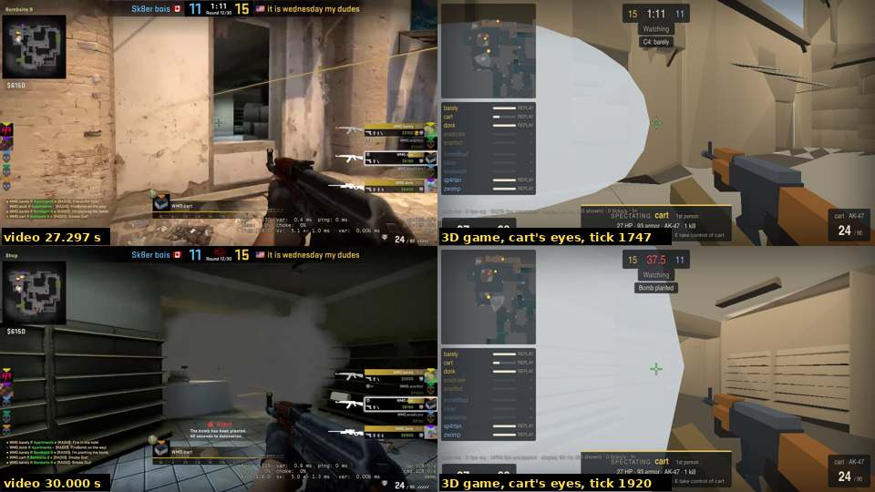
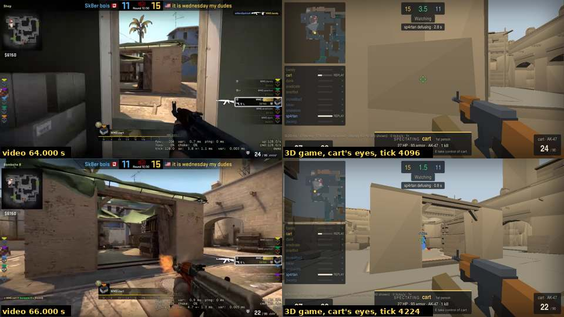
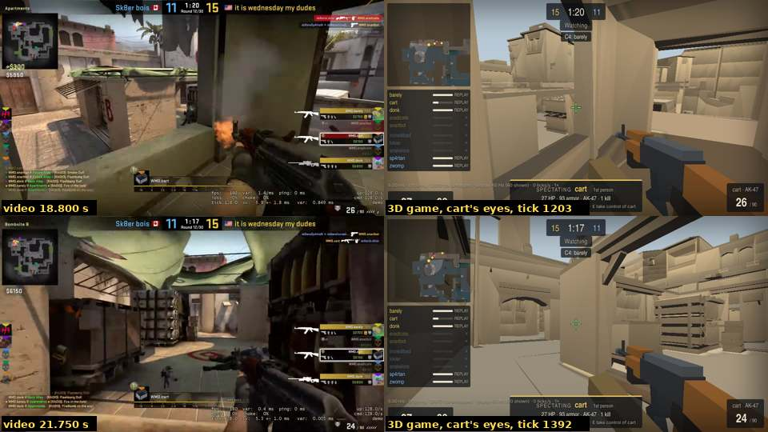

# cart POV review: the video vs the 3D game spectating cart, frame by frame (V3, 2026-11-07)

John (11:05): "kick off an agent to check the video frame by frame versus our game spectating cart frame by frame and
flag any issues that come up, and put them into our backlog." (backlog #47)

## What was compared

- **226 paired timestamps** (452 frames): every 0.5 s from 0 to 70 s, plus every kill, the plant, the defuse start and
  end, every timed shot in the shots CSV, every grenade throw (4.8, 5.6, 7.8, 8.8, 17.8, 19.2, 25.8, 29.8 s) and pop in
  the sim (6.297, 7.094, 9.297, 10.297, 19.297, 19.313, 27.297, 31.297 s), every shot cart fires in the sim (24
  ticks), cart's four snaps (14.375, 21.75, 29.375, 64.281 s) and his weapon switches. Left: the private recording
  (frame `round(60 t)`). Right: the 3D app (`dist-3d`, `?human=none&seed=1`, the golden no-human run) **through
  cart's eyes at every timestamp**, 960 x 540 at CS:GO's 106.26 x 73.74 deg FOV, via the deterministic test API
  (`seekTick(round(64 t) + 1)`, `eyes('cart')`, `render()`).
- The video shows cart's own POV for 13.6–32.2, 37.4–49, 54.2–55.2 and 59.4–70.3 s (148 of the 226 pairs). Elsewhere
  it shows eradicate (0–13.2), donk or barely; for those frames the right side is what cart should see from where the
  sim has him, judged against the round breakdown and what the other POVs show of cart.
- **12 extra live frames** (the page's own frame loop, manual driver at 60 fps of round time, spectating cart), because
  the test API's seek rebuilds the Scene: kill feed, tracers and recent effects only exist in live play.
- The headless 3D run (`npm run harness3d -- --until end`, unchanged: "Played it like the tape: CT defuse, 0.72 s
  left", all kills on their ticks) scanned per tick for cart: position jumps, yaw/pitch flips, speed, z steps, weapon
  switches.
- Every sheet was looked at by eye; the key moments again at full size.

Reproduce (the video must be next to the repo, `docs/parity.md`):

```sh
npm run build:3d
npx tsx tools/video-parity.ts --app 3d --runs watch --spectate cart --times "<list>" --out logs/v3-cart   # new --spectate
python3 -I <sheets10.py> logs/v3-cart data/round.json logs/v3-cart/sheets10    # 10 s groups, pages of 8 pairs
```

Sheets (gitignored, `logs/v3-cart/sheets10/`): `sNN-MM.pK.jpg` = the 10 s group NN–MM s, page K; cells A1..D2 (row,
column), each cell = video | game with t and tick. Committed (downscaled): the three images below.





## What matches

HP / armor / ammo through cart's eyes match the video at every cart frame (100/100 → 27/93 at 18.5 s; 30 → 24 over the
six duel shots 18.517–19.0; 24 → 13 over the defuse spray 65.9–66.9; 13 → 6 post-round 68.66–69.28), the kill count, the
clock (1:39 at 0 s), the plant on 27.517 s and the defuse on 66.800 s, the kill on Lokier (18.8 s, HS) and cart's death
(69.41 s), smoke-out at 24.55 s (video: by 25.0 s), knife-out at 59.6 s, and the round's broad path (Back Alley →
Apartments → window → Balcony → B → Market/Shop → Shop door → B box). The page's pawns equal the Node run's at every
landed tick (0.000 u).

## Findings, ranked by how much John would notice

t = video seconds; tick = round(64 t) (the frame shows the observe after that tick). Sheet refs are
`logs/v3-cart/sheets10/<sheet>:<cell>`.

| # | t (s) / tick | Video shows | Game shows | Frame | Likely cause | Owner |
|---:|---|---|---|---|---|---|
| 1 | 27.297 → 45 / 1747 → 2880 | cart's 25.8 s smoke blooms in the Market window; from inside Shop it is a small grey puff at the window (29.4–31.0); the Shop floor and cart's path are clear | the smoke pops point-blank in front of cart outside the window as a giant opaque ellipsoid (half the screen white, 27.3–28.0), cart walks into it (28.5–30.0 mostly white) and it sits in the doorway he later looks through (37.5–45) | s20-30.p3:B1–D2, s20-30.p4, s30-40.p1:A1, s30-40.p3 | the host's throw for this smoke (landing −1860, −347) vs the measured landing in the window | **#45, S1** (confirmed, time-stamped) |
| 2 | 63.5 → 64.3 / 4064 → 4115 | cart walks through the **Shop door** (a full-height door frame, palm tree beyond) at 63.5–64.0 and is outside facing the B box at 64.28 | at 64.0 cart stands facing a wall inside Shop; on tick 4114→4115 he jumps **140 u** in one tick to outside (the Market-window line, x ≈ −2000) | s60-70.p2:A1–B1 | the snapped track at the Market exit (harness snap `cart@4114`) | **#46, T2** (confirmed: the video exit is the door, not the window) |
| 3 | 65.0 → 66.9, 68.6 → 69.3 / 4160 → 4282, 4394 → 4434 | during the defuse sp4rtan is **out of sight behind the crate / cylinder stack** inside the B box; cart sprays into the stack (66.0: the crosshair on crates); post-round sp4rtan is visible crouched among the crates | sp4rtan stands **in the open** in the box's opening, upright, in cart's crosshair, the red C4 beside him; cart's spray "misses" a fully visible defuser | s60-70.p2:C1–D2, s60-70.p3, s60-70.p6 | plant/defuse spot (−1984, 315) on the open side of the stack (#18/#31: the POV frame puts the plant behind/north of the stack) and the stack's shape in the CS2 mesh (finding 4) | new (related #31) |
| 4 | 20.5 → 23.0, 64.3 → 69.3 / 1312 → 1472, 4114 → 4436 | B site has big **green tarps** overhead (the canopy over the cylinder stack, the tarp roof of the B box), a tall stack of **gas cylinders** on pallets, and the red **B** decal on the floor | bare dark beams and no tarp anywhere; the B box has no roof; the stack is a slatted wooden rack with no cylinders; no floor decal | s20-30.p1:B2–D2, s60-70.p2:B1–D2, s60-70.p6:A1 | the render package draws the CS2 world mesh only (no cloth/prop models, no decals): `src/app3d/render-package.ts`, `tools/extract-geometry.ts`; X1's 2020 render package would carry them | new (X1 #14 related) |
| 5 | 0 → 3.5, 33.5 → 37.4, 49.5 → 53.5 / 0 → 224, 2144 → 2394, 3168 → 3424 | (other POVs) cart holds angles: at 37.5 s, the first cart frame after 33.4, he looks across Shop at the posters with the doorway in view | cart **stares point-blank into a wall** for seconds (Back Alley yaw 180°, the whole screen one flat wall; Shop yaw −86°; Shop shelves at arm's length) | s00-10.p1:A1–D1, s30-40.p2 (all), s40-50.p3:C1–s50-60.p2:B2 | facings outside the watched segments (round.json has cart's yaw only while the video watches him): the puppet's inferred yaw (`src/core` replay / `tools/snap-tracks.ts` view) doesn't avoid walls | new (related V2 #26) |
| 6 | 17.8 → 19.0 / 1139 → 1216 | cart is already **at the barred window** at 17.8 looking down at the B box; at 18.5–18.8 his crosshair is on Lokier crouched beside the box | at 17.8 cart is still in the corridor (Lokier a small blue capsule through an arch); at 18.5–18.8 he fires from further back/left: the box small at lower left, the crosshair on a bench, Lokier not under it | s10-20.p3:C2–D2, s10-20.p4 (all), image 3 | the window-duel positions and view (G6's interim snap; V2's video fit) | **V2 (#26/#27)** (time-stamped) |
| 7 | 61.40 → 63.5 / 3930 → 4064 | cart draws the **AK at 61.40 s** (ammo HUD 24/90 from the frame at 61.40; knife until 61.35) | knife out until **63.5 s**: 2.1 s late; he runs to the door with the knife | s60-70.p1:B2–D2; `logs/v3-knife/hud.png` | data: `data/round.json` `timelines.weapon.cart` has AK at 63.5 (tick 4064); the video says 61.40 | new (data) |
| 8 | 14.39, 21.77, 29.39 / 921, 1393, 1881 | cart walks smoothly (Apartments; off the Balcony onto B site; inside Shop) | one-tick jumps of **98 u**, **96 u + 22 u down** (after landing from the Balcony on z −136 at tick 1387 at 275 u/s, then snapped to the floor), **111 u** (plus a 14 u step up and down at 29.47–29.69) | s10-20.p2:C1–C2, s20-30.p1:C1, s20-30.p4:A1 | harness snaps `cart@920/1392/1880` (`data/geometry/mirage-tracks.json`, `tools/snap-tracks.ts` on the CS2 mesh; the known "9 snaps per round" gap) | new for cart's three (the 4114 one is #46) |
| 9 | 19.2 → 19.31 / 1229 → 1236 | donk's molotov flies **out of the Apartments window toward B** (the trail and flames top-right of cart's view at 19.2–19.3) | it bursts **7 ticks after the throw at donk's own feet** inside Apartments (−1297, 847, −80); nothing flies past cart | s10-20.p5:B2–C2 | the host's recorded throw for this molotov (direction/pitch into the wall); also cart's own 4.8 s smoke pops 70 u from him in Back Alley at 6.297 s (−484, 852) — H5's "the recorded Back Alley throws bounce off geometry" | new (H4/H5 related) |
| 10 | 7.0 → 10.5, 21.5 → 22.0 / 448 → 672, 1376 → 1408 | clean overhangs, beams and awnings (Back Alley, Apartments entrance, B site) | large **black jagged triangles** across the upper walls and sky | s00-10.p3:B1–D2, s10-20.p1:A1–B2, s20-30.p1:B2 | the world mesh's thin overhang/cloth/awning triangles drawn black (back faces or unlit materials): `src/app3d/renderer3d.ts`, `src/app3d/world-mesh.ts` | new |
| 11 | 27.3 → 45 / 1747 → 2880 | a grey, soft, volumetric smoke (29.4–31.0 from inside Shop) | an opaque, flat-shaded, hard-edged white ellipsoid | s20-30.p3:B1, s40-50.p1:A1–D2 | smoke effect drawing (`src/app3d/renderer3d.ts` effects) | new (look only; position is #45) |
| 12 | 27.52 → 66.8 / 1761 → 4275 | after the plant the HUD shows only the red C4 icon and the "bomb has been planted, 40 seconds" alert; no countdown; nothing about the defuse | a red **bomb countdown** (40.0 → 0.7) in place of the clock, then a green countdown and "**sp4rtan defusing · 5.0 s**" for the T spectator | s20-30.p3:B2–C1, s60-70.p1:C1 | `src/app3d/hud3d.ts` `clockView` (the 2D app's addition carried over; CS2 gives a T no bomb timer and no defuse progress) | new |
| 13 | 17.8 / 1139 | the Apartments window onto B has **vertical iron bars** | an open hole | s10-20.p3:C2 | 2020 map vs the CS2 mesh (X1 settles it) | new (X1 #14 related) |
| 14 | 13.6 → 70 | kill feed with each kill for ~6 s (12.4 s entry gone by 18.5; the 12.75 s entry, the recorder's own death, longer); money ($5850, +$300 at 18.8, $6150, +$2200); "Sk8er bois Wins The Round" banner; team bar on top; CT score left, T right | live play: kill feed for 5 s (`KILL_FEED_TICKS` 320); after any seek or scrub the feed is empty (the Scene is rebuilt: `advanceSeek` / `testSeek`); no money, no win banner, no plant alert; T score left | s10-20.p4:A1, s60-70.p5:A2; `logs/v3-live/` | `src/app3d/hud3d.ts`, `src/app/scene.ts`, `src/app3d/main.ts` seek | new (low) |
| 15 | 69.41 / 4442 | death cam: the view drops and turns to the killer, then the spectator moves on | the camera stays at cart's standing eye with "0 HP", no viewmodel | s60-70.p8:A2–B1 | spectate camera on the followed pawn's death (`src/app3d/spectate.ts`) | new (low) |
| 16 | 18.16, 65.56 / 1162, 4196 | (18.0–18.5: cart already aimed out of the window; 65.5–65.9: steady on the box) | one-tick view snaps: 30° yaw + 13.5° pitch at 18.16, 20.7° yaw at 65.56; the AK puppet also runs at up to 218.8 u/s (ticks 1042–1050, 1324–1330; CS2's AK is 215) | headless log | puppet aim onto a target / recorded yaw keys; replay speed follows the track | new (low) |

Already owned, seen again (no new rows): cart's ceiling pitch at 59.4–59.7 s (video −76°, game 0°; s50-60.p4:A2–B1) →
V2 #26; no pistol in cart's loadout → #33; the tan block under the AK viewmodel → #37; the spectated player's tracer
drawn sideways across the view in live play (66.5 s) → #50.

## Notes on the tooling

- `tools/video-parity.ts` gains `--spectate <id>` (3D: one player's eyes at every timestamp instead of the camera
  schedule). With it the per-timestamp HUD checks still compare the video's watched player, so read the sheets, not
  the verdicts.
- Timestamps whose `60 t` ends in .5 (e.g. 14.375 s) crash the 3D similarity step: `video-parity.ts` names the frame
  with JavaScript's `Math.round` (863) while `video_truth.py` extracts it with Python's banker's `round` (862). The 3D
  screenshots are taken before that; this review made its sheets with its own script. Not fixed here.
- The test API's `render()` never shows muzzle flashes, tracers or kill feed (exact mode, Scene rebuilt per seek);
  the live frames cover those. In the manual-driver live run the spectated viewmodel disappears after cart's first
  shot (`lastShotMs` is `performance.now()` while the driver's clock is synthetic): an artifact of the harness, not seen
  in real-time play.
