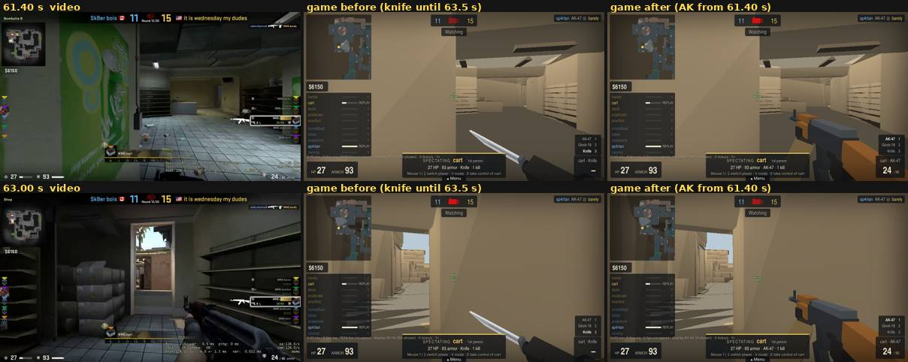
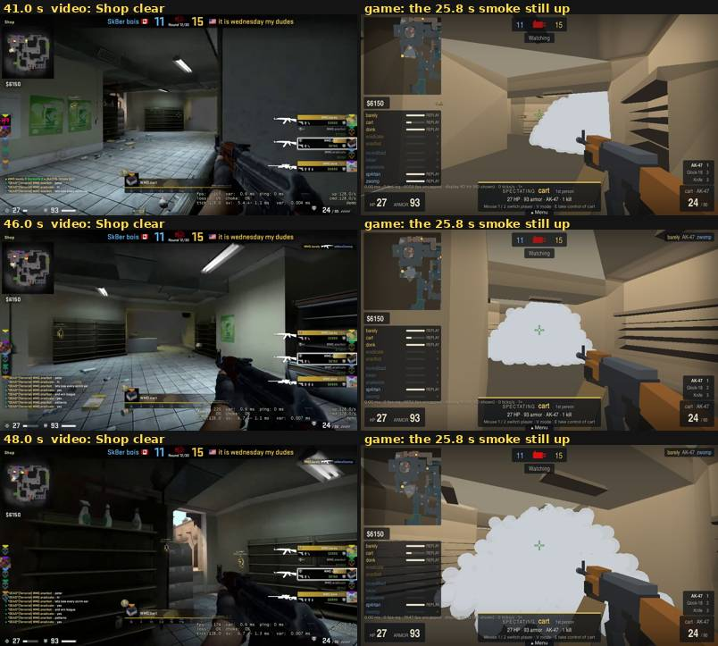

# Second video review: the video vs the 3D game through the same player's eyes (V4, 2026-11-07)

John (23:51): "Kick off an agent to watch the original video again and compare against our replay. Fix anything that
is not correct." (backlog #87). The first review (V3, [`cart-pov-review-2026-11-07.md`](cart-pov-review-2026-11-07.md))
looked through cart's eyes only; about 40 PRs have landed since (backlog #57–#86).

## What was compared

- **203 paired timestamps**: every 0.5 s from 0 to 70 s, every kill, the plant, the defuse start and end, every timed
  shot of the shots CSV, every grenade throw (4.8, 5.6, 7.8, 8.8, 17.8, 19.2, 25.8, 29.8 s) and every pop in the game
  (7.11, 8.72, 9.3, 10.3, 19.3, 20.14, 29.13, 33.13 s), plus 57.6, 58.3, 59.6, 61.4, 63.5, 64.0 s. Left: the recording
  (frame `round(60 t)`). Right: the 3D app (`dist-3d`, `?human=none&seed=1`, the golden no-human run) through the eyes
  of **the player the video shows at that moment** (the camera schedule: eradicate 0–13.2, donk 13.2–13.6, cart
  13.6–32.2, barely 32.2–33.4, donk 33.4–37.4, cart 37.4–49, barely 49–49.4, donk 49.4–51, barely 51–54.2, cart
  54.2–55.2, barely 55.2–59.4, cart 59.4–70.3), 960 x 540 at CS:GO's 106.26 x 73.74 deg FOV, via the test API.
- Every sheet looked at by eye, the moments in question again at full size (the molotov 19.25–21.3 s, the Shop smoke
  29.5–48.5 s, the AK draw 61.3–61.5 s, the radar 13.7–15.0 s).
- The HUD numbers the tool reads off the video (HP, armor, clip, clock, C4 icon) against the game at every timestamp.
- The headless 3D run (`npm run harness3d -- --until end`) scanned per tick for every pawn: view changes > 18 deg per
  tick, position jumps > 20 u, ground speed over the weapon's run speed.

```sh
npm run build:3d
npx tsx tools/video-parity.ts --app 3d --runs watch --times "<list>" --out logs/v4 --sheets none
# contact sheets: 12 pairs per page (video | game), cells A1..F2, logs/v4/s12/vNN.jpg (gitignored)
```

Sheet refs below are `vNN:<cell>` in `logs/v4/s12/`.

**Tooling fixed on the way** (both in this PR): since L1 (#57) the 3D view fills the window and the control bar covered
the bottom half of every parity screenshot; the shot setup now hides the bar (its own Hide button). And
`video_truth.py` rounds frame numbers half up like `video-parity.ts` (V3's crash at 14.375 s).

## What matches

Through all five players' eyes: the clock (63/63), the C4 icon from 27.517 s, the round end on 66.800 s, the score
(CT left after #67), HP at every frame but one (50.3 s, 3 ticks before donk's kill tick 3222), cart's ammo through the
window duel (30 → 24; the first shot is on tick 1184, one tick before the HUD's 18.517 s), the defuse spray (24 → 13) and the post-round spray (13 → 6), donk's Glock quick-switch at
49.93 s (20/120 on both), barely's knife at 57.6–58.85 s (K1), the money ($9150, $6900, $5850 → $6150, $3000 → $3300),
the kill feed (~6 s, #67), the plant alert and the win banner. Cart's Shop smoke now blooms deep in Shop at the same
place in his view as the video's at 29.1–31.0 s (S1). No pawn's view turns more than 18 deg in a tick anywhere in the
run (F1). Cart's 140 u jump at the Shop exit (V3 #2) is gone.



## Findings, ranked by how noticeable

t = video seconds, tick = round(64 t).

| # | t (s) / tick | Video | Game | Sheet | Cause | Fixed? / owner |
|---:|---|---|---|---|---|---|
| 1 | 41.0 → 48.5 / 2624 → 3104 | cart looks across Shop (41.0, 45.5, 46.0, 48.0): **the Shop is clear**; the smoke S1 placed by the freezer (seen at 44.5 s) is gone | a dense white cloud fills the middle of cart's view until 48.5 s | v10:A2–F2, v11:A1–C2 | cart's 25.8 s smoke pops at 29.125 s (tick 1864) where the video's first puff is 28.1 s, and lasts CS2's 18 + 2 s; the video's (CS:GO) is gone ≤ 16.4 s after the puff. The look (white, opaque) is #64 | **open → #88** (S1/H5: pop time; the CS2 duration is by design) |
| 2 | 62.5 → 65.0 / 4000 → 4160 | cart leaves Shop through the door; the radar has him at x −1950 … −2040 (the window line) | T2's route through the CS2 mesh's door at x ≈ −2290: **226–354 u** off the radar (the largest position error of the round) | v15:A1–C2 | the Shop door on the CS2 mesh vs the 2020 map | **X1c** (→ #89 to re-check on the 2020 map) |
| 3 | 65.5 → 66.9, 68.5 → 69.3 / 4192 → 4282, 4384 → 4436 | sp4rtan hidden behind the crates while defusing, crouched among them post-round | standing in the open in the box's opening, in cart's crosshair | v15:D1–F2, v17 | the plant/defuse spot and the stack (V3 #3, #57) | **X1c + bomb follow-up** (#57, #76) |
| 4 | 33.4 → 37.4, 49.4 → 49.85 / 2138 → 2394, 3162 → 3190 | donk is **scoped in** (the AWP scope's black circle) the whole time the video shows him, until his 49.85 s shot | donk never scopes: the bare AWP viewmodel | v08:F1–v09:C2, v11:D2 | puppets have no zoom: round.json has no scope timeline and the Core never presses zoom (#75's paused half) | **open → #90** |
| 5 | 19.25 → 21.3 / 1232 → 1363 | donk's molotov flies over cart's head out of the Apartments window and down over the Balcony railing toward the B site (its trajectory line at 19.9–20.2 s) | it bursts **on the Balcony in front of cart** at 20.14 s (−1899, 821, −48), an orange patch in his view | v05:F1–v06:B1 | molotovs, flashes and HE are still on the 2D model: a flat throw along the yaw, landing on the thrower's floor, so it can't drop to B | **open → #91** (V3 #9 updated) |
| 6 | 14.375 / 920 | cart walks into Apartments behind barely | a one-tick **98 u teleport** | v04:B2–C1 | the recording: cart's 10 Hz track moves at a steady 71 u/s from 13.0 to 14.2 s, then 1,084 u/s (14.2 → 14.3), then 41 u/s; the video's radar agrees at 14.0 and 14.5 s, so cart, barely and donk all "move" 150–220 u in that half second (dots overlapping in the Apartments cluster around the 13.2–13.6 camera switch) | **open → #92** (re-read the radar 13.2–14.5 s at 60 fps) |
| 7 | 21.77 / 1393 | cart drops off the Balcony onto B | a 96 u one-tick jump (lands on a z −136 surface of the CS2 mesh, then snapped to the floor) | v06:C1–C2 | CS2 mesh vs the 2020 map under the Balcony | **X1c** (#61) |
| 8 | 17.8 → 19.0 / 1139 → 1216 | cart at the barred window, crosshair on Lokier beside the B box | further back/left, the box low-left, Lokier right of the crosshair; an open window | v04:F2–v05:E1 | the window-duel positions stay off (`WINDOW_DUEL_AS_FITTED`) until the 2020 map; bars #66 | **X1c** (#26/#27, #66) |
| 9 | 61.40 → 63.5 / 3930 → 4064 | cart has his **AK out from 61.40 s** (ammo HUD 24/90; the knife until 61.35 s) | the knife until 63.5 s, so he walks to the Shop door knife out | v14:E1–v15:A2 | data: the page's weapon timeline (V3 #7) | **fixed** (this PR: `WEAPON_DRAWS` in `tools/extract-round.ts`) |
| 10 | 0 → 12.7 / 0 → 815 | eradicate's HUD: **100 HP / 89 armor** | 100 / 100 | v01–v03 (all) | data: the kit assumed a fresh vest | **fixed** (this PR: `KITS.eradicate.armor` 89) |
| 11 | 49.9 → 50.2 / 3194 → 3213 | donk's armor **100 → 96 → 91 → 91** through sp4rtan's spray (chest, stomach, leg) | armor stays 100 while his HP drops | v11:E2–v12:B1 | data: the damage list had no armor for these hits | **fixed** (this PR: `HIT_ARMOR`, 4 / 5 / 0) |
| 12 | 21.5 → 23.5, 64.3 → 69.3 | green tarps over the stack and the B box, gas cylinders, the red B decal | none | v06:C2–F2, v15–v17 | render package (V3 #4) | **X1c** (#58) |
| 13 | 33.13 / 2120 | (barely's view of B) | a black jagged triangle at the top of the view | v08:E2 | thin overhang triangles drawn black (V3 #10) | **X2 / X1c** (#63) |
| 14 | 4.8 → 59 | radio calls and dead chat in the bottom left ("Smoke Out!", "Fire in the hole!", "I'm planting the bomb.", chat) | no radio or chat line anywhere in the 3D HUD (round.json has all of them) | v01:F1, v07:A1–D2, v11 | `src/app3d/hud3d.ts` has no chat area | **open → #93** (low) |
| 15 | everywhere | full character models | players are coloured capsules (Ts orange, CTs blue); a dead player is a capsule on the floor | v04:B1–B2, v06:C2, v17 | the low-fi renderer's choice (#8) | **open → #94** (low; renderer) |
| 16 | 12.75 → 13.2 / 816 → 845 | CS:GO's ragdoll death cam: the view tumbles to the floor and looks up the room | eradicate's view goes black in 0.4 s (headshot) | v04:A1–A2 | John's #85 spec (CS2's fade; 0.4 s for a headshot) | by design (#85) |
| 17 | kill feed | each kill's entry appears 3–4 ticks after the game's kill tick | — | report events | the 60 fps scan finds the entry's first visible frame (it fades in); the kill ticks are the golden master | not a bug |

**Not a bug: the AK puppets at 216–219 u/s** (V3 #16, backlog #69: cart ticks 1043–1050, eradicate 730–740). That is
Source's own ground movement: friction (`sv_friction` 5.2, `sv_stopspeed` 80) runs before acceleration
(`sv_accelerate` 5.5, wishspeed 215), and while the wish direction turns, the part of the velocity across it survives the
friction, so the speed rises a little over 215. Simulating that loop at 64 tick: a steady 2 deg/tick turn peaks at
219.2 u/s, 5 deg/tick at 216.9 (Source SDK `gamemovement.cpp` `Friction()`/`Accelerate()`; the convars are
`docs/movement.md`'s). The other speeds over a weapon's 215 belong to other weapons (molotov/C4 245/250, Deagle 230,
M4A4 225).



## V3's 16 findings now

| V3 # | Finding | Now |
|---:|---|---|
| 1 | Market smoke pops point-blank, cart walks into it | **fixed** (S1 #62): blooms deep in Shop where the video's does at 29.1–31.0 s; new: it outlives the video's (finding 1) |
| 2 | Shop exit: faces a wall, then a 140 u jump at tick 4115 | **fixed** (T2 #63: the door, no jump); new: 226–354 u off the radar at 62.5–65 s (finding 2, X1c) |
| 3 | sp4rtan defusing in the open | open (finding 3; #57, X1c + bomb follow-up) |
| 4 | No tarps, cylinders, B decal | open (finding 12; #58, X1c) |
| 5 | cart stares into walls when the video isn't on him | not re-checked (this review looked through the video's camera; #59 stays queued) |
| 6 | Window duel position/view | open (finding 8; #26/#27, X1c) |
| 7 | AK draw 2.1 s late | **fixed** (this PR; finding 9) |
| 8 | Teleports at ticks 920, 1392, 1880 | 1880 fixed (#63); 920 is the recording (finding 6, #92); 1392 is the mesh (finding 7, X1c) |
| 9 | donk's molotov at his feet; cart's Back Alley smoke 70 u from him | the molotov now bursts on the Balcony in front of cart (finding 5, #91); cart's smoke pops 390 u east of him (H5's note), out of every POV the video shows, so nothing to compare |
| 10 | Black triangles | open (finding 13; #63, X2) |
| 11 | Smoke drawn as a white ellipsoid | partly: a puffy cloud now, still white and opaque (#64, X2) |
| 12 | Bomb countdown / defuse progress in the T spectator's HUD | **fixed** (#67): only the C4 icon in the clock |
| 13 | No bars on the Apartments window | open (#66, X1c) |
| 14 | HUD gaps (feed, money, banner, alert, CT score left) | **fixed** (#67) |
| 15 | No death cam for the spectated player | **fixed** (#64/#85): the fade; eradicate's headshot goes black in 0.4 s (finding 16) |
| 16 | One-tick view snaps; AK puppet at 218.8 u/s | snaps **fixed** (F1 #69: none > 18 deg/tick in the whole run); the speed is CS2's own movement (above) |

## What this PR changes

- `tools/extract-round.ts`: `WEAPON_DRAWS` (cart's AK at 61.40 s, replacing the page's 63.5 s), `HIT_ARMOR` (donk's
  armor 4 / 5 / 0 on the 49.9 / 50.0 / 50.1 s hits), `KITS.eradicate.armor` 89; each correction throws if it no longer
  applies. `data/round.json` regenerated from the web-apps page (same sha), `data/geometry/mirage-tracks.json`
  re-snapped (only the round.json hash changed). Golden events unchanged in both hosts; the fixtures' digests move
  (cart's weapon from tick 3930, the armor values).
- `tools/parity/browser.ts` (bar hidden for 3D shots), `tools/parity/video_truth.py` (half-up frame numbers).
- The parity baselines (`docs/parity/baseline-*.json`) are not refreshed here: the checks this fixes (eradicate's
  armor 0–12.7 s, donk's at 49.9–50.2 s, cart's clip 61.4–63 s) show as "fixed" against them, nothing regresses.
