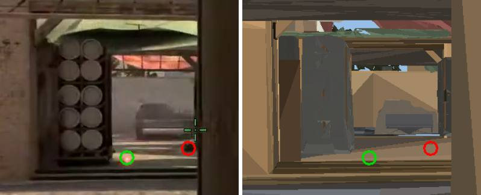
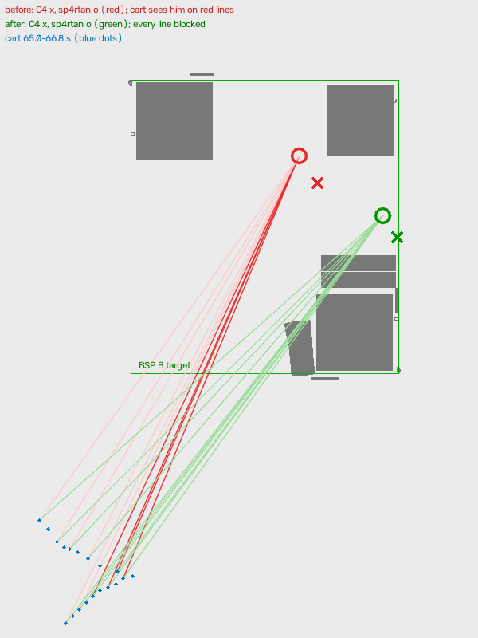
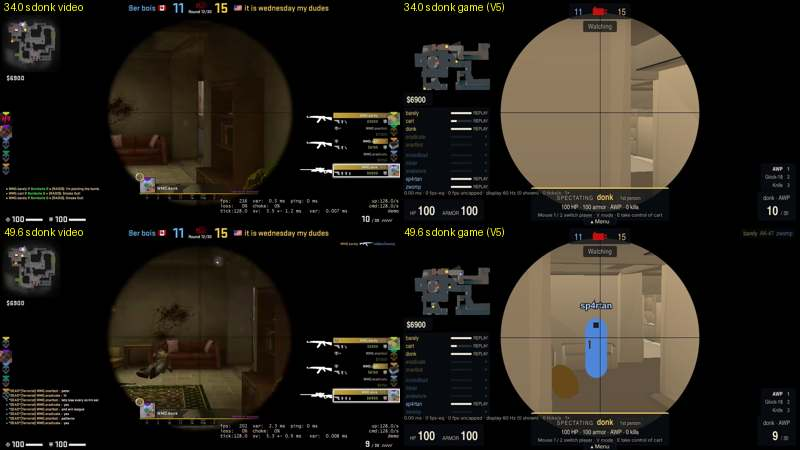

# Round data (`data/round.json`)

Everything the game knows about the recorded round: Mirage, round 12/30, Sk8er bois (CT) 11 – 15 "it is wednesday my dudes" (T), Sp4rtaN's 1v3 retake and defuse. The file is generated. Don't edit it by hand: change the extractor and re-run it.

## Regenerate

```sh
npx tsx tools/extract-round.ts ../web-apps/cs2/mirage-round-replay/index.html   # [shots.csv] [--out data]
npx tsx tools/validate-round.ts                                                 # [data/round.json] [--csv <csv>]
```

- **Inputs:** (V2) `data/source/view-fit.json` when present (the fitted views; position refinements, none at present); the web-apps replay page (its `<script id="data" type="application/json">` block and the one inline `data:image/jpeg` radar), the shots CSV (default `<page dir>/source/shots/mirage-round-sp4rtan-1v3-shots.csv`), and `data/tuning.json` (clip/reserve per weapon).
- **Outputs:** `data/round.json` (2-space JSON, fixed key order, trailing newline), `data/mirage-radar.jpg` (1024×1024 overview, the bytes from the page), and `data/source/mirage-round-sp4rtan-1v3-shots.csv` (a verbatim copy, so CI can check the shot count without web-apps).
- **Determinism:** same inputs give byte-identical outputs. `tests/round-data.test.ts` rebuilds the round twice and compares it with the committed file whenever the web-apps clone is found next to the repo (or at `$ROUND_SOURCE_HTML`); without it that one test is skipped.
- `meta.sources` records the SHA-256 of both inputs, so a stale `round.json` is easy to spot.
- **Types:** `RoundData` and the record types in `src/contracts/round.ts`; `parseRound` validates a parsed file (see `docs/contracts.md`, Types).

## Conventions used throughout

- Player ids are lowercase (`barely cart donk eradicate incredibad lokier snakelore snarlbot sp4rtan zwomp`). Arrays keyed by player are sorted by id, and so are objects keyed by player.
- Every time `t` (video seconds, replay t = 0 is clock 1:39) has `tick = Math.round(t * 64)` next to it: `t0/tick0`, `t1/tick1`, `plantT/plantTick`, `deathT/deathTick` and so on.
- Positions are `{x, y, z}` in Source world units (Mirage frame, see `docs/conventions.md`). The source only gives `lastKnown` positions as `{x, y}`.
- Weapon ids: `ak47 awp ssg08 deagle m4a4 glock knife c4`, grenades `smoke flash he molotov`. `glock` appears only as donk's quick-switch in the shots CSV (and so in his weapon timeline). Lokier's rifle is always `ssg08` (the extractor turns any AWP attributed to him into `ssg08`); donk's AWP is real.
- `confidence` is one of `observed | estimated | inferred`.

## Fields

### `meta`

| Field | Source | Notes |
| --- | --- | --- |
| `clock0` | `meta.clock0` | 98.25 s on the round clock at t = 0 |
| `bombTimerSec` | `meta.bombTime` | 40 |
| `score {ct, t}` | `meta.score.*[0]` | score before the round: 11 – 15 |
| `scoreAfter {ct, t}` | `meta.score.*[1]` | 12 – 15 |
| `teams {CT, T}` | `meta.teams` | team names |
| `map {posx, posy, scale, size}` | `meta.map` | radar transform (−3230, 1713, 5, 1024) |
| `video` | `meta.video` | YouTube URL of eradicate's POV recording |
| `durationSec` | `meta.duration` | 80.27 (the clip runs into next round's freeze time) |
| `roundEndT/Tick` | `meta.roundEnd` | 66.8, the defuse |
| `hudRound` | `meta.hudRound` | "Round 12/30" |
| `ticksPerSec` | constant | 64 |
| `sources` | computed | input file names (relative to the workspace), SHA-256s, CSV row count; `viewFit` (V2) when `data/source/view-fit.json` was merged |

### `players[]` (sorted by id)

| Field | Source |
| --- | --- |
| `id`, `name`, `team`, `note` | page `players[]` (`name` is the in-game display name) |
| `color`, `chev` | page `players[]`. CTs have no colour in the source, so `color` is the CS2 teammate colour of their `chev` (yellow `#ffd83d`, green `#3ad27a`, orange `#ff9230`, blue `#4ea6ff`, purple `#b65ff2`). |
| `start {pos, yaw, confidence}` | first track sample (t = 0). `yaw` comes from the page's `yaw` rows at t = 0; only eradicate has one, the rest are `null`. |
| `startHp`, `startArmor`, `startHelmet` | movement doc (table in `tools/extract-round.ts`): 100/100/helmet for everyone except snarlbot (44 HP). The extractor checks this against the page's `hp`. CT values are assumed. |
| `startMoney` | page `players[].money` (Ts only, `null` for CTs) |
| `kit {primary, secondary, grenades[], c4, kit, clip, reserve, assumed}` | movement doc. `clip/reserve` are for the weapon drawn at t = 0, from `data/tuning.json`. |
| `pickups[] {t, tick, weapon}` | movement doc: Sp4rtaN picks up an AK-47 at 19.6 s |
| `role`, `roles[]` | movement doc. `role` is the first entry of `roles` (barely: `take_b`, `planter`). |
| `isHumanDefault` | `true` only for `cart` |
| `deathT/deathTick` | page `players[].death` (`null` for Sp4rtaN) |

Kits at t = 0:

| id | primary | secondary | grenades | c4 / kit | clip/reserve | assumed |
| --- | --- | --- | --- | --- | --- | --- |
| barely | ak47 | – | he, smoke | c4 | 30/90 | no |
| cart | ak47 (donk's) | – | smoke, smoke | – | 30/90 | no |
| donk | awp | glock | flash, molotov | – | 10/30 | no |
| eradicate | ak47 | – | – | – | 30/90 | no |
| incredibad | m4a4 | – | – | – | 30/90 | yes |
| lokier | ssg08 | – | – | – | 10/90 | no |
| snakelore | m4a4 | – | – | – | 30/90 | yes |
| snarlbot | ak47 | – | smoke, flash | – | 30/90 | no |
| sp4rtan | – | deagle | – | defuse kit | 7/35 | no |
| zwomp | m4a4 | – | – | – | 30/90 | yes |

### `tracks.<id>`

| Field | Source / meaning |
| --- | --- |
| `samples[] {t, tick, x, y, z, confidence, uncertainty?, resampled?, refined?}` | page `tracks` rows `[t, x, y, z, flag(, uncertainty)]`, on an exact 0.1 s grid from t = 0 to the last source sample |
| `offGridSamples[]` | source rows whose `t` is not a multiple of 0.1 (event anchors such as kills at 17.85 s), kept verbatim |
| `yaw[] {t, tick, deg}` | page `yaw` rows `[t, id, deg]` for this player (20 Hz where present; Ts only, while they were on camera): the radar's view cone |
| `view[] {t, tick, yaw, pitch, source, confidence}` | **V2**, `data/source/view-fit.json` (`tools/fit-view-angles.ts`, `docs/viewfit.md`): the first-person view fitted to the video frame while the camera watches this player (10 Hz, 30–60 fps around key moments; empty for the others). `source: 'video'` with `confidence` `observed` (clear fit) or `estimated` (ambiguous), `'radar'` (the fit failed: smoke, flash, blur; `yaw` = the radar yaw, `pitch: null`), and `inferred` = a segment's first view held back up to 0.8 s across the camera switch. `yaw` degrees CCW from +x, `pitch` Source's (+ = down, ±89). |
| `scope[] {t, tick, zoom, confidence}` | **V5** (#90), `SCOPES` in `tools/extract-round.ts`, checked against V2's fitted FOV (`view-fit.json` `vfov`): the player's scope changes (0 unscoped, 1 / 2 = the AWP's 40° / 10° at 4:3), `observed` on the frame the overlay appears or drops, `inferred` off camera. Absent for a player never scoped (only donk). See "Scope" below |
| `endT/endTick` | last source sample (death time, or 70.3 s for Sp4rtaN) |

Track `flag`, worked out from the data and the round breakdown:

| flag | `confidence` | Meaning | Where |
| --- | --- | --- | --- |
| 0 | `observed` | Seen on camera or radar | Ts almost all the time; CTs only during sightings (Snakelore 12.0+, Lokier 12.5–12.75 and 17.45+, Sp4rtaN 49.9–50.4, 58.6–65.2, 68.75+, Zwomp 43.9+) |
| 1 | `estimated` | Interpolated between observations or off-camera for a short time | snarlbot 0–13.0 s, cart 13.4–13.8 and 14.8–15.4 s, barely 27.9 s, Sp4rtaN 65.2–68.7 s |
| 2 | `inferred` | Reconstructed route, never seen | CTs outside sightings |

The 6th column (CT tracks only) is the uncertainty radius in world units. It is written as `uncertainty` on every non-observed sample that has it (for example Sp4rtaN 320 before his first kill, then 200, 260, 140, 120; Zwomp 450 then 240). Observed samples carry 0 in the source and have no `uncertainty` field.

Resampling: the source is 10 Hz but jumps half a step at some event anchors (snarlbot from 13.05 s, Lokier from 12.75 s, Sp4rtaN around 17.85, 19.6, 68.75 and 70.0 s, eradicate's last sample at 12.75 s). Grid samples that fall between source rows are linearly interpolated, rounded to whole units, marked `resampled: true`, and take the less certain confidence (and larger uncertainty) of their two neighbours. The original off-grid rows are in `offGridSamples`, so nothing from the source is lost.

`refined: 'viewfit'` (V2) marks a sample moved from the radar reading to where the video's first-person frames put the
player (`data/source/view-fit.json` `positions`, `tools/fit-view-angles.ts`, `docs/viewfit.md` "Engagement
positions"). **None at present**: the window duel's fitted positions (cart and Lokier within the radar's ±40 u) wait
for a map with the 2020 Apartments window (`tools/sight-snap.ts` `WINDOW_DUEL_AS_FITTED`).

### `shots[]` (one per CSV row, in CSV order)

CSV columns: `t_video_s, round_clock, shooter, weapon, event, target, damage, headshot, source, confidence, note`.

| Field | From column | Notes |
| --- | --- | --- |
| `t`, `tick` | `t_video_s` | `null` for count-only rows whose column is a range (e.g. `33.35–48.85`) |
| `window {t0, tick0, t1, tick1}` | `t_video_s` | the range for count-only rows, else `null` |
| `count` | `event` | shots represented: 1 for a shot/hit, N for "N shots (count only)", 0 for kill-feed-only rows and the weapon switch |
| `shooter` | `shooter` | |
| `weapon` | `weapon` | |
| `kind` | `event` | `shot`, `shot_kill` ("shot → kill"), `hit`, `kill` (kill feed only, shot unknown), `shot_count`, `switch` |
| `target` | `target` | `(probable)` / `(defusing)` stripped (still in `raw`); `null` for `unknown` or empty |
| `damage`, `armorDamage` | `damage` | "73 HP / 7 armor" → 73, 7 |
| `headshot` | `headshot` | `yes` → true |
| `confidence` | `confidence` | `inferred` if the text says so; `estimated` for "time unknown"; otherwise `observed` (HUD/kill feed/audio timings ±0.017–0.03 s) |
| `raw` | every column | all CSV cells verbatim, keyed by header (`round_clock`, `source` and `note` are only here) |

### Events

| Field | Source | Notes |
| --- | --- | --- |
| `kills[] {t, tick, killer, victim, weapon, hs, assist, postRound, kpos, vpos, kplace, vplace}` | page `kills` | 69.4 s (Sp4rtaN → cart) has `postRound: true` |
| `damage[] {t, tick, attacker, victim, amount, armor, weapon, note, apos, vpos, source}` | page `damage` (`source: "damage"`) plus CSV rows with a damage figure that the page lacks (`source: "shots_csv"`: Sp4rtaN's 13-damage kill shot on donk at 50.3 s, with `apos/vpos` `null`) | `armor` only where the CSV gives it (7 at 18.5 s), else `null` |
| `utility[] {t, tick, thrower, kind, place, throwPos, landing, radio}` | page `util`; `landing` from `MEASURED_LANDINGS` in `tools/extract-round.ts` (V0, measured on the video) | `throwPos` matches the thrower's track at the throw time (where it was thrown from). `landing {x, y, z, uncertainty, t?}` is where it comes to rest and pops (smoke bloom, flash/HE detonation, fire), `uncertainty` a radius in units, `t` (V5) the video time it pops when the video shows that; `null` where the recording never shows it. See "Grenade landings" below |
| `radio[] {t, tick, who, place, text, kind}` | page `events` texts of the form `who @ place (RADIO): text` (`kind: "radio"`), plus the plant call-out without `(RADIO)` at 24.4 s (`kind: "callout"`) | |
| `chat[] {t, tick, who, dead, text}` | page `events` of kind `chat` (all `*DEAD*` all-chat) | |
| `sightings[] {who, t0, tick0, t1, tick1, place, by}` | page `sightings` | when a CT was seen, and by whom |
| `lastKnown[] {who, t0, tick0, t1, tick1, pos {x, y}}` | page `lastknown` | radar last-known markers |
| `pov[] {t0, tick0, t1, tick1, target, note}` | page `pov` | which player the recording's camera follows |
| `bomb {carrier, plantT, plantTick, pos, defuseStartT, defuseStartTick, defuseT, defuseTick}` | page `bomb`; `pos` from `PLANT_SPOT` (P3) | plant 27.517 s at (−1882, 243, −160) (measured on barely's POV; the page has (−1982, 311)), defuse 61.8 → 66.8 s (kit) |
| `timelines.hp/money .<id>[] {t, tick, value}` | page `hp`, `money` | Ts only |
| `timelines.weapon.<id>[] {t, tick, weapon, raw}` | page `weapons`, plus the shots CSV's weapon switches | `weapon` is the first item of the display text; `raw` keeps it (`"AK-47 · C4"`); CTs shown as `—` have `weapon: null`. Every CSV `switch` row adds a point (`raw` `"<CSV weapon> (shots CSV)"`), and so does a switch back named in its note as `back to <weapon> at <t>` (`raw` `"<weapon> (shots CSV note)"`): donk's Glock at 49.93 s and his AWP again at 50.083 s. Points are sorted by `t` (page first on a tie); one that repeats a page point is not added. |
| `events[] {t, tick, kind, text, who, victim, util}` | page `events` | the narrative feed, ids lowercased |

Not copied: the page's `nav` and `places` (the nav mesh is task A3's `data/mirage-nav.json`).

## Known gaps

- **CT weapons:** Incredibad, Snakelore and Zwomp were never seen holding a weapon; `m4a4` is assumed (`kit.assumed: true`). CT grenades and secondaries are unknown (empty / `null`), as are the Ts' pistols except donk's Glock.
- **CT HP and armor:** never shown; 100/100 with helmet is assumed. CT money is unknown (`startMoney: null`).
- **CT routes:** outside sightings the CT tracks are `inferred` reconstructions with an `uncertainty` radius of 110–450 units. Treat them as plausible, not recorded.
- **Grenade landings:** only the throw position and time are known; where each smoke, flash, HE and molotov landed is not in the data, except cart's 25.8 s smoke (measured, V0/S1/V5). The hosts' aims for the 7.8, 8.8, 17.8 and 19.2 s throws are assumptions (V5, below).
- **Yaw / view:** only for Ts while on camera (eradicate, cart, donk, barely). There is no CT yaw, and most players have no yaw at t = 0. V2's fitted view (`view[]`) adds the pitch and corrects the radar yaw (median 13–22° off in the spectator segments); 21 of 856 frames fall back to the radar yaw.
- **Shots:** exact times only for shots seen on the ammo HUD of the spectated player, plus a few audio-confirmed first shots. Off-camera sprays are counts over a time window, and kill-feed-only kills don't say how many shots were fired.
- **Resampled samples:** a few tens of grid samples per affected track are interpolated (see above), so they can differ by a few units from where the player really was.
- **Level flips:** `z` is the 2020 nav floor under the radar dot, so where floors overlap it can be the wrong one. barely 35.1–44.7 s is on the underpass / Tunnel Stairs in `round.json` (dz −198 in, +154 out) but was on Catwalk; `round.json` keeps the source as is and `tools/snap-tracks.ts` pass 0 (`levelFlips`, `docs/geometry.md` "barely 33–48 s") corrects it in `data/geometry/mirage-tracks.json`, which is what the hosts use.

## Grenade landings and the plant spot (V0, measured on the video)

Measured on eradicate's recording (the same frames `tools/video-parity.ts` reads; the video stays outside the repo).
The 2020 CS:GO radar draws **no** smoke, fire or flash markers (checked on the POV radar 0-12.75 s and the spectator
radar 13.2-70 s: only player dots, the C4 icon, view cones and last-known markers), so a landing can only come from a
first-person view that shows it. The demo draws grenade trajectories as yellow lines, which helps where they are in view.

| t | thrower | kind | landing | uncertainty | evidence |
| ---: | --- | --- | --- | ---: | --- |
| 4.8 | cart | smoke | `null` | | not on camera: eradicate faces the Apartments door in Back Alley 4.8-12.7 s (frames 5.0-11.0 s show no cloud or trajectory) |
| 5.6 | snarlbot | smoke | `null` | | not on camera (Palace Alley; the camera is eradicate's) |
| 7.8 | snarlbot | flash | `null` | | not on camera; eradicate is not blinded |
| 8.8 | donk | flash | `null` | | not on camera (pops behind eradicate; he is not blinded) |
| 17.8 | barely | HE | `null` | | not resolved: cart's POV 17.8-20.3 s looks out of the Apartments window at B; no detonation in view (19.17-19.5 s at 60 fps), no damage row. V5 assumes it (below) |
| 19.2 | donk | molotov | `null` | | not resolved: no fire in cart's views of B 19.4-22.5 s; the burning bottle flies past cart's right out of the Apartments doorway at 19.23-19.33 s, and at 20.0-20.2 s (cart on the Balcony) the yellow trajectory lines go down over the railing and end at the white van (Truck) on B. V5 assumes it (below) |
| 25.8 | cart | smoke | (−1890, −585, −166) | 40 | **S1 (backlog 45), re-measured: deep inside Shop, not in the window.** cart throws from the B side (−2059, 88) through the Market window; the grenade flies on and comes to rest by the white freezer counter ~320 u south of the window, where it blooms (first puff 28.1 s). Measured with V2's fitted cameras (`docs/viewfit.md`): the end of the trajectory line in cart's POV at 29.5 s and 30.0 s and the freezer seen at 44.5 s (a camera 350 u away) give three rays that cross within 2 u at (−1882…−1901, −581…−585, −129); the floor below is the landing. At 29.5–31 s the cloud is ahead of cart in the room (to his right at 29.5–30 s, left at 31 s), and he climbs in through the window at 28.2–28.5 s with no cloud in it. John: "it doesn't land blocking the window of market. it lands deeper inside market." V0b's spot just inside the window ((−1885, −320), #44) read the trajectory as coming down behind the jamb and the 29.6–30.2 s cloud as filling the window; the fitted views put that cloud 250–350 u south of it. **V5 (#88): `t` 28.1 s**, the first puff: the trajectory line has its end hook by 28.2 s and the cloud already fills the middle of cart's view at 28.217 s (frame 1693), while his view at 28.0 s shows the room clear. The hosts throw it with the aim `tools/utility-aim.ts` solves for the spot and the time (`docs/grenades.md`); it pops at (−1840, −578) at 28.09 s in both hosts (50 u east of the spot; S1's aim popped it 34 u from the spot but at 29.13 s, a second late) |
| 29.8 | barely | smoke | `null` | | not resolved: its trajectory line is in barely's POV 32.2-33.4 s, but without his view angles (V2) the end point can't be placed |

**V5 (#91): assumed landings for the four throws the video doesn't show** (`ASSUMED_TARGETS` in `tools/utility-aim.ts`;
the hosts throw every grenade on the CS2 engine since V5, so each needs an aim, and the 2D model's flat throw along the
yaw had donk's molotov burst on the Balcony in front of cart). Each is chosen so the throw does what the frames allow and
no more: no T is blinded (the video's eradicate is not; the other Ts' frames show no flash), and nothing bursts where a
POV the video shows would see it. Where the hosts' throws go (solved from the snapped tracks, the other players included):

| t | thrower | kind | assumed target | the hosts' detonation | why |
| ---: | --- | --- | --- | --- | --- |
| 7.8 | snarlbot | flash | (400, −1690, 300) | (351, −1661, 290), 9.28 s, in the air over the Palace roofs | Palace Alley is open to the south; a flash popped high toward A blinds nobody and no POV the video shows has it |
| 8.8 | donk | flash | (−650, 470, −220) | (−665, 444, −175), 10.28 s, down the Tunnel Stairs | the clear way from his spot (south-west); below the Back Alley floor, out of every T's sight (eradicate's view 8.8–10 s shows no pop, he is not blinded); only donk himself sees it, white for 0.37 s |
| 17.8 | barely | HE | (−1920, 600, −160) | (−1888, 616, −63), 19.28 s, in the air just past the Balcony railing | out of the Apartments window toward B; cart's view over the Balcony at 19.17–19.5 s shows no explosion; no damage row (it hurts nobody: barely is a puppet) |
| 19.2 | donk | molotov | (−2330, 800, −125) | (−2385, 774, −126), 20.94 s, on the Truck platform by the van | out of the Apartments window over cart's head (the solve includes the players: the first aim hit cart and burst on the Balcony) and down by the van, where the trajectory lines end; west of cart's way down to B and behind all his views of 19.4–22.5 s, which show no fire |

**The Market window is the same in 2020 and on the CS2 mesh** (V0b, after H5 #41 found the first landing unreachable).
On the CS2 mesh the wall between B and Shop has its face at y −264, with the window open over x −1946…−1890 (sill z −126,
lintel −14); the door is the full-height gap at x −2356…−2292. In the video:
- cart's own track crosses the wall line at (−1962, −264) at 28.5 s and is inside Shop at (−1959, −314) by 28.8 s. He
  climbs through the window, not the door, within the radar's ±25 u of the mesh's opening.
- At 26.3 s, from (−1965, 2) facing the wall, the opening is straight ahead.

So the first measurement's x was wrong, not the map: the counter at x −2040…−1980 is inside Shop, west of the window,
behind the wall from the B side.

**The other recorded throws (H5's question: do the throw spots and aims fit the frames?).** None of their landings is on
camera (table above), and the recording has no yaw for cart, snarlbot or donk at 4.8–8.8 s (only eradicate's own),
so the aims are not data: H5's assumed targets are all that exists. The throw spots are the throwers' radar dots on
eradicate's POV radar (±10–20 u). On the CS2 mesh:
- **cart at 4.8 s** (Back Alley, (−468, 924, −80)): the recorded z is 64 u above the mesh floor (−144) under a roof
  136 u above his eye. He is clear only towards yaw 0–90° (east and north-east, 320–400 u). Every other direction is
  20–60 u from a wall, so a throw "west down the approach" hits the wall in front of him.
- **snarlbot at 5.6 and 7.8 s** (Palace Alley, (718, −1274) and (700, −1300)): open sky, clear 400 u only towards yaw
  270° (south) and 150–260 u east and south-east. Throws towards the north (yaw 0–45°) hit the wall 50–96 u away.
- **donk at 8.8 s** (Back Alley, (−180, 623, −77)): open sky, clear west and south-west (yaw 135–225°, 400 u), with a wall
  36–51 u away to the north-east. eradicate's view at 8.8–10 s shows no pop and he is not blinded. A pop 86 u above the
  Apartments roof is therefore not contradicted, but nothing in the frames confirms it either.

If H5's throws from these spots bounce back at every pitch, the assumed yaw points into the near wall. Aim along the
clear directions above, or treat the spots as ±20 u and step out to the free side (H5's free-stand search).

**The plant spot** (John: "planted behind the cylinder stack, aka planted for catwalk"; "trust barely's POV frame over
the radar data"). P3 measured it on the video against the 2020 BSP and moved it: **(−1882, 243, −160)** (was the page's
(−1982, 311), the radar's C4 icon). Tools: `tools/viewfit/plant.py` (ray casts the 2020 package's drawn mesh with the
CS:GO camera of `tools/viewfit/scene.py`; `render` an eye/yaw/pitch, `ray` a pixel onto the mesh and a z plane).

- **The stack.** The cylinder stack is `bomb_tanks.mdl` on its ammo pallet, x −1978…−1878, y 75…226, top z −36 (the
  south one; render mesh and `.phy` hulls of `mirage-2020`, the same block on the CS2 mesh). Its cylinder ends face
  east (catwalk) and west (Market). V0c's "stack at y 348…432" is the shorter north stack (shell pallet, top z −85);
  between the two runs a corridor, y 224…348, open at both ends.
- **The light.** The C4's red light shows on barely's POV only at 58.23–58.33, 58.58–58.67 (and 58.92–58.98 s, the
  death cam), on the floor just right of the south stack's east face (1920 × 1080: (864.0, 581.8) at 58.3 s, (934.5,
  539.9) at 58.6 s). Each frame's camera is V2's fit (eye (−1377, 263, −106); yaw 174.38 / −178.25, pitch 2.90 / 5.60),
  rendered on the 2020 mesh and aligned to the frame by edge correlation in a window round the stack (shift (4, 1) and
  (−19, −4) px; the stack's edges, the cylinders, the van behind and the overhead beam then line up within ~1 px). The
  light's ray: bearing 182.32° / 182.27° (it passes 17 u north of the stack's north face), depression 6.09° / 5.91°,
  crossing the floor (z −160) at (−1883, 242.5) / (−1898, 242.3) and a light 3 u up at (−1855, 244) / (−1869, 244).
  **Measured (−1876 ± 20, 243 ± 6)**: the x spread is the light's height and ±1.5 px; y is pinned by the bearing. The
  frames all look from the east along the corridor, so the range comes from the floor plane, not from a second
  bearing. The radar's spot (−1982, 311) would show its light 86 px right of and 17 px above where it is (open floor
  down the corridor, at the centre of the view); a spot on the light's bearing at the radar's x, (−1982, 238), would
  sit 13.5 px above it.
- **Cart's view as the second constraint.** At 65.0–66.8 s cart sprays into the stack and never sees sp4rtan. From
  each of V2's 40 fitted eyes of cart in 65–67 s, eye-to-body rays (z +30, +46, +60) on the 2020 mesh reach a defuser
  at (−1905, 277) on 0 of 120, at the radar's spot (−2005, 345) on 63 of 120, and at (−2005, 277) (the same y, the
  radar's x) on 97 of 120: only the corridor's east end, behind the stack, hides him.
- **The data.** `PLANT_SPOT` in `tools/extract-round.ts`: the nearest point of the measurement inside the BSP's
  `func_bomb_target` "B site" (x −2216…−1880, y 72…440). The radar's B-site dots read ~(−100, +68) off there:
  `RADAR_SHIFTS` moves **barely** by that from 23.0 s (ramped in by 24.0, pinned on the C4 24.2–27.4 s, ramped out
  28.9–29.9 s; the radar walks him out across the north stack at 28.4–28.9 s, moved he leaves along the brick pier's
  south face) and **sp4rtan** from 58.9 s (after his kill on barely) to the defuse spot **(−1900, 270)** (`DEFUSE_SPOT`:
  (−18, +27) from the C4, the radar's own dot-to-icon offset (−24, +40) within its ±20 u, moved to the nearest spot
  that cart's snapped track can't see at any 10 Hz sample of 65.0–66.8 s), back on his recorded path by 68.0 s. Moved
  samples are `estimated`, `uncertainty` 20. The snapper fits them better: OK samples 2,144 → 2,184 (CS2) and 2,007 →
  2,036 (2020), impossible 114 → 110 on 2020. barely's walk in from the Apartments exit is the snapper's reroute (round
  the brick pier and the stack); the radar's x of the Apartments stairs is ~90 u off the other way, so the offset is
  local to the C4, not a radar-wide shift.



*barely at 58.3 s. Left: the video (the C4's light under the green ring); right: the 2020 mesh from the aligned camera.
Red: the page's (−1982, 311), where the radar put it; green: (−1882, 243), 3 u above the floor.*



*Cart's snapped positions at 65.0–66.8 s (blue) and his sight of the defuser (MeshSight on the 2020 package, sp4rtan
crouched): before, at the radar spot, 7 of 19 clear (red); after, behind the stack, 0 of 19. In the 3D harness (the
engine's own `sees`, ticks 4160–4275) cart saw sp4rtan on 58 of 116 ticks before and 0 after.*

## Scope (V5, #90)

donk carries the AWP all round; the video shows him scoped every frame it watches him from 33.35 s (V4 #4). Read at 60 fps
(frame n = video time n / 60; the frames are decoded with `ffmpeg -ss (n / 60 − 0.002)`, which returns frame n):

| t | frame | zoom | confidence | evidence |
| ---: | ---: | ---: | --- | --- |
| 33.35 | 2001 | 1 | observed | the first frame of his 33.35–37.217 s camera segment (frame 2000 is barely's): the AWP scope, ammo 10/30; scoped on every frame of the segment. V2 fits zoom 1 (vfov 30.54°) |
| 47.6 | – | 0 | inferred | off camera (37.233–49.383 s): the radar has him at ≤ 81 u/s while he holds the angle (under the AWP's scoped 100) and then 120–228 u/s from 47.7 s, which only unscoped allows. His one off-camera AWP shot (shots CSV, 37.25–49.4 s) unscopes him until the bolt has cycled |
| 49.4 | 2964 | 1 | observed | the first frame of his 49.4 s camera segment (2963 is still barely's): scoped, ammo 9/30 |
| 49.833 | 2990 | 0 | observed | the scope drops the frame before his shot's muzzle flash (frame 2991, 49.85 s, ammo 9 → 8): the AWP's unzoom on the shot. The shot itself was scoped (49.817 s, frame 2989, still in the scope, sp4rtan's muzzle flash in it) |

V2's fit agrees on every fitted frame except the one it labelled donk's at 37.3 s, which is cart's (the camera switched at
37.233 s): `FIT_NOT_THE_PLAYER` in `tools/extract-round.ts`. The Core presses ATTACK2 for each change (`ScriptPlan.scope`,
`docs/core.md`), the hosts step the zoom like CS2 (`src/sim2d/scope.ts`; the 3D host's weapon mechanics), and a scoped
puppet sees through the scope's FOV and walks at most at the scoped speed (`docs/sim3d.md`).



## sp4rtan's kill on barely, 58.85 s (K1)

John: "sp4rtan killing barely is still bugged". The video (barely's own POV 55.2–59.4 s) against the 3D game spectating
barely and sp4rtan, and the headless log (ticks 3560–3790):

- **Video.** barely has his **knife** out from 57.6 s (`timelines.weapon`; the breakdown's "molotov" is wrong: the HUD and
  the viewmodel show a knife, and he never draws a molotov). From 58.4 s he stands in the arch at the east end of B
  site, the arch's north pillar filling the right half of his screen and B site open to the left of its edge. At
  58.72 s sp4rtan is in view just left of that edge, by the barrel stack, and the kill lands a few frames later.
- **Game, before.** (1) sp4rtan was 190–228 units behind his tape: at the kill his puppet was at (−2129, 542), at the
  foot of the Apartments stairs, not at (−2089, 357) by the bomb (the harness's worst observed miss, 228 u at 58.6 s).
  His inferred route covers the Apartments, the stairs and the site at 140 u/s until 57.0 s and then at 320–335 u/s
  (57.0–58.5 s), which no AK runner can do (run speed 215), and the snapped track kept it (`retime` lets a track go as
  fast as the recording). (2) barely's radar dot at 58.2–58.85 s, (−1370, 311), is 17 units east of the pillar's east face
  (x −1392, y 300–345; the pillar is x −1522…−1392, y 275–365 on the CS2 mesh): in the game he stared into the wall
  and sp4rtan shot him from out of sight (`scripted hit through geometry` at 3766, no aim point in sight).
- **Fix.** `tools/snap-tracks.ts` pass 4 `lead`: an inferred stretch walks at most 0.9 × run speed toward the next
  seen sample and starts earlier where it has to (sp4rtan 52.6–58.6 s, up to 220 u ahead in the Apartments; only he
  changes). `tools/vision-labels.ts` `SNAP_FIXES` makes barely ↔ sp4rtan (58.6–58.85 s) a recorded duel for pass 5,
  which moves barely 53 u south at 58.4–58.8 s into the arch opening, where his POV puts him (the 2D mask exclusion
  stays: it is about the raw dot). The kill stays on tick 3766, and both see each other at 58.72–58.84 s.
- **2020 vs CS2.** Not a map difference as far as the video shows: the pillar is in both. One CS2 surface grazes the
  line: the west face of the box west of the bomb (x −1969, y 347–430, top z −95) is 1–3 units above and inside the
  line from sp4rtan's eye (z −96) at his tape spot; at barely's corrected spot the line passes south of it. X1b's 2020
  map can confirm both.


Top left the video, top right the game before (barely facing the pillar), bottom left after (barely in the arch, the
site open as in the video), bottom right sp4rtan's eyes after (barely at the crosshair). barely's facing is the
puppet's; V2b's `view[]` for this segment will refine it, and the positions don't depend on it.

