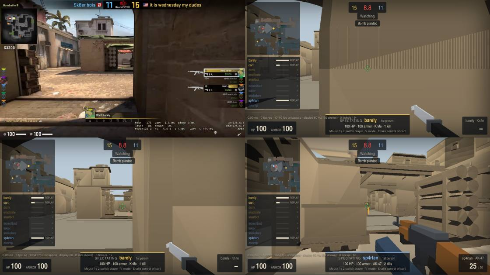
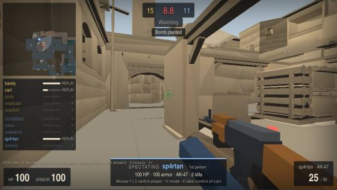

# Round data (`data/round.json`)

Everything the game knows about the recorded round: Mirage, round 12/30, Sk8er bois (CT) 11 – 15 "it is wednesday my dudes" (T), Sp4rtaN's 1v3 retake and defuse. The file is generated. Don't edit it by hand: change the extractor and re-run it.

## Regenerate

```sh
npx tsx tools/extract-round.ts ../web-apps/cs2/mirage-round-replay/index.html   # [shots.csv] [--out data]
npx tsx tools/validate-round.ts                                                 # [data/round.json] [--csv <csv>]
```

- **Inputs:** the web-apps replay page (its `<script id="data" type="application/json">` block and the one inline `data:image/jpeg` radar), the shots CSV (default `<page dir>/source/shots/mirage-round-sp4rtan-1v3-shots.csv`), and `data/tuning.json` (clip/reserve per weapon).
- **Outputs:** `data/round.json` (2-space JSON, fixed key order, trailing newline), `data/mirage-radar.jpg` (1024×1024 overview, the bytes from the page), and `data/source/mirage-round-sp4rtan-1v3-shots.csv` (a verbatim copy, so CI can check the shot count without web-apps).
- **Determinism:** same inputs give byte-identical outputs. `tests/round-data.test.ts` rebuilds the round twice and compares it with the committed file whenever the web-apps clone is found next to the repo (or at `$ROUND_SOURCE_HTML`); without it that one test is skipped.
- `meta.sources` records the SHA-256 of both inputs, so a stale `round.json` is easy to spot.
- **Types:** `RoundData` and the record types in `src/contracts/round.ts`; `parseRound` validates a parsed file (see `docs/contracts.md`, Types).

## Conventions used throughout

- Player ids are lowercase (`barely cart donk eradicate incredibad lokier snakelore snarlbot sp4rtan zwomp`). Arrays keyed by player are sorted by id, and so are objects keyed by player.
- Every time `t` (video seconds, replay t = 0 is clock 1:39) has `tick = Math.round(t * 64)` next to it: `t0/tick0`, `t1/tick1`, `plantT/plantTick`, `deathT/deathTick` and so on.
- Positions are `{x, y, z}` in Source world units (Mirage frame, see `docs/conventions.md`). The source only gives `lastKnown` positions as `{x, y}`.
- Weapon ids: `ak47 awp ssg08 deagle m4a4 glock knife c4`, grenades `smoke flash he molotov`. `glock` appears only as donk's quick-switch in the shots CSV (and so in his weapon timeline). Lokier's rifle is always `ssg08` (the extractor turns any AWP attributed to him into `ssg08`); donk's AWP is real.
- `confidence` is one of `observed | estimated | inferred`.

## Fields

### `meta`

| Field | Source | Notes |
| --- | --- | --- |
| `clock0` | `meta.clock0` | 98.25 s on the round clock at t = 0 |
| `bombTimerSec` | `meta.bombTime` | 40 |
| `score {ct, t}` | `meta.score.*[0]` | score before the round: 11 – 15 |
| `scoreAfter {ct, t}` | `meta.score.*[1]` | 12 – 15 |
| `teams {CT, T}` | `meta.teams` | team names |
| `map {posx, posy, scale, size}` | `meta.map` | radar transform (−3230, 1713, 5, 1024) |
| `video` | `meta.video` | YouTube URL of eradicate's POV recording |
| `durationSec` | `meta.duration` | 80.27 (the clip runs into next round's freeze time) |
| `roundEndT/Tick` | `meta.roundEnd` | 66.8, the defuse |
| `hudRound` | `meta.hudRound` | "Round 12/30" |
| `ticksPerSec` | constant | 64 |
| `sources` | computed | input file names (relative to the workspace), SHA-256s, CSV row count |

### `players[]` (sorted by id)

| Field | Source |
| --- | --- |
| `id`, `name`, `team`, `note` | page `players[]` (`name` is the in-game display name) |
| `color`, `chev` | page `players[]`. CTs have no colour in the source, so `color` is the CS2 teammate colour of their `chev` (yellow `#ffd83d`, green `#3ad27a`, orange `#ff9230`, blue `#4ea6ff`, purple `#b65ff2`). |
| `start {pos, yaw, confidence}` | first track sample (t = 0). `yaw` comes from the page's `yaw` rows at t = 0; only eradicate has one, the rest are `null`. |
| `startHp`, `startArmor`, `startHelmet` | movement doc (table in `tools/extract-round.ts`): 100/100/helmet for everyone except snarlbot (44 HP). The extractor checks this against the page's `hp`. CT values are assumed. |
| `startMoney` | page `players[].money` (Ts only, `null` for CTs) |
| `kit {primary, secondary, grenades[], c4, kit, clip, reserve, assumed}` | movement doc. `clip/reserve` are for the weapon drawn at t = 0, from `data/tuning.json`. |
| `pickups[] {t, tick, weapon}` | movement doc: Sp4rtaN picks up an AK-47 at 19.6 s |
| `role`, `roles[]` | movement doc. `role` is the first entry of `roles` (barely: `take_b`, `planter`). |
| `isHumanDefault` | `true` only for `cart` |
| `deathT/deathTick` | page `players[].death` (`null` for Sp4rtaN) |

Kits at t = 0:

| id | primary | secondary | grenades | c4 / kit | clip/reserve | assumed |
| --- | --- | --- | --- | --- | --- | --- |
| barely | ak47 | – | he, smoke | c4 | 30/90 | no |
| cart | ak47 (donk's) | – | smoke, smoke | – | 30/90 | no |
| donk | awp | glock | flash, molotov | – | 10/30 | no |
| eradicate | ak47 | – | – | – | 30/90 | no |
| incredibad | m4a4 | – | – | – | 30/90 | yes |
| lokier | ssg08 | – | – | – | 10/90 | no |
| snakelore | m4a4 | – | – | – | 30/90 | yes |
| snarlbot | ak47 | – | smoke, flash | – | 30/90 | no |
| sp4rtan | – | deagle | – | defuse kit | 7/35 | no |
| zwomp | m4a4 | – | – | – | 30/90 | yes |

### `tracks.<id>`

| Field | Source / meaning |
| --- | --- |
| `samples[] {t, tick, x, y, z, confidence, uncertainty?, resampled?}` | page `tracks` rows `[t, x, y, z, flag(, uncertainty)]`, on an exact 0.1 s grid from t = 0 to the last source sample |
| `offGridSamples[]` | source rows whose `t` is not a multiple of 0.1 (event anchors such as kills at 17.85 s), kept verbatim |
| `yaw[] {t, tick, deg}` | page `yaw` rows `[t, id, deg]` for this player (20 Hz where present; Ts only, while they were on camera) |
| `endT/endTick` | last source sample (death time, or 70.3 s for Sp4rtaN) |

Track `flag`, worked out from the data and the round breakdown:

| flag | `confidence` | Meaning | Where |
| --- | --- | --- | --- |
| 0 | `observed` | Seen on camera or radar | Ts almost all the time; CTs only during sightings (Snakelore 12.0+, Lokier 12.5–12.75 and 17.45+, Sp4rtaN 49.9–50.4, 58.6–65.2, 68.75+, Zwomp 43.9+) |
| 1 | `estimated` | Interpolated between observations or off-camera for a short time | snarlbot 0–13.0 s, cart 13.4–13.8 and 14.8–15.4 s, barely 27.9 s, Sp4rtaN 65.2–68.7 s |
| 2 | `inferred` | Reconstructed route, never seen | CTs outside sightings |

The 6th column (CT tracks only) is the uncertainty radius in world units. It is written as `uncertainty` on every non-observed sample that has it (for example Sp4rtaN 320 before his first kill, then 200, 260, 140, 120; Zwomp 450 then 240). Observed samples carry 0 in the source and have no `uncertainty` field.

Resampling: the source is 10 Hz but jumps half a step at some event anchors (snarlbot from 13.05 s, Lokier from 12.75 s, Sp4rtaN around 17.85, 19.6, 68.75 and 70.0 s, eradicate's last sample at 12.75 s). Grid samples that fall between source rows are linearly interpolated, rounded to whole units, marked `resampled: true`, and take the less certain confidence (and larger uncertainty) of their two neighbours. The original off-grid rows are in `offGridSamples`, so nothing from the source is lost.

### `shots[]` (one per CSV row, in CSV order)

CSV columns: `t_video_s, round_clock, shooter, weapon, event, target, damage, headshot, source, confidence, note`.

| Field | From column | Notes |
| --- | --- | --- |
| `t`, `tick` | `t_video_s` | `null` for count-only rows whose column is a range (e.g. `33.35–48.85`) |
| `window {t0, tick0, t1, tick1}` | `t_video_s` | the range for count-only rows, else `null` |
| `count` | `event` | shots represented: 1 for a shot/hit, N for "N shots (count only)", 0 for kill-feed-only rows and the weapon switch |
| `shooter` | `shooter` | |
| `weapon` | `weapon` | |
| `kind` | `event` | `shot`, `shot_kill` ("shot → kill"), `hit`, `kill` (kill feed only, shot unknown), `shot_count`, `switch` |
| `target` | `target` | `(probable)` / `(defusing)` stripped (still in `raw`); `null` for `unknown` or empty |
| `damage`, `armorDamage` | `damage` | "73 HP / 7 armor" → 73, 7 |
| `headshot` | `headshot` | `yes` → true |
| `confidence` | `confidence` | `inferred` if the text says so; `estimated` for "time unknown"; otherwise `observed` (HUD/kill feed/audio timings ±0.017–0.03 s) |
| `raw` | every column | all CSV cells verbatim, keyed by header (`round_clock`, `source` and `note` are only here) |

### Events

| Field | Source | Notes |
| --- | --- | --- |
| `kills[] {t, tick, killer, victim, weapon, hs, assist, postRound, kpos, vpos, kplace, vplace}` | page `kills` | 69.4 s (Sp4rtaN → cart) has `postRound: true` |
| `damage[] {t, tick, attacker, victim, amount, armor, weapon, note, apos, vpos, source}` | page `damage` (`source: "damage"`) plus CSV rows with a damage figure that the page lacks (`source: "shots_csv"`: Sp4rtaN's 13-damage kill shot on donk at 50.3 s, with `apos/vpos` `null`) | `armor` only where the CSV gives it (7 at 18.5 s), else `null` |
| `utility[] {t, tick, thrower, kind, place, throwPos, landing, radio}` | page `util`; `landing` from `MEASURED_LANDINGS` in `tools/extract-round.ts` (V0, measured on the video) | `throwPos` matches the thrower's track at the throw time (where it was thrown from). `landing {x, y, z, uncertainty}` is where it comes to rest and pops (smoke bloom, flash/HE detonation, fire), `uncertainty` a radius in units; `null` where the recording never shows it. See "Grenade landings" below |
| `radio[] {t, tick, who, place, text, kind}` | page `events` texts of the form `who @ place (RADIO): text` (`kind: "radio"`), plus the plant call-out without `(RADIO)` at 24.4 s (`kind: "callout"`) | |
| `chat[] {t, tick, who, dead, text}` | page `events` of kind `chat` (all `*DEAD*` all-chat) | |
| `sightings[] {who, t0, tick0, t1, tick1, place, by}` | page `sightings` | when a CT was seen, and by whom |
| `lastKnown[] {who, t0, tick0, t1, tick1, pos {x, y}}` | page `lastknown` | radar last-known markers |
| `pov[] {t0, tick0, t1, tick1, target, note}` | page `pov` | which player the recording's camera follows |
| `bomb {carrier, plantT, plantTick, pos, defuseStartT, defuseStartTick, defuseT, defuseTick}` | page `bomb` | plant 27.517 s at (−1982, 311, −160), defuse 61.8 → 66.8 s (kit) |
| `timelines.hp/money .<id>[] {t, tick, value}` | page `hp`, `money` | Ts only |
| `timelines.weapon.<id>[] {t, tick, weapon, raw}` | page `weapons`, plus the shots CSV's weapon switches | `weapon` is the first item of the display text; `raw` keeps it (`"AK-47 · C4"`); CTs shown as `—` have `weapon: null`. Every CSV `switch` row adds a point (`raw` `"<CSV weapon> (shots CSV)"`), and so does a switch back named in its note as `back to <weapon> at <t>` (`raw` `"<weapon> (shots CSV note)"`): donk's Glock at 49.93 s and his AWP again at 50.083 s. Points are sorted by `t` (page first on a tie); one that repeats a page point is not added. |
| `events[] {t, tick, kind, text, who, victim, util}` | page `events` | the narrative feed, ids lowercased |

Not copied: the page's `nav` and `places` (the nav mesh is task A3's `data/mirage-nav.json`).

## Known gaps

- **CT weapons:** Incredibad, Snakelore and Zwomp were never seen holding a weapon; `m4a4` is assumed (`kit.assumed: true`). CT grenades and secondaries are unknown (empty / `null`), as are the Ts' pistols except donk's Glock.
- **CT HP and armor:** never shown; 100/100 with helmet is assumed. CT money is unknown (`startMoney: null`).
- **CT routes:** outside sightings the CT tracks are `inferred` reconstructions with an `uncertainty` radius of 110–450 units. Treat them as plausible, not recorded.
- **Grenade landings:** only the throw position and time are known; where each smoke, flash, HE and molotov landed is not in the data.
- **Yaw:** only for Ts while on camera (eradicate, cart, donk, barely). There is no CT yaw, and most players have no yaw at t = 0.
- **Shots:** exact times only for shots seen on the ammo HUD of the spectated player, plus a few audio-confirmed first shots. Off-camera sprays are counts over a time window, and kill-feed-only kills don't say how many shots were fired.
- **Resampled samples:** a few tens of grid samples per affected track are interpolated (see above), so they can differ by a few units from where the player really was.
- **Level flips:** `z` is the 2020 nav floor under the radar dot, so where floors overlap it can be the wrong one. barely 35.1–44.7 s is on the underpass / Tunnel Stairs in `round.json` (dz −198 in, +154 out) but was on Catwalk; `round.json` keeps the source as is and `tools/snap-tracks.ts` pass 0 (`levelFlips`, `docs/geometry.md` "barely 33–48 s") corrects it in `data/geometry/mirage-tracks.json`, which is what the hosts use.

## Grenade landings and the plant spot (V0, measured on the video)

Measured on eradicate's recording (the same frames `tools/video-parity.ts` reads; the video stays outside the repo).
The 2020 CS:GO radar draws **no** smoke, fire or flash markers (checked on the POV radar 0-12.75 s and the spectator
radar 13.2-70 s: only player dots, the C4 icon, view cones and last-known markers), so a landing can only come from a
first-person view that shows it. The demo draws grenade trajectories as yellow lines, which helps where they are in view.

| t | thrower | kind | landing | uncertainty | evidence |
| ---: | --- | --- | --- | ---: | --- |
| 4.8 | cart | smoke | `null` | | not on camera: eradicate faces the Apartments door in Back Alley 4.8-12.7 s (frames 5.0-11.0 s show no cloud or trajectory) |
| 5.6 | snarlbot | smoke | `null` | | not on camera (Palace Alley; the camera is eradicate's) |
| 7.8 | snarlbot | flash | `null` | | not on camera; eradicate is not blinded |
| 8.8 | donk | flash | `null` | | not on camera (pops behind eradicate; he is not blinded) |
| 17.8 | barely | HE | `null` | | not resolved: cart's POV 17.8-20.3 s looks out of the Apartments window at B; no detonation in view, no damage row |
| 19.2 | donk | molotov | `null` | | not resolved: no fire in cart's views of B 19.4-22.5 s; trajectory lines in view at 20.0 s but no end point |
| 25.8 | cart | smoke | (−1885, −320, −166) | 45 | cart throws from the B side (−2059, 88) into the Market window. In his POV at 26.3–27.2 s the trajectory line passes through the window opening and disappears, descending, behind its east (left-in-view) jamb, so it comes down on the Shop floor just inside and east of the opening. From inside Shop (29.6–30.2 s) the cloud fills the window. It blocks the window, as John remembers, and does not land deep inside Market. H5's `aimAtLanding` reaches it from cart's spot (6–19 u at (−1890, −310) / (−1880, −350); pitch about −5°, yaw −66°, half strength). Corrected in V0b: the first measurement, (−2035, −305, −94) on the counter, was about one window width too far west, behind solid wall on the CS2 mesh |
| 29.8 | barely | smoke | `null` | | not resolved: its trajectory line is in barely's POV 32.2-33.4 s, but without his view angles (V2) the end point can't be placed |

**The Market window is the same in 2020 and on the CS2 mesh** (V0b, after H5 #41 found the first landing unreachable).
On the CS2 mesh the wall between B and Shop has its face at y −264, with the window open over x −1946…−1890 (sill z −126,
lintel −14); the door is the full-height gap at x −2356…−2292. In the video:
- cart's own track crosses the wall line at (−1962, −264) at 28.5 s and is inside Shop at (−1959, −314) by 28.8 s. He
  climbs through the window, not the door, within the radar's ±25 u of the mesh's opening.
- At 26.3 s, from (−1965, 2) facing the wall, the opening is straight ahead.

So the first measurement's x was wrong, not the map: the counter at x −2040…−1980 is inside Shop, west of the window,
behind the wall from the B side.

**The other recorded throws (H5's question: do the throw spots and aims fit the frames?).** None of their landings is on
camera (table above), and the recording has no yaw for cart, snarlbot or donk at 4.8–8.8 s (only eradicate's own),
so the aims are not data: H5's assumed targets are all that exists. The throw spots are the throwers' radar dots on
eradicate's POV radar (±10–20 u). On the CS2 mesh:
- **cart at 4.8 s** (Back Alley, (−468, 924, −80)): the recorded z is 64 u above the mesh floor (−144) under a roof
  136 u above his eye. He is clear only towards yaw 0–90° (east and north-east, 320–400 u). Every other direction is
  20–60 u from a wall, so a throw "west down the approach" hits the wall in front of him.
- **snarlbot at 5.6 and 7.8 s** (Palace Alley, (718, −1274) and (700, −1300)): open sky, clear 400 u only towards yaw
  270° (south) and 150–260 u east and south-east. Throws towards the north (yaw 0–45°) hit the wall 50–96 u away.
- **donk at 8.8 s** (Back Alley, (−180, 623, −77)): open sky, clear west and south-west (yaw 135–225°, 400 u), with a wall
  36–51 u away to the north-east. eradicate's view at 8.8–10 s shows no pop and he is not blinded. A pop 86 u above the
  Apartments roof is therefore not contradicted, but nothing in the frames confirms it either.

If H5's throws from these spots bounce back at every pitch, the assumed yaw points into the near wall. Aim along the
clear directions above, or treat the spots as ±20 u and step out to the free side (H5's free-stand search).

**The plant spot** (John: "planted behind the cylinder stack, aka planted for catwalk"). Measured: **(−1981, 305, −160) ± 25 u**,
the centre of the planted C4 icon on the spectator radar from 27.6 s to the defuse (and of the carried C4 icon while
barely plants, 24.3-27.5 s), through the radar registration of `docs/parity.md` (dots vs this file's observed samples:
RMS 21 u). The data's (−1982, 311, −160) is 7 u from that, inside the measurement's error, so **it is not moved**.
The cylinder stack is the solid of the CS2 mesh at x −1968…−1888, y 348…432 (75 u high): cart walks past it at
22.5 s and its cylinder ends fill the right of his view from about 150 u. The bomb is just off its south-west corner
(16 u west, 37 u south), on the side a T on catwalk sees: barely's view from catwalk at 58.3 s shows the bomb's red
light on the floor at the stack's foot. Two things don't fit and are left open (they need the players' view angles, V2):
in that view the light looks just north of the stack rather than south, and at 65.9-66.6 s cart sprays at the stack
with Sp4rtaN defusing out of his sight, while in the 3D app at 66 s the defuser at his recorded spot (−2005, 345) is in
plain view from cart's eyes (`docs/parity/2026-11-07-3d.md`). Sp4rtaN's spot is where his dot went under the C4 icon, not
an observation of where he crouched.

A recheck of barely's 58.3 s frame that does not depend on the recorded yaw (angles measured against the stack's own
edges in the frame, 106.26 deg FOV): the light is 1.6 deg right of the stack's north silhouette, i.e. on a bearing of
165-167 deg from barely's spot (-1370, 312), which on the CS2 mesh passes just north of the stack (y 440-455). The CS2
mesh has no standable floor there (a 20 u gap at z -176 between the stack and the site's north wall), so that reading
cannot be reproduced on the CS2 map, and the recorded yaws near the stack are about 20 deg high (V2's image fit for
cart at 65-66.7 s), so yaw-based bearings don't settle it either. The plant spot stays where the radar puts it until
the 2020 map (X1) or V2's view angles can place the stack and the bomb against each other.

## sp4rtan's kill on barely, 58.85 s (K1)

John: "sp4rtan killing barely is still bugged". The video (barely's own POV 55.2–59.4 s) against the 3D game spectating
barely and sp4rtan, and the headless log (ticks 3560–3790):

- **Video.** barely has his **knife** out from 57.6 s (`timelines.weapon`; the breakdown's "molotov" is wrong: the HUD and
  the viewmodel show a knife, and he never draws a molotov). From 58.4 s he stands in the arch at the east end of B
  site, the arch's north pillar filling the right half of his screen and B site open to the left of its edge. At
  58.72 s sp4rtan is in view just left of that edge, by the barrel stack, and the kill lands a few frames later.
- **Game, before.** (1) sp4rtan was 190–228 units behind his tape: at the kill his puppet was at (−2129, 542), at the
  foot of the Apartments stairs, not at (−2089, 357) by the bomb (the harness's worst observed miss, 228 u at 58.6 s).
  His inferred route covers the Apartments, the stairs and the site at 140 u/s until 57.0 s and then at 320–335 u/s
  (57.0–58.5 s), which no AK runner can do (run speed 215), and the snapped track kept it (`retime` lets a track go as
  fast as the recording). (2) barely's radar dot at 58.2–58.85 s, (−1370, 311), is 17 units east of the pillar's east face
  (x −1392, y 300–345; the pillar is x −1522…−1392, y 275–365 on the CS2 mesh): in the game he stared into the wall
  and sp4rtan shot him from out of sight (`scripted hit through geometry` at 3766, no aim point in sight).
- **Fix.** `tools/snap-tracks.ts` pass 4 `lead`: an inferred stretch walks at most 0.9 × run speed toward the next
  seen sample and starts earlier where it has to (sp4rtan 52.6–58.6 s, up to 220 u ahead in the Apartments; only he
  changes). `tools/vision-labels.ts` `SNAP_FIXES` makes barely ↔ sp4rtan (58.6–58.85 s) a recorded duel for pass 5,
  which moves barely 53 u south at 58.4–58.8 s into the arch opening, where his POV puts him (the 2D mask exclusion
  stays: it is about the raw dot). The kill stays on tick 3766, and both see each other at 58.72–58.84 s.
- **2020 vs CS2.** Not a map difference as far as the video shows: the pillar is in both. One CS2 surface grazes the
  line: the west face of the box west of the bomb (x −1969, y 347–430, top z −95) is 1–3 units above and inside the
  line from sp4rtan's eye (z −96) at his tape spot; at barely's corrected spot the line passes south of it. X1b's 2020
  map can confirm both.




Top left the video, top right the game before (barely facing the pillar), bottom left after (barely in the arch, the
site open as in the video), bottom right sp4rtan's eyes after (barely at the crosshair). barely's facing is the
puppet's; V2b's `view[]` for this segment will refine it, and the positions don't depend on it.

