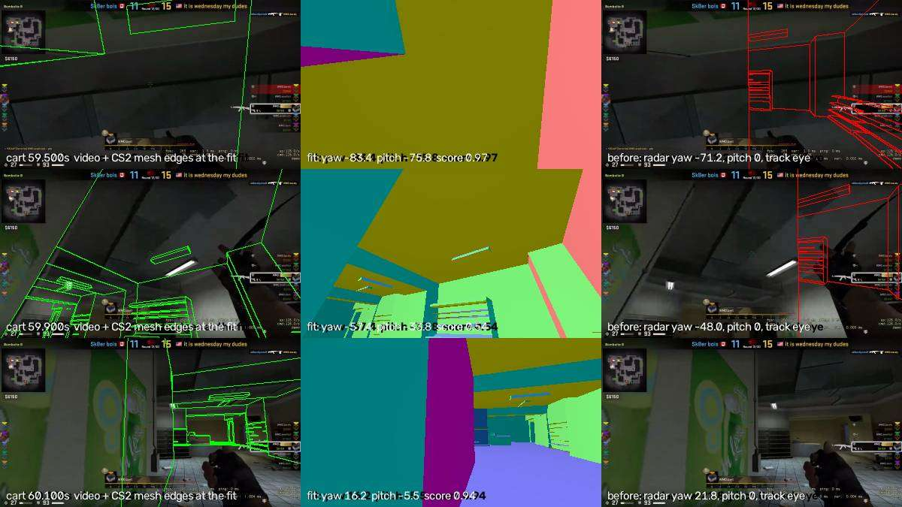
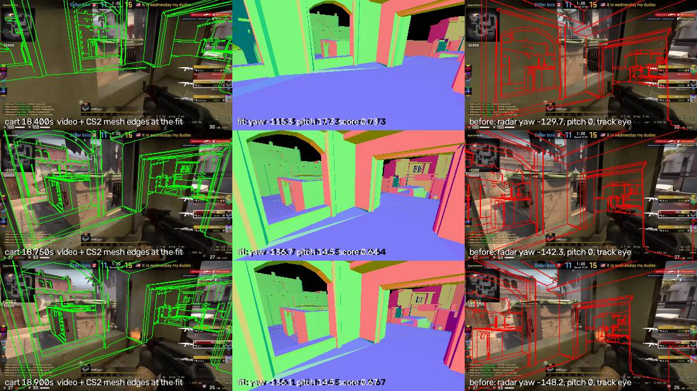
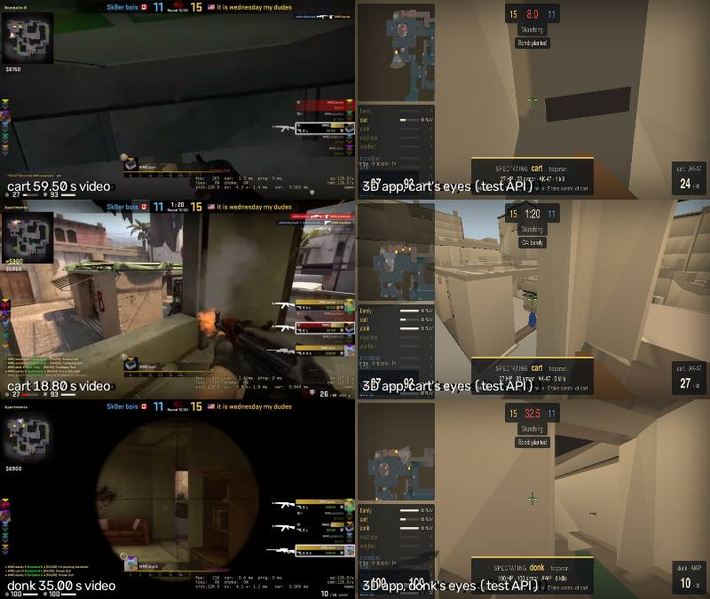

# View fit (V2): the watched player's yaw and pitch from the original video

John (2026-11-07): "go back to the source original video and make sure all of the players' view angles are set
properly. For example, in Market when barely dies, cart should be staring up at the ceiling because he did so in the
original video."

Before V2 the round data had a **yaw** only for the player on camera, read from the radar's view cone, and **no pitch
anywhere**: puppets looked level. V2 fits the camera of every first-person frame of the recording against CS2 Mirage's
mesh and writes the result into `data/round.json` (`tracks.<id>.view`, `docs/round-data.md`). Puppets follow it
(`src/core/puppet.ts`, `docs/core.md` "Puppets"), so the 3D app's first-person spectating shows the real view.



*cart at 59.5, 59.9 and 60.1 s, just after barely's death: staring at the Market ceiling (pitch −76°), then looking
down into the room. Left: the frame with the mesh's edges drawn at the fitted view; middle: the mesh rendered from the
fitted eye; right: the old view (radar yaw, pitch 0) in red.*

## Run it

```sh
python3 tools/viewfit/fit.py                 # the fit: logs/viewfit/fit.json (856 frames; ~1 h on 2 loaded vCPUs)
python3 tools/viewfit/fit.py --repick        # only redo the per-segment Viterbi picks from the cached segments
npx tsx tools/fit-view-angles.ts             # -> data/source/view-fit.json, logs/viewfit/report.md
npx tsx tools/extract-round.ts ../web-apps/cs2/mirage-round-replay/index.html   # merge into data/round.json
npx tsx tools/snap-tracks.ts                 # re-snap (the refined samples)
npx tsx tools/fit-view-angles.ts --check     # the line-of-sight checks on the merged, re-snapped data
python3 tools/viewfit/sheets.py logs/viewfit/fit.json out.jpg cart:59.5,donk:35   # contact sheets
npm run build:3d && npx tsx tools/viewfit/check3d.ts   # the 3D app's camera against the recorded view
```

**Needs:** `python3` with `numpy`, `opencv-python-headless` and `embreex` (`pip install embreex`: Intel Embree ray
casts, ~2 M rays/s per core), `ffmpeg`, and the private video (`../web-apps/cs2/mirage-round-replay/source/
video_1080p60_h264.mp4`, or `$VIEWFIT_VIDEO`). Never in CI; the video never enters this repo. Per-segment results are
cached in `logs/viewfit/segments/` (a restart resumes), decoded frames in `logs/viewfit/frames.npy`.

## Method (`tools/viewfit/`)

**Frames.** Every 10 Hz grid time of every first-person camera segment (`round.pov`, minus the death cam and the next
round; up to each player's track end), plus 30 fps around the key moments (cart 18.3–19.0, 59.4–60.2, 65.8–69.4 s; donk
49.85–50.35 s) and 60 fps ±0.1 s around every timed shot of the watched player: **856 frames** (cart 577, eradicate
127, barely 81, donk 71), decoded at 480 × 270.

**Camera.** CS:GO's `default_fov 90` at 4:3, hor+: 73.74° vertical, 106.26° horizontal at 16:9, square pixels (focal
180 px at 480 × 270), roll 0, at the player's snapped (CS2 floor) track position + eye 64 + a fitted offset (dx, dy
within ±90 with a Gaussian prior of σ 45 u, the radar's ±20–40; dz −24…+12, so a crouched eye at −18 is allowed).
**Scoped** frames (the AWP overlay: black left and right of the circle, `features.is_scoped`) use the scope circle only
and try both AWP zoom levels (40 and 10 at 4:3: 30.54° and 7.51° vertical); donk 33.4–37.4 s fits zoom 1 throughout. The
FOV was checked on the frames: barely's B-site windows (53.0 s) and the Back Alley door (eradicate, 5–9 s) line up across
the whole frame at 73.74°.

**Masks.** The spectator / POV HUD (radar, scoreboard, kill feed, player panels, chat, spectated name, net_graph, ammo)
and the viewmodel (the bottom-right weapon and hands) are masked (`features.hud_mask`).

**Score** of a candidate view (`features.GridScorer`, `features.LineSet`), on a grid sample every 8 px (≈ 2,000 rays):

- **Regions.** Each ray is labelled by the CS2 mesh surface it hits (triangles joined through shared edges whose normals
  differ < 12°, so a whole floor or wall is one region; the decimated mesh's tessellation can't match texture) × a depth
  bin (300 / 900 / 2,500 u); a miss is sky. η² of the frame's Lab colours given the labels, minus its chance level.
- **Edges.** + 0.15 × the mean standardised frame gradient across grid neighbours whose labels differ.
- **Manhattan.** + 0.5 × the length-weighted share of the frame's LSD line segments that point at a vanishing point of
  a world axis (Mirage is mostly axis-aligned), minus chance. This is mesh-free and pins pitch and yaw (mod 90°) where the
  mesh is plain — e.g. the Market ceiling, where the physics mesh is one flat plane.
- − the eye-offset prior.

**Search per frame** (`fit.fit_frame`): around each of the previous frame's three best views (±15° yaw, ±12.5° pitch,
2.5° steps), a sweep around the radar yaw (±35°, pitch −84…84; at a segment's first frame ±45° and a 3 × 3 eye grid of
40 u), and the mirror pitch of the previous best (up and down look alike to both cues on plain ceilings and floors).
Rotations from one eye are lookups in a cube map of labels (`features.LabelCube`); the best few are refined jointly in
(dx, dy, dz, yaw, pitch) by a shrinking random search with direct ray casts. Each frame keeps its ≤ 5 distinct (> 5°)
hypotheses.

**Per segment** (`fit.viterbi`): a Viterbi pass over the hypotheses minimises each frame's score deficit against its
best, 0.006 per degree of view change beyond 12° per 0.1 s, and 0.15 per frame left out (≤ 3 in a row). Leaving frames
out stops one motion-blurred frame from dragging the sequence onto the mirror view (at 59.73–59.8 s the best single-frame
views look *down*; the sequence stays on the ceiling). 17 frames are left out.

**Confidence** (`tools/fit-view-angles.ts`): `observed` when the pick scores ≥ 0.62 and beats the best view more than
8° away by ≥ 0.02; `estimated` when it scores ≥ 0.45; otherwise (and for left-out frames) the radar yaw is kept
(`source: 'radar'`, no pitch). Calibrated on the frames checked by eye on the contact sheets (scores of good fits
0.65–1.2; median pick 0.89).

**Held views.** A camera segment's first fitted view is held back up to 0.8 s across the spectator's camera switch
(`inferred`) when its first sample is `observed` and its first three agree within 6°: the spectator switches to cart
0.55 s after barely's death, and cart's first frames (59.43–59.7 s) stare at the ceiling unchanged, so his view at the
death (58.85 s) is that ceiling stare. 40 samples are held (cart 24: before 37.4, 54.2 and 59.4 s; barely 8; donk 8).

## Results

### Coverage

| player | fitted frames | observed | estimated | radar fallback | held (inferred) |
| --- | ---: | ---: | ---: | ---: | ---: |
| barely | 81 | 68 | 11 | 2 | 8 |
| cart | 577 | 452 | 108 | 17 | 24 |
| donk | 71 | 57 | 14 | 0 | 8 |
| eradicate | 127 | 120 | 5 | 2 | 0 |
| **all** | 856 | **697 (81 %)** | 138 (16 %) | 21 (2.5 %) | 40 |

`round.json` carries 895 view samples: the 856 fitted frames (21 of them radar fallbacks) and 40 held ones.

### The known moments

| moment | fitted | notes |
| --- | --- | --- |
| **cart in Market when barely dies** (58.85 s; cart on camera from 59.43 s) | **pitch −75.8°** (yaw −83.4°) at 59.43–59.57 s, −78.3° at 59.6 s, −73° at 59.7 s; then −51° (59.83), −34° (59.9), −24° (60.0), −6° (60.03 s) as he looks down into the room | held back to 58.8 s (`inferred`), so the 3D app's camera through cart's eyes **at 58.85 s has pitch −75.83°** (test API, below) |
| **donk scoped east in the Apartments** (33.4–37.4 s) | zoom 1 (AWP 40), **yaw −13° … −16°**, pitch 0…4°, held all segment (radar cone: 5…13°) | sheet: `img/viewfit-scoped.jpg` |
| **eradicate's own POV** (0–12.75 s) | median \|fit − radar yaw\| **1.2°** over 120 observed frames (his radar is the rotating POV radar, registered per frame); 34 frames > 10° apart (p90 32°), mostly fast turns in the first seconds where the 20 Hz radar yaw lags | sheet: `img/viewfit-eradicate.jpg` |
| the spectator segments | median \|fit − radar yaw\| 13° (barely), 20° (cart), 22° (donk) | the spectator radar's view cone is a coarse direction cue, not the view |

### The view at the watched shots

Angle between the fitted view and the line from the fitted eye to the target's head (track + 64). *Before*: the
recorded positions; *after*: the refined ones (below), with the eye moved with them.

| t (s) | shooter → target | frame conf. | fitted yaw / pitch | error before | error after |
| ---: | --- | --- | --- | ---: | ---: |
| 18.517 | cart → lokier | estimated | −112.6° / 15.9° | 21.4° | 23.3° |
| 18.617 | cart → lokier | estimated | −122.6° / 12.7° | 14.0° | 17.2° |
| 18.700 | cart → lokier | observed | −139.6° / 13.5° | **2.2°** | 6.8° |
| 18.800 (the headshot) | cart → lokier | estimated | −136.7° / 14.6° | **4.4°** | 8.2° |
| 18.900 | cart → lokier | estimated | −136.1° / 14.5° | 6.2° | 16.4° |
| 49.850 | donk → sp4rtan (AWP, missed) | estimated | −28.3° / 1.1° | 24.6° | 24.6° |
| 65.9–66.9 (11 shots) | cart → sp4rtan (no damage) | observed | 69° → 49° / 0…5° | 4.8–14.1° | (not refined) |
| 68.667 | cart → sp4rtan | observed | 22.4° / 2.5° | 10.0° | |
| 68.77–69.27 (6 shots) | cart → sp4rtan | estimated / 1 observed | 92–102° / 7–11° | 73–80° | |

Reading: cart's flick onto Lokier is caught (18.52–18.62 s he is still turning, his recoil kicks after each shot), and at
the kill the view points within 2–4° of Lokier's recorded head. The 18.9–19.0 s rows are after the kill. Sp4rtaN's
recorded track at 49.85 s and 68.8–69.3 s is the inferred / radar one; donk's AWP shot missed, and cart's last spray
frames (68.8–69.3 s, after the round's end banner) fit poorly (score ≈ 0.62, mesh box clutter at the B boxes): those
rows say the target is not where the view is, or the fit is off — they are left as they are and not used.

## Engagement positions (the window duel)

G6's audit found cart ↔ Lokier impossible on the CS2 mesh at the recorded positions: both scripted hits (Lokier's 73 on
cart at 18.5 s, cart's headshot at 18.8 s) crossed the Apartments wall 5–10 u west of the window's edge, and G6's sight
pass (pass 5 of `tools/snap-tracks.ts`) moved cart up to 108 u to compensate. V2 places them from the video instead
(`tools/fit-view-angles.ts`, `ENGAGEMENTS`):

1. **cart's eye**: the median fitted offset of his 13 observed frames 18.2–18.78 s.
2. **Lokier** onto cart's line of sight at the frames where cart's crosshair is on him (18.75–18.8 s, the headshot), at
   his radar distance, within 3° of the crosshair (the fit, spread and recoil), at most 60 u (he is radar-observed).
3. **Depth.** The fit pins the eye across the view but hardly along it: moving cart's eye forward along the view costs
   the 18.5–18.8 s frames only 0.02–0.08 of score over the first 80–100 u, then the score collapses when the eye reaches
   the window (cart's 18.7 s frame, eye moved forward along the view, rotation re-fitted: 0 u 0.74, 40 u 0.67, 80 u 0.65, 120 u 0.63, 140 u 0.42; 18.8 s: 0.68, 0.60, 0.60, 0.55, 0.35). So cart is moved
   by the least amount, forward along his view yaw (−136.7°) at half the cost of sideways (≤ 64 u), that opens both
   scripted hits' eye-to-band lines with a margin (± 2 u, the band 4 u lower, and the victim crouched, since the
   puppet's button plan crouches slow stretches). Result: **cart (+22.6, −92.7) + 104 u forward / 56 u left → (−15,
   −123) from his snapped track; Lokier (+41, −44)**, tapered over 0.8 s at both ends.
4. **The approach** (17.4–17.9 s, past the first window, where the recording's sighting of Lokier starts at 17.45 s):
   each 10 Hz frame's own fitted offset (median of 3; the fit is strong there, scores 0.8–1.0, offsets (0…13, −51…−70)),
   plus per frame the least move (same rule) that opens the eye-to-head line both ways to Lokier.
   43 samples in all (cart 16.6–19.5 s, Lokier 17.5–18.8 s), each listed in `data/source/view-fit.json` `positions` and
   in `docs/round-data.md`; the kill / damage event positions at 18.5 / 18.8 s move with them.
5. Re-snapped: pass 5 then finds the duel (17.45–18.8 s) in sight and **leaves it alone** (it now moves only eradicate
   12.5–12.7 s, up to 33 u, and donk 49.9–50.1 s, up to 6 u).

| check | before (G6 pass 5 on main) | before (recorded, no pass 5) | after (V2) |
| --- | --- | --- | --- |
| eye-to-head line cart ↔ Lokier, 18.2–18.8 s (`--check`) | – | 0 % of ticks open | **100 %** |
| lokier → cart 73, chest, 18.50 s | through geometry (audit tick 1184) | blocked | **open** (no audit line) |
| cart → lokier kill, head, 18.80 s | through geometry (audit tick 1203) | blocked | **open** (no audit line) |
| cart's displacement from the recording | up to 106 u (pass 5, 17.0–19.3 s) | 0 | up to 124 u (fit 28 u + 104 u depth) |

G6's no-human audit now lists 6 lines instead of main's 8: ticks 1184 and 1203 are gone; 32, 816, 1142, 3194, 3206 and
3766 remain (`npx tsx tools/scenario-outcomes.ts nohuman`; T1 already removed 2829).

**Not refined** (`refine: false`): donk ↔ Sp4rtaN (49.9–50.35 s: donk's view at his missed AWP shot is 24.6° from
Sp4rtaN's recorded spot, which is radar-observed from 49.9 s, so moving Sp4rtaN onto it would contradict the radar; the
two corridor-door-frame audit lines 3194 / 3206 stay), barely ↔ Sp4rtaN (58.85 s: no frame shows Sp4rtaN at barely's
crosshair; the B-pillar line 3766 stays), cart ↔ Sp4rtaN (65.9–69.4 s: cart sprays at the box Sp4rtaN defuses behind,
no hit; the kill line at 69.4 s is open). barely ↔ Zwomp (44.2 s): the camera is on cart, nothing to fit.



## The 3D app (test API, `tools/viewfit/check3d.ts`)

`seekTick`, `eyes(id)`, `render()`, `state().camera` at each moment, against `round.json`'s view (at the tick or the one
before; scripted aim overrides the recorded view during engagements):

| player, t | camera yaw / pitch | recorded |
| --- | --- | --- |
| **cart, 58.844 s (tick 3766, barely's death)** | −12.6° / **−75.83°** | −83.4° / −75.83° (held; the yaw is still turning at 12°/tick) |
| cart, 59.5 s | −83.43° / −75.83° | −83.43° / −75.83° |
| cart, 60.0 s | −14.7° / −26.0° | −8.4° / −24.0° (one tick behind a fast look-down) |
| cart, 18.8 s | −140.6° / 16.3° | −136.7° / 14.5° (scripted aim at Lokier's refined head) |
| donk, 35.0 s | −16.19° / 1.59° | −16.10° / 1.85° |
| barely, 53.0 s | 103.80° / −13.94° | 103.84° / −13.91° |
| eradicate, 5.0 s | 179.57° / 1.17° | 179.68° / 1.33° |



The 3D host's FOV check for `sees` uses the yaw only (as 2D's, `src/sim3d/sight.ts`), so pitch changes no `sees`.

## What the positions changed in the tests

| test | before (main) | now | why |
| --- | --- | --- | --- |
| `golden-round` snaps | cart 1392 | cart 1394 | he leaves the window duel from the fitted spot |
| `sim3d-golden` audit ticks | 32, 816, 1142, 1184, 1203, 3194, 3206, 3766 | without 1184, 1203 | the window duel is in sight |
| `duels`, `scenarios` (miss-lokier-shop) first sight of cart | 1138 | **1133** (17.70 s) | Lokier sees cart through the first window at his fitted spot (the recording's sighting starts at 17.45 s) |
| plant in never-peeks, cart-dies, cart-goes-a, miss-lokier-shop, idle takeovers | 1768 | 1769 (0.84 s on the bomb) | barely's LIVE kill of the outlived Lokier, at Lokier's fitted spot, is a tick later |
| `duel-perfect-aim` scenario | stops at 18.0 s | stops at **18.25 s** | at 18.0 s cart is between the windows, out of sight; at 18.25 s he is at the second window: his first shot (before 18.52 s) would hit, the kill lands on 18.80 s, nobody goes LIVE (the test is unchanged) |
| `takeover-duel` scenario | aim, hold at the 18.0 s spot | aim, **walk to the second window** (−1777, 679), hold, fire at 18.7 s | the duel rule as before: the hit lands on 1184, cart's own shots resolve like the tape (kill on 1203), the round is the tape |
| `smoke-window` scenario | smoke at (−1700, 790), spot (−1712, 700), step west to (−1900, 740) | smoke at (−1750, 790), spot (−1777, 679), step west to (−1930, 720) | the same story on the fitted geometry: hidden in the smoke at the spot, seen when he steps west along the window wall (20.09 s), the hit 1 s later, cart kills Lokier, nobody LIVE |
| `takeover` T = 17.6 / 18 (idle) | Lokier's hit on the idle cart at 1266 / 1184 | **no hit; Lokier goes LIVE** (1345 / 1183) | idle at 17.6 s cart stands at the first window, 208 u from the hit's spot (> 192); idle at 18.0 s he is between the windows when the hit is due, out of sight. The block cart > lokier at T = 18 is still issued (the duel gate, not geometry). The idle rounds' later events are re-baselined (T = 18: barely survives, the LIVE defuse at 4299) |
| `rejoin` never-peeks | 0.828 s left, digest 93e0dc15 (rejoin off) | 0.844 s, 68ec22fb | the plant a tick later |

## Known limits

- The CS2 physics mesh is not the 2020 CS:GO map: no glass, window bars, props or skybox buildings, decimated on an
  8-unit grid. Frames dominated by those (B-site boxes up close, cart 68.8–69.3 s) fit poorly and are marked.
- Depth along the view is weak (above); the engagement step uses that freedom on purpose and says so.
- Plain ceilings and floors: up and down look alike to both cues; the sequence (Viterbi) decides. A frame whose
  neighbours are all plain could flip; none is left in the round (checked on the sheets).
- Smoke / flash / motion-blur frames: 21 fall back to the radar yaw (no pitch); the puppet then holds its pitch.
- Roll is 0; the FOV is not refitted per frame (only the zoom level when scoped).
