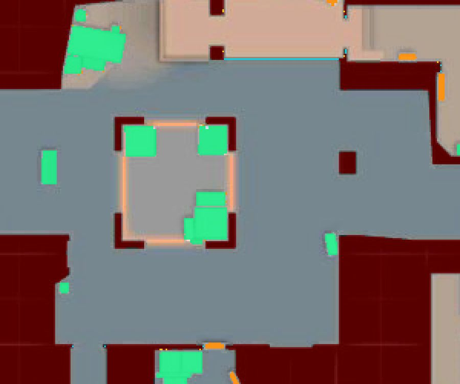

# Vision (G6: sight and bullets on CS2 Mirage's 3D geometry; C4's 2D sight kept for hosts without it)

What a pawn can see, and what bullets and grenade effects can cross. Since G6 the answer comes from **straight
segments against the CS2 collision mesh** (`src/sim2d/mesh-sight.ts`, `MapGeometry.traceSight`), the same mesh 3D
movement walks on (`docs/geometry.md`). C4's radar sight mask (`data/mirage-vismask.json`, `src/sim2d/vision.ts`)
now only clamps grenade throws (their flight is still 2D), and is the whole sight of a host built without 3D geometry
(the 2D movement mode, the synthetic test meshes). It is not a prefilter (below). **Both hosts use the same
`MeshSight`**: `Sim2DHost` and the 3D host (`Sim3DHost`, src/sim3d; its own `MeshSight3` is gone), so the 3D
no-human run equals the 2D golden master in every line, `sees` included (`tests/sim3d-golden.test.ts`).

**Why.** The radar mask has no heights: it treated whole building walls as windows and let lines pass under floors
and through rooms. In the no-human golden master **3,107 of 7,063 `sees` entries (44 %) had every aim point blocked
on the mesh**, and 323 of 432 enemy entries sampled every 8th tick (74.8 %) were blocked eye to eye. In John's case
(`fixtures/scenarios/cart-dies.json`) the LIVE Lokier went LIVE at 10.38 s "seeing" cart, and at 11.27 s donk in Back
Alley headshot him at the Truck with the AWP, 1,990 units away through the Apartments building. After G6: **0 false
entries** in the golden master and in every scenario (`tools/sight-check.ts`, `tests/scenarios.test.ts`), and that
kill is impossible (`tests/sight3d.test.ts`).

## The model (`MeshSight`)

**Segments.** `MapGeometry.traceSight(a, b)` is `traceLine` against the **sight triangles only**: `combineMeshes(world,
clips)` records the world's triangle count (`sightTriangles`), so G3's player clips stop movement but not sight or
bullets, as CS2's `playerclip` does. Glass, windows and bullet-pass railings were never in the awpy mesh, so they are
open. Two-sided triangles, open segment (touching an end doesn't count), closed triangle. A cell whose sight triangles'
z extent misses the segment's z range in it is skipped whole (open floors cost nothing), and a triangle whose box
misses the segment's box in the cell is skipped (18 % faster than G2's `traceLine` on recorded pairs, same answers:
`tests/sight3d.test.ts` compares 2,000 segments).

**Eye.** `pos.z` + `damage.eyeHeight` (64), `crouchEyeHeight` (46) crouched, at the pawn's real z: an airborne pawn
looks from where it is (3D movement keeps the true feet z).

**Aim points.** Like CS2's bots (`CCSBot::IsVisible(player)` checks the gut, head, feet and both elbows), the viewer's
eye is traced to several points of the target's body, and the target is seen if **any** segment is clear. In order
(the first clear one ends the test):

| point | where (standing; crouched heights × 46 / 64) |
| --- | --- |
| head | `bandHeights.head` 64 above the feet: the eye |
| chest | `bandHeights.chest` 48 |
| left, right | chest height, `ai.sightSideUnits` (12) to either side, perpendicular to the 2D line of sight |
| leg | `bandHeights.leg` 16 |

**One trace for both directions.** The head point is the eye (64 = 64, and 46 = 46 crouched), so the eye-to-head
segment of a pair is eye to eye and serves both directions: `pairSight(a, b)` traces it once, **from the first pawn of
the pair (id order)**, and only the directions it leaves blocked try their other points.

**`sees` (contract F5).** For every unordered pair (i < j, id order), both alive: each direction is asked if the
viewer isn't blind and the target is within `ai.fovDeg / 2` (53°) of its yaw (2D bearing); none asked → nothing traced.
Then smoke (the 2D segment between the two positions through an active smoke disc) blocks both, before any trace.
Then `pairSight`. Lists sorted by id; dead pawns neither see nor are seen; teammates are included (the human's `sees`
decides puppet snaps). Not symmetric any more: a pawn behind a low wall can see a standing enemy's head while the enemy
sees nothing of him (the shared eye line is the only symmetric part). The host caches `sees` per state, as before.

**Hints (cost only).** For each pair, MeshSight keeps the triangle that last blocked one of its segments and tests that
triangle first on the next query: if the segment crosses it, the segment is blocked, exactly what the full trace would
say; otherwise the full trace decides. Answers never depend on the hints, so snapshots don't carry them and a port may
drop them.

### Who uses what

| user | query |
| --- | --- |
| `sees` | `MeshSight.pairSight`: eye to the aim points, plus FOV, smoke and blindness (above) |
| bullets (`traceShot`) | `LosQuery.shotClear`: the shooter's eye to the impact point at the hit band's height (`docs/combat.md`); a blocked segment stops the bullet; no wall penetration |
| LIVE AI guard spot (`guardSpot`) | `GuardSight.pointClear`: the spot's eye to the bomb's leg-height point |
| LIVE AI targets, reactions, hearing vs sight | `sees` (an enemy in `sees` is seen; a heard one isn't) |
| Core: sighting trigger, the scheduled Lokier encounter (start and gate: "cart in Lokier's `sees` at the spot"), rejoin unrest, puppet snaps (the human's `sees`) | `sees`, unchanged code |
| flash, HE | `effectClear`: the grenade to the pawn's eye (flash) or stomach-height body (HE); a grenade lying on the ground traces from the CS2 floor under it + 2 (its z is the 2020 nav's) |
| grenade throw clamp | the 2D radar mask (`GrenadeSight.lineOfSight`), unchanged: the flight is 2D |
| Core: scripted aim (B3) | `sees`: a puppet tracks its target only while it sees it, else it pre-aims at the recorded spot (`docs/core.md` "Aim") |
| scripted-hit audit (both hosts) | `MeshSight.blockDistance`: the attacker's eye to the victim's hit band (below) |
| 2D view's tracers | `Session.tracerSight()`: a scripted hit's tracer ends on the victim only if the shooter sees it; any other ends at the first mesh wall along the shooter's view (`traceSight`) |
| 3D host's bullets | `traceShot3` on the same world mesh (the hitboxes; `docs/sim3d.md`) |

### Not a prefilter: the radar mask

A prefilter may only reject what the exact test would reject. Over the golden master (every 4th tick, every alive pair,
FOV aside) the mask's 2D sight and the mesh agree on 13,923 pairs; the mask **blocks 61 pairs the mesh sees** (the
Truck-to-Apartments-corridor line through the balcony door, cart and donk in the corridor at 15.2 s, …), so as a
prefilter it would drop real sightings, and it **passes 574 pairs the mesh blocks** (the false sightings). It isn't
cheaper either: its DDA plus the nav level check cost about what a mesh trace with hints does. The cheap filters are
the ones that never lose a sighting: alive, blind, FOV, smoke, then one shared trace, then hints.

## Recorded duels (`tools/sight-snap.ts`, pass 5 of the track snapping)

The recording's positions are a 2020 POV video's, ±20–40 units and more near walls (`docs/geometry.md`), and a
recorded duel can be impossible on the real mesh at them. The decisive one: **cart's recorded path through the
Apartments (17.45–18.8 s) runs 80–145 units behind the window's sill** (z −24, the room's floor −48). From Lokier on B
(eye −92) every line to him then passes under the sill: in sight for 2 ticks of the 87, and neither Lokier's recorded
73 at 18.5 s nor cart's headshot at 18.8 s could connect. The windows are where geometry.md found them (x −1816…−1752
and −1672…−1608, y ≈ 656, open from z −24 to +70). Cart's recorded view yaw at the kill (−145.7°) points at Lokier from
about 100 units further south, close to the window, not from the recorded spot (−137.1°). Moving Lokier instead
would take ≥ 200 units.

So the snapped tracks (G3, `data/geometry/mirage-tracks.json`) get a fifth pass: for each **recorded duel** (a trusted,
non-excluded sighting of the vision labels with a trusted hit or kill between the pair in its window, until either
dies), both must see each other at every 10 Hz sample of the window, standing, and crouched too where the snapped
track moves slower than 120 u/s but isn't standing still (where the puppet may crouch-walk). Where they don't, one of
the two (both are tried; the cheaper wins) moves as little as it can: a Viterbi search over 4-unit (window) and 8-unit
(1.5 s either side) candidate stand spots within 128 units on the same floor, steps within the recorded weapon's run
speed × 1.1 and in clear hull lines, cost = distance from the snapped spot + how much each step differs from the snapped
step. Not walls opened: positions moved.

| duel | at the snapped positions | moved |
| --- | --- | --- |
| eradicate ↔ Lokier, 12.5–12.75 s (the Truck to the corridor through the balcony door) | 3 samples out of sight | eradicate 12.5–12.7 s, up to 33 u |
| cart ↔ Lokier, 17.45–18.8 s (the window) | 14 samples out of sight | cart 17.0–19.3 s, up to 106 u, along the window |
| donk ↔ sp4rtan, 49.9–50.35 s (Apartments corridor, a door frame) | 3 samples out of sight | donk 49.9–50.1 s, up to 6 u |
| cart ↔ sp4rtan, 68.75–69.4 s (B site) | in sight | – |

Not duels (unchanged, as C4 found them): barely → Zwomp at 44.0–44.2 s (barely's recorded level is wrong) and
barely ↔ sp4rtan at 58.6–58.85 s (the pillar), both excluded with evidence in `tools/vision-labels.ts`; snarlbot →
incredibad (0.5 s) and sp4rtan → snarlbot (17.85 s) are on inferred positions. All four duels then hold at every sample
(`tests/sight3d.test.ts`), and the scheduled encounter's spot (cart's track at the hit) is now (−1728, 700).

## Aim follows sight (G6)

John, watching with no takeover, saw cart aim-lock Lokier through the Apartments wall and shoot him. Since G6 a
puppet's scripted aim (B3) tracks the target only while the target is in its `sees`; otherwise it holds the pre-aim on
the recorded spot where the next shot or hit lands (`docs/core.md` "Aim"). The recorded damage still lands on its tick,
but a bullet fired at a wall ends at the wall: in 3D the ray stops there (`shots()`), and the 2D view's tracers stop
at the first mesh wall along the shooter's view unless the shooter sees its victim. Nobody visibly tracks through
geometry, and the no-human round's kills, damage, plant and defuse stay on their ticks (only the look changes; the
fixtures in `docs/golden.md`).

## Scripted hits through geometry (audit)

The tape is the truth, so a recorded hit lands whatever the mesh says. Each host checks every scripted gun hit it
applies: if the segment from the attacker's eye to the victim's hit band (`bandHeights[hitgroup]`, chest for bands
without a height; crouched × 46 / 64) crosses a world triangle, it appends to `combatLog()`

    script: scripted hit through geometry: lokier -> cart ssg08 chest at tick 1184 (18.50 s): wall 351.3 u from lokier's eye, cart 466.9 u; another aim point in sight

(the landing tick, the pair, weapon and band, the wall's distance from the eye and the victim's, and whether any of the
victim's five aim points is in sight). `npx tsx tools/scenario-outcomes.ts` prints them for every run. These are the
recorded engagements whose positions (the 2020 video's, snapped) conflict with the CS2 mesh; V2 (`v2-viewfit`) refines
the positions from the video and X1 brings the 2020 BSP. In the no-human round (identical in 2D and 3D):

| tick | t (s) | attacker → victim | weapon, band | wall from the eye / victim | another aim point in sight | why |
| ---: | ---: | --- | --- | --- | --- | --- |
| 32 | 0.50 | snarlbot → incredibad | AK-47, chest | 126 / 223 u | no | incredibad's position is inferred (kill feed only) |
| 816 | 12.75 | lokier → eradicate | SSG 08, head | 415 / 1,189 u | no | the balcony-door line; eradicate's puppet lags the pass-5 samples |
| 1142 | 17.84 | sp4rtan → snarlbot | Deagle, chest | 31 / 441 u | no | sp4rtan's route is inferred |
| ~~1184~~ | 18.50 | lokier → cart | SSG 08, chest | – | – | **the window duel: gone with V2** (`docs/viewfit.md` "Engagement positions": cart and Lokier placed from cart's first-person frames; G6 had the line meet the Apartments wall 10 u west of the window's edge) |
| ~~1203~~ | 18.80 | cart → lokier | AK-47, head | – | – | **the window duel: gone with V2** (was 5 u west of the edge) |
| 3194 | 49.91 | sp4rtan → donk | AK-47, chest | 424 / 528 u | yes | the Apartments corridor door frame |
| 3206 | 50.09 | sp4rtan → donk | AK-47, chest | 434 / 529 u | yes | the same; donk's 3200 hit is open |
| 3766 | 58.84 | sp4rtan → barely | AK-47, head | 222 / 784 u | no | the B-site pillar (excluded in the vision labels) |

T1 took barely → Zwomp (2829, 44.20 s) off this list: the recording had barely a level too low, on the Tunnel Stairs
under Catwalk, and on Catwalk (`docs/geometry.md`, "barely 33–48 s") the hit is in sight.

## Validation

```sh
npx tsx tools/sight-check.ts --log <log.jsonl[.gz]>     # re-trace every sees entry; count false ones
npx tsx tools/sight-check.ts --recorded [--log <golden>]  # recorded engagements at the snapped and the run's positions
```

`sight-check` re-implements the aim points on its own and traces them with `traceSight`.

| run | `sees` entries (enemy) | every aim point blocked | enemy entries, eye to eye blocked (every 8th tick) |
| --- | ---: | ---: | ---: |
| golden master, before G6 | 7,063 (3,091) | 3,107 (44.0 %) | 323 / 432 (74.8 %) |
| golden master, G6 | 4,295 (805) | **0** | 17 / 143 (seen by another aim point) |
| cart-dies, before | 5,432 (2,146) | 2,414 | 226 / 309 (73.1 %) |
| cart-dies, G6 | 2,388 (746) | **0** | 12 / 134 |

`tests/scenarios.test.ts` asserts 0 for the golden master, the follow run and every scenario, and that no engine bullet
hit's segment (eye to the impact point) crosses a wall. The 12 hand-picked must-not-see pairs are blocked at every aim
point both ways.

Recorded engagements (`--recorded`, the golden master's positions), ticks with sight: at the snapped positions every
trusted, non-excluded sighting, damage and kill is in sight on most or all of its ticks (cart → Lokier 84 of 87,
eradicate → Lokier 17 / 17, donk → sp4rtan 36 / 36, cart → sp4rtan 68.75 s 100 / 100; Lokier's 18.5 s hit and cart's
18.8 s kill 5 / 5). In the golden run's own positions (puppets lag their tracks by a few units) cart → Lokier is in sight
on 67 of 87 ticks from 17.63 s; Lokier → eradicate at 12.75 s is not (eradicate's puppet lags the moved samples): a
scripted kill between puppets, so nothing depends on it. The excluded and inferred ones stay out of sight.

## Scenarios before and after (`tools/scenario-outcomes.ts`)

Before: main before G6 (the radar mask, H1's tracks); after: G6 (the mesh, pass 5, aim on sight).

| run | before | after | why |
| --- | --- | --- | --- |
| no human | the tape: CT defuse, 0.72 s | the same | scripted; nothing branches on `sees` |
| block-barely, block-sp4rtan | round still on / sp4rtan LIVE (blocked) at 3815, kills cart 3830 | the same | body blocks; no sight change in reach |
| **cart-dies** | Ts win by elimination: Lokier LIVE (sighting) at 10.38 s, **donk AWPs him at 721 through the Apartments**, Zwomp, eradicate, sp4rtan LIVE | CT defuse, 0.83 s left: Lokier LIVE (sighting) at 651, kills cart at 680; eradicate LIVE (gunfire); Lokier outlives his tape, barely kills him at 1418 and the rest is the tape | donk can't see Lokier through the building (the false sighting John saw), so nobody else is pulled LIVE |
| cart-goes-a | CT defuse 0.83 s; sp4rtan sights cart at 1813, kills him 1852 | the same, sighting at 2103, kill at 2220 | A main's lines on the mesh open later |
| duel-perfect-aim, takeover-duel, takeover-mid-duel | the tape | the tape | recorded duels in sight (pass 5) |
| early-peek-lokier | cart kills Lokier 1053; Zwomp LIVE (gunfire) | cart kills Lokier 1091; nobody else LIVE | on the mesh cart's line to Lokier from the corridor opens 38 ticks later; the shot then no longer sets off Zwomp's gunfire trigger |
| flank-sp4rtan | Ts win (cart kills sp4rtan 2856) | the same | open lines in both |
| lokier-late | cart kills Lokier 1372 | 1371 | the window line one tick earlier |
| mid-zwomp, miss-lokier-shop | CT defuse | the same | |
| never-peeks | sp4rtan kills cart 2599 | 2597 | sp4rtan sights cart 2 ticks earlier |
| smoke-window | cart kills Lokier 1370 | 1381 | the mesh opens cart's line through the window 11 ticks later |

## Cost

`tests/sight3d.test.ts`: 10 viewers × 9 targets at the snapped positions every 0.5 s of the round: **0.15 ms per tick**
(132 segment tests, 30 full traces; 0.29 ms without the hints), against 0.09–0.11 ms for C4's mask in the same test.
In whole runs sight costs less than C4's level check did: the harness's no-human round went from 899 to about 710 µs per
tick (docs/app.md has the Session and browser numbers). After the aim-on-sight change and the M1 merge (measured on a
shared 2-vCPU box at load average ≈ 16, so only the comparison means anything): `npm run harness -- --human none` main
5,162 / 6,318 µs per tick, G6 5,755 / 4,943 (alternating runs: no difference beyond the noise); `npm run check:browser`
at 4× main 168.6 ticks/s, G6 134.4 (both far off the 256 target under that load; the same PROBLEM lines on main).

## Known limits

- **No wall penetration.** CS2 bullets go through thin walls and props by material; the mesh has no materials. No
  recorded kill or hit is a wallbang.
- **Glass and windows are open**, and so is anything awpy dropped (`passbullets`, `grenadeclip`). Mirage's windows
  used here have no glass.
- **Decimation:** the mesh is clustered on an 8-unit grid (`docs/geometry.md`), so box and frame edges can be a few
  units off; lines that graze them can differ from CS2's.
- **Smoke** is still a 2D disc of full height between the two positions; flashes and HE ignore partial cover beyond one
  segment; grenade flight is 2D on the radar mask.
- **Recorded positions:** pass 5 fixes only the duels; other recorded sightings on estimated or inferred positions can
  stay out of sight. Puppets follow their tracks within a few units, so a line that only just clears at a sample can
  close between samples (pass 5 checks the samples only).
- FOV is a 2D cone (no pitch limit); there is no leaning in CS2 either.

## The 2D sight (C4 / F, hosts without 3D geometry)

What follows is C4's mask and F's cover rule as they were. With the CS2 mesh they only clamp grenade throws.

### The mask (`tools/extract-vismask.ts`)

```sh
npx tsx tools/extract-vismask.ts          # data/mirage-vismask.json + logs/vismask-debug.png (+ -bsite.png, B site 3×)
npx tsx tools/extract-vismask.ts --check  # fails if the committed file is stale
npm run extract:vismask                   # the same as the first line
```

Input: `data/mirage-radar.jpg` (1024 × 1024, SHA-256 `e270489d…`, recorded in the file). Output: one cell per radar
pixel (5 units), the radar transform `px = (x + 3230) / 5`, `py = (1713 − y) / 5`. jpeg-js decodes the JPEG (a
devDependency; tools only, nothing at runtime).

On this radar, playable space is coloured (blue-grey floors, tan rooms, teal stairs, white props) and walls and
out-of-map space are black or near-black. The dark-grey grid lines and labels (L ≈ 55, chroma ≤ 6) are drawn in the
black background, never over floors. Steps, with the parameters written into the file's `params`:

| step | parameter | value | why |
| --- | --- | --- | --- |
| 1. classify | `lumOpen` | 72 | Open if luminance L = 0.299 R + 0.587 G + 0.114 B ≥ 72. Grid lines peak at ≈ 60; the darkest floor shading (CT spawn) is ≈ 72. |
| | `lumTeal`, `chromaTeal` | 28, 12 | Darker pixels are open only if blue-green (G ≥ R, B ≥ R) with L ≥ 28 and chroma ≥ 12: the dark teal Tunnel Stairs (L 30–50) are floor; JPEG ringing next to tan rooms is reddish and stays wall. |
| 2. close walls | `closeRadius` | 1 | Dilate then erode the walls with a 3 × 3 square: open cracks ≤ 2 cells wide inside walls are filled, so a lighter JPEG pixel can't open a hole through a wall. No doorway is that narrow (a player is 6.4 cells wide). This also removes the grid lines and labels (4,305 cells). |
| 3. open specks | `minOpenArea` | 64 | 8-connected open components < 64 cells become wall (4 components, 63 cells). |
| 4. wall specks | `minWallArea` | 6 | 4-connected wall components < 6 cells not touching the border become open (dark noise on floors: 6 components, 13 cells). Pillars and wall stubs are larger. |
| 5. thin lines | `openThinLines` | true | A wall cell with open cells on both sides along x or along y (a line one cell thick) becomes open, in one pass (184 cells). On this radar 1-px dark lines drawn over floors are windows and railings: the Apartments window over B, the Mid window of Sniper's Nest, the Tunnel Stairs railing. Full-height walls are black gaps of 2 cells or more, which this step never touches. |
| 6. cover (F) | `coverLumSeed`, `coverChroma` | 190, 24 | Boxes, crates and the Truck are drawn light grey to white (L 190–255, chroma ≤ 12) on floors that are L ≤ 156 (blue-grey 131, the grey bombsite squares 154) or colourful (tan rooms, chroma > 30). An open cell this light and grey seeds a prop. |
| | `coverLumEdge` | 170 | JPEG blurs box edges over 1–2 px: cells at least this light (and as grey) 8-connected to a seed through such cells join it (14,122 candidates). |
| | `coverOpenRadius` | 1 | An opening by a 3 × 3 square drops cover lines and slivers up to 2 cells thick (ledge highlights in Mid and on the T ramp). |
| | `coverMinArea`, `coverMinCore` | 12, 5 | 8-connected components smaller than 12 cells, or without a 5 × 5 square (25 × 25 units) inside, are dropped: the remaining 3-cell-wide highlight lines (the long one beside T spawn's ramp, 3 × 78) and door sills (the Shop door, 12 × 4). 19 dropped, 52 kept. |

Result: 738,507 wall cells (unchanged by cover), 12,413 cover cells in 52 components, 297,656 open. The file (49 KB,
format `vismask@2`) is run-length encoded, one row per line: each `rows` row lists run lengths alternating wall, open,
wall, … starting with wall (the first may be 0; cover counts as open there), and each `cover` row run lengths
alternating not cover, cover, … starting with not cover. A `vismask@1` file (no `cover`) still decodes, with no cover.
Same image in, same bytes out (`tests/vision.test.ts` rebuilds it and compares).

`logs/vismask-debug.png` shows the radar with walls tinted red, cells the cleanup closed in yellow and cells it opened
in cyan, cover in green and cover candidates the opening or the component filter dropped in orange;
`logs/vismask-debug-bsite.png` is B site at 3×; `logs/vision-labels.png` adds the labelled pairs (below). All are
gitignored.



### Line of sight (2D)

**`VisMask.lineOfSight(a, b)`** (2D): an Amanatides–Woo DDA over the exact cells the segment crosses, measuring each
run of consecutive wall cells along the segment (in cells). A run longer than `ai.losWallTolerancePx` (1) blocks, so
grazing a corner (a tiny length in a wall cell) doesn't. A run that touches either end may be up to
`ai.losEndpointTolerancePx` (3) long: a pawn's centre a few units inside a wall cell. Outside the grid is wall. The
walk starts from the lexicographically smaller end, so `lineOfSight(a, b) === lineOfSight(b, a)` exactly.
`trace(a, b)` returns the longest run and where it starts (tools, tests).

**`Sight`** combines it with a **level check** on the nav floors (`NavMesh.floorsAt`), because the 2D mask can't
tell the Underpass from Catwalk above it:

- `flat(a, b)`: the mask (or, without one, the nav mesh's `lineOfSight`; the synthetic meshes in the tests).
- `clear(a, eyeA, b, eyeB)`: `flat`, and the straight 3D line between the two eyes (floor z + eye height) sampled every
  `ai.losLevelStepUnits` (16) against the floors under each sample. It is blocked where it is more than
  `ai.losLevelSlackUnits` (48) below every floor under a sample (inside the ground: a ledge face seen from below), or
  where, over one floor surface (floors matched sample to sample within `nav.stepHeight`), it is both more than 48
  below it and above it (through a slab: Catwalk over the Tunnel). Samples off the mesh don't constrain.
- `lineOfSight(a, b)`: `clear` with the standing eye height (`damage.eyeHeight`) at both ends; 2D only if a point
  has no z. This is what hitscan calls.

The slack is 48 because the nav's two-corner height model is off by tens of units on some sloped areas: at 24, the
Truck → Apartments line (Lokier's kill of eradicate) clipped a Balcony area 24 units under its modelled floor. The
Underpass → Catwalk line runs 69 units under the Catwalk floor.

#### Cover (F)

The radar has no heights, so a box can't be treated as a wall (you see and shoot over a waist-high crate) nor as floor
(a pawn crouched or defusing behind it is hidden). `Sight.coverClear(a, b)` decides, for the straight line between the
two ends (each a point with a height above its floor, eye or body band, and a posture):

A run of cover cells along the 2D segment **blocks** unless

1. it is at most `ai.losCoverTolerancePx` (1) cells long along the line (grazing a box corner), or
2. it contains an end (a pawn's centre on a box: standing on it, or position error), or
3. an **upright** end is within `ai.losCoverNearUnits` (48) of it along the line: a standing pawn at a box looks and
   shoots over it, and is seen over it. Crouched, planting and defusing pawns are **low**: they never look over cover,
   so a defuser hugging a box is hidden from across the site; so is a target point on the ground (the AI's guard spot
   check on the planted bomb); or
4. the line passes over it: across the whole run it is at least `ai.losCoverHeightUnits` (72) above the lower end's
   floor (from the Apartments window or a balcony you see over the boxes on B).

It is symmetric in its ends, and only the mask's cover cells count (walls are the flat test's). The rule was chosen
against the recording: every recorded kill, damage and sighting stays visible (below; the three that touch cover all
have an end on or at a box: Lokier at the Truck at 12.5–12.75 s, on the B-site box at 18.8 s), and B3's aimed fire items
lose nothing.

#### Who used what before G6

| user | query | note |
| --- | --- | --- |
| `sees` | `Sight.clear`, eye to eye (64, or 46 crouched), with postures | plus FOV, smoke and blindness (below). Crouched, planting or defusing (`SeePawn.busy`, a plant or defuse in progress) pawns are low for cover |
| bullets (`traceShot`) | `Sight.lineOfSight(shooter, impact)`, the impact point with the target's floor z; then `Sight.coverClear` from the shooter's eye to the hit band's point on the target | **Bullets use the mask**: you can shoot through the Apartments window, as cart and Lokier did. Windows and railings are shoot-through; a box stops a bullet under the cover rule (the shooter's and the victim's postures, `ScanPawn.busy`), and so is everything behind it on the ray; there is still no wall penetration. |
| grenades (throw clamp, flash, HE) | `Sight.flat` (`GrenadeSight`) | 2D: a grenade's arc is above eye level, so the level check would be wrong; grenades fly through windows, over drops and **over boxes** (cover is ignored) |
| LIVE AI guard spot | `Sight.clear(spot, eye, bomb, leg band, upright, low)` | a guard spot needs sight to the bomb over the boxes |
| B2's snap rule | `sees` of the human's pawn | through `Observe` (see below) |

