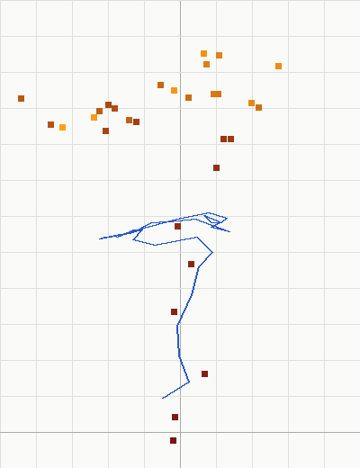
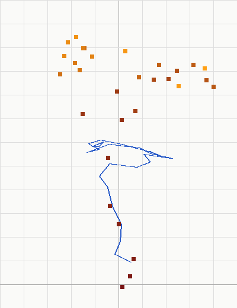

# CS2 weapon mechanics (`src/engine/weapons`, `data/weapons.json`; H2)

A pure, host-independent module (imports only `src/contracts`; ESLint enforces it, and the determinism rules of
`src/core` apply) that models CS2's weapons as exactly as the public data allows: the weapon table, recoil tables and
spray patterns, the inaccuracy and spread model, aim / view punch, tagging, fire rate, reloads, zoom, bursts, damage
(the sim2d math, data-driven) and wall penetration. The 3D host uses it since H2b (below, "In the 3D host").

## Sources

| # | Source | What it gives | Status |
| --- | --- | --- | --- |
| S1 | CS2 `game/csgo/pak01_dir/scripts/weapons.vdata` (KV3 text) as mirrored by [SteamDatabase/GameTracking-CS2](https://github.com/SteamDatabase/GameTracking-CS2/blob/cce7bf1f190144c1c08fb0fe75fd3c9514f2637f/game/csgo/pak01_dir/scripts/weapons.vdata) at commit `cce7bf1f` (2026-11-05). Copy in `data/source/cs2/weapons.vdata`, sha256 `cc04aa26fd8d4a34119df7c4b7f4f29c7ebe0c7862ce78e0a2a753642502ba0a` (in `data/weapons.json` → `source`). | Every number of the weapon table | **verified** (game files) |
| S2 | CS2 console variable dump `DumpSource2/convars.txt`, same repo and commit | `view_punch_decay 18`, `weapon_air_spread_scale 1`, `sv_jump_impulse 301.99338`, `mp_tagging_scale 1`, `mp_flinch_punch_scale 3`, `weapon_accuracy_shotgun_spread_patterns true`. CS2 has **no** `weapon_recoil_*` variables. | verified |
| S3 | Source SDK 2013, [`src/public/vstdlib/random.h`](https://github.com/ValveSoftware/source-sdk-2013) | `CUniformRandomStream` layout (`m_idum`, `m_iy`, `m_iv[NTAB]`, NTAB 32) = Numerical Recipes `ran1`. The SDK has **no Counter-Strike code** (no `cs_weapon_parse.cpp` / `weapon_csbase.cpp`), so the formulas below could not be cross-checked against Valve source. | verified (layout) |
| S4 | CS:GO console defaults, [totalcsgo.com](https://totalcsgo.com/commands/weaponrecoildecay2exp) pages for `weapon_recoil_decay2_exp` 8, `weapon_recoil_decay2_lin` 18, `weapon_recoil_vel_decay` 4.5, `weapon_recoil_scale` 2, `weapon_recoil_variance` 0.55, `weapon_recoil_view_punch_extra` 0.055 (the site lists some defaults inconsistently; the values used are the ones its own "default" examples give) | Recoil dynamics constants | CS:GO only; validated by S5 |
| S5 | [csstats.gg/spray-patterns](https://csstats.gg/spray-patterns) (updated 22 Aug 2023): CS2 spray height / width in degrees for 12 spray weapons and the difference to CS:GO | The only per-weapon CS2 recoil numbers found | community-measured |
| S6 | [cs2pulse AK-47](https://cs2pulse.com/spray-patterns/ak-47) ("the first 4 or 5 going straight and the last 4 to 5 curving slightly to the left … After the 10th bullet … the spray moves toward the right for 4 to 5 bullets … then the bullets move to the left once and then to the right"), [counterstrikewiki](https://counterstrikewiki.com/Spray_Patterns_and_Recoil_Control) (AK "11–15: pull down and to the left, 16–20: pull to the right"), [metabot.gg](https://metabot.gg/en/cs2/guides/cs2-spray-control-recoil-patterns) ("the AK-47 kicks right, then sweeps hard left"), all read 2026-11-07. [csdb.gg](https://csdb.gg/recoil-patterns/) says the opposite ("drifts left before swinging back to the right") and is outvoted by S9. | Qualitative spray shapes | community |
| S9 | CS:GO's 2020 game source as published in [SwagSoftware/Kisak-Strike](https://github.com/SwagSoftware/Kisak-Strike) (`game/shared/cstrike15/`): `cs_weapon_parse.cpp` `WeaponRecoilData::GenerateRecoilTable` and the `weapon_recoil_suppression_shots 4` / `_factor 0.75` / `weapon_recoil_variance 0.55` cvars; `cs_player_shared.cpp` `CCSPlayer::KickBack` (`angleVelocity[YAW] = -sinf(DEG2RAD(fAngle)) * fMagnitude`, `[PITCH] = -cosf(…)`, view punch × `weapon_recoil_view_punch_extra 0.055`) and `GetAimPunchAngle` (× `weapon_recoil_scale 2.0`); `cs_gamemovement.cpp` `DecayAimPunchAngle` / `HybridDecay`; `weapon_csbase.cpp` the `weapon_recoil_*` defaults (decay2_exp 8, decay2_lin 18, vel_decay 4.5, decay_coefficient 2, cooldown 0.55 "DEPRECATED") and the recoil-index decay; `baseplayer_shared.cpp` `view_recoil_tracking 0.45`, `view_punch_decay 18`; `vstdlib/random.cpp` `CUniformRandomStream` | The recoil algorithm itself (CS:GO; CS2 keeps the vdata fields it reads) | Valve source (CS:GO) |
| S7 | `docs/combat.md` and `data/round.json`: the recorded hits (SSG 08 73 HP / 7 armor; AK-47 27 / 34 / 26) | Hitgroup multipliers stomach 1.25 and leg 0.75, armor bonus 0.5, the rounding | verified by the recording |
| S8 | [PC Gamer, March 2026 reload change](https://www.pcgamer.com/games/fps/counter-strike-2-introduces-the-games-biggest-shake-up-in-years-now-when-reloading-you-lose-all-the-mags-remaining-ammo) | Reserve counted in magazines (`m_bReserveAmmoAsClips`), a reload discards the magazine | verified (matches S1) |
| M | The CS:GO-era model as publicly documented by the community (structure of `GetInaccuracy`, `UpdateAccuracyPenalty`, the recoil table, `FireBullet` penetration). No public Valve source exists for these (S3); everything built on them is **unverified** and its constants are tunables in `data/tuning.json` → `weapons._engine`. | Formulas | unverified |

No public per-bullet CS2 spray table with provenance exists (the community sites draw patterns or describe them); the
patterns here are **generated** from S1's recoil parameters and seed by the documented generator and checked against S5
and S6 (see "Recoil").

### How many numbers are verified

- **Weapon table: 3,028 numbers** (48 rows × up to 63 fields) all copied from S1. Two are interpretations, flagged
  below: `reloadTime` (= `m_flDisallowAttackAfterReloadStartDuration`) and the derived `reserve`.
- **Spray patterns: 1,608 numbers** (26 weapons) generated from S1 by Valve's algorithm (S9); 10 of the 12 weapons S5
  covers match within 2.5 % in height at `recoilScale` 1.884 (see "Recoil" for why not 2).
- **`weapons._engine`: 39 constants.** 5 verified in CS2 (S2), 1 fitted to S5 (`recoilScale`), 9 read from CS:GO's
  source (S9: the recoil decay, variance, suppression, view punch extra, view tracking and the kick's yaw sign) that
  reproduce CS:GO's spray envelopes within 0.5 % (right for CS:GO, not confirmed for CS2, which hides them),
  **24 unverified** (table below).
- Global damage numbers (`tuning.damage`): hitgroup stomach 1.25 / leg 0.75 / armor bonus 0.5 / falloff 500 verified
  by S7; arm 1, neck 1, generic 1 unverified.

## API (what the host calls)

```ts
import { parseWeaponTable, armsContext, freshArms, deploy, stepArms, applyHit, maxSpeedOf,
         penetrate, traceBulletDamage, damageAfterHitgroup, bulletDamage } from '../engine/weapons';

const table = parseWeaponTable(weaponsJson);            // data/weapons.json
const ctx = armsContext(table, tuning, 64);             // tuning.weaponModel + tuning.damage; builds recoil tables once
let arms = freshArms(ctx, 'ak47', tick);                // per pawn; or deploy(ctx, arms, id, clip, reserve, tick)

// every tick, per pawn (rng: the Core's seeded Rng, e.g. rng.fork('spread:' + id)):
const r = stepArms(ctx, arms, { tick, attack, attack2, reload, view: { pitch, yaw }, motion: { velocity, onGround, crouched, onLadder } }, rng);
arms = r.state;
if (r.shot) for (const dir of r.shot.pellets) {
  // host: trace eye → eye + dir × range against hitboxes and world, giving the hit, its distance and hitgroup
  const pen = traceBulletDamage(weaponDef(table, arms.weapon), eye, dir, hitDistance, solidQuery, tuning.damage, ctx.model);
  const hp = damageAfterHitgroup(w, pen.damage, hitgroup, victimArmor, victimHelmet, tuning.damage); // {health, armor}
  victimArms = applyHit(ctx, victimArms, arms.weapon, armoredHitgroup);                         // tagging + hit punch
}
const speedCap = maxSpeedOf(ctx, arms, attack);         // for the movement code
const camera = cameraAngles(ctx, arms, view);           // render the first-person camera here
const crosshair = crosshairAngles(ctx, arms, view);     // where the next bullet goes (cl_crosshair_recoil)
```

- `fireShot(ctx, state, rng, view, motion, tick) → { state, shot }` is the low-level single shot (no cadence or ammo
  checks); `shot = { pellets: Vec3[], inaccuracy, spread, aim, recoilIndex }`, `aim` = view + aim punch × recoilScale.
- `arms.punch.view` is the screen shake for the camera (not the bullet); `arms.punch.aim × recoilScale` is where the
  crosshair's bullet goes (CS2 `cl_crosshair_recoil`).
- `SolidQuery(origin, dir, maxDistance) → SolidSpan[]` (enter, exit, optional penetration modifier), sorted, pure. The
  module never touches geometry. `tests/weapons-penetration.test.ts` has a reference implementation on `MapGeometry`.
- Everything is deterministic: same state, input and RNG stream → identical output (state numbers rounded to 6
  decimals like the rest of the engine). The recoil tables use their own deterministic generator (below), not the RNG.

## Weapon table (`data/weapons.json`)

Built by `npx tsx tools/extract-weapons.ts` from S1 (a test rebuilds it and compares byte for byte). Field ←
vdata key; `Pair` = `[primary, alt]` (alt = scoped, silencer off, burst, revolver right click; scalars are duplicated):

| field | vdata | notes |
| --- | --- | --- |
| `damage`, `bullets` | `m_nDamage`, `m_nNumBullets` | |
| `armorRatio` | `m_flArmorRatio` | HP share through armor = armorRatio × 0.5 (AK 1.55 → 77.5 %) |
| `penetration`, `range`, `rangeModifier` | `m_flPenetration`, `m_flRange`, `m_flRangeModifier` | |
| `headshotMultiplier` | `m_flHeadshotMultiplier` | 4; Desert Eagle 3.9, M4A1-S 3.475 |
| `cycleTime` | `m_flCycleTime` | **AK-47 0.1 s** (600 rpm). The H2 brief quoted 0.0998; the game file says 0.1. |
| `burst` | `m_bHasBurstMode`, `m_flCycleTimeWhenInBurstMode`, `m_flTimeBetweenBurstShots` | Glock, FAMAS; 3 rounds (`burstShots`, unverified) |
| `clip`, `reserveMax`, `reserveAsClips`, `reserve` | `m_iMaxClip1`, `m_nPrimaryReserveAmmoMax`, `m_bReserveAmmoAsClips` | `reserve` derived: magazines × clip (AK 3 × 30 = 90; AWP 2 × 5 = 10) |
| `reloadTime` | `m_flDisallowAttackAfterReloadStartDuration` | **interpretation, unverified**: used as the magazine reload time (AK 2.466667 s; csdb.gg says 2.5); for shell shotguns the reload start |
| `reloadsSingleShells` | `m_bReloadsSingleShells` | Nova, XM1014, Sawed-Off; per shell `shellReloadSec` (unverified) |
| `deployTime` | `m_flDeployDuration` | AK 1.0, AWP 1.266667, M4A4 1.133333 (the 2D table assumed these) |
| `maxSpeed`, `attackMovespeedFactor` | `m_flMaxSpeed`, `m_flAttackMovespeedFactor` | AWP 200 (100 scoped), Negev 0.5 while firing |
| `spread`, `inaccuracy.*` | `m_flSpread`, `m_flInaccuracyStand/Crouch/Move/Jump/Land/Ladder/Fire`, `…JumpInitial`, `…JumpApex`, `…Reload` | already in the game's tangent units (CS:GO's ×0.001 is applied in the file) |
| `recoil.*` | `m_flRecoilAngle`, `…AngleVariance`, `…Magnitude`, `…MagnitudeVariance`, `m_nRecoilSeed` | |
| `recovery.*` | `m_flRecoveryTimeStand/Crouch`, `…StandFinal/CrouchFinal`, `m_nRecoveryTransitionStartBullet/EndBullet` | −1 = unset (equipment) |
| `flinchLarge`, `flinchSmall` | `m_flFlinchVelocityModifierLarge/Small` | tagging |
| `zoom.*` | `m_nZoomLevels`, `m_nZoomFOV1/2`, `m_flZoomTime0..2`, `m_bUnzoomsAfterShot` | |
| `price`, `killAward`, `silencer`, `spreadSeed`, `tracerFrequency`, `gearSlot`, `kind` | `m_nPrice`, `m_nKillAward`, `m_eSilencerType`, `m_nSpreadSeed`, `m_nTracerFrequency`, `m_GearSlot`, `m_WeaponType` | |

Ids: the vdata class without `weapon_`, except `m4a4` (= `weapon_m4a1`), `m4a1s`, `galil`, `sg553`, `p2000`, `usps`,
`zeus`, `he`, `flash`, `smoke`, `incendiary`, and the items `kevlar`, `assaultsuit`, `defuser` (prices only).
Knife skins, heavy armor and NVGs are left out.

Against the 2D table (`tuning.weapons`, docs/combat.md): damage, armor penetration, range modifier, headshot multiplier,
fire rate and auto/semi agree for all six guns (tested). Differences: the AWP magazine is **5** in CS2 (the recording
showed 10; the 2D table keeps 10), and the reserves follow the March 2026 magazine system (M4A4 120, SSG 08 20, Desert
Eagle 21, Glock 60).

### All weapons (from `data/weapons.json`)

Primary mode; cycle in brackets = alt; speed in brackets = scoped/alt; reload "+ shells" = shell-by-shell.

| id | class | kind | dmg | armor pen | range mod | HS | cycle s | clip / reserve | reload s | deploy s | speed (alt) | pen | stand / crouch / move inacc. | price / award |
| --- | --- | --- | ---: | ---: | ---: | ---: | ---: | ---: | ---: | ---: | ---: | ---: | --- | ---: |
| cz75a | weapon_cz75a | pistol | 31 | 0.7765 | 0.85 | 4 | 0.1 | 12 / 24 | 2.73333 | 1.83333 | 240 | 1 | 0.01043 / 0.0076 / 0.01341 | 500 / 300 |
| deagle | weapon_deagle | pistol | 53 | 0.932 | 0.85 | 3.9 | 0.225 | 7 / 21 | 2.2 | 1 | 230 | 2 | 0.0042 / 0.00218 / 0.0481 | 700 / 300 |
| elite | weapon_elite | pistol | 38 | 0.575 | 0.79 | 4 | 0.12 | 30 / 60 | 3.76667 | 1 | 240 | 1 | 0.007 / 0.00525 / 0.01785 | 300 / 300 |
| fiveseven | weapon_fiveseven | pistol | 32 | 0.9115 | 0.81 | 4 | 0.15 (0.3) | 20 / 40 | 2.26667 | 1 | 240 | 1 | 0.0091 / 0.00683 / 0.04 | 500 / 300 |
| glock | weapon_glock | pistol | 30 | 0.47 | 0.85 | 4 | 0.15 (0.3) | 20 / 60 | 2.26667 | 1 | 240 | 1 | 0.0056 / 0.0042 / 0.01 | 200 / 300 |
| p2000 | weapon_hkp2000 | pistol | 35 | 0.505 | 0.91 | 4 | 0.17 | 13 / 52 | 2.26667 | 1 | 240 | 1 | 0.0049 / 0.00368 / 0.013 | 200 / 300 |
| p250 | weapon_p250 | pistol | 38 | 0.64 | 0.9 | 4 | 0.15 (0.3) | 13 / 39 | 2.26667 | 1 | 240 | 1 | 0.0091 / 0.00683 / 0.02 | 300 / 300 |
| revolver | weapon_revolver | pistol | 86 | 0.932 | 0.94 | 4 | 0.5 (0.4) | 8 / 16 | 2.26667 | 1.16667 | 180 (220) | 2 | 0.002 / 0.001 / 0.0065 | 600 / 300 |
| tec9 | weapon_tec9 | pistol | 33 | 0.906 | 0.79 | 4 | 0.12 | 18 / 54 | 2.56667 | 1 | 240 | 1 | 0.0049 / 0.00368 / 0.00381 | 500 / 300 |
| usps | weapon_usp_silencer | pistol | 35 | 0.505 | 0.91 | 4 | 0.17 | 12 / 24 | 2.2 | 1 | 240 | 1 | 0.0049 / 0.00368 / 0.01387 | 200 / 300 |
| bizon | weapon_bizon | smg | 27 | 0.63 | 0.8 | 4 | 0.08 | 64 / 128 | 2.43333 | 1.1 | 240 | 1 | 0.014 / 0.0105 / 0.02757 | 1300 / 600 |
| mac10 | weapon_mac10 | smg | 29 | 0.575 | 0.8 | 4 | 0.075 | 30 / 90 | 2.56667 | 1 | 240 | 1 | 0.0133 / 0.00998 / 0.01399 | 1050 / 600 |
| mp5sd | weapon_mp5sd | smg | 28 | 0.625 | 0.87 | 4 | 0.08 | 30 / 90 | 2.96667 | 1 | 235 (220) | 1 | 0.01 / 0.0085 / 0.03 | 1400 / 600 |
| mp7 | weapon_mp7 | smg | 30 | 0.625 | 0.87 | 4 | 0.08 | 30 / 90 | 3.16667 | 1 | 220 | 1 | 0.01 / 0.0085 / 0.01986 | 1400 / 600 |
| mp9 | weapon_mp9 | smg | 26 | 0.6 | 0.87 | 4 | 0.07 | 30 / 60 | 2.13333 | 1.2 | 240 | 1 | 0.009 / 0.008 / 0.02904 | 1250 / 600 |
| p90 | weapon_p90 | smg | 26 | 0.69 | 0.86 | 4 | 0.07 | 50 / 100 | 3.36667 | 1 | 230 | 1 | 0.01365 / 0.01024 / 0.031 | 2350 / 300 |
| ump45 | weapon_ump45 | smg | 35 | 0.65 | 0.75 | 4 | 0.09 | 25 / 75 | 3.46667 | 1 | 230 | 1 | 0.01343 / 0.01007 / 0.02876 | 1200 / 600 |
| ak47 | weapon_ak47 | rifle | 36 | 0.775 | 0.98 | 4 | 0.1 | 30 / 90 | 2.46667 | 1 | 215 | 2 | 0.00641 / 0.00481 / 0.17506 | 2700 / 300 |
| aug | weapon_aug | rifle | 28 | 0.9 | 0.98 | 4 | 0.1 | 30 / 90 | 3.2 | 1.16667 | 220 (150) | 2 | 0.0049 / 0.00368 / 0.13545 | 3300 / 300 |
| famas | weapon_famas | rifle | 30 | 0.7 | 0.96 | 4 | 0.09 | 25 / 100 | 3.3 | 1 | 220 | 2 | 0.00759 / 0.0055 / 0.09934 | 1950 / 300 |
| galil | weapon_galilar | rifle | 30 | 0.775 | 0.98 | 4 | 0.09 | 35 / 140 | 3.03333 | 1.1 | 215 | 2 | 0.00877 / 0.00658 / 0.12356 | 1800 / 300 |
| m4a1s | weapon_m4a1_silencer | rifle | 38 | 0.7 | 0.94 | 3.475 | 0.1 | 20 / 60 | 3.06667 | 1.13333 | 225 | 2 | 0.0049 / 0.0041 / 0.09288 | 2900 / 300 |
| m4a4 | weapon_m4a1 | rifle | 33 | 0.7 | 0.97 | 4 | 0.09 | 30 / 120 | 3.06667 | 1.13333 | 225 | 2 | 0.0049 / 0.0041 / 0.13788 | 2900 / 300 |
| sg553 | weapon_sg556 | rifle | 30 | 1 | 0.98 | 4 | 0.11 | 30 / 90 | 2.76667 | 1 | 210 (150) | 2 | 0.00581 / 0.00381 / 0.13601 | 3000 / 300 |
| awp | weapon_awp | sniper | 115 | 0.975 | 0.99 | 4 | 1.455 | 5 / 10 | 3.66667 | 1.26667 | 200 (100) | 2.5 | 0.0808 / 0.0606 / 0.17648 | 4750 / 100 |
| g3sg1 | weapon_g3sg1 | sniper | 80 | 0.825 | 0.98 | 4 | 0.25 | 20 / 40 | 4.66667 | 1 | 215 (120) | 2.5 | 0.0258 / 0.01935 / 0.15048 | 5000 / 300 |
| scar20 | weapon_scar20 | sniper | 80 | 0.825 | 0.98 | 4 | 0.25 | 20 / 40 | 3.06667 | 1 | 215 (120) | 2.5 | 0.0258 / 0.01935 / 0.15048 | 5000 / 300 |
| ssg08 | weapon_ssg08 | sniper | 88 | 0.85 | 0.98 | 4 | 1.25 | 10 / 20 | 3.7 | 1 | 230 | 2.5 | 0.0317 / 0.02378 / 0.12345 | 1700 / 300 |
| mag7 | weapon_mag7 | shotgun | 30×8 | 0.75 | 0.45 | 4 | 0.85 | 5 / 15 | 2.5 | 1 | 225 | 1 | 0.007 / 0.00525 / 0.01599 | 1300 / 900 |
| nova | weapon_nova | shotgun | 26×9 | 0.5 | 0.7 | 4 | 0.88 | 8 / 32 | 0.466667 + shells | 1 | 220 | 1 | 0.007 / 0.00525 / 0.03675 | 1050 / 900 |
| sawedoff | weapon_sawedoff | shotgun | 32×8 | 0.75 | 0.45 | 4 | 0.85 | 7 / 32 | 0.466667 + shells | 1 | 210 | 1 | 0.007 / 0.00525 / 0.0168 | 1100 / 900 |
| xm1014 | weapon_xm1014 | shotgun | 20×6 | 0.8 | 0.7 | 4 | 0.35 | 7 / 32 | 0.6 + shells | 1 | 215 | 1 | 0.007 / 0.00525 / 0.03603 | 2000 / 600 |
| m249 | weapon_m249 | machinegun | 32 | 0.8 | 0.97 | 4 | 0.08 | 100 / 200 | 5.7 | 1.1 | 195 | 2 | 0.0077 / 0.00534 / 0.15625 | 5200 / 300 |
| negev | weapon_negev | machinegun | 35 | 0.71 | 0.97 | 4 | 0.075 | 150 / 300 | 5.7 | 1.1 | 150 | 2 | 0.01017 / 0.00763 / 0.15914 | 1700 / 300 |
| zeus | weapon_taser | taser | 500 | 1 | 0.99 | 4 | 0.15 (0.3) | 1 / 0 | 5 | 1 | 230 | 0 | 0.06 / 0.05 / 0.013 | 200 / 100 |
| knife | weapon_knife | knife | 50 | 0.85 | 0.99 | 4 |  |  |  | 1 | 250 | 1 |  | 0 / 1500 |
| knife_t | weapon_knife_t | knife | 50 | 0.85 | 0.99 | 4 |  |  |  | 1 | 250 | 1 |  | 0 / 1500 |
| decoy | weapon_decoy | grenade | 50 | 0.5 | 0.99 | 4 |  |  |  | 1 | 245 | 1 |  | 50 / 300 |
| flash | weapon_flashbang | grenade | 50 | 0.5 | 0.99 | 4 |  |  |  | 1 | 245 | 1 |  | 200 / 300 |
| he | weapon_hegrenade | grenade | 99 | 0.6 | 0.99 | 4 |  |  |  | 1 | 245 | 1 |  | 300 / 300 |
| incendiary | weapon_incgrenade | grenade | 40 | 0.7375 | 0.99 | 4 |  |  |  | 1 | 245 | 1 |  | 500 / 300 |
| molotov | weapon_molotov | grenade | 40 | 0.9 | 0.99 | 4 |  |  |  | 1 | 245 | 1 |  | 400 / 300 |
| smoke | weapon_smokegrenade | grenade | 50 | 0.5 | 0.99 | 4 |  |  |  | 1 | 245 | 0 |  | 300 / 300 |
| c4 | weapon_c4 | c4 | 50 | 0.5 | 0.99 | 4 |  |  |  | 1.23333 | 250 | 1 |  | 0 / 300 |
| assaultsuit | item_assaultsuit | equipment | | | | | | | | | | | | 1000 |
| defuser | item_defuser | equipment | | | | | | | | | | | | 400 |
| healthshot | weapon_healthshot | equipment | | | | | | | | | | | | 0 |
| kevlar | item_kevlar | equipment | | | | | | | | | | | | 650 |

## Recoil (`recoil.ts`)

**Generator** (S9 `WeaponRecoilData::GenerateRecoilTable`, line for line). Per weapon and mode, a `ValveUniformRandom`
(S9 `CUniformRandomStream`, checked against vstdlib/random.cpp: Park–Miller with a 32-entry shuffle, float32
`RandomFloat`) seeded with `m_nRecoilSeed` yields 64 entries. For bullet j:

- `a' = angle + U(−angleVariance, angleVariance)`, `m' = magnitude + U(−magnitudeVariance, magnitudeVariance)`;
- full-auto weapons smooth: `a_j = lerp(0.55, a_{j−1}, a')` (`weapon_recoil_variance`), same for m (j > 0);
  semi-automatic weapons use `a'`, `m'` directly;
- full-auto weapons then damp the **running** magnitude of the first 4 bullets, `m_j ×= lerp(j / 4, 0.75, 1)`
  (`fMagnitude *= fSuppressionFactor`), so the damping carries into the next bullets through the smoothing (AK:
  22.5, 21.63, 22.96, 25.15, 27.82, 29.02, 29.56, 29.80, 29.91, 29.96).

**Kick and decay** (S9 `KickBack`, `DecayAimPunchAngle`). A shot at recoil index i (⌊i⌋ mod 64, `GetRecoilOffsets`)
adds `(pitch −cos a × m, yaw −sin a × m)` to the aim punch velocity (`recoilYawSign` −1: a positive angle kicks to
the player's **right**) and the same × `recoilViewPunchExtra` (0.055) to the view punch. Each tick (dt = 1/64):
`aim ×= e^(−8 dt)`, then its length −= 18 dt (to 0); `aim += vel·dt/2; vel ×= e^(−4.5 dt); aim += vel·dt/2`;
`view ×= e^(−18 dt)` (S2). The bullet leaves along view + aim × `recoilScale`; the camera shows view + aim ×
recoilScale × `view_recoil_tracking` (0.45) + the view punch (S9 `EyeAngles` + `GetAimPunchAngle() × tracking`).

**What was wrong until #54 (R1, 2026-11-07).** (1) **The pattern was mirrored**: the kick used `+sin a`, chosen to
match csdb.gg's "drifts left" (S6), where Valve's `KickBack` has `−sin a`. In the game the AK leans slightly left on
bullets 6–9, swings **right** on 10–17 (up to 4.3°, ~38 u at 500 u), left on 19–27 and right again on 28–30 (S6:
cs2pulse, counterstrikewiki, metabot; csdb is the odd one out). (2) The suppression damped a stored copy instead of
the running magnitude, so bullets 2–9 kicked up to 19 % too hard and the first 5 bullets climbed ~1° too fast (bullet
5: 4.48° up, was 5.43°). (3) Past bullet 64 the index stuck on the last entry; Valve wraps it (Negev 150 rounds).

**Measured in the 3D app** (`tools/spray-wall3d.ts`: headless Chromium, cart takes control at 18.2 s, mouse still,
mouse 1 held for 30 bullets; impacts on a wall 500 u ahead, x + = the player's right, grid 10 u; blue = the camera):

| before (mirrored) | after |
| --- | --- |
|  |  |

Before, bullets 7–9 landed 10–14 u right and 10–17 −12 to −44 u (left); after, 7–9 land −7 to −16 u (left), 10–17
+13 to +43 u (right), 19–27 −6 to −25 u, 29–30 +25 to +36 u (one seeded run, so the cone is on top). The camera
moved by exactly 0.45 of the bullets' punch on every bullet after the first (the tool divides (camera − camera at
tracking 0) by (crosshair − view): 0.4500), and the view did not move.

**Scale: why `recoilScale` stays 1.884, not 2.** CS:GO's `weapon_recoil_scale` is 2.0 (S9). CS2 has no
`weapon_recoil_*` or `view_recoil_tracking` convar at all (S2, re-checked 2026-11-07 against the current
`DumpSource2/convars.txt`, which lists even development-only cvars such as `sv_suppress_viewpunch`), so its value
can't be read. The only CS2 measurement (S5) puts every spray weapon's height ~5.6 % below CS:GO's (AK 11.06° vs
11.75°; ten weapons, 4.0–7.1 %), and the generator at scale 2 reproduces S5's CS:GO heights to 0.0 % (geometric mean
1.0001 after the fix). A different measuring distance or `view_recoil_tracking` can't explain the 1.884 (S5 is in
degrees; tracking would scale it by 0.45, not 0.94); the tick rate can't either (128 tick shrinks the AK by 2.5 %, not
6 %). So the fit stands as the best CS2 number: **fitted, not verified**. Widths shrink less (~3.8 %) than heights in
S5, so CS2's change may be in the decay rather than a pure scale; with 1.884 the widths are within 2.2 %.

**Validation.** The model's 30-bullet envelopes (standing, holding ATTACK, 64 tick) against S5:

| weapon | model height ° (scale 1.884) | CS2 (S5) | model width ° | CS2 (S5) | model height ° at scale 2 / CS:GO (S5) |
| --- | ---: | ---: | ---: | ---: | --- |
| AK-47 | 11.09 | 11.06 | 6.98 | 7.14 | 11.77 / 11.75 |
| M4A4 | 8.94 | 9.06 | 6.23 | 6.29 | 9.49 / 9.44 |
| SG 553 | 8.68 | 8.59 | 9.66 | 9.70 | 9.22 / 9.19 |
| AUG | 7.80 | 7.84 | 5.63 | 5.67 | 8.28 / 8.25 |
| Galil AR | 7.36 | 7.31 | 7.04 | 7.06 | 7.82 / 7.81 |
| FAMAS | 7.03 | 6.96 | 4.84 | 4.89 | 7.46 / 7.43 |
| UMP-45 | 9.10 | 8.95 | 3.53 | 3.56 | 9.67 / 9.63 |
| MP7 | 6.21 | 6.27 | 3.38 | 3.39 | 6.60 / 6.57 |
| P90 | 7.44 | 7.47 | 6.04 | 6.15 | 7.90 / 7.88 |
| MP5-SD | 6.21 | 6.27 | 3.38 | 3.39 | 6.60 / 6.57 |
| M4A1-S | 8.29 | 5.93 | 5.82 | 4.62 | **mismatch** |
| MP9 | 10.63 | 9.13 | 8.16 | 7.20 | **mismatch** |

The mirror fix doesn't change any envelope and the suppression fix moves them by ≤ 0.6 %. MP7 and MP5-SD share seed
61649 and identical parameters, and S5 lists identical envelopes for them, which supports the seed-based generation.
The M4A1-S and MP9 differ, most likely because their parameters changed after S5's August 2023 measurement (M4A1-S
now 20 rounds; not confirmed). Leetify's per-weapon patterns (leetify.com/cs2-spray-patterns, John's reference) could
not be read from this environment: the egress proxy refuses the host (HTTP 403 to curl and to headless Chromium,
2026-11-07), so the per-weapon comparison against it is still open.

`sprays` holds, for the 16 spray weapons (full magazine) and 10 pistols (10 shots at the cycle time), the per-bullet
`[pitch, yaw]` offsets in degrees (pitch − = up) of the deterministic part of the shot; inaccuracy is added on top.

## Spraying: what the 3D game must reproduce (`tests/weapons-spray.test.ts`)

**How CS2 randomizes a spray.** The recoil pattern is **fixed** per weapon: the 64-entry table is generated once from
the weapon's recoil parameters and `m_nRecoilSeed` (S1), so every AK-47 spray kicks the view the same way; the
"variance" parameters (`m_flRecoilAngleVariance` 70°, `…MagnitudeVariance` 0 for the AK) and the smoothing
(`weapon_recoil_variance` 0.55) shape that one table, they are not re-rolled per spray (S6: csdb.gg computes patterns
"bullet for bullet" from the game's recoil parameters; the spray-coach project in S6's search notes the real
trajectory is "fixed, identical for everyone"). The only per-shot randomness is the **inaccuracy + spread cone**
(accuracy.ts), drawn from the seeded RNG, whose size grows with each shot (fire inaccuracy) and recovers over the
recovery time.

**1,000 seeded AK-47 magazines at a wall 1,024 u away, standing still, view fixed** (seeds 1000–1999). The mean
impact of each bullet equals the pattern within 0.1° (tested: all 30), the scatter about it equals the cone of that
bullet within 6 %, and no bullet leaves the cone `1,024 × (I + S)`. The mean cloud spans 11.09° × 6.98° (csstats.gg
CS2: 11.06° × 7.14°). Pitch − = up, yaw + = the player's left (Source):

| bullet | pattern pitch ° | pattern yaw ° | on a wall at 500 u (right, up) | inaccuracy I | mean scatter at 1,024 u | max scatter |
| ---: | ---: | ---: | --- | ---: | ---: | ---: |
| 1 | 0.000 | 0.000 | -0.0, -0.0 | 0.00641 | 3.28 | 7.2 |
| 2 | -0.373 | -0.193 | 1.7, 3.3 | 0.01035 | 5.20 | 11.2 |
| 3 | -1.355 | 0.013 | -0.1, 11.8 | 0.01294 | 6.67 | 13.9 |
| 4 | -2.881 | -0.134 | 1.2, 25.2 | 0.01421 | 7.62 | 15.2 |
| 5 | -4.480 | -0.176 | 1.5, 39.2 | 0.01617 | 8.12 | 17.2 |
| 6 | -6.163 | 0.471 | -4.1, 54.0 | 0.01787 | 9.10 | 18.9 |
| 7 | -7.610 | 0.892 | -7.8, 66.8 | 0.01812 | 9.42 | 19.2 |
| 8 | -8.617 | 1.572 | -13.7, 75.8 | 0.01914 | 9.99 | 20.2 |
| 9 | -9.347 | 0.702 | -6.1, 82.3 | 0.01889 | 10.11 | 20.0 |
| 10 | -9.136 | -1.497 | 13.1, 80.4 | 0.01965 | 9.98 | 20.7 |
| 11 | -9.561 | -2.672 | 23.3, 84.2 | 0.02014 | 10.78 | 21.2 |
| 12 | -10.006 | -1.985 | 17.3, 88.2 | 0.01950 | 9.95 | 20.6 |
| 13 | -10.080 | -2.817 | 24.6, 88.9 | 0.02004 | 10.29 | 21.1 |
| 14 | -9.587 | -4.152 | 36.3, 84.4 | 0.01944 | 10.17 | 20.5 |
| 15 | -9.851 | -4.299 | 37.6, 86.8 | 0.02001 | 10.16 | 21.1 |
| 16 | -10.279 | -2.416 | 21.1, 90.7 | 0.02038 | 9.86 | 21.5 |
| 17 | -10.516 | -1.223 | 10.7, 92.8 | 0.01964 | 10.22 | 20.7 |
| 18 | -10.828 | -0.480 | 4.2, 95.6 | 0.02014 | 10.28 | 21.2 |
| 19 | -10.692 | 0.941 | -8.2, 94.4 | 0.01950 | 10.23 | 20.6 |
| 20 | -10.263 | 2.683 | -23.4, 90.5 | 0.02004 | 10.14 | 21.1 |
| 21 | -10.512 | 1.729 | -15.1, 92.8 | 0.02040 | 10.66 | 21.5 |
| 22 | -10.518 | 1.977 | -17.3, 92.8 | 0.01966 | 10.11 | 20.7 |
| 23 | -10.807 | 1.570 | -13.7, 95.4 | 0.02015 | 10.30 | 21.2 |
| 24 | -10.927 | 1.099 | -9.6, 96.5 | 0.01950 | 10.33 | 20.6 |
| 25 | -10.789 | 2.100 | -18.3, 95.3 | 0.02005 | 10.55 | 21.1 |
| 26 | -11.081 | 2.460 | -21.5, 97.9 | 0.02040 | 10.19 | 21.5 |
| 27 | -11.088 | 1.365 | -11.9, 98.0 | 0.01966 | 9.92 | 20.7 |
| 28 | -10.943 | -0.343 | 3.0, 96.7 | 0.02015 | 10.44 | 21.2 |
| 29 | -9.899 | -2.731 | 23.9, 87.3 | 0.01951 | 9.80 | 20.6 |
| 30 | -9.912 | -3.488 | 30.5, 87.4 | 0.02005 | 10.54 | 21.1 |

**Recoil control.** A shooter that pulls the view against the mean pattern before each bullet (view = −pattern[i])
puts every bullet's mean on the aim point (within 0.06°) and leaves only the cone: the first 10 bullets group with a
**median of 7.2 u, 95 % within 17.3 u and all within 20.3 u** of the aim point at 1,024 u (1,000 sprays). Uncontrolled,
the same 10 bullets lie at a median of 94 u and 95 % within 173 u. This is the expected CS2 grouping for a perfect
pull-down; a human adds his own tracking error on top.

**View vs bullet vs crosshair.** Bullets leave along view + aim punch × `recoilScale` (`crosshairAngles`; CS2's default
`cl_crosshair_recoil true` draws the crosshair there, S2). The camera (`cameraAngles`) moves by view + aim punch ×
recoilScale × `viewRecoilTracking` (0.45, CS:GO's `view_recoil_tracking`; CS2 has no such variable in its dump, so
**unverified**) + the view punch (screen shake, ×0.055 of the kick, decaying at `view_punch_decay` 18). So with a fixed
crosshair the spray climbs ~55 % above where the camera looks; with the recoil crosshair, the crosshair sits on the next
bullet. The app must: render with `cameraAngles`, draw the crosshair at `crosshairAngles` (or centred if the player
turns it off), and feed the mouse into `view` only (never write punch back into view).

`cameraAngles(ctx, s, view, tracking?)` takes the tracking share as an optional argument (clamped to 0–1, default
`viewRecoilTracking`): the 3D app's **Recoil tracking** setting (docs/app3d.md; 0.45 by default) passes it through
`Sim3DHost.aimView(id, view, tracking)`. It changes only what the screen shows: the bullets and the crosshair are
the same at every setting.

## In the 3D host (H2b)

`Sim3DHost` (src/sim3d/host.ts) keeps sim2d's fire / ammo / reload machine (`stepWeapon`, so cadence, ammo and the
recorded fire ticks are unchanged) and runs the mechanics next to it for every pawn: `trackArms` each tick (weapon
sync, penalties and decay, scope, punch decay, tagging recovery) and `trackShot` on each shot (`fireShot`: the
direction from view + punch × 2 + the cone, RNG `Rng(seed).fork('spread:<id>:<tick>')`). State in snapshots
(`arms`).

| Who | Bullet | Speed |
| --- | --- | --- |
| The human (while controlled) and LIVE pawns | lands along the spread + recoil direction; may go through walls | `MoveOptions` (docs/movement.md): `runSpeed` = `maxSpeedOf` without tagging (the weapon's `m_flMaxSpeed` in its mode, AWP 100 scoped, × the attack factor while firing), `velocityModifier` = tagging; passed only where they differ from the table / 1 |
| Puppets (REPLAY) | **outcome traced along the scripted view as before** (scripted damage is the truth; no recorded event changes); the drawn tracer follows the spread direction | the table's speeds (their tracks) |

- **Tagging and hit punch**: `applyHit` on the victim of every bullet hit that lands (not on a blocked recorded pair).
- **Scope**: ATTACK2 steps the zoom of scoped weapons; a reload or (AWP / SSG) a shot drops it until the bolt is back;
  `aimView` reports the level and its FOV from the table.
- **Penetration**: `meshSolidQuery(world mesh)` (src/sim3d/hitscan.ts; the faces along the ray in enter / exit pairs,
  a face within 4 u after an exit continues the solid, default modifier: no materials) and `penetrate`. When a wall
  stops the ray before any hitbox, the nearest hitbox behind it along the full range is the target; if the bullet
  gets there, the damage is the penetration's (`damageAfterHitgroup` of what is left), else it stops in the wall.
  Open-air hits keep the 2D table's `bulletDamage`, as before.
- **Tests** (`tests/sim3d-spray.test.ts`, 1,000 seeded magazines in the host at a wall 1,024 u away): per-bullet mean
  within 0.040° of the pattern (limit 0.1°), dispersion within 4.5 % of each bullet's cone (limit 6 %); recoil control
  (view = − pattern before each bullet): every mean within 0.048° (limit 0.06°), bullets 1–10 median 6.99 u, 95 %
  17.34 u, max 20.33 u (uncontrolled median 112.8 u), the engine's numbers above; an AK chest shot at 800 u: 27 HP in
  the open, 16 through 8 u of wall, none through 120 u; a tagged victim runs at 105 u/s 10 ticks into a run vs 130
  untouched and is back to 215 within 3 s; the camera and crosshair kick and recover; scoped AWP at most 100 u/s.

**First shot and recovery** (AK-47; all from S1 values through the formulas above):

| situation | inaccuracy I | max cone at 1,024 u |
| --- | ---: | ---: |
| first shot standing | 0.00641 | 7.2 u |
| first shot crouched | 0.00481 | 5.5 u |
| walking 111.8 u/s (shift) | 0.05807 | 60 u |
| running 215 u/s | 0.18147 | 186 u |
| moving ≤ 73.1 u/s (34 % of 215: counter-strafed) | 0.00641 | 7.2 u (the movement term is instantaneous) |
| take-off | ≈ 0.239 | 245 u |
| near the apex | < 0.02 (air term ~0, take-off penalty decaying) | < 21 u |
| 0.75 s after landing | < 0.00654 (within 2 % of standing) | 7.3 u |
| bullet 8–30 of a held spray | 0.0189–0.0204 | ≈ 21 u |
| after a spray | the excess falls to 1/10 in 0.506 s (standing "final" recovery) | |
| AWP scoped / unscoped first shot | ≈ 0.0015 / > 0.05 | ≈ 1.5 u / > 50 u |

## Accuracy (`accuracy.ts`)

All in the game's units (tangent of the cone half-angle; radius at 1,024 u = 1,024 × value).

1. **Penalty floor** (`penaltyFloor`): ladder → `ladder`; in the air → `stand + jumpApex × airSpreadScale`; crouched →
   `crouch`; else `stand`; + `reload` while reloading.
2. **Penalty update per tick** (`decayPenalty`): if the floor is above the penalty, the penalty jumps to it; else
   `penalty = floor + (penalty − floor) × e^(−dt × ln(10) / recovery)`, i.e. the excess falls to a tenth over one
   recovery time. `recovery` is `stand`/`crouch` for recoil index ≤ `transitionStartBullet`, the `…Final` value from
   `transitionEndBullet`, linear between (AK: 0.368 → 0.506 s standing between bullets 2 and 5).
3. **Shot:** penalty += `fire` (AK 0.0078); take-off adds `jumpInitial` (AK 0.10094), landing adds `land`.
4. **Inaccuracy at the shot** (`inaccuracy`): penalty + `movementScale × move` + (in the air) `airScale × jump ×
   airSpreadScale`, capped at `maxInaccuracy` 1.
   - `movementScale` = clamp((speed − 0.34 max) / (0.95 max − 0.34 max), 0, 1)^`moveCurveExponent`, max = the weapon's
     speed in the current mode (AK: 0 up to 73.1 u/s, full from 204.25 u/s).
   - `airScale` = clamp((√|vz| − 0.25 √J) / (√J − 0.25 √J), 0, 2), J = 301.99338 (S2): 1 at take-off, 0 near the apex.
5. **Direction** (`drawSpread`, `shotDirection`): r1, θ1 (inaccuracy, shared by all pellets), then r2, θ2 per pellet,
   all from the caller's RNG (uniform in [0, 1), θ × 2π); offset `x = cos θ1 r1 I + cos θ2 r2 S`, `y = sin θ1 r1 I +
   sin θ2 r2 S`; direction = normalize(forward + right x + up y) of view + punch. The radius is uniform, not
   area-uniform, so shots bunch toward the centre. R8 alt fire: r1 = 1 − r1². Negev bullets 0–2: r1, r2 squared once per
   missing index (its accurate first shots).

**Statistical envelope** (`tests/weapons-engine.test.ts`, 10,000 seeded shots each, AK-47, wall at 1,024 u): for
standing (I 0.00641), crouched (0.00481), running at 215 u/s (0.18147), walking at 111.8 u/s (0.05807) and jumping at
take-off (0.24811) the maximum radius lies within [0.97, 1] × 1,024 × (I + S) (standing 7.18 u, crouched 5.54 u,
running 186.4 u, jumping 254.7 u), the mean radius is within 1.5 % of the integrated expectation, the centre within
2 % of R, and the share inside half the cone within 1.5 points of the expectation (≈ 0.5).

## Arms state machine (`arms.ts`)

Per tick: take-off / landing penalties → penalty and recoil-index decay (index ×= e^(−2 dt) once no shot came for
1.1 cycles) → reload progress → ATTACK2 (zoom 0 → 1 → … → 0 with `m_flZoomTime1` cooldown; burst / detachable silencer
toggle; revolver alt fire) → fire → reload start → punch decay and tagging recovery. Fire needs: deployed, cycle ready,
clip > 0, no magazine reload (a shell reload is interrupted), and for semi-autos the first tick of the press. Held fire
keeps sim2d's fractional cadence (AK ticks 0, 7, 13, 20, 26, 32, 39, 45, 52, 58 in 1 s). Burst: 3 rounds
`timeBetweenShots` apart (Glock 0.05 s → ticks 1, 5, 8), next burst after `burst.cycleTime`. Snipers with
`unzoomsAfterShot` unzoom and re-zoom when the bolt has cycled. Reload: magazine refill at `reloadTime` (old rounds lost
with `damage.reloadDiscardsMagazine`); shells one per `shellReloadSec` after `reloadTime`. `deploy` resets the penalty
and recoil index (CS2 keeps punch and tagging, which belong to the player).

**Tagging** (`applyHit`): victim speed modifier = min(current, flinch × `mp_tagging_scale`), flinch = `flinchLarge`
(AK 0.4) on the first hit while at full speed, `flinchSmall` (0.55) after; recovers at `taggingRecoveryPerSec`;
`maxSpeedOf` multiplies it in. **Hit punch:** view punch −`hitViewPunchDeg` × `mp_flinch_punch_scale` (3) on every hit;
aim punch −`hitAimPunchDeg` only when the hit area is unarmored (Kevlar prevents aim punch). Both rules are unverified.

## Damage (`damage.ts`)

Exactly sim2d's formula and rounding (docs/combat.md), data-driven: `falloff = damage × rangeModifier^(d / 500)`,
× hitgroup multiplier (weapon headshot multiplier; `tuning.damage.hitgroupMult` otherwise), armor with
`armorPen = armorRatio / 2` and `armorBonus` 0.5, `trunc` after rounding to 6 decimals. Tested identical to sim2d's
`bulletDamage` for the six 2D guns over distances × hitgroups × armor, and the recorded hits reproduce: SSG 08 on cart
73 / 7, AK-47 on donk 27 / 34 / 26. Falloff: AK chest unarmored 35 at 500 u, 34 at 1,000 u, 33 at 2,000 u.

## Penetration (`penetration.ts`)

Structure M (CS:GO `FireBullet` / `HandleBulletPenetration`), constants `pen*` (all unverified):

- up to 4 surfaces; none for penetration power 0 (Zeus) or after 3,000 u of flight; a solid thicker than 90 u stops it;
- at each surface, with air distance s so far (solid thickness not counted): damage ×= rangeModifier^(s/500) (the
  cumulative falloff is applied again at every surface, a CS quirk kept on purpose), then with `pm = 1 / modifier`
  `lost = 0.16 × damage + (3 / power × 1.25) × 3 pm + pm × thickness² / 24`; below 1 damage it stops;
- at the target: × rangeModifier^(s_target / 500). Without solids this equals the open-air falloff (tested).

The host supplies the solids; Mirage's mesh has no materials, so all surfaces use `penDefaultModifier` 1. Results on
the Mirage mesh (`tests/weapons-penetration.test.ts`; horizontal rays at z 20 from y 500 north to a target at 320 u):

| line | solid | AK-47 (36) | AWP (115) |
| --- | --- | ---: | ---: |
| B Apartments window frame, x −1824 | wall y 648–660 + frame 660–664 = 16 u | **13.6** (10 HP through armor vs 27 in the open) | **80.7** |
| Apartments wall between the windows, x −1700 | 12 u | 18.2 | |
| Window opening, x −1790 | none | 35.5 (open air) | |
| Apartments hallway door frame on sp4rtan → donk's recorded line (x −1488 … −1504) | 16.1 u at 422 u, target 527 u | **13.0** | |

The **Shop door frame** asked for in the brief could not be identified on the mesh (Shop's interior is crates and
shelving whose faces don't separate into a door frame by ray probing), so the documented Apartments door frame
(docs/geometry.md) is the second case. The recorded AK hits on donk (27 / 34 / 26) are full-damage, so the real line
passed beside that frame: it is a position error of the recording, not a wallbang.

## `weapons._engine` constants (data/tuning.json)

| key | value | source | status |
| --- | ---: | --- | --- |
| recoilScale | 1.884 | fit to S5 CS2 (CS:GO `weapon_recoil_scale` 2.0, S9; CS2 has no such cvar, S2) | fitted |
| recoilDecayExp / recoilDecayLin / recoilVelDecay | 8 / 18 / 4.5 | S9 (`weapon_recoil_decay2_exp/_lin`, `weapon_recoil_vel_decay`) | CS:GO source, validated by S5 |
| recoilVariance | 0.55 | S9 `weapon_recoil_variance` | CS:GO source, validated by S5 |
| recoilViewPunchExtra | 0.055 | S9 `weapon_recoil_view_punch_extra` | CS:GO source |
| viewRecoilTracking | 0.45 | S9 `view_recoil_tracking` (not in CS2's dump) | CS:GO source |
| recoilSuppressionShots / Factor | 4 / 0.75 | S9 `weapon_recoil_suppression_shots/_factor` | CS:GO source |
| recoilYawSign | −1 | S9 `KickBack` (yaw velocity −sin a × m); S6 (AK swings right after bullet 10) | CS:GO source + community |
| viewPunchDecay | 18 | S2 `view_punch_decay` | verified |
| recoilIndexDecay / recoilIndexDelayCycles | 2 / 1.1 | M | unverified |
| burstShots | 3 | common knowledge | unverified |
| moveStartFraction / moveFullFraction / moveCurveExponent | 0.34 / 0.95 / 1 | M (0.34 = CS duck speed modifier, same as `movement.crouchFactor`) | unverified |
| airSpreadScale | 1 | S2 `weapon_air_spread_scale` | verified |
| airLowSpeedFraction / airMaxPenalty | 0.25 / 2 | M | unverified |
| jumpImpulse | 301.99338 | S2 `sv_jump_impulse` | verified |
| penaltyDecayRatio | 10 | M | unverified |
| maxInaccuracy | 1 | M | unverified |
| shellReloadSec | 0.5 | — | unverified |
| taggingScale | 1 | S2 `mp_tagging_scale` | verified |
| taggingRecoveryPerSec | 0.4 | M | unverified |
| hitAimPunchDeg / hitViewPunchDeg | 2 / 1 | — | unverified |
| flinchPunchScale | 3 | S2 `mp_flinch_punch_scale` | verified |
| penMaxPenetrations / penMaxDistance / penMaxThickness | 4 / 3000 / 90 | M | unverified |
| penDamageLostFraction / penPowerConst / penPowerFactor / penModFactor / penThicknessDivisor | 0.16 / 3 / 1.25 / 3 / 24 | M | unverified |
| penDefaultModifier / penMinDamage | 1 / 1 | M | unverified |

## Known gaps

- **Formulas are unverified against Valve code** (S3 has no CS code): the inaccuracy structure, the jump / land /
  apex rules, recoil-index decay, tagging selection and recovery, hit punch, and penetration are the CS:GO-era model.
  The CS2 probe should measure: spray of an AK held 30 rounds at a wall (pins `recoilScale` and the yaw sign), shot
  radii standing / running / jumping with `weapon_debug_spread_show`, an AK through a known-thickness wall
  (`sv_showimpacts_penetration 1`), and the speed after being tagged.
- **CS2 sub-tick**: shots happen at sub-tick times in CS2; here at tick granularity.
- **Shotgun spread patterns**: CS2 uses fixed patterns (`weapon_accuracy_shotgun_spread_patterns`, `m_nSpreadSeed`);
  the data isn't public, so pellets are random per shot.
- **Materials**: no surface properties for the mesh (all modifier 1); bullets don't penetrate players.
- **Reload times** are `m_flDisallowAttackAfterReloadStartDuration`; the moment CS2 refills the magazine may differ.
  Per-shell shotgun timing unknown.
- **Revolver** hammer delay (primary fire) and silencer attach / detach times are not modelled (silencer toggles
  instantly). Knife, Zeus and grenades are in the table but the state machine does not attack with them (the Zeus
  fires as a gun with range 120).
- **M4A1-S and MP9** sprays disagree with S5 (probably parameter changes since August 2023).
- Ladder state and the stack-boost rule (`weapon_accuracy_stack_boost_limit`) are inputs only (`onLadder`).
